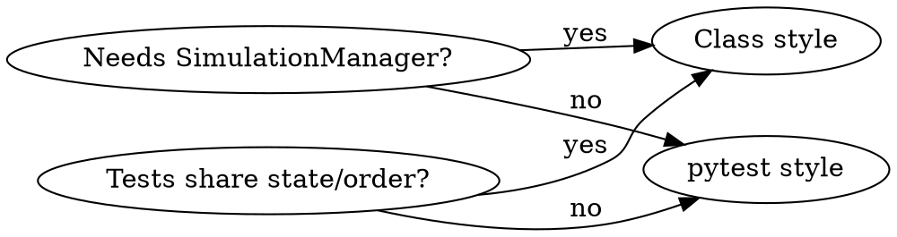

# Add Test

Reuse sufficient existing coverage; add or extend focused tests following
EmbodiChain's conventions when a meaningful coverage gap remains.

## When to Use

- User asks to "add a test", "write tests for X", "test this module"
- A production change may leave a behavior or regression unverified
- Assessing test coverage during PR preparation or review

## Test necessity review

Before adding or extending tests, inspect the production contract, supported
callers and inputs, and the closest existing coverage. Reapply these criteria
after writing the cases:

- Identify the observable behavior, real regression, or explicit boundary the
  case protects and the gap in existing coverage. Reuse adequate existing tests;
  a new public function or PR checklist does not require a new test file.
- Use an independent expected result derived from the contract, a known example,
  or a trusted reference. A regression case should detect the original error.
  Avoid reproducing the implementation to calculate its own expected result or
  asserting only that a result exists when correctness matters.
- Prefer extending a relevant case or adding a meaningful parameter to creating
  parallel coverage. Remove or merge additions that repeat the same behavior
  without detecting a distinct failure. Do not lock private layout, call order,
  or source wording without a contract requirement.
- Keep negative and boundary cases for explicit validation contracts, safety
  constraints, and reachable failures. Do not enumerate hypothetical unsupported
  states, chase coverage percentages, or add cases just to check a PR box.
- Weigh distinct verification value against fixture complexity, brittleness,
  maintenance, and runtime/resource cost. Preserve explicitly requested scenarios
  while simplifying their implementation.

Briefly report the coverage relied upon, including why no new cases were needed
when existing tests or appropriate static checks suffice. No per-test
justification ledger is required.

## Test File Location

Tests mirror the source tree under `tests/`:

```
embodichain/lab/sim/motion/solvers/pytorch_solver.py  →  tests/sim/motion/solvers/test_pytorch_solver.py
embodichain/lab/gym/envs/managers/rewards.py    →  tests/gym/envs/managers/test_reward_functors.py
embodichain/toolkits/graspkit/pg_grasp/foo.py   →  tests/toolkits/test_pg_grasp.py
extensions/embodichain_tasks/embodichain_tasks/manipulation/push_cube.py → tests/gym/envs/tasks/test_push_cube.py
```

Rules:
- File name: `test_<module>.py`
- Directory path mirrors `embodichain/` structure under `tests/`
- Create `__init__.py` files in new `tests/` subdirectories if needed

## Two Test Styles

### pytest Style — For Pure-Python Logic (No Sim)

Use when: testing functors, utility functions, pure math, config validation — anything that doesn't need a `SimulationManager`.

```python
# ----------------------------------------------------------------------------
# Copyright (c) 2021-2026 DexForce Technology Co., Ltd.
#
# Licensed under the Apache License, Version 2.0 (the "License");
# ...
# ----------------------------------------------------------------------------

from __future__ import annotations

import pytest
import torch

from embodichain.my_module import my_function


def test_expected_output():
    result = my_function(input_value)
    assert result == expected_value
```

### Class Style — For Sim-Dependent or Ordered Tests

Use when: tests need `SimulationManager`, GPU setup, or must run in a specific order. Share state via `setup_method`/`teardown_method`.

```python
# ----------------------------------------------------------------------------
# Copyright (c) 2021-2026 DexForce Technology Co., Ltd.
#
# Licensed under the Apache License, Version 2.0 (the "License");
# ...
# ----------------------------------------------------------------------------

from __future__ import annotations

import pytest
import torch

from embodichain.lab.sim import SimulationManager, SimulationManagerCfg


class TestMySimComponent:
    def setup_method(self):
        config = SimulationManagerCfg(headless=True, device="cpu")
        self.sim = SimulationManager(config)
        # ... setup ...

    def teardown_method(self):
        self.sim.destroy()
        SimulationManager.flush_cleanup_queue()

    def test_basic_behavior(self):
        result = self.sim.do_something()
        assert result == expected_result

    def test_raises_on_bad_input(self):
        with pytest.raises(ValueError):
            self.sim.do_something(bad_input)
```

## Resource-Aware Test Classification

Use the narrowest test type that proves the behavior:

- Prefer mocks or CPU-only inputs for pure logic and shape validation.
- `tests/conftest.py` automatically classifies conventional CUDA, renderer, and
  real-simulation tests. Add `@pytest.mark.gpu`, `@pytest.mark.slow`, or
  `@pytest.mark.requires_sim` explicitly only when the test's node id/source
  cannot reveal that requirement (for example, a hidden CUDA helper or an
  end-to-end toolkit test).

Slow CPU cases that do not launch simulation can run on separate workers. Keep
them independent of test order and shared mutable module state, or declare an
explicit `xdist_group` when cases must stay together. Ordinary CPU modules and
native resource groups retain their existing grouping.

The CI runner discovers serial GPU/simulation selections in a separate
collection-only process, then executes their exact ordered node IDs. Execution
checks that node order and markers match discovery before setup. Keep imports
and parametrization independent of unrelated test modules; discovery and
execution startup both count toward lane time. Retain native destruction,
cleanup-queue flushes and garbage collection in every test lifecycle.

GPU tests are skipped by default to keep normal test runs within the shared VRAM budget. Run them explicitly and serially:

```bash
# Default suite: GPU-marked tests are skipped.
pytest tests/

# Dedicated GPU suite. Do not add -n unless pytest-xdist is installed.
pytest tests/ --run-gpu -m gpu
```

For backend/device matrices, run the complete contract on one representative
configuration and use small (one environment, low-resolution) smoke tests for
the remaining configurations. Always destroy a real `SimulationManager` and
flush its cleanup queue in teardown.

## Task Program and task-configuration tests

Choose the test surface by ownership layer:

| Changed boundary | Primary test location |
|---|---|
| Language schema, strict decoder, AST/compiler | `tests/lab/task_program/` |
| Semantic scene/profile/call/effect contracts | `tests/lab/task_program/semantics/` |
| Configured integration, catalog, simulation assembly | `tests/gym/envs/task_program/` |
| Gym bridge and episode completion | `tests/gym/envs/task_program/`, `tests/gym/envs/test_embodied_env_task_program.py` |
| Packaged task components/deployments | `tests/test_task_program_package_data.py`, task-layout/config tests |
| Lightweight RL environment/trainer routing | `tests/learning/` |

For JSON/YAML configuration, test through the same strict loader and component
composition used by production. A `yaml.safe_load()` assertion alone does not
prove closed fields, relative component paths, physical scene targets,
contracts, catalog coverage, or program preflight.

When changed validation behavior lacks coverage, add a focused negative case at
its earliest owning boundary. Candidate cases include unknown fields, missing
component files, duplicate inline/component ownership, absent `simulation_uid`,
contract mismatch, unknown Semantic Calls, or missing registered lowerers; they
are not a required matrix for every change. Keep live-simulation qualification
separate from provider-free decode/compiler tests.

For a complete configured Task Program deployment, use
`$add-task-program`'s read-only inspector as a focused smoke check before
adding a heavier environment test.

## Mocking Patterns for Functor Tests

Most functor tests don't need a live simulation. Use mock objects following the pattern in `tests/gym/envs/managers/test_reward_functors.py`:

```python
from unittest.mock import MagicMock, Mock


class MockSim:
    """Mock simulation for functor tests."""

    def __init__(self, num_envs: int = 4):
        self.num_envs = num_envs
        self.device = torch.device("cpu")
        self._rigid_objects: dict = {}

    def get_rigid_object(self, uid: str):
        return self._rigid_objects.get(uid)

    def add_rigid_object(self, obj):
        self._rigid_objects[obj.uid] = obj


class MockEnv:
    """Mock environment for functor tests."""

    def __init__(self, num_envs: int = 4):
        self.num_envs = num_envs
        self.device = torch.device("cpu")
        self.sim = MockSim(num_envs)
```

Key points for mock objects:
- Set `num_envs` and `device` attributes (functors use these)
- Mock only the sim methods the functor actually calls
- Use `MagicMock(uid="...")` for `SceneEntityCfg` parameters

## Steps

### 1. Identify the Behavior and Coverage Gap

Inspect the changed code, its callers, and existing tests to determine the
behavior to verify and whether it needs live simulation. Apply the
[test necessity review](#test-necessity-review); reuse sufficient existing
coverage instead of adding a case. Ask the user only when unresolved intent
materially affects the required coverage.

### 2. Determine Test File Path

Map the source path to test path:

```
embodichain/<subpath>/<module>.py  →  tests/<subpath>/test_<module>.py
```

Prefer extending a relevant existing case or test module when it closes the
identified gap. Create a new test file only when no suitable module exists.

### 3. Choose Test Style



### 4. Write the Test

Use the appropriate template (pytest or class style above).

Rules:
- **Apache 2.0 header** — required on every test file
- **`from __future__ import annotations`** — after header, before imports
- **No magic numbers** — define expected values as named constants or comment their origin
- **Test function names** — `test_<scenario>` (descriptive, not just `test_foo`)
- **One assertion concept per test** — don't bundle unrelated checks

Reapply the [test necessity review](#test-necessity-review) to the completed
cases and remove or consolidate redundant additions before validation.

### 5. Add `if __name__ == "__main__"` Block

Include this for tests that support optional visual/interactive debugging:

```python
if __name__ == "__main__":
    # For visual debugging: set is_visual=True when calling env methods
    test_obj = TestMyComponent()
    test_obj.setup_method()
    # ... manually run test logic ...
```

### 6. Run the Test

```bash
# Single file
pytest tests/<subpath>/test_<module>.py -v

# Single test function
pytest tests/<subpath>/test_<module>.py::test_expected_output -v

# GPU-specific test
pytest tests/<subpath>/test_<module>.py --run-gpu -m gpu -v

# Single test class method
pytest tests/<subpath>/test_<module>.py::TestMyClass::test_basic_behavior -v
```

### 7. Run `black`

```bash
black tests/<subpath>/test_<module>.py
```

## Conventions Summary

| Convention | Rule |
|-----------|------|
| File header | Apache 2.0 copyright block (same 15 lines as source) |
| File naming | `test_<module>.py` |
| Function naming | `test_<scenario>` |
| `from __future__` | Required after header |
| Magic numbers | Define as named constants with explanatory comments |
| Simulation tests | Initialize/teardown in `setup_method`/`teardown_method` |
| CUDA coverage | Use `@pytest.mark.gpu`; run with `--run-gpu -m gpu` |
| Long integration | Use `@pytest.mark.slow`; keep it out of normal PR runs |
| Pure-logic tests | Use mock objects, no real sim |
| `SceneEntityCfg` | Use `MagicMock(uid="...")` in tests |
| Assertions | `assert`, `pytest.approx`, `torch.allclose`, `pytest.raises` |
| Entry block | `if __name__ == "__main__"` for visual debugging support |

## Common Mistakes

| Mistake | Fix |
|---------|-----|
| Missing Apache header on test file | Copy the 15-line copyright block |
| Using real `SimulationManager` for functor tests | Use `MockEnv`/`MockSim` — much faster, no GPU needed |
| Hardcoded numbers without explanation | Define as `EXPECTED_DISTANCE = 0.5  # cube at origin, target at (0.5, 0, 0)` |
| Testing multiple concepts in one function | Split into separate `test_<scenario>` functions |
| Forgetting cleanup | Call `self.sim.destroy()` and `SimulationManager.flush_cleanup_queue()` in teardown |
| Using full matrices | Use one full representative case and low-resource smoke coverage elsewhere |
| Not running `black` on test file | CI checks all files including tests |

## Quick Reference

| Action | Command |
|--------|---------|
| Run default tests | `pytest tests/` |
| Run GPU tests | `pytest tests/ --run-gpu -m gpu` |
| Run single file | `pytest tests/<path>/test_<name>.py -v` |
| Run single test | `pytest tests/<path>::test_<name> -v` |
| Run with print output | `pytest -s tests/<path>/test_<name>.py` |
| Format | `black tests/<path>/test_<name>.py` |
