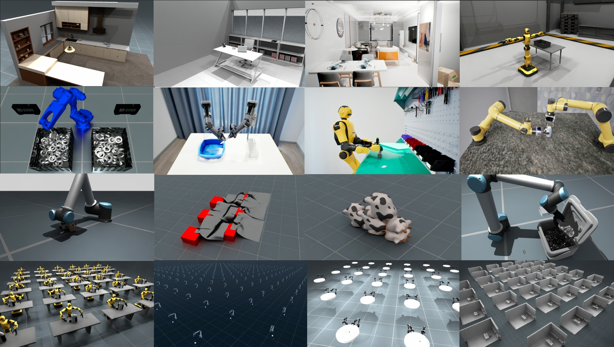
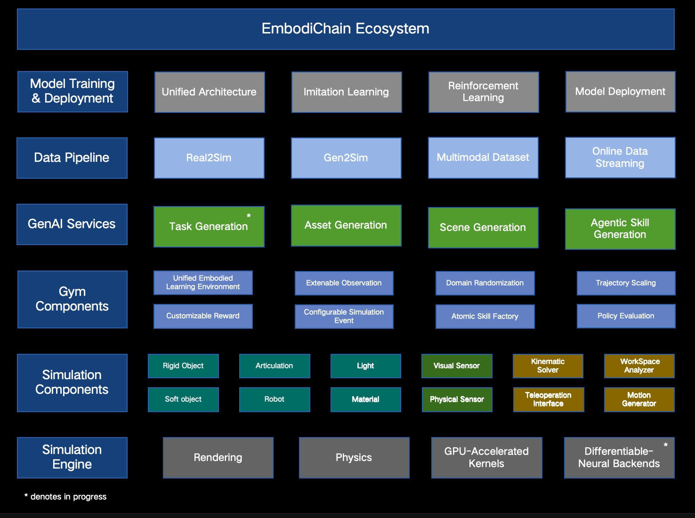

# EmbodiChain



[](LICENSE)
[](https://dexforce.com/embodichain/index.html#/)
[](https://dexforce.github.io/EmbodiChain/main/index.html)
[](https://docs.python.org/3/whatsnew/3.12.html)
[](https://github.com/DexForce/EmbodiChain/releases)
---

EmbodiChain is an end-to-end, GPU-accelerated framework for Embodied AI. It streamlines research and development by unifying high-performance simulation, automated generative data pipelines, modular model architectures, and efficient training workflows. This integration enables rapid experimentation, seamless deployment of intelligent agents, and effective Sim2Real transfer for real-world robotic systems.

Official task and robot modules live under [extensions/](extensions/README.md)
and ship with the main distribution. Their Python imports remain
`embodichain_tasks` and `embodichain_robots`.

> [!NOTE]
> EmbodiChain is in Alpha and under active development:
> * More features will be continually added in the coming months. You can find more details in the [roadmap](https://dexforce.github.io/EmbodiChain/main/resources/roadmap.html).
> * Since this is an early release, we welcome feedback (bug reports, feature requests, etc.) via GitHub Issues.


## Key Features

- 🚀 **High-Fidelity GPU Simulation**: Realistic physics for rigid & deformable objects, advanced ray-traced sensors, all GPU-accelerated for high-throughput batch simulation.
- 🤖 **Unified Robot Learning Environment**: Standardized interfaces for Imitation Learning, Reinforcement Learning, and more.
- 📊 **Scalable Data Pipeline**: Automated data collection, efficient processing, and large-scale generation for model training.
- ⚡ **Efficient Training & Evaluation**: Online data streaming, parallel environment rollouts, and modern training paradigms.
- 🧩 **Modular & Extensible**: Easily integrate new robots, environments, and learning algorithms.

The figure below illustrates the overall architecture of EmbodiChain:

<p align="center">
  
</p>

Explore EmbodiChain's module relationships with the [interactive architecture visualization](https://dexforce.github.io/EmbodiChain/main/overview/architecture/index.html#).


## Getting Started

To get started with EmbodiChain, follow these steps:

- [Installation Guide](https://dexforce.github.io/EmbodiChain/main/quick_start/install.html)
- [Quick Start Tutorial](https://dexforce.github.io/EmbodiChain/main/tutorial/index.html)
- [API Reference](https://dexforce.github.io/EmbodiChain/main/api_reference/index.html)

### Python and LeRobot dependencies

Installation selects the LeRobot SDK by Python version:

| Python | LeRobot | Hugging Face Hub | Shared Torch stack |
| --- | --- | --- | --- |
| 3.10 / 3.11 | 0.4.4 | >=0.35.3, <0.36 | torch 2.7.x, torchvision 0.22.x, TorchCodec 0.5.x |
| 3.12 | 0.6.1, including training/dataset dependencies | >=1.6, <2 | Same |

TensorDict remains >=0.13, <0.15. The newer Torch/TensorDict migration is
tracked separately in [#883](https://github.com/DexForce/EmbodiChain/issues/883).
Select matching CPU or CUDA wheels when installing the Torch stack; the SDK
matrix CI checks a clean CPU installation, recording/loading, and an official
ACT update/checkpoint/reset. GPU simulation and full policy learning acceptance
are separate checks. Python versions above 3.12 select the newer SDK but are not
part of this validation matrix.

Recordings retain the existing task/subtask table and depth-sidecar schema on
both routes. LeRobot 0.6.1 exposes `subtask_index` but does not automatically
resolve `meta/subtasks.parquet`; the EmbodiChain preview resolves it explicitly.
Use the [standalone exporter](tools/lerobot_export/README.md) for native 0.6.1
persistent-language annotations and depth features. The SDK dependency upgrade
does not replace the existing EmbodiChain ACT model or migrate its checkpoints.

### Task Environments

Official task environments are included in the main `embodichain` installation.
Use `embodichain list-task` to discover tasks and `embodichain run-task` to launch
one with its configuration. See [Supported Tasks](https://dexforce.github.io/EmbodiChain/main/resources/task/index.html)
for available tasks, runnable configurations, and task authoring guides.

For external training, see the optional
[RLinf integration](https://dexforce.github.io/EmbodiChain/main/guides/rlinf.html)
and the [official RLinf EmbodiChain recipe](https://rlinf.readthedocs.io/en/latest/rst_source/examples/embodied/embodichain.html).

## Contribution Guide

We welcome contributions! Please see the [CONTRIBUTING.md](https://github.com/DexForce/EmbodiChain/blob/main/CONTRIBUTING.md) file in this repository for guidelines on how to get started.

## Publications

See [Academic Publications](https://dexforce.github.io/EmbodiChain/main/resources/publications/README.html) for a complete list of academic papers related to EmbodiChain.

## Citation

If you find EmbodiChain helpful for your research, please consider citing our work:

```bibtex
@misc{EmbodiChain,
  author = {EmbodiChain Developers},
  title = {EmbodiChain: An end-to-end, GPU-accelerated, and modular platform for building generalized Embodied Intelligence},
  month = {November},
  year = {2025},
  url = {https://github.com/DexForce/EmbodiChain}
}
```

```bibtex
@misc{GS-World,
   author = {Guiliang Liu and Yueci Deng and Zhen Liu and Kui Jia},
   title = {GS-World: An Efficient, Engine-driven Learning Paradigm for Pursuing Embodied Intelligence using World
      Models of Generative Simulation},
   month = {October},
   year = {2025},
   journal = {TechRxiv}
}
```
