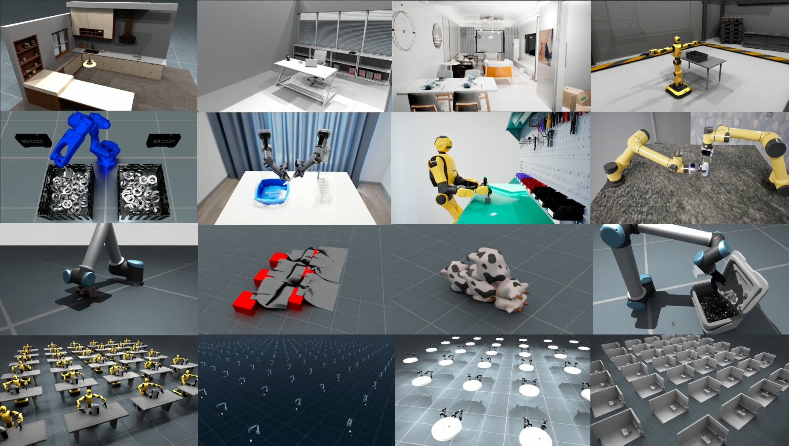
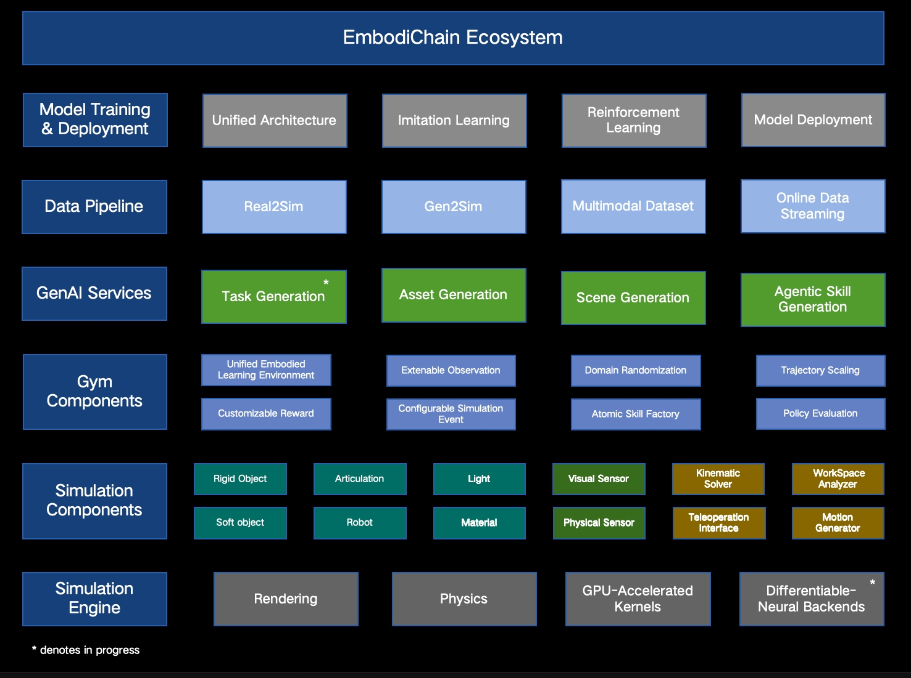

# EmbodiChain



[](LICENSE)
[](https://dexforce.com/embodichain/index.html#/)
[](https://dexforce.github.io/EmbodiChain/main/index.html)
[](https://docs.python.org/3/whatsnew/3.12.html)
[](https://github.com/DexForce/EmbodiChain/releases)
---

EmbodiChain is an end-to-end, GPU-accelerated framework for embodied AI. It brings
robot simulation, generative data pipelines, and learning workflows together
so you can build environments, collect demonstrations, train policies, and
evaluate them in simulation.

> [!NOTE]
> EmbodiChain is in Alpha and under active development. See the
> [roadmap](https://dexforce.github.io/EmbodiChain/main/resources/roadmap.html)
> for planned work, and share bug reports or feature requests through
> [GitHub Issues](https://github.com/DexForce/EmbodiChain/issues).

## Key Features

- 🚀 **High-Fidelity GPU Simulation**: Realistic physics for rigid & deformable objects, advanced ray-traced sensors, all GPU-accelerated for high-throughput batch simulation.
- 🤖 **Unified Robot Learning Environment**: Standardized interfaces for Imitation Learning, Reinforcement Learning, and more.
- 📊 **Scalable Data Pipeline**: Automated data collection, efficient processing, and large-scale generation for model training.
- ⚡ **Efficient Training & Evaluation**: Online data streaming, parallel environment rollouts, and modern training paradigms.
- 🧩 **Modular & Extensible**: Easily integrate new robots, environments, and learning algorithms.

The figure below illustrates the overall architecture of EmbodiChain:

<p align="center">
  
</p>

Explore EmbodiChain's module relationships with the [interactive architecture visualization](https://dexforce.github.io/EmbodiChain/main/overview/architecture/index.html#).

## Getting Started

1. **Set up your environment** with the [Installation Guide](https://dexforce.github.io/EmbodiChain/main/quick_start/install.html), including Docker, local installation, Python compatibility, and optional dependencies.
2. **Build your first simulation** with the [Quick Start Tutorial](https://dexforce.github.io/EmbodiChain/main/tutorial/index.html).
3. **Explore runnable workflows** in the [examples](examples/README.md), or consult the [API Reference](https://dexforce.github.io/EmbodiChain/main/api_reference/index.html) to build your own.

After installation, discover the available tasks, robots, and examples:

```bash
embodichain list-task
embodichain list-robot
embodichain run-example --list
```

### Task Environments

Use `embodichain list-task` to discover tasks and `embodichain run-task` to launch
one with its configuration. See [Supported Tasks](https://dexforce.github.io/EmbodiChain/main/resources/task/index.html)
for available tasks, runnable configurations, and task authoring guides.

### Third-party Training Frameworks

EmbodiChain supports **RLinf** and **LeRobot** alongside its native trainers.
EmbodiChain owns simulation, task configuration and demonstration collection;
the selected framework owns its training runtime and checkpoints.

| Workflow | Entry point |
| --- | --- |
| RLinf: train against EmbodiChain Gym environments; the upstream example uses CartPole PPO | [RLinf integration](https://dexforce.github.io/EmbodiChain/main/guides/rlinf.html) |
| LeRobot: collect demonstrations, train official ACT and evaluate in simulation | [LeRobot integration](https://dexforce.github.io/EmbodiChain/main/guides/lerobot.html) · [Runnable ACT example](examples/learning/act/README.md) |
| Export finalized recordings for LeRobot 0.6.1 consumers | [Dataset export](https://dexforce.github.io/EmbodiChain/main/guides/lerobot_export.html) |

See [training framework selection](https://dexforce.github.io/EmbodiChain/main/guides/training_frameworks.html)
for dependency profiles, ownership and compatibility boundaries.

## Official Extensions

EmbodiChain bundles four extension modules alongside the core framework. They
provide reusable tasks, robot presets, models, and evaluation workflows, and
ship in the main `embodichain` distribution with the same version.

| Module | What it provides | Explore |
| --- | --- | --- |
| `embodichain_tasks` | Official task environments, runnable deployments, and reusable scene and embodiment components for manipulation, locomotion, and classic control. | [Task configurations and authoring](extensions/embodichain_tasks/README.md) |
| `embodichain_robots` | Concrete robot presets, model assets, and calibrated defaults, organized by vendor and model. | [Robot catalog and configuration](extensions/embodichain_robots/README.md) |
| `embodichain_models` | Policy models for action prediction, and world models / neural dynamics models for predicting future states and environment dynamics. | [Model families and workflows](extensions/embodichain_models/README.md) |
| `embodichain_benchmarks` | Motion planning and Atomic Skill evaluation suites with scenarios, planner adapters, scoring, and reports. | [Benchmark suites and usage](extensions/embodichain_benchmarks/motion_generation/README.md) |

The core provides shared simulation, data, and learning infrastructure; extensions
build on those APIs for specific robots, tasks, models, and evaluations. Import
modules by their `embodichain_*` names: `extensions/` is their source directory,
not a Python import prefix. Model weights, datasets, and optional runtime
dependencies are configured through each workflow's guide.

See the [extension development guide](extensions/README.md) for package layout
and how to add a bundled extension.

## Contribution Guide

We welcome contributions! Please see the [contribution guide](CONTRIBUTING.md) for guidelines on how to get started.

## Publications

See [Academic Publications](https://dexforce.github.io/EmbodiChain/main/resources/publications/README.html) for a complete list of academic papers related to EmbodiChain.

## Citation

If you find EmbodiChain helpful for your research, please consider citing our work:

```bibtex
@misc{EmbodiChain,
  author = {EmbodiChain Developers},
  title = {EmbodiChain: An end-to-end, GPU-accelerated, and modular platform for building generalized Embodied Intelligence},
  month = {November},
  year = {2025},
  url = {https://github.com/DexForce/EmbodiChain}
}
```

```bibtex
@misc{GS-World,
   author = {Guiliang Liu and Yueci Deng and Zhen Liu and Kui Jia},
   title = {GS-World: An Efficient, Engine-driven Learning Paradigm for Pursuing Embodied Intelligence using World
      Models of Generative Simulation},
   month = {October},
   year = {2025},
   journal = {TechRxiv}
}
```
