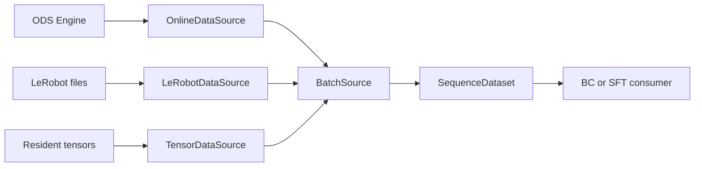

# Reusable online and offline training-data loading

Status: the initial numeric source/loader API and local BC demo integration are implemented.
Updated 2026-10-19. Image/video sequence loading and out-of-core storage remain outside this implementation.

For use and operation, start with the [ODS guide](../source/features/online_data.md),
[architecture and data flow](../source/features/ods/architecture.md),
[configuration and runtime verification](../source/features/ods/configuration.md).
This document owns source/Dataset architecture and implementation boundaries; task parameters
and historical run evidence remain with the demo.

The proposed [ODS data-stream showcase](ods-data-stream-showcase-design.md)
uses standard SDK/DataLoader video decoding for its offline comparison. That
planned reader is separate from the shipped resident numeric backend; its
visual results cannot be obtained by dropping images or preloading decoded
datasets through the current numeric loader.

## Problem and acceptance criterion

`SequenceDataset` supplies one PyTorch context-iteration interface for live and
resident sources. `OnlineDataSource`, `TensorDataSource` and `LeRobotDataSource`
implement the public `BatchSource` contract. `OfflineDataset` remains a
compatibility alias; `OnlineDataset` preserves its original chunk API and
delegates its opt-in context iteration to the common Dataset.
The [local ChunkBC demo](../../examples/ods/simple_bc_demo/README.md) consumes
these sources and owns its feature transformation, writer, sidecar/content
auditing and experimental accounting. Its task, model, trainer, checkpoint
and evaluator live in `examples/ods/simple_bc_demo/`, outside the official task
catalog. The public numeric reader also accepts standard LeRobot datasets
without the demo sidecar
through explicit schema and column mapping. Inspection/depth tools retain their
separate ownership.

The required invariant is: the same source frames, schema, window and transform
produce the same training tensors, regardless of live or persisted storage.
This does not require a refreshing online experiment and a fixed offline corpus
to draw the same batches, or imply identical learning curves.

## Ownership and public interfaces

All shared loading components belong to `embodichain/data_pipeline/datasets/`.
The components below are exported from that package.

| Component | Responsibility |
| --- | --- |
| `SequenceSpecCfg` | Validated history length, prediction horizon, sampling mode and generation filter, with fixed canonical padding; use `@configclass`. |
| `BatchSource` protocol | Expose schema and `sample_context(batch_size, spec, generator=...)`; return an independently owned TensorDict. |
| `OnlineDataSource` | Delegate publication, locks, provenance, errors and quotas to the existing engine. |
| `LeRobotDataSource` | Read through the official SDK, validate or explicitly map metadata, and provide bounded resident numeric storage. |
| `TensorDataSource` | Resident CPU TensorDict storage, temporal metadata and optional per-source quotas. |
| `SequenceDataset` | Storage-independent context iteration/collation and explicit per-iterator limits. |
| Compatibility entries | `OfflineDataset` aliases `SequenceDataset`; `OnlineDataset` preserves chunk APIs and delegates context iteration. |
| Schema utilities | `validate_data_schema` and `data_schema_fingerprint` share semantic validation and persistable identity. |

Pure window/mask calculations and canonical padding are shared between source
adapters. Source ownership, synchronization and lifecycle remain separate. The
public contract must not depend on Franka, a 51-feature layout or ChunkBC.
Task features, absolute TCP-target construction, normalization fitting, noise,
training and efficiency reporting remain with the local demo.



Select a source object, rather than adding an online/offline flag and mutually
exclusive path/engine arguments to the Dataset. Source adapters retain their
own allocation, SDK, producer-lock and quota ownership. The common Dataset
does not create environments, load files, request refill or become a replay
owner. Direct `sample_context()` consumption remains supported for callers
that explicitly schedule production and training.

## Batch and sequence contract

- Use `obs`, `actions`, `valid`, `loss_mask` and source metadata in a TensorDict.
  `obs` may be nested named tensors; feature layout/dtype are schema-defined.
- For history H and prediction horizon F, return `[B, H + F - 1, ...]`.
  Index H-1 is the current pre-action observation, paired with its recorded
  action request or controller command as explicitly declared by the schema.
- History includes now; future supervision includes now. `loss_mask` is true
  only for real frames at or after the current index. Every current anchor is
  valid. Never cross an episode, invalid gap or continuity change.
- Preserve current episode-uniform selection followed by uniform eligible
  anchors. Any alternative weighting needs an explicit configuration and its
  own parity tests; it is not a storage-adapter default.
- Invalid numeric payloads are zero; invalid source/language IDs are -1.
  Apply canonical masking after any row-local feature conversion: quaternion
  conversion can map a zero input to a nonzero identity rotation. Stateful or
  stochastic transforms must declare temporal/RNG requirements separately.
- Declaration validation checks optional names/dtypes/versions, pre-action
  observation timing, explicit action semantics and positive step duration.
  Source adapters additionally check stored shapes and supported action
  contracts. Units, frames, rotations, normalization and semantic truth remain
  caller declarations; the validator performs no implicit conversions. A
  matching vector width alone does not establish compatibility.
- All public source constructors use the same declaration validator: explicit
  action semantics or representation and positive `step_dt` are required.
  Optional observation timing must be `pre_action`, as required by this source
  contract. Names/dtypes and supplied root/feature versions are checked; actual
  tensor layouts and ODS action descriptors are checked by their adapters.
  Older `TensorDataSource(schema={})` calls must supply truthful action metadata;
  legacy engine/chunk APIs are unchanged.
- Keep storage-column adaptation separate from task/model feature conversion.
  `schema.observation.version` can identify a feature transform, as in PickPlace.
  Persist versions, units, frames and normalization declarations rather than
  inferring them. `data_schema_fingerprint()` hashes finite canonical JSON;
  reordered mapping keys do not change it, while feature order and declared
  versions do. It neither identifies callable code nor proves a declaration true.
- Persist portable dataset/episode/frame identities. Keep engine-local run ID,
  generation and acceptance time as optional origin metadata, not a replacement
  for portable identity. Resolve language using the source's own dictionary;
  unrelated integer language IDs are not equivalent text.
- Persist continuity and segment metadata when present. For a source that
  cannot represent a requested boundary/mode, reject it explicitly. The current
  PickPlace format supports continuous valid spans and rejects adjacent valid
  continuity changes or negative continuity IDs on valid frames.

## Loading, memory and concurrency

The first offline implementation supports numeric episodes and explicit
schema mappings. Reuse official SDK decoding instead of implementing another
LeRobot format reader. Make SDK imports optional/lazy; metadata inspection must
remain usable without loading simulation or video stacks. Do not silently infer
action semantics for external datasets lacking EmbodiChain metadata.

Read in bounded SDK batches. Require an explicit resident-memory allowance and
estimate tensor allocation before materialization; reject oversized datasets
before allocation. This initial resident backend does not promise scalable
out-of-core image/video training. Leave decoding, bounded lazy episode caches
and additional storage backends for a separately measured extension. Record
loading cost separately from resident minibatch sampling.

ODS must choose anchors, check validity/identity/quota and copy the selected
payload under its existing producer lock. Do not expose unlocked shared views
or copy the whole cache for every batch to make a common interface convenient.
Pure window calculation uses O(B*T) validity work and O(B*(H+F)*D) selected
payload storage, matching the existing path; avoid per-frame Python dispatch.
The padding fix writes into the newly constructed feature tensor in place.

Batch ownership must survive later refills or samples. A supplied generator
must isolate sampling from augmentation/model randomness; adding this option
to the engine must preserve its existing default RNG behavior. ODS owner-only
refill/stop operations remain outside Dataset workers. Budgeted offline
sampling must not multiply allowances through copied DataLoader workers; start
with explicit owner-process consumption and reject unsupported worker modes.

Finite stored episodes may be sampled repeatedly. State source cardinality,
iteration limits and quota exhaustion separately. Preserve immediate empty
window errors with `DataUnavailableError`, a `RuntimeError` subclass compatible
with existing handlers. Distinguish it from `DataBudgetExhaustedError`, permanent
read/worker failures and schema errors. No eligible window in a fixed source
does not imply waiting can help. Retry/wait deadlines belong to the caller. Do not catch a
permanent failure and silently continue with old data.

Use a common delivered-chunk unit for optional per-source limits, including
duplicate draws within a batch. Preserve atomic full-batch debit after copying;
failed optimization does not refund delivered chunks. Live replacement retires
unused credits, whereas an offline source does not refill. Offline protected
resume must restore its ledger or fail; ODS resume continues to declare a new
source run rather than exact shared-cache recovery.

`max_batches` bounds one iterator and never resets source budgets. A new iterator
may draw again only within the remaining source allowance. Prefetch and failed
transforms already consumed delivered chunks; report delivered and completed
optimizer chunks separately. Initial protected usage remains owner-process
consumption. RLinf adapters may define bounded logical training epochs without
inferring unique-data cardinality from an ODS cache.

## Relationship to ODS and RLinf

This is the numeric online BC/SFT loading path and pre-RLinf showcase milestone
of [#788](https://github.com/DexForce/EmbodiChain/issues/788), which supersedes
[#672](https://github.com/DexForce/EmbodiChain/issues/672). Per-source delivery
protection and throughput pacing remain in the existing engine/configurator;
the Dataset does not derive learning-safe reuse bounds from throughput alone.

The future DAgger handoff is committed, labeled episodes into RLinf replay.
RLinf is then the single training aggregation/eviction/sampling owner; ODS
publishes experience without maintaining a second training replay. Same-state
expert queries, separate expert/behavior actions and label-validity masks,
commit acknowledgment/deduplication and coordinated resume remain later work.
The existing BC `actions/valid/loss_mask` contract must not silently acquire
DAgger semantics or success-only eligibility for learner failures.

## Alignment gate

Maintained unit coverage belongs to the reusable production components:
`tests/data_pipeline/test_sources.py` compares actual ODS and resident sampling
with deterministic CPU buffers; `test_lerobot_source.py` exercises the official
SDK reader. Schema, quota, continuity, padding, ownership and failure contracts
remain covered without importing the learning example.

The showcase learner, private writer, training orchestration and reporting are
validated through runnable experiments and retained evidence, without dedicated
unit tests. The earlier full-chain batch/optimizer alignment harness is retained
in Git history; its recorded results below remain historical evidence.

Public source and SDK tests cover the following boundaries:

1. Keep source snapshots frozen during paired comparisons; record exact
   implementation hashes and distinguish historical validation from new runs.
2. Schema/order/dtype/action-contract mismatches, explicit external mappings,
   timestamp gaps, language resolution and supported continuity/segment modes.
3. Source replacement and copy ownership, worker/read errors, quota depletion,
   bounded loading and unsupported DataLoader configurations.
4. A lightweight offline import in a process without simulation dependencies.

Use exact tensor equality for deterministic CPU numeric paths and explicitly
defined tolerances for nondeterministic device operations. Report corpus
identity, selected frame IDs, schema, normalizer/model/RNG states and SDK
version. Numerical parity is not evidence of a throughput improvement.

### Historical PickPlace validation

The earlier [recorded check](../../examples/ods/simple_bc_demo/docs/ODS_ALIGNMENT_VALIDATION.json)
passed nine paired CPU cases and 146 related regression cases. A real expert
producer also supplied two generations/four accepted episodes (1,330 valid
frames); four paired batches/32 chunks and four optimizer updates matched
exactly, including sampling RNG, loss, gradients and optimizer state. All eight
observed owned processes exited. These checks validate the recorded numeric
example revision, preceding public API extraction; they do not validate every
batch of the previous pilot or rerun the relocated implementation.
The record retains an earlier harness filename failure and the native shutdown
warning; neither is silently removed from the evidence.

The public API validation and subsequent SequenceDataset consolidation are
recorded separately in
[DATASET_LOADING_VALIDATION.json](../../examples/ods/simple_bc_demo/docs/DATASET_LOADING_VALIDATION.json).
Its follow-up section distinguishes its CPU/SDK regression checks from
the earlier physical producer experiments and implementation hashes. The record
also retains pre-extraction golden outputs and later removal of dedicated
example tests. Original paths/hashes remain unchanged in the relocated JSON;
see the [evidence index](../../examples/ods/simple_bc_demo/docs/README.md).

## Delivery and performance gate

1. Canonical padding, continuity rejection and paired tests are in place. Retain
   previous experimental records with their original source revisions.
2. Public contracts and shared pure sampling helpers are extracted. Existing
   engine defaults are preserved, with explicit context RNG/filter options.
3. The bounded LeRobot numeric adapter and common SequenceDataset are
   implemented. OfflineDataset is a compatibility alias; OnlineDataset context
   mode delegates to the common implementation. Old chunk APIs remain available.
4. The showcase uses public sources; its duplicate resident sampler and SDK
   loading loop are removed. It retains task hashes, writing and experiments.
5. Qualify end-to-end overhead before repeating timed comparisons. Include B=1
   and B=256, F=1/64, C=32/256, loading/peak memory, lock-held sampling time and
   concurrent refill. Use equal payloads, instrumentation and workload settings;
   report per-batch and wall-clock costs separately. Disclose feature conversion
   placement and acquisition/persistence costs; numerical parity alone does not
   make differently staged pipelines a pure storage comparison. The existing
   5% telemetry overhead gate remains unresolved and cannot be waived by parity tests.

Public API documentation and focused tests accompany each implementation step.
Image/video loading, mixed online/offline replay, distributed worker ledgers,
DAgger, RLInf integration and exact cache recovery are outside the first scope.


## Consumption example

`schema` below must explicitly describe the recorded observations/actions,
including action semantics and step duration. It is not inferred from a task
name or vector width. For datasets with known recorded names, their order is
verified; unannotated external data requires a truthful caller mapping.

```python
from torch.utils.data import DataLoader
from embodichain.data_pipeline.datasets import (
    LeRobotDataSource, OnlineDataSource, SequenceDataset, SequenceSpecCfg,
)

sequence = SequenceSpecCfg(history_length=2, prediction_horizon=64)
source = LeRobotDataSource(
    "/path/to/lerobot", schema=schema, source_id="my-dataset-v1",
    memory_limit_bytes=512 * 1024 * 1024,
)
dataset = SequenceDataset(source, sequence, batch_size=64, max_batches=1000)
loader = DataLoader(dataset, batch_size=None, num_workers=0)
# batch contains obs/actions/valid/loss_mask and source frame_ids.
for batch in loader:
    train_step(batch)

# engine is already started and remains caller-owned.
online_source = OnlineDataSource(
    engine, schema=schema,
    observation_transform=feature_fn,
)
online = SequenceDataset(online_source, sequence, batch_size=64, max_batches=1000)
```

A learner that explicitly schedules refill/waits can call the source's
`sample_context()` directly, as the showcase does. Delivery quotas are local to
one source/ledger, not a distributed global allowance across independent runs.
The first offline wrapper reports source/quota errors immediately; max_batches
is an explicit iteration bound rather than an inferred epoch size.
