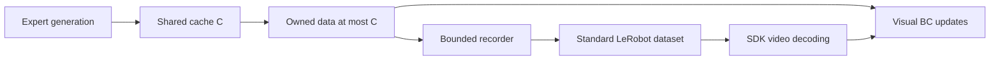

# ODS visual training and data-stream showcase

This example measures how asynchronous generation changes **trained-state
coverage and complete pipeline time under a fixed actual training budget**.
It reuses the Franka PickPlace environment and physical expert from
`examples/ods/simple_bc_demo`. The experiment, BC head, recorder and scheduling
remain example-local; public sampling contracts belong to ODS.

Use the [example README](../../examples/ods/data_stream_demo/README.md) for
commands, configuration guidance and output interpretation. Historical studies,
including failed attempts and negative results, are linked from the compact
[experiment evidence index](../../examples/ods/data_stream_demo/EXPERIMENTS.md).
Generated plots, logs, source snapshots and machine-specific inventories are
kept outside the source change.

## Fixed-training-budget visual comparison

The main question is: with identical actual training work and assigned
hardware, how much distinct physical data reaches completed optimizer updates,
and how long does the whole pipeline take? Data volume and final coverage are
outcomes rather than matching constraints.

| Path | Behavior |
| --- | --- |
| Offline-8 / 32 / 128 | Generate, record and finalize the full corpus, then train through standard LeRobot decoding |
| ODS overlap | Train after initial fill while later generations and recording continue |
| ODS serial | Regenerate the overlap sources and replay its ordered training manifest with generation/model updates serialized |

Run third-person (`single`) and third-person plus wrist (`dual`) camera
conditions separately. The delivery-only diagnostic also supports state-only
input, but that condition does not participate in the visual training matrix.
Serial may overlap recording with generation or training; it must not acquire
an extra archive-submission barrier that confounds the intended comparison.

The direct owned-data edge is ODS; the finalized-dataset edge is offline.
Every arm saves a standard dataset. The serial control reuses the direct path
while prohibiting generation/model-update overlap.

## Model and work contract

The systems default is U=128 updates, B=32 chunks, H=2 causal observations and
F=32 future action targets. Each qualified run completes 4,096 training chunks
and 131,072 valid action targets. Complete windows stay within one episode and
continuity segment. A larger budget is a new frozen recipe; 128 updates do not
imply task convergence.

The shared lazy `learning/models/ResNet10Encoder` adapts RLInf commit
[`91a302ec50ddacd1fdabc5859b85e3661d768236`](https://github.com/RLinf/RLinf/blob/91a302ec50ddacd1fdabc5859b85e3661d768236/rlinf/models/embodiment/modules/resnet_utils.py):

- torchvision BasicBlock stages `[1,1,1,1]`, GroupNorm4, epsilon 1e-5;
- eight learned spatial embeddings, 256-dimensional projection, LayerNorm/Tanh;
- scratch initialization with the full encoder trainable;
- one encoder shared across ordered camera views and both history frames.

Keep attribution and third-party license notices in the module. The compatible
reference stack is PyTorch 2.7/torchvision 0.22. The example requires neither
RLInf runtime nor pretrained weights.

Adapters supply 256×256 RGB float32 in [0,1]; the encoder applies ImageNet
normalization once. Numeric inputs are two 27-feature robot observations:
qpos, qvel and TCP pose. Cube geometry, success, expert progress and future
observations do not enter policy forward. The 512/512 MLP predicts F×10
absolute TCP position, rotation and gripper targets. Target construction and
normalized MSE follow ChunkBC. Future data are supervision only.

Use FP32 AdamW, learning rate 3e-4, weight decay 1e-6 and gradient-norm limit 1,
with augmentation/noise disabled. Match initialization and recipe within each
vision/seed; freeze numeric normalization from the common initial eight
trajectories. Save model, optimizer, normalization, RNG, configuration and step
state. Equal work does not require equal final weights or policy quality.

## Acquisition, reuse and recording

Default C=8 shared episodes, P=2 parallel producer environments and lifetime
per-source delivery cap K=128. K is an engineering guard, not an empirically
optimal learning setting. Subsequent acquisition uses publication-granularity
handoff; the initial full C block remains common to normalization.

The owner polls complete P-episode producer subbatches, validates immutable
source/generation/frame/continuity metadata, and clones under the existing
publication lock. Busy or unpublished rows return no data; overwritten expected
identities and worker failures fail explicitly. Copy all accepted sources in a
generation before requesting its successor. The public engine's immediate
sample/error behavior does not change.

Raw training, archive-staging and serial-ready owners share a C-episode bound.
Packing creates independent writer packets and releases raw references. The
writer queue holds two packets, plus one active packet and at most one pending
submission. Returned batches are independent of later cache replacement.
Require P*K>=B and enough batch entries to cover every retained source.
`--handoff-mode generation` retains whole-generation acquisition as a control.
Serial archives published subbatches during generation and defers updates until
that generation completes. Trace v2 records retained block boundaries and
recorder/handoff settings; v1 traces remain readable.

At each batch boundary, budget-aware prefetch requests necessary supply when
remaining credits cannot fund remaining updates. Optional refresh uses measured
generation, recorder-staging, snapshot and recent complete ready-update times.
Cold model startup is excluded from the latter estimate. Unknown timing defers
optional requests. Pending requests coalesce; credits never reset on eviction.
An `eager` diagnostic requests after every switch and reports unused data.

Each block receives at least one completed batch covering all sources before
replacement. Sample sources evenly, visiting unused legal anchors before
reshuffling. Offline uses the same balancing/anchor rule but may reuse its
fixed corpus to complete the budget. After update U, accept no new requests;
finish and record every already-requested generation. Untrained tails count
as acquisition cost and never as trained diversity.

Create and finalize datasets through LeRobot 0.4.4, with real Parquet/video
features, 30 FPS and AV1/yuv420p/GOP2/CRF30. Explicit encoder threads default to
one and must match across arms. Camera encoding is sequential to avoid an SDK
process-pool fork from the CUDA learner's writer thread. SDK episode service
has nested validation, frame-ingestion, save/encode/commit and manifest spans;
these partition the outer service and are not additional wall time.

Offline training uses the official Dataset and CPU TorchCodec 0.5 decoding,
four spawned workers and prefetch factor one. Numeric supervision reads the
required 33 frames; each camera reads only the two causal history frames.
Do not replace standard decoding with a resident fully decoded corpus.

## Timing, resources and capacity guidance

Complete pipeline time starts at supervised process launch and ends after
training, all accepted recording, checkpoint writes and normal process closure.
Also record last-update time, first-update latency, waits and recording drain.
Mandatory content audit and requested independent policy evaluation run after
this clock. Zero-scene runs explicitly record evaluation as not requested.
Failures remain visible and do not enter qualified ratios.

Use separate simulation/training primary GPUs and the same eight-CPU affinity
across compared arms. Record GPU UUIDs, masks, thread budgets, actual context
placement and sampled resources. Hardware admission is not exclusive host
reservation. An explicitly declared passive graphics allowance is recorded and
bounded separately; it grants no extra compute capacity.

Measure accepted generation episodes/s, recorder busy-service episodes/s, and
complete ready-batch preparation/transfer/optimizer updates/s. Keep pure model
time separate. `min(generation, recording)` estimates bottleneck supply;
`gamma_effective*K/B` estimates its protected update ceiling. Shared-host
contention, startup and cleanup prevent treating either as total-time forecasts.
Overlapping intervals cannot be summed to obtain pipeline time.

Preflight preserves C/P/B/K and defaults to `max(16,ceil(C*K/B)+8)` updates.
It reports when later generations never reach training. Sweep feasible P
values that divide C, then select the smallest measured P within 90% of the
best effective supply under matched hardware/recipes. A computed K needed to
keep training busy is diagnostic, not permission to raise the reuse guard.
Freeze the workload before comparison; avoid artificial delays or dummy work.

## Metrics, evidence and acceptance

Only synchronized completed updates increase training coverage. Preserve
immutable source/frame identities, ordered update manifests and retired-source
counters. Report trained and entropy-effective source counts, occupied initial
XY cells (fixed 8×8 grid), cube XYZ voxels at anchors (2 cm), unique anchors,
history/target frames, target duplication, publish-to-first-training latency,
and lifetime chunks per source. New IDs do not imply new physical states.

Generate time/coverage, coverage-growth, pipeline-timeline and lifetime-reuse
figures from run logs. Resource metrics distinguish fixed numeric cache size
from actual runtime memory, and finalized disk bytes from unmeasured temporary
peaks. Preserve unused-source counts and all failure reasons.

Before paired ratios, verify matching initial-model/normalization hashes,
initial-C numeric prefix, camera order, actual U/B/H/F, GPU assignment, CPU
budget and supervisor/process evidence. Serial additionally matches source,
anchor and retained-block order. Neither matching numerical manifests nor
lossy AV1 files establish raw rendered RGB identity.

Qualification covers reference-aligned encoder outputs/gradients, preprocessing,
view/history order, image-dependent fitting, actual parameter updates and
checkpoint reload. Shared encoder tests own its production contract. Actual
pipeline checks cover causal windows, quotas, bounded ownership, old-output
independence, real SDK decoding, AV1 PSNR/MAE, every saved video frame and normal
worker closure. Add focused production regressions for core defects; do not
build a separate general training-test framework around the example.

Run qualification, smoke, metric checks, throughput preflight and one-seed pilot
before a formal matrix. The formal recipe is four primary arms×two camera
modes×three seeds, plus six serial replays. Regenerate data, rotate arm order
and retain slow/failed attempts. Evaluate the same 20 development states after
timing as policy-quality context. Report the measured time–coverage tradeoff;
the historical studies do not establish universal speedup or task convergence.
