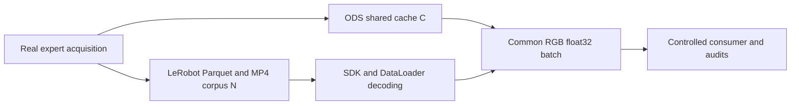

# ODS data-stream showcase and standard LeRobot comparison

Status: engineering implementation and validation in progress, updated
2026-10-21. The showcase has real acquisition, standard decoder-backed IO and
supervised experiment/report entry points; formal measurements are pending.
Existing numeric LeRobot loading remains unchanged.

This experiment measures how EmbodiChain generates, updates and delivers real
robot trajectories under state-only, single-camera and two-camera workloads.
It compares ODS with standard LeRobot file access and video decoding. There is
no model, optimizer, student evaluation or learning-performance claim.

The branches represent separate runs with the same acquisition recipe, not a
shared timed producer that also pays an unreported recording cost for ODS.

## 1. Questions and comparison groups

The main questions are when data becomes usable, how much data a consumer can
receive, what resources each path needs, and whether per-episode delivery
limits remain correct during asynchronous replacement. Reuse the existing
Franka single-cycle PickPlace environment and physical expert from the
[BC demo](../../examples/ods/simple_bc_demo/README.md). Keep its physics,
randomization, actions and physical acceptance criteria unchanged.

The main report contains nine configurations, each run with seeds 19001,
19002 and 19003: **27 main runs**.

| Data path | State only | Third-person camera | Third-person + wrist cameras |
| --- | --- | --- | --- |
| Standard decoded LeRobot, matched K | L-State | L-Single | L-Dual |
| ODS streaming, no delivery limit | S-State | S-Single | S-Dual |
| ODS protected streaming, matched K | P-State | P-Single | P-Dual |

The LeRobot main row uses the official Dataset/DataLoader and decoder. Its
parent-side sampler enforces the common experiment's episode weighting and K;
this exposure guard is experiment code, not a claimed LeRobot SDK feature.
The reader and decoder themselves remain unmodified.

Include three appendix diagnostics for each visual condition, using seed
19001 and identifying them as one-seed diagnostics:

- Standard decoded LeRobot with no K, using the same full corpus and reader
  settings. Retain this conventional baseline even if it performs better.
- Frozen ODS: initial C episodes, no refill, K enabled.
- Standard decoded LeRobot restricted to the first C logical episodes, with
  K enabled. This makes the static-source diagnostic cardinality explicit.

There are nine appendix runs. Reader variants reuse finalized main datasets;
they do not require another full acquisition. Frozen remains a diagnostic,
not the main offline baseline. No dataset iterator may reset a source's K.

Compare P with S to isolate delivery protection. Compare P with matched-K L
to assess the complete pipelines under equal source limits; their availability
and retirement differ, so this is not a pure shared-memory-versus-disk test.
Use the C-sized static diagnostics to investigate that difference. The
unrestricted LeRobot appendix shows the practical cost of omitting protection.

## 2. Common task, data and visual workload

Use `physics: default`, physics/control frequencies 240/30 Hz, C=8 cached
episodes, P=2 producer environments, at most 600 steps per episode, B=32
chunks, history H=2 and prediction horizon F=32. Thus each chunk covers
L=H+F-1=33 frames. Enable provenance and lifecycle logging for ODS.

For the main comparison, both acquisition paths have an accepted-data budget
N=4C=32 episodes. Offline LeRobot stores all N before consumption starts;
ODS starts consumption after the initial C and replaces rows over four
generations. Equal C is a resident-capacity comparison, not equal total data.
Record N, C, valid frame counts and actual consumed-source counts separately.

K is 128 delivered chunks per immutable source episode, with the same hard
limit. This is an engineering demonstration value, not a recommended or
scientifically qualified learning-reuse setting. One chunk costs one credit,
regardless of its frame count or number of cameras. Eviction retires unused
credits; publishing a new identity cannot replenish an old identity's credits.

Use the same expert recipe and seed schedule for every main arm. Independently
generated trajectories are not presumed byte-identical. Record ordered
state/action manifests and hashes; claim exact pairing only when the payloads
actually match. Compare non-image manifests within each visual condition;
do not require independently rendered or lossy-decoded pixels to hash equally.

### Camera and image contract

| Condition | Acquisition | Renderer |
| --- | --- | --- |
| State | No camera observations or hidden recording camera | `no-render` |
| Single | One fixed third-person camera | `fast-rt`, SPP=1 |
| Dual | The same third-person camera plus a wrist-mounted camera | Same visual renderer/settings |

Use 256x256 color images, no depth/mask/normal outputs, no augmentation or
super-resolution. The qualified camera profile v3 uses SPP=1 with offscreen
OptiX spatial denoising and window denoising disabled. Capture every simulation control step: 30 Hz
in simulation time, with wall-clock throughput measured independently.
Headless operation remains enabled in all arms. UI, display recording and
report-video encoding are excluded from timed consumption; camera rendering
needed to generate data is included in acquisition time.

The third-person camera uses the existing eye (-0.50,-0.90,0.88), target
(-0.50,0.10,0.20) and Z-up convention. The wrist camera attaches to
`FrankaPanda/fr3_hand_tcp`; in that parent frame use eye (0.10,0,-0.10),
target (0,0,0.03) and up (0,1,0). Both use a 60-degree field of view, centered
principal point and near/far 0.005/3 m. Verify view coverage and parent
attachment before freezing this profile. A failed view qualification stops
the run; camera changes require a new protocol/profile version, not automatic
target tracking during episodes. Preserve the existing BC demo's sensor-off
defaults by giving the new example its own acquisition configuration.

Preflight rejected v1's self-occluded wrist view and noisy raw rendering;
v2 qualified the fixed side mount and spatial denoising. V3 additionally gives
the inherited cube and goal distinct material UIDs, preserving their original
orange/green colors and all physics. Earlier failures and calibration samples
are retained; no formal result may mix these profile versions.

ODS stores its native RGBA uint8 observations in CPU shared memory. Standard
LeRobot videos store RGB and the SDK decoder returns channel-first RGB
float32 in [0,1]. The final consumer contract is therefore:

- The same named float32 state/action features and source identities.
- Per-camera RGB float32 tensors `[B,33,3,256,256]` in [0,1].
- Common validity, continuity and loss masks, with zero numeric/image padding
  and -1 padded source IDs. Current pre-action index is H-1.

ODS must drop alpha, rearrange channels, convert/scale and produce the owned
consumer tensors inside its measured delivery path. LeRobot's corresponding
decoding, conversion, collation and common padding are measured too. Do not
compare ODS uint8 output with LeRobot float32 output as equivalent batches.

This is explicitly a **full-context visual data-delivery workload**: both
backends return all 33 image frames, not only historical observations. It
does not estimate the throughput of a VLA configuration that requests only
two historical images; future frames are never presented as causal model
inputs because this example has no model.

At the default size, image storage alone is approximately:

| Cameras | ODS image cache, native RGBA | One native image batch | One final RGB float32 batch |
| --- | ---: | ---: | ---: |
| 1 | 1.17 GiB | 264 MiB | 792 MiB |
| 2 | 2.34 GiB | 528 MiB | 1,584 MiB |

These are tensor-payload sizes, not total or peak process memory. Account for
decoder staging, normalization temporaries, worker queues and retained outputs.
Preflight shared memory, RAM and VRAM; never silently reduce resolution,
cameras, C, B or context length in a failing arm.

## 3. Standard LeRobot path and timing protocol

### File acquisition and real decoding

Pin the first protocol to the existing py311-compatible stack: LeRobot 0.4.4
and TorchCodec 0.5, recording the resolved package versions and source hashes.
The [official v3 layout](https://huggingface.co/docs/lerobot/lerobot-dataset-v3)
uses Parquet state/action data, per-camera MP4 video and episode metadata.

Create datasets with the official SDK. Visual arms use real `video` features
and `use_videos=True`, FPS=30, SDK codec `libsvtav1`, yuv420p, GOP=2 and CRF=30.
Use the pinned SDK's ordinary per-episode encoding path with one encoder
thread. Only physically accepted episodes are committed. Bound raw-episode
staging to two queued episodes plus active producer/writer work. Failed
attempts, encoding, metadata finalization and temporary files remain in cold
pipeline cost and resource accounting. The state-only arm uses standard
Parquet fields without a fabricated video stream.

Read using public `LeRobotDataset.__getitem__` through
`torch.utils.data.DataLoader`, with CPU TorchCodec decoding. Default to four
workers, `prefetch_factor=1`, persistent workers, ordered delivery, no pinned
memory and one Torch thread per worker. Reserve the same eight-CPU affinity
budget for each whole pipeline; record native decoder thread behavior rather
than patching the decoder. Worker processes use spawn and initialize their
own Dataset/decoder; never decode in the parent and then inherit that decoder
into workers.

Use `delta_timestamps` for offsets [-1,0,...,31]/30 on all delivered temporal
fields, including each camera. Keep SDK episode-boundary checks and timestamp
tolerance 1e-4. Convert the SDK's boundary padding indicators into the common
zero-padding and loss-mask contract; do not train or count repeated boundary
frames as additional valid targets.

The following are not permitted in the main LeRobot baseline:

- Loading an entire decoded corpus into resident TensorDicts or NumPy arrays.
- Using the current numeric `LeRobotDataSource`/BC numeric loader as the visual
  reader, reading backing columns to bypass image access, or stripping images.
- Pretending pre-extracted frames, cached decoded chunks or `.pt` tensors are
  standard video decoding.
- Silent fallback to another codec, decoder, fewer workers or a smaller batch.

Normal SDK decoder-instance caching, OS file caching and bounded DataLoader
prefetch are retained and disclosed. Cache state is process-cold and
software/filesystem-cache-warm unless a separately isolated storage experiment
proves otherwise. Do not purge system-wide caches on the shared host.

### Sampling protection and data equivalence

All main arms use episode-uniform selection followed by a uniform eligible
anchor, with replacement. The LeRobot sampler changes selection, not file
access or decoding. The parent process alone owns the optional K ledger:
reserve credits before dispatching indices to workers, commit them after the
complete batch has been decoded, normalized and returned, and keep delivered
plus outstanding reservations within K. Report unconsumed prefetch separately.
Decode failures terminate explicitly; they cannot refund and silently retry
the same batch. Creating a new DataLoader iterator cannot create new credits.

Record matching action order/semantics, step duration, valid frame lengths,
camera order and physical episode IDs. Video compression is lossy: preserve
small fixed raw RGB reference samples and report decoded PSNR/MAE separately.
Require exact numeric/provenance integrity for a stored trajectory, but do not
claim pixel-identical tensors or equal video/raw storage quality.

### Time boundaries and offered load

Measure two views of each run without adding their overlapping durations:

1. **Acquisition-inclusive:** from process launch through accepted expert
   generation to first usable batch and onward. LeRobot includes writing,
   video encoding, finalization, reader startup and decoding; ODS includes
   initial C-episode fill and delivery. Both pay their actual failures/retries.
2. **Source-ready consumption:** from starting a fresh reader/consumer on
   available data. LeRobot still reads and decodes requested windows; ready
   never means an already decoded resident corpus. No historical collection
   cost is charged to an already existing dataset in this view.

The cold first-batch comparison includes the chosen collect-N-before-consume
barrier versus ODS's initial-C barrier. It cannot attribute that entire
difference to the memory transport. This baseline is the local finalized
`LeRobotDataset` path, not `StreamingLeRobotDataset`, and does not establish
that the LeRobot ecosystem cannot stream data.

Use preflight ODS accepted-acquisition rates gamma_v, ODS immediate sampling
service estimates under concurrent production, and ready-source delivery
capacities for the standard decoded LeRobot reader in each visual condition.
These measure different components and are labeled separately. Freeze one common nominal demand
R=4K*max(gamma_v) and one consumption window
T=max(180 seconds, max(4C/gamma_v)), with a 900-second ceiling. Do not reduce
R to the slowest decoder's capacity: inability to serve offered load is a
result. Each path records its target and achieved rate, with no accumulated
catch-up queue after a wait. Preflight rates predict neither concurrent
capacity nor a guaranteed speedup.

Rotate run order with fixed order seed 47001. Use generation seed `seed` and
independent sampling seed `seed+10000`; freeze hardware, CPU budget, profile
and rates before the three main seeds. Record warmup/calibration separately.
ODS manual refills start after initial fill, then follow each completed
generation up to N. Waiting must drain events and propagate worker errors.
Use 120-second data/reader waits and 1800-second initial/generation waits,
shortened by applicable absolute run deadlines. Exhaustion without pending
production is normal; temporary unavailability, failure and deadline expiry
have distinct outcomes.

## 4. Metrics and report artifacts

| Metric | Definition and scope |
| --- | --- |
| First usable batch | Process-launch-to-first-delivery and reader-start-to-first-delivery, separately |
| Acquisition | Accepted episodes/s and accepted valid observation images/s, with failures counted separately |
| Consumer throughput | Delivered chunks/s versus nominal demand, including normalizer/collation cost |
| Final batch latency | Consumer-visible p50/p95; includes waiting, reads/decoding and output conversion |
| Component service | ODS immediate sample/copy versus LeRobot fetch/decode service, labeled separately from prefetched `next()` latency |
| Data freshness | ODS publication-to-first-delivery p50/p95, consumed generations and never-consumed evictions |
| Reuse | Per-identity delivered chunks, reservations/prefetch, cap violations and retired unused credits |
| Logical image bandwidth | Returned image samples/s and final batch MiB/s, including duplication/padding as labeled; not physical bus/disk bandwidth |
| Memory and storage | Exact tensor/cache bytes, sampled owner/worker PSS and VRAM, final and observed temporary disk bytes, codec/quality settings |

The offline corpus is already finalized at reader start; its file/load time is
not an ODS publication delay. Keep freshness definitions source-specific.
Count a chunk once by its anchor source, not once per camera or future frame.
Reconcile delivered counters with engine/parent-ledger audits. Unsupported
resource peaks remain unknown. All main throughput includes fixed common
accounting; expensive pixel checks and image encoding run in the separate
correctness/report path rather than being hidden from one backend's timing.
Reader-worker service durations wrap public SDK item access; they are not
summed and presented as consumer wall time or pure decoder-kernel latency.
Completed batches returned after the fixed observation deadline remain in the
lifetime K ledger and raw logs, but never enter window throughput, latency
quantiles or generation-coverage qualification. Native reads/decodes cannot
always be cancelled mid-call; trailing completion/cleanup time is disclosed.
The ownership audit retains views of one original returned batch, including
its full image backing allocation, and includes that cost in sampled memory.
Consumer wait counters use only their overlap with the measurement window;
cold-generation waits are retained in a separate lifetime counter. Report
request-rate throttling and exhausted-source idle time separately. Controller
recovery intervals include the final successful retry service and therefore
must not be added to sampling service as mutually exclusive phases.

Standard-reader shutdown stops new prefetch dispatch, drains the finite pending
reads without counting them as delivery, then requires every worker to exit
normally. Cancellation preserves the delivered K ledger. Aborted or forcibly
terminated workers fail the run even when they have joined; cleanup and quality
audits use the same strict exit check. Drain time is disclosed after the fixed
observation window.

Device qualification observes both compute and graphics contexts by owned PID
tree/process group. A CUDA mask alone does not prove graphics isolation. On the
current host, a standalone program linking only Vulkan reproduced a 6 MiB
graphics context on physical GPU7 after instance creation, before explicit
device enumeration; destruction released it. This is a driver-initialization
footprint, not evidence that ODS executed on that device. The optional
`--aux-graphics-gpu-id` suite setting explicitly reserves a separately qualified
idle GPU and excludes it from primary assignments. Only known pure-graphics
contexts up to 8 MiB per owned PID are accepted there; compute contexts, larger
or unknown allocations and other GPUs still fail. Default supervision remains
strict. Freeze this resource scope during calibration and use it for both
backends, include all owned GPU allocations, and report these runs as primary
plus reserved auxiliary GPU measurements. The small footprint does not prove
zero performance impact or establish a single-GPU result.

Produce four main figures: data availability/cache-consumption timelines;
per-source reuse distributions with the K line; first-batch/final-batch latency
and achieved demand; and visual-load throughput/memory/storage panels. Report
individual seeds plus median/range. Show lossless numeric integrity and lossy
image quality alongside speed, without claiming an algorithm leaderboard.

Save resolved config/schema, environment and decoder/codec versions, corpus
manifests, event/counter logs, failures and cleanup, machine-readable results,
one Markdown report, PNG/SVG/PDF figures and small synchronized camera samples.
Generate the short data-flow animation after timing from those same logs.

## 5. Implementation milestones and acceptance

The entry point is `examples/ods/data_stream_demo/`, separate from
the BC learner. Reuse the physical task and expert; add local visual profiles,
an SDK-backed decoded batch adapter, experiment orchestration and report tools.
The current public numeric loader keeps its documented behavior. Shared
production contracts belong to data_pipeline; a future general-purpose
decoded reader requires its own API/tests, not an accidental expansion of the
numeric loader in this example. No new generic trainer or hidden Dataset
refill/epoch behavior is introduced.

Implement and qualify in this order:

1. Validate state/single/dual acquisition, real wrist attachment and raw image
   recording without changing the physical expert or acceptance test.
2. Round-trip accepted episodes through standard LeRobot files, public SDK
   temporal access and actual TorchCodec decoding. Verify no resident shortcut.
3. Add common output conversion, parent-side quota/reservation accounting,
   bounded queues, metrics and complete lifecycle handling.
4. Run tiny engineering cases for all nine main configurations, then freeze
   calibration and execute the report and appendix suites.

Required checks cover image-inclusive batch ownership after refill; exact
numeric/provenance round-trip; camera UID/shape/dtype and valid zero padding;
episode/continuity boundaries; matched frame indices across cameras and state;
and cap correctness with duplicate selections and prefetched worker batches.
Verify actual decoder calls for both camera tracks and timestamp/frame
alignment, not merely the presence of image keys. Use synthetic frame-ID
images for exact decoder alignment tests and real-scene reference samples for
quality/motion checks. A static scene may legitimately contain identical
pixels; image inequality alone does not establish freshness.

Every main streaming run must consume at least three generations and observe
delivery of some new-generation data before that whole generation completes.
Every protected source must stay within K. Also check exhaustion/iterator
recreation, read/worker failures, finite waits, cancelled prefetch and joined
processes. A run that misses the intended overload or generation coverage
reports that outcome; do not change seeds, K, images or success definitions
to turn it into a pass. Resource prerequisites may mark an arm unsupported,
never synthesize measurements for it.

Add production-contract tests only where production code changes; use runnable
engineering experiments for the example and retain their artifacts. The report
may conclude about measured data availability, decoding/transport cost,
resource tradeoffs and delivery protection. It cannot establish better state
coverage from new IDs alone, count delivered chunks as completed training,
or claim policy quality, universal ODS speedup or exact cache recovery.

Implementation references: the
[existing numeric loading contract](dataset-loading-design.md),
[official pinned Dataset](https://github.com/huggingface/lerobot/blob/v0.4.4/src/lerobot/datasets/lerobot_dataset.py)
and [video decoder/encoder](https://github.com/huggingface/lerobot/blob/v0.4.4/src/lerobot/datasets/video_utils.py).
