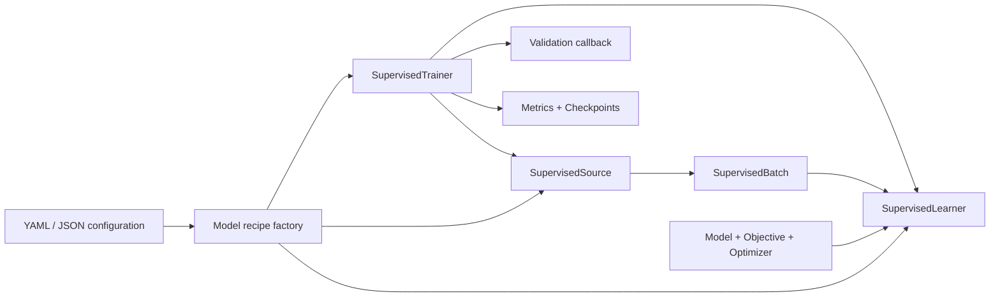

# SL 训练模块架构设计

本文描述当前 `embodichain.learning.sl` 的实现，面向训练基础设施维护者与模型接入开发者。
SL 指监督学习（Supervised Learning），包括策略模仿学习和动力学模型拟合。
使用入口见 [Supervised Learning 概览](../source/overview/learning/supervised_learning.md)，
完整签名见 [SL API](../source/api_reference/embodichain/embodichain.learning.sl.rst)。

## 设计目标与模块边界

共同训练层复用优化器更新、训练编排、验证与恢复机制；模型配方负责定义“学什么”、
数据如何解释以及如何评估。SL 不要求固定的观测维度、动作表示、时间轴或模型结构。

| 所属层 | 职责 | 边界 |
| --- | --- | --- |
| `learning.sl` | 批次协议、单次更新、训练编排、DDP、训练产物与恢复 | 不推断动作语义，不采集数据或创建仿真环境 |
| `data_pipeline` | 存储读取、在线缓冲、序列窗口、连续性、填充与交付配额 | 不决定模型输入编码、目标函数和优化器 |
| `learning.models` / `learning.layers` | 通用网络、特征归一化组件和可微运动学层 | 不拥有具体模型族的训练配方 |
| `embodichain_models` | 具体模型、编码器、目标函数、数据适配器和工厂 | 通过 SL 协议组合训练，不由 SL 核心反向导入 |
| 应用与示例 | 数据采集、生产者生命周期、任务部署和物理策略评估 | 不把这些生命周期隐式塞入一次优化器更新 |

核心 SL 导入不初始化仿真或 RL；`SequenceBatchSource` 通过延迟导出加载数据管线桥接。
存储与窗口的完整契约由[数据加载设计](dataset-loading-design.md)维护。

## 公共接口与数据契约

| 接口 | 契约 |
| --- | --- |
| `SupervisedBatch` | 分离 `inputs`、`targets`、命名 `masks` 和宿主侧 `metadata`；张量可以组成嵌套结构，不强制统一时间轴 |
| `SupervisedSource` | 提供稳定 `source_id` 和 `sample(batch_size, *, generator)`，返回独立拥有存储的批次；使用调用者传入的 CPU 采样 RNG |
| `SupervisedObjective` | `compute_loss(model, batch)` 构造模型特定的可微目标，返回 `LossResult` |
| `LossResult` | `loss` 为连接模型参数的标量；`metrics` 为诊断值；`weight` 为有限正数，DDP 中表示本地有效监督数量 |
| `SupervisedLearner` | 执行一次前向、反向、梯度检查/裁剪及优化器更新；维护成功更新计数 |
| `SupervisedTrainer` / `SupervisedTrainerCfg` | 组合数据源与 learner，管理更新预算、采样 RNG、调度、验证、日志和检查点 |
| `SupervisedTrainingState` | 按注册顺序参与成功更新，提供独立快照、无副作用兼容性校验和状态恢复 |

`SupervisedBatch.to(device)` 迁移输入、目标与掩码中的张量，保留 dtype 和梯度链路，
宿主元数据不迁移。批次容器本身不会克隆或 detach 张量：生产者负责存储所有权，
Objective 负责掩码、归一化、积分与多步展开。Trainer 不自动切断时间上的计算图。

单位、坐标系、关节顺序、动作含义和控制周期必须由配方显式声明，不能从张量宽度推断。
恢复所需的模型配置、预处理版本、动作/时间语义与数值策略应写入配方 `signature`；
该标识依赖配方真实维护，不是对调用代码的自动语义分析。

## 一次训练更新与生命周期

`train_from_config()` 解析 `factory: module:function`，将完整配置交给工厂，要求返回
`SupervisedTrainer`。`model`、`data`、`objective`、`optimizer`、`evaluation`
等配置由工厂解释，核心不强制所有模型采用相同子字段。`trainer` 使用公共配置类。
分布式入口先建立进程组并解析设备，再调用工厂；可选 `resume()` 在 `fit()` 前执行。

一次 `fit()` 迭代按以下顺序推进：

1. 从已提交的采样 RNG 创建候选 RNG，向 Source 取批次并迁移到训练设备。
2. Learner 切换训练模式、清空梯度，让 Objective 计算标量损失并执行反向传播。
3. 检查损失与梯度范数，按配置裁剪梯度，再执行 `optimizer.step()`。
4. 优化器成功返回后增加 `num_updates`，Trainer 提交候选采样 RNG。
5. 按插入顺序调用训练状态参与者的 `on_update()`，然后推进 scheduler。
6. 到达验证间隔时执行验证；随后写入指标，到达保存间隔时保存检查点。
7. 达到更新预算后保存 `last.pt`，返回更新数、最终指标、检查点路径与 batch 信息。

`total_updates` 与 `fit(stop_after=...)` 都是绝对更新边界，包含已恢复的工作量。
`checkpoint_interval=0` 关闭周期保存，但结束时仍保存；验证需要回调与非零间隔同时存在。

非有限损失或梯度会阻止优化器提交，但前向中改变的 buffer、已消耗的全局 RNG 或数据源
交付配额不因此自动回滚。优化器、状态参与者、调度器或 I/O 的失败也不是整轮事务回滚：
尤其优化器成功后，下游回调失败不会撤销参数更新。失败应终止当前运行，从可兼容的已保存
边界恢复，不应把部分成功的迭代当作可安全重试的空操作。

Learner 支持可选 BF16 autocast、裁剪函数和覆盖前向/反向/裁剪的数值上下文；
当前接口不提供通用 FP16 GradScaler 策略。模型特定积分精度和数值策略仍由配方决定。

CLI 在结束或异常退出时调用返回 Source 的可选 `close()`，释放其消费资源（如预取工作）。
生产者启动、停止、补充数据与应用资源仍由工厂/宿主负责；直接调用 Trainer 的程序自行管理
数据源关闭。`distributed_run(device)` 仅销毁它自己创建的进程组。

## 数据源适配与所有权

| 数据源 | 采样与身份 | 恢复条件 |
| --- | --- | --- |
| `TensorBatchSource` | 对非空 CPU 张量树建立 detached 独立快照；首轴大小一致；按显式 RNG 有放回抽样；身份包含内容和语义元数据摘要 | 重建相同固定数据与配方，满足 Trainer 的恢复校验 |
| `SequenceBatchSource` | 将数据管线 `BatchSource` 的规范窗口通过显式 encoder 转成批次，身份包含 schema、窗口、encoder 版本和语义元数据 | 默认拒绝精确续训；须显式 `immutable=True`，且底层是无交付配额的常驻 `TensorDataSource`（含常驻 LeRobot 数据源） |
| 模型专用 Source | 承担图像/状态编码、模型窗口及模型所需的数据身份 | 工厂自行提供可恢复状态和身份约束，不能由通用接口推定 |

序列 encoder 必须显式选择因果输入与监督目标，不能将未来观测误作当前输入。
桥接层保留规范掩码与来源信息到保留字段 `metadata['sequence_source']`，不在该字段
重复存放原始观测和动作。存储诊断信息不进入语义身份；语言等语义元数据进入身份。
编码版本需要涵盖闭包配置、特征顺序与单位等变化。

不可变序列源在构造时以有界临时内存计算内容摘要，采样时检查声明和张量版本，恢复时
重新检查实际内容。该机制不复制整个底层语料，也不授权调用者修改常驻数据。
实时缓冲和交付额度不会被 Trainer 自动保存或恢复；这类源可以训练和保存快照，但
`validate_resume()` 会拒绝精确续训。采样/编码错误直接传播，桥接层不重试、不等待补充，
编码或优化失败也不退还已交付上下文的配额。

## 单机多卡训练

CLI 与 `distributed_run()` 支持 `torchrun` 单机多进程启动，CPU 使用 Gloo，CUDA 使用
NCCL 并映射到 `cuda:LOCAL_RANK`。批量大小按 rank 配置，全局抽样数为
`batch_size * world_size`；学习率不会自动缩放。固定张量源在各 rank 独立有放回抽样，
可能重叠；按 epoch 遍历的专用源可自行分片，不由 Trainer 统一强制。

DDP 下 Objective 的 loss 和 metrics 必须为本地有效监督上的均值，`weight` 是相应
有效数量，每个 rank 都必须为正。全局损失为 `sum(weight * loss) / sum(weight)`。
由于 DDP 平均梯度，Learner 在 backward 前按 `world_size * local_weight / global_weight`
缩放本地 loss，避免不同掩码密度的 rank 被等权处理。指标名称在 rank 间一致且训练期间稳定。

所有 rank 参与通常的 `fit()`、`save()` 和 `resume()`；只有 rank 0 写产物和执行验证。
验证使用未包装的 `learner.model`，无需其他 rank 执行验证前向。
每个 rank 的 RNG、采样状态、buffer 与训练参与者状态分别保存；状态以有界分块汇聚，
精确恢复要求相同 world size。DDP buffer 广播默认为关闭，可由配方显式启用并绑定恢复策略。

## 检查点、验证与输出保护

检查点包含模型和优化器状态、更新计数、调度器类型与状态、配置、配方签名、数据身份、
运行身份及 RNG/采样/训练参与者状态。DDP 还记录 world size 与各 rank 的本地状态。
临时文件写入成功后通过替换目标文件发布检查点。

恢复先检查可选 Source `validate_resume()`、数据与配方身份、配置、优化器布局、
调度器和训练参与者兼容性，再检查输出目录准入，然后恢复运行状态。
当前公共配置只有 `output_dir` 可改变；DDP 的设备比较按设备类型归一化。
不能通过修改 `total_updates` 或 world size 把精确续训变成一个新训练计划。
参与者必须提供不与活状态共享可变存储的快照，并在校验时不修改活状态。

验证前先捕获已提交边界。验证结束或异常后恢复模型训练模式、buffers、RNG、采样 RNG
和训练参与者状态；回调不应修改模型参数、优化器或外部数据源等未受保护状态。
只有开发/验证集可用于选检查点，测试集不参与选择。验证回调内的 `save()` 使用预先收集的
边界，不发起新的集体通信；回调外保存必须由所有 rank 一起调用。

输出目录使用 `run.json` 标识运行，指标追加到 `metrics.jsonl`。新运行不能覆盖其他运行的
产物；恢复到已有目录要求运行身份匹配，且指标历史完整、没有超出检查点更新数。
从较早检查点继续时，使用新目录保存后续结果；旧格式无运行身份的检查点也需要新目录。
目录准入机制不是多写者锁，同一目录的并发写者仍需外部协调。

## 模型配方与扩展方式

| 模型族 | 工厂（相对于 `embodichain_models`） | 模型族拥有的适配 |
| --- | --- | --- |
| ACT | `policy.act.sl_recipe:build_act_trainer` | 当前 RGB 与因果动作窗口、ACTPolicy/ACTObjective、训练集归一化、图像内容身份 |
| NeRD | `dynamics.nerd.sl_recipe:build_supervised_trainer` | 动力学分片窗口、状态 codec、NeRDObjective、积分与数值策略、学习率调度 |
| RWM | `dynamics.rwm.sl_recipe:build_rwm_trainer` | 固定张量语料、状态/动作语义与周期校验、多步动力学目标、训练集归一化 |

新增模型接入时，先定义输入、监督和掩码语义，再实现 Source 与 Objective，最后由工厂组合
模型、优化器、Learner 和 Trainer。必要时通过 `training_states` 注册源游标、模型平均或
其他更新参与者；相关数学逻辑留在模型族中。使用开发集回调评估，并将恢复所需语义写入
signature，不另建隐藏的训练状态。

参考[最小回归配方](../../examples/learning/sl_ddp/recipe.py)、
[单机分布式示例](../../examples/learning/sl_ddp/README.md)与
[数据源桥接示例](../../examples/learning/sl_data_source/README.md)。
模型集成见 [ACT](../../extensions/embodichain_models/embodichain_models/policy/act/sl_recipe.py)、
[NeRD](../../extensions/embodichain_models/embodichain_models/dynamics/nerd/sl_recipe.py) 与
[RWM](../../extensions/embodichain_models/embodichain_models/dynamics/rwm/sl_recipe.py)。

## 行为验证依据

下表是现有测试与契约的对应关系，不代表本次文档修改重新执行了这些训练测试。

| 现有测试 | 主要验证内容 |
| --- | --- |
| [test_learner.py](../../tests/learning/sl/test_learner.py) | 独立掩码 SGD 对照、多步梯度链路、非有限损失不提交更新 |
| [test_trainer.py](../../tests/learning/sl/test_trainer.py) | dropout/优化器/采样精确恢复、独立存储、无仿真导入、身份与输出历史保护、验证状态恢复 |
| [test_sequence.py](../../tests/learning/sl/test_sequence.py) | 因果窗口、掩码与来源、配额不退款、不可变内容校验和恢复前拒绝 |
| [test_distributed.py](../../tests/learning/sl/test_distributed.py) | 不等权监督的全局更新、CPU/Gloo 恢复、分块保存、rank 故障传播和单写者行为 |
| [test_training_states.py](../../tests/learning/sl/test_training_states.py) | 更新参与者精确恢复、布局不兼容拒绝和默认旧格式兼容 |

这些测试支持训练基础设施契约；模型训练精度、任务成功率与 GPU 性能需要模型自身的
验收配方和测量，不能由通用训练器测试推导。
