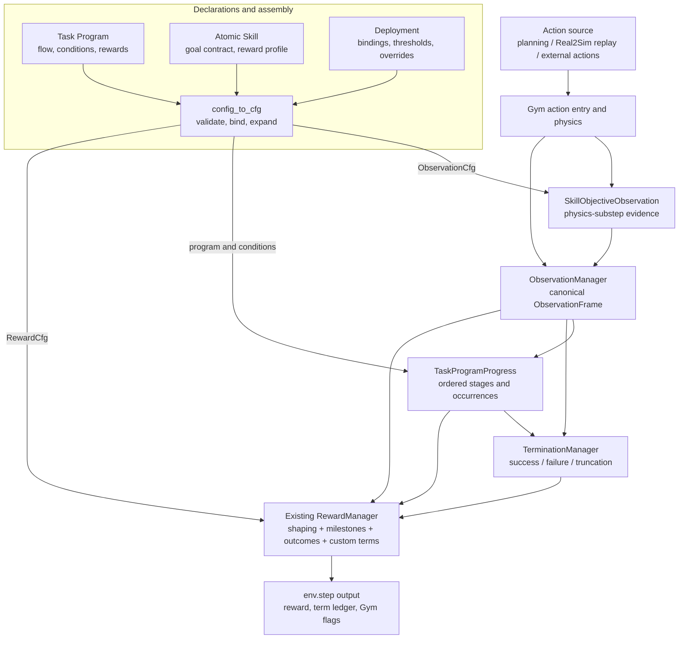
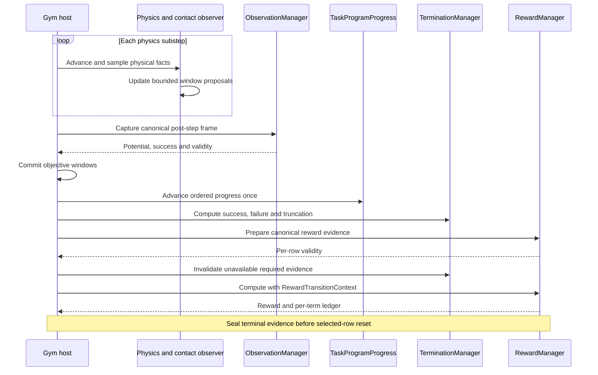

# Task Program and Atomic Skill reward composition

Task Programs declare task flow and program-level rewards. Atomic Skills provide
reusable measured goals and potential templates. Gym binds these declarations
to observations and ordinary `RewardCfg` terms; the existing `RewardManager`
owns reward evaluation, weighting, caching and reset.

The implementation includes composed rewards and CPU native acceptance.
Learned Atomic Skill execution and policy convergence remain outside the
qualified scope. The implementation is tracked in
[PR #1223](https://github.com/DexForce/EmbodiChain/pull/1223).

## Architecture and ownership



Standalone skill objectives skip `TaskProgramProgress`: the same measured skill
goal feeds termination and potential shaping directly. The action producer does
not define acceptance or change the reward profile. In the Task Program reward
host, `execution: policy` declares external action ownership and measured
progress; it does not construct a learned policy or run the expert adapter.
Planning/Real2Sim motion must reach that host through its action interface.
The native acceptance fixture collects planning commands separately, then
replays them through ordinary `JointPositionAction` terms.

| Owner | Responsibility | Source |
| --- | --- | --- |
| Task Program | Flow, named conditions, reward defaults and ordered occurrences | [progress.py](../../embodichain/lab/task_program/integrations/progress.py) |
| Atomic Skill profiles | Pure role-score composition and profile revisions | [reward_profiles.py](../../embodichain/lab/sim/atomic_skills/reward_profiles.py) |
| Gym configuration | Binding, semantic consistency checks and generated terms | [gym_utils.py](../../embodichain/lab/gym/utils/gym_utils.py), [reward_composition.py](../../embodichain/lab/gym/envs/managers/reward_composition.py) |
| Skill observation | Physical evidence, goal scores, validity and bounded dwell windows | [skill_objective.py](../../embodichain/lab/gym/envs/managers/skill_objective.py) |
| RewardManager | Execute additive terms, apply weights, cache repeated reads and reset selected histories | [reward_manager.py](../../embodichain/lab/gym/envs/managers/reward_manager.py) |
| TerminationManager | Final success, failure, invalid evidence and time limits | [termination_manager.py](../../embodichain/lab/gym/envs/managers/termination_manager.py) |
| Compute | Potential shaping and executed action-chunk aggregation | [rewards.py](../../embodichain/compute/rewards.py) |

Core Task Program language/compiler/runtime code remains independent of Gym.
Simulation profiles do not import Gym. Shared numerical reward operations live
in `compute`, without simulator or environment-manager dependencies.

## Program-level rewards

Composition is opt-in through Task Program `rewards` or deployment
`rl_task.reward_composition`. Tasks without composition retain their ordinary
reward configuration.

| Component | Implemented behavior | Default |
| --- | --- | --- |
| Progress shaping | Potential from completed ordered progress units | Generated for program composition |
| Milestones | Once-only first achievement of each expanded occurrence | Total budget 1, divided across progress units |
| Task outcome | Once-only accepted success or failure | Success +10; failure -10 |
| Time cost | Subtract `time_cost * step_dt` each control step | 0 |
| Additional terms | Ordinary additive `RewardCfg` functors | Explicit task configuration |

An existing explicit `success_reward` suppresses the default automatic success
bonus unless the composition explicitly sets `success`. Explicit
`program_stage_reward` first-achievement terms suppress the automatic bonus for
the same selected event. Authored names, occurrence IDs and `call:N` aliases use
the same matcher. Existing reward terms must use `add` when automatic
composition is enabled.

Deduplication respects the explicit term's payout scope. An episode-scoped
bonus covers only the first occurrence of its authored stage name; later
occurrences keep their automatic milestone. Selecting only a later occurrence
with episode scope does not suppress an automatic event that term cannot pay.
Authored stage names take precedence over textual call and occurrence aliases.
An explicit `call_index` remains a structural compiled-call selection, even when
a stage is named `call:0`. Generated milestones select numeric progress
occurrences, so authored names cannot redirect them. Preflight and runtime use
the same selector index.

Collision, energy and action-smoothness objectives can use existing or newly
implemented reward functors. Composition does not automatically add them.

## Default skill potentials and acceptance

Each role score is a finite batch vector in `[0, 1]`. Position, orientation and
joint errors use explicit scales to form bounded scores; target-based metric
bindings reduce vector errors by Euclidean norm before applying
`1 - tanh(error / scale)`.

| Skill | Default potential | Independent acceptance |
| --- | --- | --- |
| `move_joints` | `joints` | Every joint error meets its tolerance |
| `move_end_effector` | `(position + orientation) / 2` | Declared position/orientation tolerances hold |
| `pick_up` | `(reach + held + held * lifted) / 3` | Target reached, sustained bilateral hold and actual lift |
| `move_held_object` | `pose * held` | Target reached while the hold remains valid |
| `place` | `(pose + pose * released + pose * released * stable) / 3` | Target, support, hand separation and low velocity hold for the stability window |

`pose` combines position and orientation scores. `held` includes the required
hold duration; `stable` measures progress through the stability window.
Manipulation objectives require explicit object/support actors and a calibrated
gripper binding. Program objectives resolve pads and complete collision links
from the selected resource's `grasp` endpoint. Standalone objectives require one
calibrated hand for their motion part. Omitted hand lists are derived; explicit
lists must match that selected hand, including its palm/body collision links.
Native contact evidence and collision geometry remain required. Binding and
acceptance declarations remain separate from
shaping weights. A zero shaping weight does not disable the physical goal.

`register_skill_reward_profile()` installs a trusted named
`SkillRewardProfile`; `objective.reward_profile` selects it, with `default`
used when omitted. A profile may use mean/product reduction or implement
`potential()` in trusted code. Measured objectives restrict selected roles to
the skill's available physical roles. A new physical metric needs an observation
implementation and binding before configuration can select it. Raw observation
metric bindings can also select a registered `profile` directly.

Built-in formulas read scores by role name, so a permutation of declared roles
does not change the formula. Profiles inheriting the built-in `potential()`
implementation require its complete role set when `reduction` is `None`.
A trusted subclass overriding `potential()` declares the roles its custom
formula consumes. Explicit mean/product reductions may select available subsets.

Effective configurations retain objective thresholds and selected profile
revisions. Checkpoint snapshots also freeze every resolved reward scalar,
including the suppressed success default of zero, failure, milestone budget,
time cost and shaping weight. Editing reward defaults in a referenced program
YAML cannot silently change the checkpoint's rewards on reload. Saved-contract
mismatches and unknown profiles reject instead of selecting different behavior.

## Composition mathematics and terminal boundaries

For the common case of one objective per current progress unit, let `N` be the
expanded unit count, `k_t` the completed count and `phi_active,t` the active
skill potential:

$$
\Phi_t = \frac{k_t}{N} + \frac{\phi_{\mathrm{active},t}}{N}.
$$

Units without skill objectives contribute only program progress; there is no
active-skill contribution after all units complete. Standalone composition uses
the skill potential directly. The final per-control-step reward is:

$$
r_t = w_\Phi\left(\gamma\bar{\Phi}_{t+1} - \Phi_t\right)
    + r_{\mathrm{milestone},t} + r_{\mathrm{outcome},t}
    - c_{\mathrm{time}}\Delta t + \sum_j w_j r_{j,t}.
$$

True task termination sets the successor potential `bar(Phi)` to zero.
Administrative truncation retains the pre-reset successor potential for
bootstrap. Completing an intermediate skill changes the active phase without
terminating the whole task. The training runtime validates composition
`discount` against algorithm `gamma` before constructing simulation.
Policy-only inference needs no algorithm block; discount matching runs only
when a consuming algorithm is supplied.

The terminal shaping contribution can be negative while task success is
correctly rewarded. In the recorded two-stage fixture, the last step is
`10 + 0.5 - 0.9424504 ≈ 9.5575495`: success, milestone and absorbing-potential
correction are separate ledger entries.

## Configuration and generated manager terms

An existing Task Program can enable generic progress/outcome rewards with:

```yaml
rewards:
  discount: 0.99
  weight: 1.0
  milestone_budget: 1.0
  success: 10.0
  failure: -10.0
  time_cost: 0.0
  skills: []
```

For measured skill shaping, entries in `rewards.skills` select `stage` or a
compiled `call_index` and declare an `objective` containing `skill_id`,
`binding`, `goal`, optional `acceptance` and optional `reward_profile`.
Multi-call segments require explicit objectives for every call before internal
progress can be expanded. Objects, resources and semantic placement targets
must agree with the compiled calls.

Program `scene_relative` call targets retain a reference-pose snapshot per
environment and call occurrence, captured at activation before the first
physics step. Later reference motion does not retarget that call. New
occurrences and reset rows acquire a new snapshot without changing peers.
Inactive goals preview the live reference and current entry orientation, keeping
the phase-handoff potential consistent with the canonical physical frame.
These measured references currently require rigid-object bindings; articulation
and link targets reject preflight. Standalone relative goals and `Place(on)`
support-frame measurements retain their declared live-reference behavior.
The effective Place preservation option applies to both `at` and `on` targets;
fixed goal quaternions that contradict preserved orientation reject.
`Place(on)` binds the destination affordance returned by semantic linking.
Object shorthand such as `on: block_1` therefore uses the same unique support
surface as the planner's explicit `on: block_1_top` selection.

Deployment `rl_task.reward_composition` overrides program defaults by top-level
field; overriding `skills` replaces the entire list. A standalone declaration
uses `rl_task.skill` with an explicit composition discount. Missing/null
standalone composition, nonfinite targets/scales, invalid dimensions and
inconsistent bindings reject during configuration or binding.

Gym generates ordinary `RewardCfg` terms named `composed_potential`,
`composed_outcome` and `composed_stage_N`. Task Program policy progress also
requires explicit action ownership and `rl_task.success` with a
`program_stage_condition`. Final/process requirements remain mandatory.

Complete examples:

- [Task Program objectives and rewards](../../examples/learning/task_program_progress/program_rewards.yaml).
- [Task Program deployment](../../examples/learning/task_program_progress/program_task.yaml).
- [Standalone MoveJoints objective](../../examples/learning/task_program_progress/joint_task.yaml).
- [Runnable guide and acceptance commands](../../examples/learning/task_program_progress/README.md).

## Runtime ordering and evidence lifecycle



Standalone goals omit the progress call. The same canonical frame supplies goal
measurement, progress, termination and reward. Episode ownership, row identity
and acquisition revisions prevent foreign or stale evidence from advancing
progress. Repeated transition reads return owned cached rewards without
consuming events or advancing histories again.
Rejected stale/foreign frames cannot rewind or advance the accepted revision
watermark.

Hold/stability windows inspect every physics substep. A first valid sample
establishes a boundary; interrupted evidence restarts the dwell. Missing sample
count/index/elapsed coverage, or object/support/hand pose writes after sampling,
invalidate affected rows. Invalid commits clear timers and boundary flags, so
diagnostic hosts continuing without auto-reset cannot reuse an old hold.

A support witness may persist when a sleeping body stops emitting positive
contact rows only while the object and support poses remain unchanged. Motion,
invalid acquisition and reset invalidate that witness. Required unavailable
evidence causes failure termination; it cannot erase the terminal shaping
boundary. Composition therefore rejects `ignore_terminations`.

Reset acquisition initializes selected potential baselines without paying
reward. Partial resets preserve other rows' histories. Window state and the
last sample have bounded per-row storage; canonical observations commit history,
while read-only queries do not.

Dynamic replay with composition clears measurement/objective/reward histories
after restoring the recorded robot, object and task state. It seeds baselines
from the final restored observation before the first replay action. Holding a
restored potential of 0.8 with discount 0.9 therefore earns `-0.08`.
Camera and stereo-camera poses retain the episode randomization applied by
`env.reset()`; replay invalidates their samples without resetting extrinsics.
Other sensors retain their state/history reset before acquiring restored state.

Measured physical goals bind fixed topology for the environment lifetime.
`replace_assets_from_group` rejects preflight when such goals are present;
construct a fresh environment for new geometry. Direct replacement/removal of
a bound object, support or reference also rejects before accessing old handles.

## Reuse with learned skills and action chunks

A future state-based learned skill can share the same goal observation and
potential template used in Task Programs. Its standalone host owns skill-episode
termination, while a Task Program host owns phase normalization and task-episode
termination. Final scalar rewards need not be identical across these hosts;
the reusable contract is the measurement and potential definition.

`aggregate_reward_sequence()` accepts per-control-step rewards, executed masks,
termination/truncation flags and optional episode IDs. It returns discounted
return, continuation discount and actual executed prefix length. Both end flags
close the prefix; only true termination suppresses bootstrap. The collector
retains the pre-reset successor observation and must not concatenate episodes.
This interface does not implement a model-specific VA/VLA training backend.

## Supported scope and recorded acceptance

Policy progress supports explicit sequential programs, finite expanded repeats,
and multi-call expansion with complete objective coverage. Parallel/implicit
segments, expert post-policies, required symbolic/call-effect outcomes, temporal
condition graphs and expert segment-start baselines reject preflight in this
progress path.

The [native acceptance reference](../../examples/learning/task_program_progress/validation/README.md)
records four passing CPU cases: success, hold, truncation and failure, totaling
1,559 `env.step` calls and 3,118 environment reward samples, including a
post-reset transition. The maximum scalar composition error is
`8.9406967e-8`; repeated-read error is zero. The arithmetic oracle consumes
canonical measured skill potentials and is not an independent geometry or
skill-formula oracle. Focused production tests cover those underlying contracts.

The [machine-readable results](../../examples/learning/task_program_progress/validation/results.json)
and [36.8-second native preview](../../examples/learning/task_program_progress/validation/task_program_rewards.mp4)
retain numerical and capture provenance. Reporting binds footage to video/trace
hashes and captured frame indices, and rejects failed qualification logs and
missing/nonfinite optimizer evidence.
The physical qualification CLI saves its diagnostic JSON before failing on
nonfinite rewards or unexpected fixture outcomes. Planning-expert acceptance
requires valid measured evidence; checkpoint task-success results remain
informational while reward finiteness is still enforced.

Physics-substep acquisition adds work. The recorded fixture timing includes
rendering and scalar auditing and does not establish large-batch or GPU
throughput. No learned-policy convergence claim is made by this acceptance.
