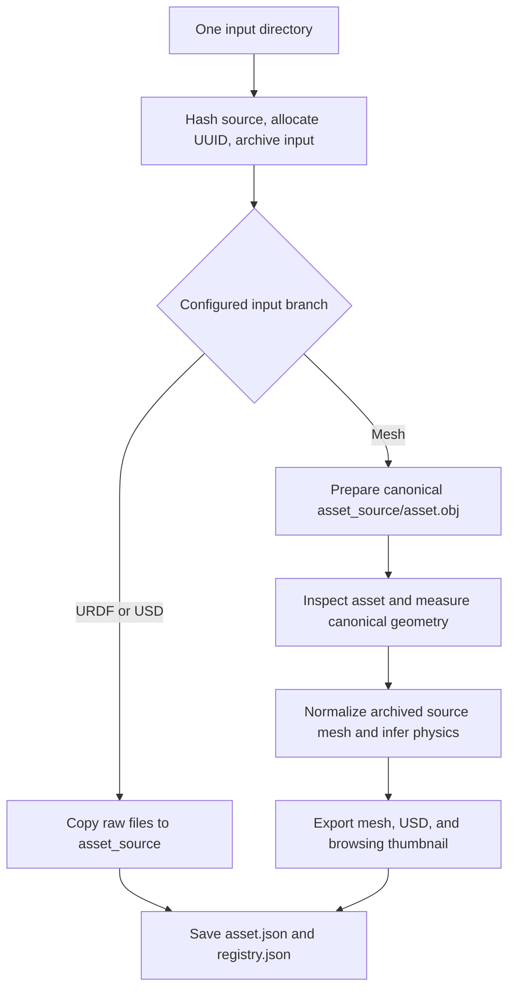

# SimReady Asset Pipeline

The **SimReady Asset Pipeline** converts an existing mesh into an asset with
normalized geometry, generated semantic and physical metadata, and mesh/USD
outputs. Its implementation lives in `embodichain.gen_sim.asset_engine`; the
command is `embodichain simready`.

Use this pipeline when you already have a mesh and need to prepare it for scene
construction. [Scene Engine](scene_engine.md) owns image-based scene generation,
editing, support relationships, and export. [Scene Services](../../overview/sim/scene/index.md)
compose configurations and prepare physical layouts after asset preparation.

## Place in the architecture

The asset package contains several entry points with different inputs and
configuration owners:

| Entry point | Input and output | Owner under `embodichain/gen_sim/` |
| --- | --- | --- |
| `embodichain simready` | One local asset directory → UUID asset directory and registry entry | `asset_engine/cli/start.py`, `asset_engine/pipeline/ingest.py` |
| SimReady browser workflow | Uploaded mesh/material files → the same CLI conversion and a downloadable mesh | `gradio_ui/app_asset_engine.py` |
| Scene Engine asset preparation | Generated meshes and graph-conditioned placement inputs → scene-owned prepared assets | `scene_engine/pipeline/utils/simready_processor.py` |
| Articulated asset generation | Image/text observations and scale metadata → validated articulated USDC | `asset_engine/pipeline/articulation.py`, `asset_engine/clients/articulated_generation.py` |

The general CLI and Scene Engine's internal processor are separate processing
flows. The general CLI does not generate a scene graph, choose task roles, or
build a runnable Gym deployment. A physics-mode annotation of `articulation`
also does not synthesize links or joints; use the separate generation service
under [articulated asset generation](#articulated-asset-generation).

## Prerequisites

Install EmbodiChain with the `gensim` extra and configure the isolated Blender
worker using [Installation](../../quick_start/install.md#optional-generative-simulation-gensim).
Keep the main EmbodiChain environment active; Blender jobs use the interpreter
selected by `EMBODICHAIN_BLENDER_PYTHON`.

The full mesh workflow uses Trimesh, offscreen rendering through Pyrender/EGL,
USD conversion dependencies, and a multimodal model endpoint compatible with
chat completions. Configure these values before starting the CLI:

```bash
export OPENAI_API_KEY="your-api-key"
export OPENAI_MODEL="your-multimodal-model"
export OPENAI_BASE_URL="https://your-provider.example/v1"
export EMBODICHAIN_BLENDER_PYTHON="/absolute/path/to/.venv-blender/bin/python"
```

Nonempty `OPENAI_API_KEY`, `OPENAI_MODEL`, and `OPENAI_BASE_URL` environment
values override `llm.openai_compatible` in
`embodichain/gen_sim/asset_engine/configs/gen_config.json`. All three resolved
fields are required, including the base URL. Model responses must include the
JSON content expected by classification, dimension, semantic, and physics
processing. General mesh conversion reads these environment variables and JSON
settings; articulation-service settings have a separate dotenv loader.

## Quick start

Put one asset and its sidecars in a directory. Mesh discovery checks files
directly inside that directory; it does not unpack archives or recursively
choose meshes from subdirectories.

```text
raw_cup/
  cup.obj
  cup.mtl
  textures/
  config.json       # Optional semantic and dimension hints
```

Run one conversion:

```bash
embodichain simready \
  --input_dir /path/to/raw_cup \
  --output_root /path/to/prepared_assets \
  --category cup
```

The module entry point accepts the same arguments:

```bash
python -m embodichain.gen_sim.asset_engine.cli.start \
  --input_dir /path/to/raw_cup \
  --output_root /path/to/prepared_assets \
  --category cup
```

| Argument | Meaning |
| --- | --- |
| `--input_dir` | Required directory containing one asset and its material/texture sidecars |
| `--output_root` | Required root for UUID asset directories and `registry.json` |
| `--category` | Required category stored in the asset's identity |

Each invocation creates a new UUID. The source folder hash records provenance;
it does not deduplicate repeated runs or automatically resume an earlier asset.
Select pipeline settings in `gen_config.json`; the CLI exposes the three
arguments above.

## Input selection and processing

The configured mesh preference is `.glb`, `.gltf`, `.obj`, `.ply`, then `.stl`.
Within the first available format, ingest chooses the first filename in sorted
order. Put only the intended source asset in the input directory.

With the shipped configuration, a top-level `.urdf` or `.usd` file selects
**direct-copy mode**, even when mesh files are also present. This mode archives
and copies the directory, saves its metadata, and returns without running the
parser sequence. It does not produce a normalized SimReady mesh or newly
inferred physics. Other USD extensions are not in the default ingest format list.



For mesh inputs, `ParserManager.DEFAULT_PIPELINE` runs these stages in order:

| Stage | Current behavior and output |
| --- | --- |
| Ingest and source preparation | Archive original files; create a canonical OBJ and material sidecars under `asset_source/` |
| `inspector` | Populate `asset_data` with the selected type, format, and source path |
| `geometry` | Optionally clean/decimate the canonical mesh with Blender; record topology, bounds, and counts in `parsed.geometry` |
| `physics` | Render the archived selected source, infer orientation/dimensions, uniformly scale and export the final mesh, generate semantics, and infer physical parameters |
| `usd` | Convert the final OBJ, when present, into a USD package using the resolved physical parameters |
| `internal` | Render a browsing thumbnail and record its path or rendering error |

The geometry parser measures the canonical source OBJ. The physics stage
separately reads the archived `identity.source_file` for final normalization;
its generated mesh is not necessarily the geometry measured by the geometry
parser. Inspect the final artifact when validating dimensions or topology.
Final mesh export places the bottom-face bounding-box center at the origin.

## Configuration

The source of truth is
{download}`gen_config.json <../../../../embodichain/gen_sim/asset_engine/configs/gen_config.json>`.
The following table distinguishes shipped defaults from optional modes:

| Setting | Shipped value | Effect |
| --- | --- | --- |
| `ingest.source_preparation.mode` | `"trimesh"` | Canonical OBJ conversion; `"blender"` enables ingest remesh, UV unwrap, and texture baking |
| `mesh_processing.trimesh_ingest.scene_mesh_strategy` | `"first"` | Source conversion selects the first geometry in a Trimesh scene; `"concatenate"` combines its geometries |
| `mesh_processing.trimesh_ingest.visual.pbr_base_color_only` | `true` | Source conversion retains the PBR base-color texture rather than every PBR material channel |
| `mesh_processing.blender_cleanup_decimate.enabled` | `true` | Enables Blender cleanup and decimation in the later geometry stage |
| `mesh_processing.simready_finalize.render_resolution` | `1024` | Resolution used for finalization views |

Choosing `trimesh` changes ingest source preparation only. The default geometry
stage still calls Blender, and later stages still need rendering and model
services. To skip the geometry stage's Blender operations as well, set:

```json
{
  "ingest": {
    "source_preparation": {"mode": "trimesh"}
  },
  "mesh_processing": {
    "blender_cleanup_decimate": {"enabled": false}
  }
}
```

These are selected fields to edit in the existing configuration, not a
replacement for the full file. `mesh_processing.blender_remesh_bake` controls
remesh resolution, decimation, UV layout, and diffuse/normal baking for Blender
ingest. `blender_cleanup_decimate.cleanup` and `.simplify` control the separate
geometry stage.

### Model settings

`llm.openai_compatible` accepts `api_key`, `model`, `base_url`, and
`default_query`. For endpoints requiring an API-version query parameter, set
`default_query` in the JSON configuration according to that endpoint's contract.
Changing the ingest mode does not disable model inference.

### Per-asset hints

An optional `config.json` beside the input mesh can provide authored semantics
and text supplied to finalization:

```json
{
  "semantic": {
    "tags": ["cup", "tableware"],
    "description": "A ceramic cup."
  },
  "extra_info": {
    "simready_info": "The cup is approximately 0.10 m tall."
  }
}
```

The mesh branch imports semantic tags/description and passes
`extra_info.simready_info` to the model as a hint. Direct-copy mode returns
before these injection steps. Hints do not constrain dimensions as a measured
calibration would.

## Outputs and simulation use

A completed mesh run has this layout; sidecars and thumbnails depend on the
corresponding stage results:

```text
prepared_assets/
  registry.json
  <asset_id>/
    asset_archive/<input-name>/    # Original files and sidecars
    asset_source/                 # Canonical OBJ, MTL, and textures
      asset.obj
    asset_simready/
      asset_simready.glb
      asset_simready.obj
    asset_usd/
      asset_simready_inst.usdc
      ...                         # Base USD, USDZ, and texture resources
    <asset_id>.png                 # Browsing thumbnail, when rendered
    asset.json
```

`registry.json` maps asset IDs to directories and categories. Within `asset.json`:

- `identity` records the source, ingest mode, and preparation mode; the top-level
  `ingest_sha256` identifies source contents and relative paths.
- `asset_data` describes the inspected source. Final mesh and USD locations are
  recorded separately under `simulation.sim_ready.sim_ready_path` and
  `usd.usd_path`.
- `parsed.geometry`, `semantics`, and `physics` contain measured source geometry,
  authored/generated semantics, and resolved physical properties. A failed
  physics inference can fall back to defaults, with `physics.source="default"`
  and zero confidence.
- `status` records processing state. `parsed=true` means the manager completed
  its sequence; it does not set `validated=true` or certify physical/task success.
  Inspect stage-specific errors such as `parsed.geometry.error` and `internal.error`.

Preview the final mesh, or the concrete USD file:

```bash
embodichain preview-asset \
  --asset_path "/path/to/prepared_assets/<asset_id>/asset_simready/asset_simready.glb" \
  --asset_type rigid --viser

embodichain preview-asset \
  --asset_path "/path/to/prepared_assets/<asset_id>/asset_usd/asset_simready_inst.usdc" \
  --asset_type rigid --viser
```

Replace `<asset_id>` with the generated directory name. Keep USD package
resources together. Use the owning [object configuration](../../overview/sim/sim_assets.md)
when declaring the asset in a simulation; choose source-physics preservation
or an explicit typed overlay there. [Scene Services](../../overview/sim/scene/workflows.md)
then provide layout, settling, and measured preparation checks.

## Browser workflow

Launch the existing engine workspace:

```bash
python -m embodichain.gen_sim.gradio_ui.gradio_app
```

In **Asset engine → SimReady**, upload the mesh and required material/texture
sidecars, enter a category, inspect the input preview, and run SimReady. The
panel copies uploads to a session run directory and invokes the same CLI in a
subprocess. It streams logs and reports success only after a zero exit code and
an existing `asset_simready.glb` or `.obj`. Reset/replacement stops that session's
previous run. The panel also contains a separate articulation-generation workflow.

## Articulated asset generation

`generate_articulated_usdcs` accepts explicit asset records, image observations,
coarse scales, and an `ArticulatedGenerationClient`. It generates and normalizes
USDC assets and updates record paths/scales; Scene Engine continues to own scene
layout and export.

This client reads `ASSET_ENGINE_ARTICULATED_GENERATION_*` service settings from
the shared `embodichain/gen_sim/.env`, with legacy
`SCENE_ENGINE_ARTICULATED_GENERATION_*` aliases. Those keys configure service
URL, timeout, retry budget, and endpoints, independently of the general mesh
pipeline's `OPENAI_*` settings. See the
{ref}`asset API reference <simready_asset_api>`
for client and generation entry points.

## Diagnose a run

| Symptom | Check |
| --- | --- |
| Missing model configuration | Resolve all three `OPENAI_*` fields before starting the process; verify chat-completions content includes the expected JSON |
| No final mesh after a successful ingest | Inspect `identity.ingest_mode`; direct-copy inputs only preserve raw files |
| An unexpected source mesh was selected | Check top-level input files, format preference, and same-format filename ordering |
| Blender errors in `trimesh` mode | Inspect the separate geometry cleanup setting and `EMBODICHAIN_BLENDER_PYTHON` |
| Rendering or thumbnail failure | Inspect EGL/offscreen rendering support and the recorded stage error; source conversion mode does not configure the renderer |

For preview modes and asset loading, see [Previewing Assets](../../guides/preview_asset.md).
For mesh preparation utilities outside this workflow, see [Toolkits](../toolkits/index.rst).
