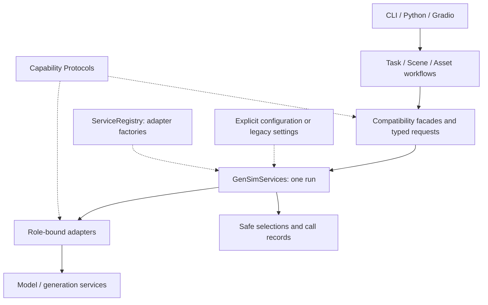

# Model services

GenSim workflows depend on model capabilities. `GenSimServices` selects adapters
by role, creates them only when needed, records calls, and releases owned
resources when a run ends. Task interpretation, scene processing and physical
acceptance remain with their respective owners. The service layer provides no
agent loop and does not establish physical success.



## Select a role

| Roles | Capability and responsibility |
|---|---|
| `task_interpretation` | Structured instruction interpretation |
| `task_image_grounding`, `task_semantic_planning` | Image evidence and catalog-constrained graph planning |
| `graph_localization` | Explicit display translation |
| `scene_understanding`, `scene_edit` | Scene/image interpretation and edit plans |
| `scene_asset_orientation`, `scene_asset_dimensions` | Scene-owned asset orientation and size queries |
| `asset_orientation`, `asset_dimensions`, `asset_semantics`, `asset_physics` | General SimReady asset annotation |
| `image_generation`, `image_segmentation` | Image artifacts and prompted RLE masks |
| `geometry_reconstruction` | Meshes with coarse layout |
| `articulated_generation` | Validated USDC delivery |
| `articulation_jobs` | Optional Gradio submit/status/cancel/download management |

Roles can share a profile or select different models and endpoints. The image
Task Engine requires no geometry, segmentation or articulated-generation server.
Use `embodichain asset-engine` for general mesh ingestion, as described in
[Asset Engine](asset_engine.md).

## Preserve existing configuration

Without an explicit Python configuration or a `model_services` section in
`asset_engine/configs/gen_config.json`, each role retains its legacy selection
rules. There is no automatic cross-provider fallback.

| Workflow | Legacy source |
|---|---|
| Task interpretation and graph translation | Process settings, fixed GenSim `.env`, then JSON `llm.openai_compatible`; key/endpoint pairs stay together |
| Scene VLM and image grounding/planning | Fixed GenSim `.env`, including Scene body defaults and attempt settings |
| General asset annotation | Nonempty process `OPENAI_*` values override the JSON LLM section |
| Image, segmentation and geometry services | Existing `SCENE_ENGINE_*` values in fixed GenSim `.env` |
| Articulated generation | Asset-owned dotenv keys, retaining the older Scene-key aliases |

The engine guides list the required legacy keys. `EMBODICHAIN_ENV_FILE` is used
by explicit profile references; it does not silently replace every legacy
loader's fixed dotenv path.

## Opt into explicit profiles

Add a `model_services` section to the existing JSON file while keeping its
`ingest`, `mesh_processing` and other sections. This minimal example configures
the three image-planning roles:

```json
{
  "model_services": {
    "profiles": {
      "planning": {
        "adapter": "openai_compatible",
        "model": "your-multimodal-model",
        "base_url": "https://your-provider.example/v1",
        "api_key_env": "MY_MODEL_KEY",
        "timeout_s": 120,
        "max_attempts": 1,
        "options": {
          "temperature": 0,
          "max_completion_tokens": 16000
        }
      }
    },
    "roles": {
      "task_interpretation": "planning",
      "task_image_grounding": "planning",
      "task_semantic_planning": "planning"
    }
  }
}
```

Choose options supported by the selected endpoint. Other shipped adapter IDs are
`image_http`, `segmentation_http`, `geometry_http`, `articulation_http` and
`articulation_jobs_http`. HTTP artifact profiles put their health/generation
paths in `options`. The packaged `services/model_services.example.json` contains
all role bindings and the corresponding endpoint/path environment references.

Connection/model fields can use `{"env": "VARIABLE_NAME"}`. `api_key_env` is
shorthand for an API-key reference. Process values override the selected dotenv
(`EMBODICHAIN_ENV_FILE` or the default GenSim `.env`) only for explicitly
referenced variables. Unrelated `OPENAI_*` settings do not fill missing explicit
profile fields. Unused profiles require no credentials or health checks.

Python `GenSimServicesCfg` takes precedence over the JSON section. Existing
caller/client injection takes precedence for its operation. The Python `model=`
override remains available; the Task Engine CLI reads configuration and ends at
the unbound semantic graph.

## Inject a run from Python

```python
from embodichain.gen_sim.services import GenSimServices, load_services_config
from embodichain.gen_sim.task_engine.image_planning import (
    generate_semantic_task_graph_from_image,
)

cfg = load_services_config("/path/to/gen_config.json")
with GenSimServices(cfg) as services:
    result = generate_semantic_task_graph_from_image(
        "/path/to/image.png", "Place the cup in the tray", services=services
    )
    records = services.records()
```

The same `services=` boundary is available on TaskAgent, Scene top-level/staged
APIs, asset ingestion and ParserManager. An implicit run is owned by its entry;
a supplied run is borrowed. Instances supplied through `injected={role: instance}`
are also borrowed and never closed by the run. Join concurrent work before closing
an owned run. Health checks execute on first role use when the adapter exposes
a health-check method.

Existing client import paths and method shapes remain compatibility facades.
Direct calls through those clients or a separately supplied caller need not go
through the run's role resolution and audit wrapper.

## Implement an adapter

Implement the corresponding public Protocol and register a factory. Subclassing
an existing client is unnecessary:

```python
from embodichain.gen_sim.services import ServiceRegistry

registry = ServiceRegistry.defaults()
registry.register(
    "my_chat", lambda profile: MyChat(profile),
    roles=("task_interpretation", "task_image_grounding", "task_semantic_planning"),
)
# Bind adapter "my_chat" in profiles and pass registry=registry to GenSimServices.
```

`MyChat` is your implementation of `ChatService.complete(ChatRequest)` returning
`ChatResponse`. Ordered text/image message parts preserve multi-view labels.
Factories receive resolved profile mappings and must release partially created
resources if construction fails. Adapters support concurrent calls; the shipped
artifact adapters serialize their HTTP sessions.

Geometry results retain object IDs and expose local meshes, Y-up metre positions,
unit `xyzw` quaternions and separate positive scale. Convert provider conventions
at the adapter boundary. Mesh-only generators must supply a layout estimator to
meet the reconstruction contract. Articulation returns validated USDCs and optional
request evidence. JSON Schema, task semantics and measured physical acceptance
remain with their consuming owners.

## Errors and audit records

Structured chat preserves the original user-message boundary, sorted schema text
and JSON-mode parsing. Invalid model content remains eligible for the owner's
bounded diagnostic repair. Transport/timeout failures are separate. Adapters own
HTTP retries and polling; accepted jobs are not resubmitted after polling errors,
and uncertain generation submissions raise `SubmissionUnknown`.

`selections()` exposes used role/adapter/model/source identities. `records()` adds
operation, elapsed time, status, attempts and artifact references, plus numeric
usage when supplied. Keys, prompts and provider error bodies are excluded. CLI
runs publish `service_calls.json`; Python users can call `write_records(path)`.
Audit sidecars must stay outside sealed bundles.

For offline checks, run `tests/gen_sim/services` and the relevant engine tests.
The explicit `scripts/validation/task_engine_images.py` harness separately runs
the pinned 20-image cohort with configured model access. Passing its semantic
acceptance does not qualify simulator execution, physical success or arbitrary
future model outputs.

See the [public service API](../../api_reference/public_api.rst) for exported
contracts, configuration, registry and classified exceptions.
