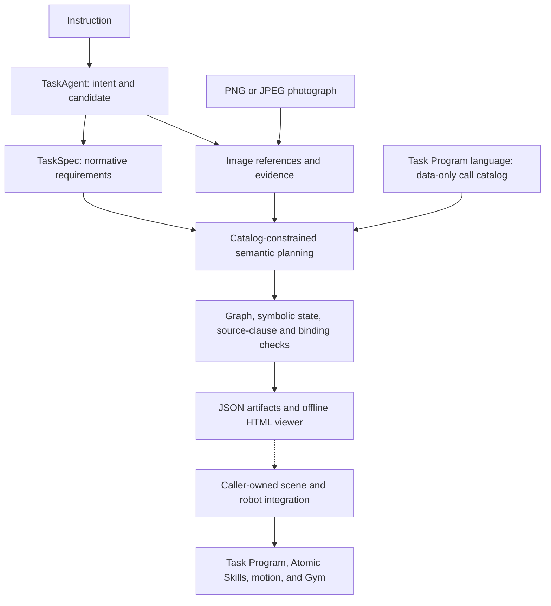

# Task Engine

Task Engine turns an instruction and a scene photograph into task candidates,
a normative TaskSpec, and a graph of canonical Semantic Calls. It preserves
image evidence, source-clause traceability, and unresolved runtime bindings so
you can inspect a proposed task before assembling an executable deployment.

Use `embodichain task-engine` for image-based semantic planning. Use the Python
contracts to validate fixed declarations or render an existing graph without
making model requests. The [API reference](../../api_reference/embodichain/embodichain.gen_sim.task_engine.rst)
covers both routes.

## Place in the architecture

Task Engine describes intended operations and their requirements. Other owners
supply assets, physical entities, robot bindings, execution, and measured evidence:

| Owner | Responsibility |
| --- | --- |
| Task Engine | Instruction interpretation, candidates, image references, TaskSpec projection, Semantic Call graphs, declaration checks, and graph display |
| TaskSpec | Normative task identity, requirements, and evaluation against supplied evidence |
| [SimReady Asset Pipeline](asset_engine.md) and [Scene Engine](scene_engine.md) | Asset preparation, scene generation/editing, and portable scene exports |
| [Scene Services](../../overview/sim/scene/index.md) | Physical layout proposals, state operations, and measured scene preparation |
| [Task Program](../../overview/task_program/index.md) | Language, compilation, configured Semantic Call lowering, execution sequencing, and runtime verification |
| Simulation, Atomic Skills, motion, and Gym | Physical entities and observations, manipulation planning, explicit stepping, episodes, and recording |



The image CLI ends at the semantic-graph output. Its logical image IDs become
physical scene bindings only through a later integration. Passing declaration
checks establishes consistency at that stage; physical task acceptance requires
runtime observations and the selected validators.

## Configure the model

Install the `gensim` dependencies described in
[Installation](../../quick_start/install.md#optional-generative-simulation-gensim).
The default image workflow makes text and multimodal model requests. Configure
the shared `embodichain/gen_sim/.env` file with these keys:

```ini
OPENAI_API_KEY=your-api-key
OPENAI_MODEL=your-multimodal-model
OPENAI_BASE_URL=https://your-provider.example/v1
SCENE_ENGINE_OPENAI_DEFAULT_QUERY={}
OPENAI_MAX_ATTEMPTS=2
```

Grounding and graph planning use the Scene Engine model loader, which requires
this file and all five keys. `SCENE_ENGINE_OPENAI_DEFAULT_QUERY` must decode to
a JSON object, and `OPENAI_MAX_ATTEMPTS` must be a positive integer. Exporting
process variables alone does not replace this loader's dotenv file.

Text interpretation also accepts Task Engine model overrides and the asset
pipeline's JSON fallback through its own settings resolver. Keeping the common
model and endpoint fields in the shared dotenv file makes the default stages
consistent. The image workflow uses model services; it does not require scene
geometry generation, segmentation, or an articulated-asset service.

## Quick start

Choose an existing PNG/JPEG image and a fresh output directory:

```bash
embodichain task-engine \
  --image /path/to/tabletop.jpg \
  --instruction "Pick up the red cup and place it on the tray." \
  --task-id cup_on_tray \
  --output outputs/task_engine/cup_on_tray
```

The package entry point accepts the same arguments:

```bash
python -m embodichain task-engine \
  --image /path/to/tabletop.jpg \
  --instruction "Pick up the red cup and place it on the tray." \
  --output outputs/task_engine/cup_on_tray_02
```

| Argument | Required/default | Meaning |
| --- | --- | --- |
| `--image` | Required | Existing `.png`, `.jpg`, or `.jpeg` file; image bytes must also decode as PNG/JPEG |
| `--instruction` | Required | Complete task instruction to interpret and preserve |
| `--output` | Required | Fresh output directory; existing directories are rejected |
| `--task-id` | `image_task` | Shared identity for candidates, TaskSpec, graph, and run metadata |

On success, the command prints the graph JSON and HTML paths. Open
`semantic_task_graph.html` to inspect the result locally. The page embeds its
viewer resources and image crops, so viewing a generated page requires neither
Node nor another model request.

## What the planning stages check

1. **Interpretation:** `TaskAgent` validates structured intent, object/target
   selectors, dependencies, requested arms, and task-specific intent. The image
   entry point requests one candidate and derives a TaskSpec from that candidate.
2. **Image grounding:** logical references receive explicit evidence identities.
   An observed object has a normalized `[xmin, ymin, xmax, ymax]` box. Hidden or
   ambiguous references retain pending bindings rather than invented detections.
3. **Planning:** the model proposes canonical calls from the data-only Task
   Program language catalog. Calls retain source step IDs and quoted instruction
   obligations; runtime geometry and policies remain binding requirements.
4. **Validation:** graph and semantic checks verify topology, call arguments,
   source identity, object/part lineage, held-object and arm state, instruction
   coverage, and the declared runtime needs.

Grounding and planning each permit one diagnostic repair after an invalid
response. `OPENAI_MAX_ATTEMPTS` is the model transport retry setting, separate
from these semantic repair rounds. Raw responses and diagnostics are retained
in `model_attempts.json` or failure audit artifacts.

The current intent vocabulary includes these task families:

| Family | Semantic intent |
| --- | --- |
| E1–E2 | Object placement at a symbolic relation, or making an object upright |
| E3 | Container pouring and its declared terminal requirements |
| E4–E5 | Arm handover or coordinated object transport, with explicit terminal behavior |
| E6–E9 | Prismatic-part operation, door operation, knob turning, and button pressing |

The vocabulary describes intended tasks. The call catalog determines which
canonical operations and arguments may represent them; a particular runtime
still needs compatible scene, robot, affordance, and policy bindings. For
example, the checker rejects a coordinated terminal hold when the catalog has
no matching hold operation instead of substituting a release.

Inspect the installed catalog without contacting a provider:

```python
from embodichain.lab.task_program.language.semantic_contracts import (
    semantic_planning_catalog,
)

catalog = semantic_planning_catalog()
print(sorted(catalog["calls"]))
```

## Output artifacts

A successful run contains:

```text
cup_on_tray/
  source_image.jpg
  task_candidates.json
  task_spec.json
  image_grounding.json
  call_catalog.json
  semantic_task_graph.json
  semantic_graph_validation.json
  instruction_requirements.json
  binding_requirements.json
  role_bindings.json
  model_attempts.json
  run_manifest.json
  semantic_task_graph.html
```

The copied source image retains the input extension, and its hash is checked
before publication. Important artifacts have different meanings:

| Artifact | What to inspect |
| --- | --- |
| `task_candidates.json`, `task_spec.json` | Intended steps, source selectors, candidate identity, and normative requirements |
| `image_grounding.json` | Source image hash/size, logical entities, evidence provenance, and reference bindings |
| `call_catalog.json` | Snapshot of symbolic call contracts used for this proposal |
| `semantic_task_graph.json` | Canonical calls, task groups, dependencies, and the unbound integration identity |
| `instruction_requirements.json` | Quoted source clauses and the nodes intended to implement them |
| `binding_requirements.json`, `role_bindings.json` | Deferred runtime needs and logical references; these are not calibrated scene bindings |
| `semantic_graph_validation.json` | Recomputable semantic/visual coverage plus the source declarations used to check it |
| `model_attempts.json` | Provider responses, repair attempts, and diagnostics |
| `run_manifest.json` | Run stage, source provenance, coverage summary, and execution status |

On semantic planning failure, the CLI saves a sibling
`<output-name>.failure-<uuid>.json` containing the error and available audit
artifacts. The incomplete output directory is cleaned up. Use a fresh directory
for another attempt; an existing successful run is never overwritten.

## Read validation and pending bindings

A successfully published image plan has these status fields:

```json
{
  "stage": "semantic_graph",
  "status": "graph_ready",
  "semantic_status": "valid",
  "execution_ready": false,
  "runtime_evidence_status": "not_run",
  "integration_status": "unbound"
}
```

`visual_status` is `complete` when the entities referenced by calls are observed,
otherwise `pending`. It describes image evidence, not 3D calibration or physical
readiness. `pending_bindings` counts declared runtime needs even when their
subjects are visible. The graph's all-zero integration fingerprint identifies
the absence of a bound runtime integration.

Image entities distinguish three provenance values:

- `observed`: visible evidence with normalized image bounds.
- `instruction_declared`: an entity introduced by the instruction without a
  visual observation.
- `runtime_required`: a logical reference to resolve through the later integration.

Unobserved entities have no image box. Ambiguous references retain candidate
identities, and explicit part parents preserve relationships such as a drawer
handle belonging to its drawer. A request to return an object to its original
pose creates a source-pose binding need; it does not invent another observed
object at that pose.

## Python planning and offline display

The Python entry point returns the JSON-ready artifact mapping without writing
a run directory:

```python
from embodichain.gen_sim.task_engine.image_planning import (
    generate_semantic_task_graph_from_image,
)

artifacts = generate_semantic_task_graph_from_image(
    "tabletop.jpg",
    "Pick up the red cup and place it on the tray.",
    task_id="cup_on_tray",
)
coverage = artifacts["semantic_graph_validation"]["coverage"]
print(coverage["semantic_status"], coverage["pending_bindings"])
```

This example makes provider requests. Explicit `instruction_caller`,
`image_caller`, and `planning_caller` arguments allow applications to supply
their own providers or fixed responses. `SemanticPlanningError.artifacts`
retains available intermediate declarations and attempts on generation failure.

To display saved declarations without calling a model:

```python
import json
from pathlib import Path
from embodichain.gen_sim.task_engine.semantic_graph_html import (
    write_semantic_task_graph_html,
)

run = Path("outputs/task_engine/cup_on_tray")
output = write_semantic_task_graph_html(
    json.loads((run / "semantic_task_graph.json").read_text()),
    "outputs/task_engine_displays/cup_on_tray.html",
    task_spec=json.loads((run / "task_spec.json").read_text()),
    validation=json.loads((run / "semantic_graph_validation.json").read_text()),
)
print(output)
```

The viewer validates supplied identities and recomputes coverage. Optional
identity-matched execution reports can add recorded overlays; displaying them
does not run the program or create new physical evidence. Choose a display
destination outside sealed bundle directories. Image cards show source assets
or source-image crops, rather than observations after each proposed call.

## Continue to execution

Resolve logical references against a real scene, provide robot profiles,
affordances, runtime policies, and acceptance bindings, then use the configured
Task Program preflight and execution path. Start with
[Scene Registry](../../overview/task_program/scene_registry.md),
[robot profiles](../../overview/task_program/robot_profiles.md), and the
[Task Program tutorial](../../tutorial/task_program.rst).

For already-authored and bound declarations, the Task Engine API also provides
pure program projection, configured bundle snapshots, and read-only reporting
contracts. Those APIs require explicit caller-owned inputs; image planning does
not produce a complete deployment automatically. Workflow configuration in
`config.py` and `defaults.yaml` belongs to these broader integration contracts,
separately from the four-argument image CLI.

See the [Task Engine API reference](../../api_reference/embodichain/embodichain.gen_sim.task_engine.rst)
for these contracts and the [CLI reference](../../guides/cli.md) for command usage.
