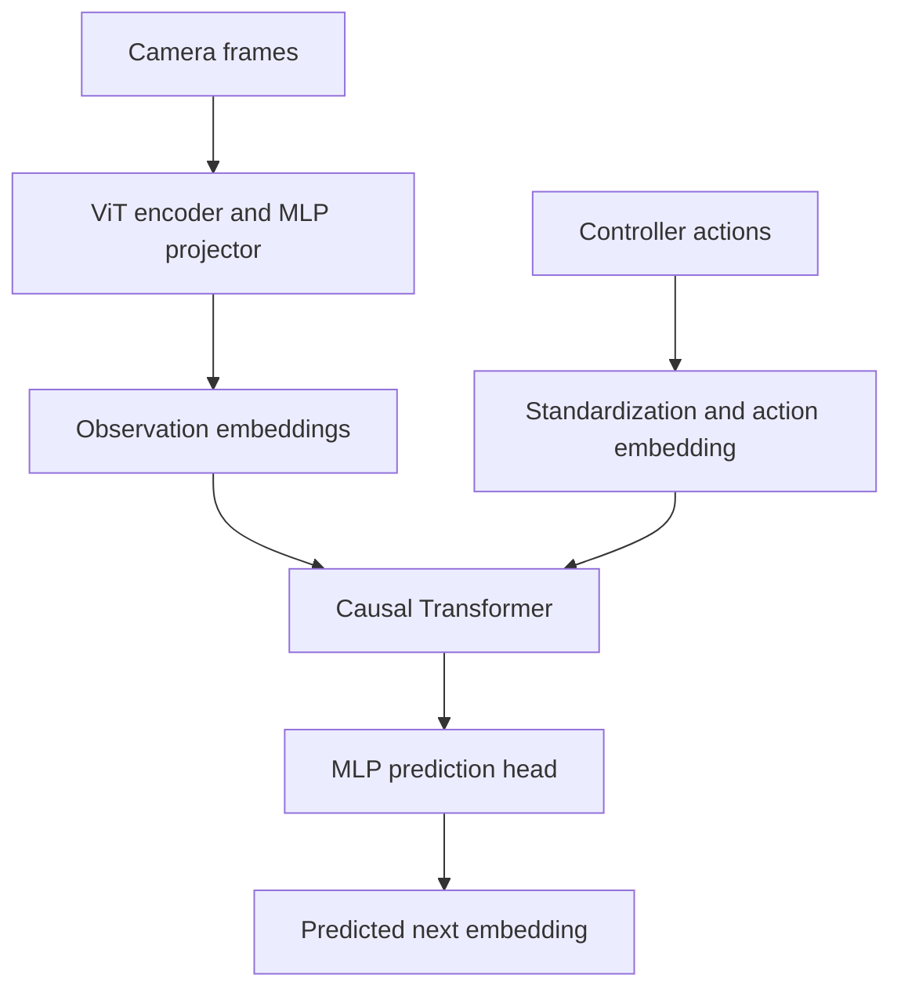

# LeWM visual world model

**LeWorldModel (LeWM)** is a Joint-Embedding Predictive Architecture (JEPA)
that learns how actions change a scene from RGB trajectories. It predicts the
embedding of a future camera frame. A planner can use those predictions to
choose actions that bring the scene closer to a goal image.

## Architecture



- **Image encoder.** `preprocess_rgb` resizes RGB frames and applies ImageNet
  normalization. The default 12-layer ViT-Tiny takes 224 × 224 images with
  14 × 14 patches. An MLP with batch normalization projects the final `[CLS]`
  token to a single 192-dimensional embedding per frame.
- **Action encoder.** Each model step takes the raw controls issued between
  successive frames. A step can pack several consecutive controls into one
  vector. LeWM standardizes that vector using saved action means and standard
  deviations, then embeds it with a 1D convolution and an MLP.
- **Dynamics predictor.** A six-layer Transformer uses learned temporal
  positions and causal attention over recent observation embeddings. The
  action embeddings condition its blocks through adaptive layer normalization
  (AdaLN-Zero). An MLP maps the output to the image embedding space.

## Training and planning

The original training objective jointly optimizes the encoder and predictor on
offline image and action sequences. The prediction term measures mean squared
error between the predicted embedding and the actual next frame's embedding
from the same encoder. The Sketched Isotropic Gaussian Regularizer (SIGReg)
uses random one-dimensional projections to push the embeddings toward a
standard Gaussian, which penalizes collapse to a constant representation.

```{math}
\mathcal{L} = \mathrm{MSE}(\hat{z}_{t+1}, z_{t+1})
              + \lambda\,\mathrm{SIGReg}(Z).
```

Here `Z` contains the encoded observations in the training batch and `λ`
weights the regularizer.

The shared supervised-learning recipe in EmbodiChain reads HDF5 episodes
containing `T + 1` RGB frames and `T` outgoing actions. It samples aligned
windows within each episode and exports weights with the model configuration
and action statistics.

At inference, the planner encodes the live observation and the goal image with
the same encoder. It feeds predicted embeddings back into the predictor to
roll out candidate action sequences. The cross-entropy method (CEM) scores
each sequence by the squared distance from its final embedding to the goal
embedding and refits its sampling distribution to the lowest-cost candidates.
Executing planned controls and replanning from fresh camera frames gives
closed-loop model predictive control.

## Reproduce the OGBench Cube example

The Cube example uses DexUni CPU rigid-body physics and the EmbodiChain
camera. The paired training workflow starts from the published OGBench Cube
weights. It adapts the visual encoder and projector to native camera images
using targets computed by the published encoder from matching upstream frames.
The predictor stays frozen, and action normalization uses statistics from the
official dataset.

Before running the commands, set up Python, CUDA and the example dependencies
from the [Cube runtime guide](https://github.com/DexForce/EmbodiChain/blob/main/examples/learning/lewm/cube/DEPLOYMENT.md).

```{include} ../../../../examples/learning/lewm/cube/README.md
:start-after: <!-- cube-reproduction-start -->
:end-before: <!-- cube-reproduction-end -->
```

The [Cube example guide](https://github.com/DexForce/EmbodiChain/blob/main/examples/learning/lewm/cube/README.md)
also shows how to collect native expert trajectories and fine-tune the full
model with the prediction and SIGReg objective.

## Model interface

`preprocess_rgb` accepts channels-last uint8 RGB or RGBA images.
`LeWM.encode` takes preprocessed RGB histories and returns latents of shape
`(B, H, D)`. Here `B` is the batch size, `H` is the number of observed
frames and `D` is the latent width.

`LeWM.rollout` takes those latents, the `H - 1` executed model actions
between observations, and candidate future actions of shape `(B, S, T, A)`.
It returns predicted future latents of shape `(B, S, T, D)` for `S` proposals
and `T` future model steps. `LeWMCEMPlanner.plan_sequence` returns a
complete sequence of raw action blocks for the caller to execute.
[LeWM API](../../api_reference/lewm.rst)

## Reference

Lucas Maes, Quentin Le Lidec, Damien Scieur, Yann LeCun, and Randall
Balestriero (2026). *LeWorldModel: Stable End-to-End Joint-Embedding Predictive
Architecture from Pixels*. [arXiv:2603.19312](https://arxiv.org/abs/2603.19312).
