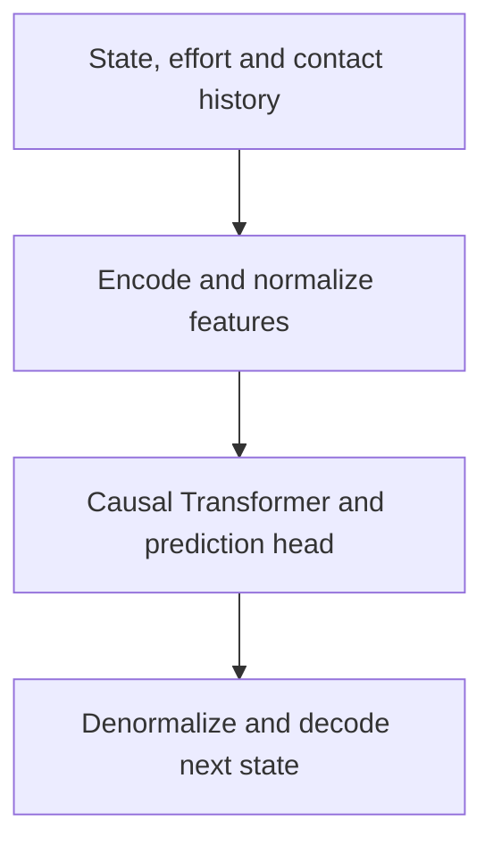

# NeRD: Neural Robot Dynamics

## Use cases

[NeRD](https://arxiv.org/abs/2508.15755) predicts articulated robot state changes
from a history of states, joint efforts and contact observations. The supported
reference systems are contact-free Cartpole and free-base Ant on a static plane.
Choose it when the transition depends on recent motion and applied efforts,
using a dataset and codec that match the physical system.

The simulation-independent network, codec, trajectory reader and SL recipe live
in `embodichain_models.dynamics.nerd`. The `learning/nerd` example prepares
resources and provides collection, training, export and evaluation commands.
Native simulation deployment is a separate consumer of the model and codec.

## How it works

The physical codec converts each observed state and effort into named feature
tensors. It expresses Ant state/contact features in the current body frame and
converts native center-of-mass velocities to the angular-first spatial-twist
convention used by the reference model. Cartpole uses joint coordinates and
velocities directly.



Named features are normalized and concatenated at each history position, then
projected into Transformer tokens with learned positional embeddings. Causal
attention lets a token use its own inputs and earlier history. The prediction
head returns state-change targets in physical units after denormalization.

For Cartpole, the target is joint-position change followed by velocity change:

```{math}
\Delta s_t =
\begin{bmatrix}
q_{t+1} \ominus q_t \\
\dot{q}_{t+1} - \dot{q}_t
\end{bmatrix}, \qquad
\widehat{\Delta s}_t = f_\theta(z_{t-H+1},\ldots,z_t).
```

Here `z` concatenates normalized features; `H` is the available history length.
The subtraction `⊖` wraps only configured continuous coordinates, such as
Cartpole's pole angle. Ant targets contain translation, a relative quaternion,
joint changes and velocity changes expressed in the frame at time t. The codec
reconstructs the next native state; an Ant quaternion target is composed as a rotation.
The timestep and physical identity come from the data/model manifests.

Training minimizes normalized state-change MSE with statistics computed only
from training windows. `forward()` predicts every token, while `evaluate()`
selects the final valid token in each history. Both the network and codec retain
input gradients. Use an autograd-enabled context when differentiating through
prediction; the inference example below disables it explicitly.

## Inputs and outputs

Let B be batch size and H the number of history positions. Named network
inputs have shape `[B, H, width]`:

| Feature | Cartpole width | Ant width |
| --- | --- | --- |
| `states_embedding` | 4 | 29 |
| `joint_f` | 2 generalized efforts | 8 actuated efforts |
| `contact_normals` | Not used | 75: 25 ordered slots × 3 |
| `contact_points_1` | Not used | 75: 25 ordered slots × 3 |
| `contact_depths` | Not used | 25 |
| `gravity_dir` | Not used | 3 |
| Prediction width | 4 | 29 |

The raw codec accepts Cartpole `q/qd` widths 2/2 or Ant widths 15/14. Ant `q`
contains xyz, an xyzw quaternion and eight joint coordinates; native `qd`
contains world COM linear velocity, world angular velocity and joint speeds.
Ant control records have zero free-base effort. The fixed plane-contact slots
are explicit observations; the network does not run collision detection.

`model(inputs)` returns `[B, H, output_dim]`.
`model.evaluate(inputs, valid_lengths)` returns `[B, 1, output_dim]`, where
`valid_lengths` is an int64 `[B]` tensor. Histories must respect the loaded
model's feature order and `block_size`; the shipped recipes use ten-position
windows. Trajectories contain T+1 states and T effort/contact records, and
windows cannot cross trajectory or train/validation/test boundaries.

## Quick start

Use the installed EmbodiChain package with PyTorch on CPU or CUDA. For a source
checkout, install it with `python -m pip install -e .` before running examples.

### Prepare and evaluate

These commands also work from an installed wheel outside the checkout:

```bash
embodichain run-example learning/nerd prepare --robot cartpole --resource-root ./outputs/nerd-resources
embodichain run-example learning/nerd eval --robot cartpole --resource-root ./outputs/nerd-resources --device cpu
```

Use `--robot ant` for Ant. `prepare` verifies pinned manifests, shards, weights
and reference asset hashes. Add `--assets-only` to prepare only teacher assets,
or `--local-files-only` to require an existing verified cache without network
access. Without `--resource-root`, the showcase uses
`EMBODICHAIN_NERD_RESOURCE_ROOT`, otherwise the cache under `XDG_CACHE_HOME` or
`~/.cache/embodichain/examples/nerd`. Evaluation writes
`outputs/nerd/<robot>/offline.json` unless overridden with `--output`.

Offline evaluation measures held-out transitions and does not start a simulator.
It does not establish accumulated rollout accuracy. Published Scene-generated
trajectories retain their original physical identity; the independent direct
Newton collector uses `nerd-direct-newton-builder-v1`. A shared schema or profile
name does not make different solvers, versions or construction paths identical.

### Use the model in PyTorch

After preparing Cartpole resources, read one matching held-out window:

```python
from pathlib import Path

import torch

from embodichain_models.dynamics.nerd import NeRDStateCodec, load_model
from embodichain_models.dynamics.nerd.data import DynamicsWindowDataset
from embodichain_models.dynamics.nerd.integration import encode_batch

root = Path("outputs/nerd-resources")
model, manifest = load_model(
    root / "models/neural_dynamics/nerd/cartpole/v1",
    device="cpu",
)
codec = NeRDStateCodec(**manifest["codec"])
dataset = DynamicsWindowDataset(
    root / "datasets/neural_dynamics/nerd/cartpole/v1",
    split="test",
    history_length=model.cfg.history_length,
    verify=True,
)
try:
    window = dataset.get_batch([0])
    inputs, targets, valid = encode_batch(window, codec, "cpu")
    with torch.inference_mode():
        delta = model.evaluate(inputs, valid.sum(dim=-1).long())
        # A full window has H input states and one final target state.
        next_q, next_qd = codec.decode(
            window["states"]["q"][:, -2],
            window["states"]["qd"][:, -2],
            delta[:, 0],
        )
    print(delta.shape, next_q.shape, next_qd.shape)  # [1, 1, 4], [1, 2], [1, 2]
finally:
    dataset.close()
```

The prepared dataset/model pair provides the matching codec, timestep and
physical identity. When supplying your own data, verify those contracts before
prediction, as the example's `eval` command does. `encode_batch` returns named
features, relative targets and a validity mask. `codec.decode()` reconstructs
native `q/qd` from the current state and its predicted change.

### Comparison videos

These recordings compare the learned NeRD transition with its matching Newton
Featherstone solver. Each video shows passive motion, shared random efforts, and
a PD controller. Passive and random-effort comparisons use the same initial
state and applied effort sequence. In the PD segment, each simulator computes
feedback from its own state, so the comparison shows closed-loop behavior.

```{raw} html
<figure>
  <video controls playsinline preload="metadata" style="width: 100%; border-radius: 12px;"
         poster="https://huggingface.co/DexForceAI/embodichain_model/resolve/main/neural_dynamics/nerd/media/cartpole-comparison.webp">
    <source src="https://huggingface.co/DexForceAI/embodichain_model/resolve/main/neural_dynamics/nerd/media/cartpole-comparison.mp4" type="video/mp4">
    Your browser does not support embedded MP4 video.
  </video>
  <figcaption>Cartpole: analytical and learned dynamics.</figcaption>
</figure>
<figure>
  <video controls playsinline preload="metadata" style="width: 100%; border-radius: 12px;"
         poster="https://huggingface.co/DexForceAI/embodichain_model/resolve/main/neural_dynamics/nerd/media/ant-comparison.webp">
    <source src="https://huggingface.co/DexForceAI/embodichain_model/resolve/main/neural_dynamics/nerd/media/ant-comparison.mp4" type="video/mp4">
    Your browser does not support embedded MP4 video.
  </video>
  <figcaption>Ant: analytical and learned contact dynamics.</figcaption>
</figure>
```

Download the [Cartpole video](https://huggingface.co/DexForceAI/embodichain_model/resolve/main/neural_dynamics/nerd/media/cartpole-comparison.mp4)
or [Ant video](https://huggingface.co/DexForceAI/embodichain_model/resolve/main/neural_dynamics/nerd/media/ant-comparison.mp4).
The recordings visualize the released reference models; they are not a claim of
paper-level accuracy or equivalent behavior in arbitrary robot scenes.

## Training and evaluation

### Train, recover and export

After preparation, train through the default common SL recipe:

```bash
embodichain run-example learning/nerd train --robot cartpole --resource-root ./outputs/nerd-resources --device cuda:0 --output-dir ./outputs/nerd/cartpole/train
embodichain run-example learning/nerd export --checkpoint ./outputs/nerd/cartpole/train/last.pt --output ./outputs/nerd/cartpole/export
embodichain run-example learning/nerd eval --robot cartpole --resource-root ./outputs/nerd-resources --device cpu --model ./outputs/nerd/cartpole/export --output ./outputs/nerd/cartpole/trained-eval.json
```

`--device cpu` is also supported for training. The shipped `sl.train.yaml`
configures 1,000 updates; this bounded example does not claim full convergence.
The default output is `outputs/nerd/<robot>/train`. Resume with the same recipe
and resources:

```bash
embodichain run-example learning/nerd train --robot cartpole --resource-root ./outputs/nerd-resources --device cuda:0 --output-dir ./outputs/nerd/cartpole/train --resume ./outputs/nerd/cartpole/train/last.pt
```

Choose an artifact-free output for a new run. Recovery checks data, recipe,
feature order and run identity.
Different or newer metric history is preserved and requires a fresh destination.
The final SL checkpoint is not a claim of validation-selected accuracy.

The generic entry point accepts the same installable factory without example
bootstrap. Copy the [Cartpole recipe](https://github.com/DexForce/EmbodiChain/blob/main/examples/learning/nerd/configs/cartpole/sl.train.yaml)
or [Ant recipe](https://github.com/DexForce/EmbodiChain/blob/main/examples/learning/nerd/configs/ant/sl.train.yaml).
Set `data.path` to the prepared dataset and `trainer.output_dir` to a fresh
output, then run:

```bash
embodichain train-sl --config /path/to/recipe.yaml
embodichain train-sl --config /path/to/recipe.yaml --resume /path/to/train/last.pt
```

Relative paths in a common SL recipe resolve from the working directory. Its
installable factory is:

```text
embodichain_models.dynamics.nerd.sl_recipe:build_supervised_trainer
```

Export accepts both SL checkpoints and historical NeRD checkpoints and preserves
floating dtype, normalization, ordered features and attention policy. Export
destinations must be new directories.

### Teacher collection and historical experiments

Prepare reference assets before invoking the independent collector:

```bash
embodichain run-example learning/nerd prepare --robot cartpole --resource-root ./outputs/nerd-resources --assets-only
embodichain run-example learning/nerd generate --robot cartpole --resource-root ./outputs/nerd-resources --device cpu --output-dir ./outputs/nerd/cartpole/generated
```

The default collection preset is a bounded smoke workflow. Generation uses
Newton's built-in analytical solvers without DexSim's custom solver/Scene
extension. Its manifest commits the candidate cursor and rejection evidence
with shards. Rejection-only progress preserves data identity; legacy sidecars
remain readable, but resuming requires matching collector source and physical
identity. Add `generate --resume` with the same configuration and output to
continue collection. For the larger collection and historical training presets,
see the [Cartpole configurations](https://github.com/DexForce/EmbodiChain/blob/main/examples/learning/nerd/configs/cartpole/README.md)
and [Ant configurations](https://github.com/DexForce/EmbodiChain/blob/main/examples/learning/nerd/configs/ant/README.md).
The smoke collector and the default 1,000-update SL run exercise the workflow;
full collection and paper-reproduction budgets are specified separately there.

Explicit `dynamics.train.*.yaml` configurations in the showcase select the
historical trainer. It retains its NeRD checkpoint format and comparison
sampling/scheduling, including historical fine-tuning and shared sample-order
options. Its `best.pt` is a model-only selected snapshot for export; `last.pt`
is resumable and retains the selected best weights. These options are separate
from default SL training. See the showcase's [research protocol](https://github.com/DexForce/EmbodiChain/blob/main/examples/learning/nerd/research/acceptance.md)
for frozen source revisions, paired-seed gates and historical evidence limits.
Moving code or rerunning a smoke does not rerun those frozen experiments.

## References

### Original paper

Jie Xu, Eric Heiden, Iretiayo Akinola, Dieter Fox, Miles Macklin, and Yashraj
Narang. **Neural Robot Dynamics.** 2025.
[arXiv:2508.15755](https://arxiv.org/abs/2508.15755).

```bibtex
@misc{xu2025neuralrobotdynamics,
  title = {Neural Robot Dynamics},
  author = {Xu, Jie and Heiden, Eric and Akinola, Iretiayo and Fox, Dieter and
            Macklin, Miles and Narang, Yashraj},
  year = {2025},
  eprint = {2508.15755},
  archivePrefix = {arXiv},
  primaryClass = {cs.RO},
  url = {https://arxiv.org/abs/2508.15755}
}
```

### Implementation and further reading

- [Neural Robot Dynamics project](https://neural-robot-dynamics.github.io/).
- [Public API](../../api_reference/model_catalogs.rst): network, codec,
  trajectory windows, objectives and trainer factory.
- [Example README](https://github.com/DexForce/EmbodiChain/blob/main/examples/learning/nerd/README.md)
  and [research protocol](https://github.com/DexForce/EmbodiChain/blob/main/examples/learning/nerd/research/acceptance.md):
  historical experiments, frozen sources and acceptance evidence.
- [All neural dynamics models](../neural_dynamics.md).

### Pinned resources

The showcase prepares these resources at fixed revisions:

| Resource | Repository | Revision |
| --- | --- | --- |
| Dataset | [DexForceAI/embodichain_datasets](https://huggingface.co/datasets/DexForceAI/embodichain_datasets) | `b9ec58f36da99cc99a93f97adfe74ebc9fd66586` |
| Portable model | [DexForceAI/embodichain_model](https://huggingface.co/DexForceAI/embodichain_model) | `78e581526570069410bf269b38c0c52c800b24a7` |
| Raw teacher assets | [DexForceAI/embodichain_data](https://huggingface.co/DexForceAI/embodichain_data/tree/97e202e41fe7fb504656a6b163291305e400780d/demo/nerd/reference_assets/v1) | `97e202e41fe7fb504656a6b163291305e400780d` |

Datasets and models use `neural_dynamics/nerd/<robot>/v1`, where `<robot>` is
`cartpole` or `ant`. Raw assets use `demo/nerd/reference_assets/v1`; the verified
archive includes the URDF/XML, attribution and license. These downloaded
payloads are stored outside Git and the wheel. The model implementation and its
third-party license ship in the main EmbodiChain wheel with the same version.

Dataset manifests publish trajectory-level train/validation/test splits and
physical provenance. Trajectories have T+1 states and T effort/contact inputs;
windows cannot cross trajectories or splits. Portable models contain
`weights.pt` and `manifest.json`, with the network, normalization, codec,
timestep and physical identity. They are inference exports, not resumable
training checkpoints. Dataset/model cards describe dependency and evaluation
limits; long-horizon Ant predictions can drift.
