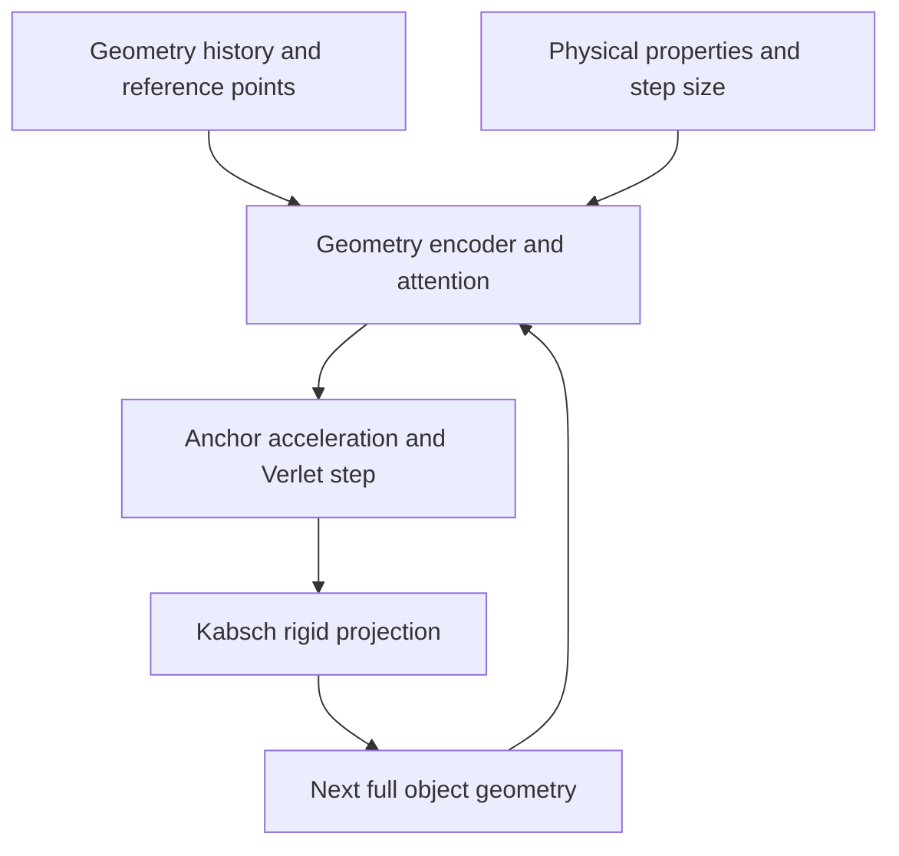

# RigidFormer: Rigid Geometry Dynamics

## Use cases

[RigidFormer](https://arxiv.org/abs/2605.09196) predicts the motion of interacting
rigid objects from observed geometry and physical properties. Use it when your
observations are aligned material points on rigid bodies and you want a free
rollout after several warmup frames. The current adapter has no action input.

`embodichain_models.dynamics.rigidformer` integrates the native author
architecture, official weights and a shared-SL training recipe for MOVi-Sphere,
MOVi-A and MOVi-B. The example provides resource preparation, an engine
comparison, fixed-checkpoint evaluation and independent reference checks.

## How it works

The geometry encoder processes material-point positions and relative geometry
between objects. Attention combines object/history features with physical
properties and step-size conditioning. The prediction path queries selected
anchors on each object to estimate their accelerations.



Predicted anchor accelerations advance positions through Verlet integration:

```{math}
\hat{x}_{t+1} = 2x_t - x_{t-1} + \hat{a}_t\,\Delta\tau^2,
\qquad \Delta\tau = 1.
```

A Kabsch fit finds a rigid transform from reference anchors to the predicted
anchors and applies it to the full object geometry. The supported MOVi
configurations use fixed reference geometry. This projection keeps predicted
points on a rigid body together instead of allowing independent point motion.

For reference anchors `r_k` and predicted anchors `x_k`, the fit solves

```{math}
(R^*,b^*)=\arg\min_{R\in SO(3),\,b}
\sum_{k=1}^{K}\|Rr_k+b-\hat{x}_{k,t+1}\|_2^2, \qquad
x_{j,t+1}=R^*r_j+b^*.
```

The same fitted transform advances every material point `j` of that object.

The author's integration unit is **model dt=1**. For MOVi's 240 Hz data, the
physical interval is `skip_step_size / 240` seconds. Step-size conditioning and
loss scaling account for the sampled interval; replacing the model integration
unit with physical seconds changes its learned numerical contract.

Training uses shifted conditioning sequences and four anchor-only smooth-L1
losses: position and acceleration, each before and after rigid projection.
The shared recipe retains author augmentation, grouped AdamW, gradient
clipping, epoch scheduling and FP32 exponential moving average (EMA).
`forward()` trains model parameters; the public `rollout()` method performs
inference without retaining autograd. This adapter does not qualify state or
action gradients for downstream differentiable control.

## Inputs and outputs

Let B be batch size, T frames, O padded objects and P padded points per object.
The principal author-layout batch fields are:

| Field | Shape | Meaning |
| --- | --- | --- |
| `obj_positions` | `[B, T, O, P, 3]` | Aligned world-space material points |
| `valid_obj_mask` | Boolean `[B, O]` | Objects present in each scene |
| `valid_vtx_mask` | Boolean `[B, T, O, P]` | Valid stored points |
| `ref_obj_positions` | `[B, O, P, 3]` | Aligned reference geometry |
| `anchor_idx` | int64 `[B, O, K]` | Prepared anchor indices; released recipes use K=4 |
| `phys_params` | `[B, O, 3]` | Mass, friction and restitution |
| `skip_step_size` | `[B]` | Positive frame stride |

The prepared source also supplies recipe-specific fields such as `vtx_rank`,
`dt` and `time_step_id`. Use its batches to preserve point identities, FPS
ordering, anchors and masks. At least two valid objects per scene are required.
Geometry prediction uses the author's CUDA KNN path; CPU supports imports,
architecture construction and checkpoint inspection.

Stored vertices are unscaled asset vertices transformed into world coordinates.
The prepared size sidecar applies metadata size about each object's origin
exactly once during reads. Use the source adapter's geometry without scaling
it a second time.

`rigidformer_batch()` separates conditioning through frame T-2 from targets
at frames 2..T-1. For free prediction, `model.rollout()` accepts **exactly**
`warmup_frames` observed frames and returns `obj_positions` with shape
`[B, num_frames, O, P, 3]`, including the warmup. The default evaluation uses
four observed frames; subsequent frames are predicted autoregressively.

## Quick start

### Install the optional dependencies

Use Python 3.11 and a CUDA-capable PyTorch installation:

```bash
python -m pip install 'embodichain[rigidformer]'
embodichain run-example learning/rigidformer --help
```

For a source checkout, install with `python -m pip install -e '.[rigidformer]'`.
The default attention backend is Torch SDPA. The optional `flash` backend needs
a compatible Flash-Attention build. The external community `rigidformer`
package is not used by this implementation.

### Prepare a debug subset and run the engine demo

```bash
embodichain run-example learning/rigidformer prepare \
  --dataset movi_sphere --assets all --limit-per-split 1

embodichain run-example learning/rigidformer demo
```

Preparation writes verified weights under `outputs/rigidformer/assets/model`
and a debug geometry subset under `outputs/rigidformer/data/MOVi-Sphere`.
Converted datasets need fresh destinations. The subset bounds conversion;
downloads may still include numeric shards and shared collision meshes.

Keep the dataset, weights and recipe in the same model family:

| `--dataset` | Prepared directory under `outputs/rigidformer/data/` | Official file under `outputs/rigidformer/assets/model/` | Recipe under `examples/learning/rigidformer/configs/` |
| --- | --- | --- | --- |
| `movi_sphere` | `MOVi-Sphere` | `rigidformer_movisphere.pth` | `sl.movi_sphere.yaml` |
| `movi_a` | `MOVi-A` | `rigidformer_movia.pth` | `sl.movi_a.yaml` |
| `movi_b` | `MOVi-B` | `rigidformer_movib.pth` | `sl.movi_b.yaml` |

Each prepared directory includes `splits.json`, `object_scales.json`, a manifest
and packed geometry. The Sphere subset supports the demo and inference below;
it is separate from the complete MOVi-A training workflow.

The demo compares live Newton XPBD spheres on the left with render-only model
predictions on the right. Both use the prepared scene's geometry and physical
properties, with newly chosen initial positions and velocities. The model sees
four sampled simulation frames and then predicts the remaining trajectory in
one free rollout. Predicted objects have no colliders and do not feed back
into the physical simulation.

To record without a display:

```bash
embodichain run-example learning/rigidformer demo --headless \
  --output outputs/rigidformer/demo-headless
```

The fresh output directory contains `rollout.mp4`, `frame.png`, aligned
`trajectory.npz` and `summary.json`. Defaults are 51 samples, stride 5 from
240 Hz physics, and 12 fps playback. Use `--data-root` and `--checkpoint` for
explicit resources, `--scene`/`--object-ids` to choose geometry, and `--device`
to select a GPU. Demo center errors measure this engine comparison; official
MOVi metrics come from fixed-checkpoint evaluation below.

### Predict from prepared geometry in PyTorch

This example reads one test window from the same Sphere debug subset. Five
source frames become four conditioning frames after the source's target shift:

```python
from pathlib import Path

import torch

from embodichain_models.dynamics.rigidformer import (
    MOViSequenceSource,
    load_rigidformer_checkpoint,
)

device = "cuda:0"
root = Path("outputs/rigidformer/data/MOVi-Sphere")
model = load_rigidformer_checkpoint(
    "outputs/rigidformer/assets/model/rigidformer_movisphere.pth",
    device=device,
    attention_backend="sdpa",
)
sampling = {
    **model.reference_config["data"],
    "sequence_length": 5,
    "skip_step_size": 5,
    "random_step_size": {"enable": False},
    "augmentation": {},
}
source = MOViSequenceSource(
    root,
    root / "splits.json",
    root / "object_scales.json",
    split="test",
    data_config=sampling,
)
sample = source.sample(1, generator=torch.Generator().manual_seed(42))
batch = {name: value.to(device) for name, value in sample.inputs.items()}
trajectory = model.rollout(batch, num_frames=51, warmup_frames=4)
print(trajectory["obj_positions"].shape)  # [1, 51, O, P, 3]
```

This is a single inference read. For training, the factory registers the source
with the trainer so traversal progress is committed after successful updates.

## Training and evaluation

### Prepare the full corpus and train

Use a complete corpus for the released training recipes. For example, MOVi-A
uses a separate prepared directory from the Sphere debug workflow:

```bash
embodichain run-example learning/rigidformer prepare --dataset movi_a
embodichain train-sl --config examples/learning/rigidformer/configs/sl.movi_a.yaml
```

Run the recipe path above from a source checkout's root. From an installed
wheel outside the checkout, copy the [MOVi-A recipe](https://github.com/DexForce/EmbodiChain/blob/main/examples/learning/rigidformer/configs/sl.movi_a.yaml)
and adjust its paths. SL recipe paths resolve from the working directory.
The default new-run output is `outputs/rigidformer/movi_a/sl`.

Full preparation requires 960 training, 120 validation and 120 test scenes.
The recipes use eight-frame windows, four anchors and sampled strides 1/5/10.
FP32 augmentation precedes BF16 network autocast; integration and rigid
registration retain the author's numerical policy.

The released MOVi-A/Sphere layout uses four GPUs × 32 scenes per rank; MOVi-B
uses six × 21. For the MOVi-A layout:

```bash
OMP_NUM_THREADS=1 torchrun --standalone --nnodes=1 --nproc-per-node=4 \
  -m embodichain train-sl --config examples/learning/rigidformer/configs/sl.movi_a.yaml
```

Choose the single-process or distributed launch for a fresh run. Batch size is
per rank; learning rates are not scaled automatically. A smaller run verifies
integration but uses a different training budget.

Recover an interrupted run with the same recipe and world size:

```bash
embodichain train-sl --config examples/learning/rigidformer/configs/sl.movi_a.yaml \
  --resume outputs/rigidformer/movi_a/sl/last.pt
```

For a distributed run, pass the same `--resume` argument through its original
`torchrun` launch. Checkpoints retain model/optimizer, source traversal,
scheduler, EMA and per-rank state. Recovery rejects changed data, split, scale,
recipe or world size. The [example README](https://github.com/DexForce/EmbodiChain/blob/main/examples/learning/rigidformer/README.md)
describes recovery into a fresh destination and the sampling contract.

### Export and evaluate fixed weights

```bash
embodichain run-example learning/rigidformer export \
  --checkpoint outputs/rigidformer/movi_a/sl/last.pt --weights ema \
  --output outputs/rigidformer/movi_a/model-ema.pt

embodichain run-example learning/rigidformer evaluate \
  --checkpoint outputs/rigidformer/movi_a/model-ema.pt \
  --data-root outputs/rigidformer/data/MOVi-A \
  --split validation --output outputs/rigidformer/movi_a/eval-validation
```

Select `--weights raw` to export raw model weights. Missing EMA is an error;
it does not silently substitute raw weights. Official weights can also be
passed directly to `evaluate`. Export produces tensor/config inference weights,
while SL checkpoints retain the training process. Export files and evaluation
directories must be fresh.

Fixed-weight evaluation uses four ground-truth warmup frames, step sizes
1/5/10, and author HopNet-aligned position/rotation metrics at physical frames
25/50/75/100/200/300/400. Off-grid checkpoints are not interpolated.
`summary.json` records corpus scope, checkpoint/data identity and metrics.
Select using validation, freeze the chosen checkpoint, then evaluate
`--split test` into a new output directory. Debug-subset results and demo center errors
do not establish complete MOVi benchmark accuracy.

## References

### Original paper

Zhiyang Dou, Minghao Guo, Haixu Wu, Doug Roble, Tuur Stuyck, and Wojciech
Matusik. **RigidFormer: Learning Rigid Dynamics using Transformers.** 2026.
[arXiv:2605.09196](https://arxiv.org/abs/2605.09196).

```bibtex
@misc{dou2026rigidformer,
  title = {{RigidFormer}: Learning Rigid Dynamics using Transformers},
  author = {Dou, Zhiyang and Guo, Minghao and Wu, Haixu and Roble, Doug and
            Stuyck, Tuur and Matusik, Wojciech},
  year = {2026},
  eprint = {2605.09196},
  archivePrefix = {arXiv},
  primaryClass = {cs.CV},
  url = {https://arxiv.org/abs/2605.09196}
}
```

### Implementation and further reading

- [RigidFormer API](../../api_reference/model_rigidformer.rst): model/config,
  checkpoint, data source, objective and trainer interfaces.
- [Example README](https://github.com/DexForce/EmbodiChain/blob/main/examples/learning/rigidformer/README.md):
  independent author comparison and exact recovery commands.
- [Acceptance protocol](https://github.com/DexForce/EmbodiChain/blob/main/examples/learning/rigidformer/research/acceptance.md):
  frozen sources, numerical checks, evaluation and retraining requirements.
- [Public model package](https://github.com/DexForce/EmbodiChain/tree/main/extensions/embodichain_models/embodichain_models/dynamics/rigidformer):
  model/config, checkpoint, source, objective and trainer APIs.
- [All neural dynamics models](../neural_dynamics.md).

### Resource provenance

The integrated author revision is `160fe0852c51cffae7b7440452b58d0b49db6df6`.
Preparation pins dataset revision `e78514b479b11acfa5d23d28f1211d7830646ff9`
and weights revision `8f2c0a3a157b64e4b310c64a01eee6e4e7e25af6`, with checksum
verification. `prepare --assets data|weights|all` chooses resources; data is
the default and training from scratch requires no pretrained weights.
`--local-files-only` requires an existing verified download cache.

The author-derived implementation retains MIT attribution. Official scenes
are CC BY 4.0; collision meshes and derived geometry are CC BY-SA 4.0. Prepared
resources retain their licenses. Datasets, weights and research results remain
outside Git and the wheel.
