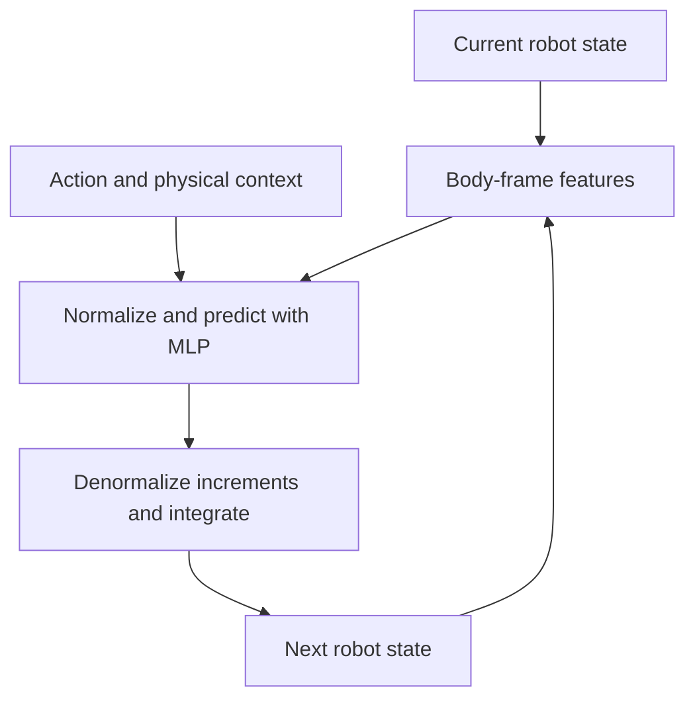

# Robot World Model (RWM)

## Use cases

RWM predicts a robot's next state from its current state, an action and optional
physical context. Use it to fit measured transitions at a fixed control period
or to differentiate a sequence of predictions with respect to states/actions.
The model, predictor, transition replay and SL recipe are available in
`embodichain_models.dynamics.rwm` and work on CPU or CUDA without a simulator.
Its state-increment formulation is inspired by
[SuperMimic](https://arxiv.org/abs/2610.28480); the implementation lineage is
documented in [References](#references).

The included example qualifies supervised fitting on controlled accelerations.
It also checks a 29-joint state layout and action gradients. These are fitting
and interface checks; robot physics and policy performance require their own
data and downstream evaluation.

## How it works

The input encoder extracts height, body-frame gravity and linear/angular
velocities, and joint positions/velocities. Global XY position and yaw do not
enter these features. The encoded state, action and physical context are
normalized and passed through an MLP to predict frame-local state increments.



Translation and velocity increments are rotated from the current body frame
into world coordinates. Rotation increments use exponential coordinates:

```{math}
p_{t+1} = p_t + R_t\,\Delta p_t, \qquad
R_{t+1} = R_t\,\operatorname{Exp}([\Delta\theta_t]_\times).
```

Here `R` maps body coordinates to world coordinates. Joint positions and
velocities receive additive increments. `step_dt` identifies the fixed physical
period represented by one prediction; it is part of the model contract rather
than a variable timestep input.

The supervised objective rolls out the model autoregressively from the initial
state, using each prediction as the next input. Future measured states enter
the loss as targets. Training retains the full multi-step graph and averages
normalized state errors over valid transitions. Invalid suffix padding is
excluded before model/error arithmetic.

For a T-step window, the loss compares the autoregressive states with measured
targets, averaging only the valid prefix:

```{math}
\hat{s}_{t+1}=F_\theta(\hat{s}_t,a_t,c_t), \qquad
\mathcal{L}=\frac{1}{D_\Delta\sum_t m_t}
\sum_t m_t\left\|\frac{e(\hat{s}_{t+1},s_{t+1})}{\bar{\sigma}}\right\|_2^2.
```

Here `c` is optional context, `m` is the validity mask, and `e` contains
translation, rotation-log, velocity and joint errors in the target body's frame.
Each scale `σ̄_i = max(σ_i, error_floor)` uses the frozen training increment
standard deviation. `D_Δ = 12 + 2*J` counts error coordinates. Batches average
over all valid transitions in all windows.

Normalization is updated explicitly from valid measured training transitions
and remains frozen during prediction. `frozen_world_model()` freezes model
parameters and statistics while retaining state/action gradients. Complete
dependent backward work inside that context before changing model parameters.
The final network layer starts at zero, so a newly constructed model with default
statistics returns the input state. Training-statistic initialization supplies
the mean increment; useful state/action dependence must be learned from data.

## Inputs and outputs

For J joints, the canonical FP32 state has width `D = 18 + 2*J`. The world
frame is Z-up:

| State field | Width | Convention |
| --- | --- | --- |
| Position | 3 | World coordinates |
| Rotation | 9 | Row-major body-to-world rotation matrix |
| Linear velocity | 3 | World coordinates |
| Angular velocity | 3 | World coordinates |
| Joint positions | J | Recorded joint order |
| Joint velocities | J | Same joint order |

`model(state, action, context)` maps `[B, D]`, `[B, A]` and optional `[B, C]`
tensors to `[B, D]` next states. Inputs must be FP32 on the model's device;
physical context is required whenever `context_dim > 0`. The learned increment
has width `12 + 2*J`, with rotation represented by three exponential coordinates.

The SL recipe reads a tensor-only PyTorch corpus with these fields:

| Corpus entry | Shape or content |
| --- | --- |
| `inputs.initial_state` | `[B, D]` |
| `inputs.actions` | `[B, T, A]` |
| `inputs.contexts` | Optional `[B, T, C]` |
| `targets` | Measured next states `[B, T, D]` |
| `masks.valid` | Boolean `[B, T]`, a nonempty valid prefix per window |
| `metadata` | `split`, `action_semantics`, `step_dt` and ordered `joint_names` when configured |

Control units/meaning, joint order and control period belong to the data/model
identity. A rotation matrix in this layout is distinct from the xyzw quaternion
used in NeRD's Ant codec. First-order rotation derivatives are supported away
from the rotation-logarithm branch cut at pi.

## Quick start

### Run the controlled fitting example

Use an installed EmbodiChain package with PyTorch, or install a source checkout
with `python -m pip install -e .`. From the same working directory throughout:

```bash
OMP_NUM_THREADS=1 MKL_NUM_THREADS=1 embodichain run-example learning/rwm \
  --output outputs/rwm-controlled-seed0 --seed 0 --device cpu
```

The output directory must be fresh. It contains `train.pt`, `validation.pt`,
`recipe.json`, checkpoints/metrics under `training/`, and `summary.json`.
Use `--device cuda:0` for CUDA. The one-joint fit runs 300 updates and checks
whether four-step held-out normalized state error falls below 15% of its initial
value. A separate 29-joint, three-context check exercises the larger layout and
initial-action gradients. Repeat seeds 0, 1 and 2 to run the documented fitting
protocol.

### Predict with the fitted model

Load the generated recipe and recover its SL checkpoint, then use the public
predictor on one validation window:

```python
import json
from pathlib import Path

import torch

from embodichain_models.dynamics.rwm import (
    RWMPredictor,
    build_rwm_trainer,
    frozen_world_model,
)

run = Path("outputs/rwm-controlled-seed0")
recipe = json.loads((run / "recipe.json").read_text())
trainer = build_rwm_trainer(recipe)
trainer.resume(run / "training/last.pt")
model = trainer.learner.model.eval()
device = next(model.parameters()).device
corpus = torch.load(run / "validation.pt", map_location="cpu", weights_only=True)
initial_state = corpus["inputs"]["initial_state"][:1].to(device)
actions = corpus["inputs"]["actions"][:1].to(device).clone().requires_grad_()

with frozen_world_model(model):
    predictor = RWMPredictor(model, initial_state)
    for action in actions.unbind(dim=1):
        predicted = predictor.step(action)
    gradient = torch.autograd.grad(predicted[:, 18:].square().sum(), actions)[0]

print(predicted.shape, gradient.shape)  # [1, 20], [1, 4, 1]
```

`RWMPredictor` retains newly allocated prediction states. Selective `reset()`
replaces chosen rows while preserving outstanding results and other rows'
graphs. `detach_state()` explicitly ends the retained prediction graph.

### Adapt recorded transitions to training windows

`TransitionReplay` copies detached, owned transitions into a bounded device
ring. For example, reuse the measured validation window above to demonstrate
the data adapter:

```python
from embodichain_models.dynamics.rwm import TransitionReplay, replay_supervised_batch

replay = TransitionReplay(
    capacity=64,
    num_envs=1,
    state_dim=model.state_dim,
    action_dim=model.cfg.action_dim,
    device=device,
)
measured_state = initial_state
for index in range(actions.shape[1]):
    measured_next = corpus["targets"][:1, index].to(device)
    replay.append(measured_state, actions[:, index].detach(), measured_next)
    measured_state = measured_next

batch = replay_supervised_batch(replay.sample_windows(batch_size=1, horizon=4))
```

In a collector, append the physical next state **before automatic reset** and
pass the `terminated`/`truncated` flags. Windows retain the terminal transition
and mask the following episode. The caller owns acquisition, reset and replay
refill. Validation data here illustrates the adapter; use training transitions
for fitting and normalization in an actual workflow.

## Training and evaluation

The emitted `recipe.json` works with the common `train-sl` entry point. To
start a separate run over the same corpora, change only the output destination
in a copy of the recipe:

```bash
python - <<'PY'
import json
from pathlib import Path

recipe = json.loads(Path("outputs/rwm-controlled-seed0/recipe.json").read_text())
recipe["trainer"]["output_dir"] = "outputs/rwm-retrain"
Path("outputs/rwm-retrain.json").write_text(json.dumps(recipe, indent=2))
PY
embodichain train-sl --config outputs/rwm-retrain.json
```

Recover an interrupted run with its matching recipe:

```bash
embodichain train-sl --config outputs/rwm-retrain.json \
  --resume outputs/rwm-retrain/last.pt
```

Relative corpus/output paths resolve from the working directory. Recovery
validates the data and configuration before restoring model, optimizer and
sampling state. GPU replay snapshots are optional; an online workflow can
explicitly rebuild/refill replay instead.

The recipe's validation callback reports multi-step loss, last-step MSE and
position error on the independent validation corpus. `summary.json` from the
controlled runner records its fitting gate, graph check and source/corpus
identity. These results qualify this controlled setup. Robot rollout accuracy
needs representative measured trajectories with the same action and physical
contract.

## References

### Original paper and implementation lineage

Qiayuan Liao, Yiyang Shao, Junfeng Long, Kevin Zakka, Roberto Horowitz,
Pieter Abbeel, and Koushil Sreenath. **SuperMimic: Scaling Humanoid Whole-Body
Control with One Differentiable World Model.** 2026.
[arXiv:2610.28480](https://arxiv.org/abs/2610.28480).

SuperMimic is the methodological inspiration for this state-increment model.
The code-level reference is the independent
[Uni-SuperMimic reproduction](https://github.com/Motphys/Uni-SuperMimic/tree/ceafbc863c52b3d613d0e19976794c5a31b9b402).
EmbodiChain's RWM integration covers the supervised transition model described
in this guide; the paper also studies policy learning and humanoid control.

```bibtex
@misc{liao2026supermimic,
  title = {{SuperMimic}: Scaling Humanoid Whole-Body Control with One
           Differentiable World Model},
  author = {Liao, Qiayuan and Shao, Yiyang and Long, Junfeng and Zakka, Kevin and
            Horowitz, Roberto and Abbeel, Pieter and Sreenath, Koushil},
  year = {2026},
  eprint = {2610.28480},
  archivePrefix = {arXiv},
  primaryClass = {cs.RO},
  url = {https://arxiv.org/abs/2610.28480}
}
```

### Implementation and further reading

- [RWM API](../../api_reference/rwm.rst): state transforms, model, predictor,
  replay, objective and trainer factory.
- [Example and fitting protocol](https://github.com/DexForce/EmbodiChain/blob/main/examples/learning/rwm/README.md).
- [Model implementation](https://github.com/DexForce/EmbodiChain/blob/main/extensions/embodichain_models/embodichain_models/dynamics/rwm/model.py):
  frame-local transition model and its upstream reference.
- [All neural dynamics models](../neural_dynamics.md).
