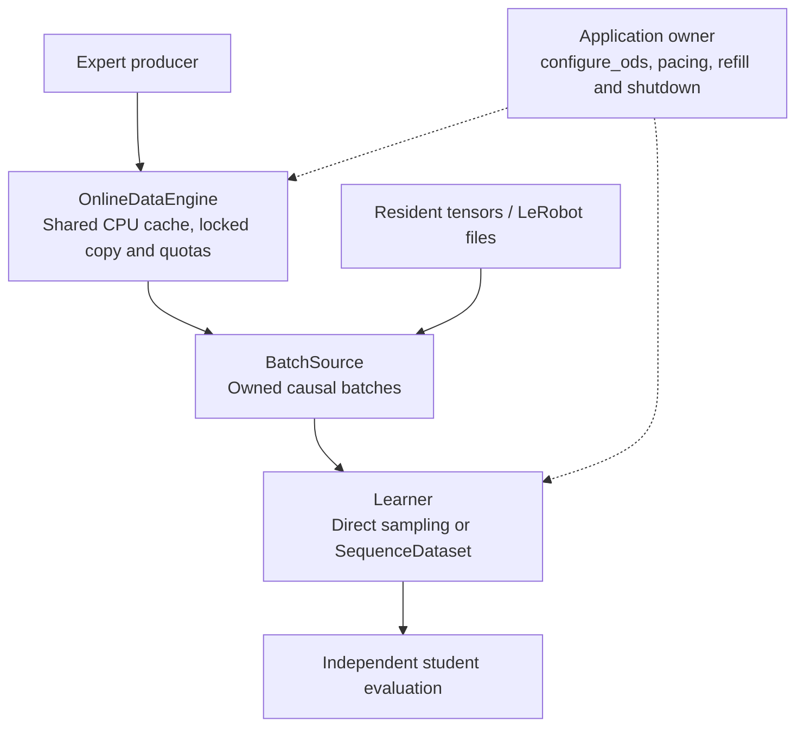

# ODS architecture and data flow

ODS supplies owned training batches from accepted simulation trajectories
through a bounded shared cache. The broader data pipeline gives live and stored
numeric trajectories one causal sampling interface. Task execution, learning
and evaluation remain application responsibilities.

## Runtime structure

Solid arrows show data flow; dotted arrows show application control. The three
`BatchSource` implementations are alternatives, not an automatic mixed replay.

The engine is not a separate training service. Its owner creates the producer
process and shared storage. The producer runs vectorized environments; P is not
a requirement for P separate OS processes. Sampling executes in the calling
consumer and retains selection, copy and quota debit under the shared lock.
Feature conversion can run on the owned copy after releasing that lock.

Applications own optional recording and independent student evaluation. Live
training does not automatically persist every sample. The evaluator loads
checkpoints and measures student rollouts; it has no implemented feedback edge
that requests targeted collection from the producer.

## Module ownership

| Layer | Public owner and responsibility |
| --- | --- |
| Production and shared state | `engine/data.py`: lifecycle, worker health, publication, sampling, generation accounting, provenance and optional live delivery ledger. |
| Language metadata | `engine/language.py`: append-only engine-local task/subtask dictionaries used by copied numeric language IDs. |
| Planning | `configuration.py`: typed reuse/runtime inputs, measured-rate calculations and immutable `ODSConfiguration`. The host applies the plan. |
| Contract and schema | `datasets/sequence.py`, `schema.py`: `BatchSource`, `SequenceSpecCfg`, typed sampling errors, semantic declaration validation and schema fingerprints. |
| Live/resident adaptation | `datasets/sources.py`: `OnlineDataSource` delegates to its caller-owned engine; `TensorDataSource` owns resident numeric data and its optional separate ledger. |
| Numeric SDK loading | `datasets/lerobot.py`: `LeRobotDataSource`, explicit field mapping, bounded reads and a resident allocation limit. |
| Iteration | `datasets/sequence_data.py`: `SequenceDataset`. `OfflineDataset` aliases it; `OnlineDataset` retains the existing chunk API and opt-in context iteration. |
| Shared numerical sampling | `datasets/_sampling.py`: window indices, padding and quota-draw helpers used without combining source lifecycle/lock ownership. |
| Application | `examples/ods/simple_bc_demo/`: local task/expert, feature definitions, model/loss, trainer, checkpoint/evaluator, writer, instrumentation and comparison. |

Schema validation cannot infer action meaning from a vector width. Observation
timing, action semantics, order, step duration and any feature conversion must
describe the data truthfully. A schema fingerprint identifies the declaration,
not the callable implementation or numerical dataset content. Engine-local
origin IDs also do not establish portable dataset content identity.

## Online and offline execution

**Live:** the owner starts the engine and waits for initial fill. The worker
accepts task rollouts and publishes complete episodes. `OnlineDataSource`
delegates to the engine's locked sampler and returns canonical owned contexts.
The host schedules further fills and training; shutdown belongs to the creator.
Refill publishes batches of rows incrementally: readable rows can temporarily
belong to different generations. A generation filter is explicit;
`wait_for_generation()` reports completion of the entire requested fill.

**Stored:** the caller constructs a `TensorDataSource` or loads numeric LeRobot
data through the official SDK. The reader validates its declared schema,
mapping, temporal data and resident allowance. Subsequent contexts come from
resident CPU tensors, not per-minibatch disk streaming. Loading creates no
simulation producer and supplies no implicit refill or epoch policy.

Both paths return contexts of length `H + F - 1`, with the current frame at
`H - 1`. Real context frames use `valid`; only real current/future targets use
`loss_mask`. Padding, episode/continuity boundaries and declared segment and
generation filters keep the pre-action observation/action pairing causal.

Exact source comparisons freeze recorded values/schema and align selected frame
IDs, sequence specification, transforms/RNG and quota/filter state. A refreshing
online run and a fixed offline corpus can still select different data and learn
differently. Shared APIs alone do not establish identical sample traces or a
training-efficiency advantage.

## Control and protection boundaries

- `configure_ods()` is a static planner. It does not run calibration, mutate a
  live engine, choose a learning-safe profile or invoke the optimizer. The
  application enforces active/average pacing and planned refill thresholds.
- `request_refill()` is owner-only and coalesces an outstanding request.
  `wait_for_generation()` waits for a complete fill. Optional bounded lifecycle
  logging must be drained during production and waits.
- A returned chunk costs one source selection. Duplicate draws count separately;
  copy failure spends nothing and downstream failure does not refund delivery.
  Live replacement retires unused allowance. Each source owns its ledger;
  there is no distributed global quota across independent sources/runs.
- `DataUnavailableError` means no eligible window exists;
  `DataBudgetExhaustedError` means eligible data cannot fund the requested batch.
  Worker/read failures remain terminal errors. Dataset iteration adds no hidden
  retry, refill or budget reset.
- Model/optimizer/RNG recovery belongs to the application. The demo recreates a
  live cache with a new run ID; exact replay-cache or protected offline-ledger
  recovery is not implemented.

See [configuration](configuration.md) for rate/cache formulas and runtime checks,
and the [Dataset/source design](https://github.com/DexForce/EmbodiChain/blob/main/docs/architecture/dataset-loading-design.md)
for implementation detail. Image/video sequence decoding, out-of-core loading,
DAgger, feedback-driven collection, RLinf integration and general replay
aggregation remain outside the implemented scope.
