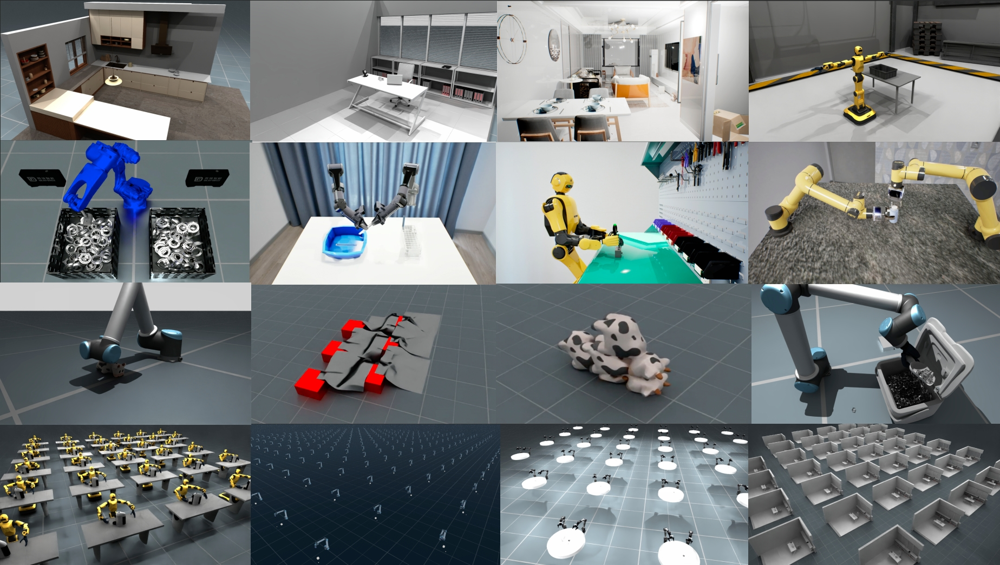
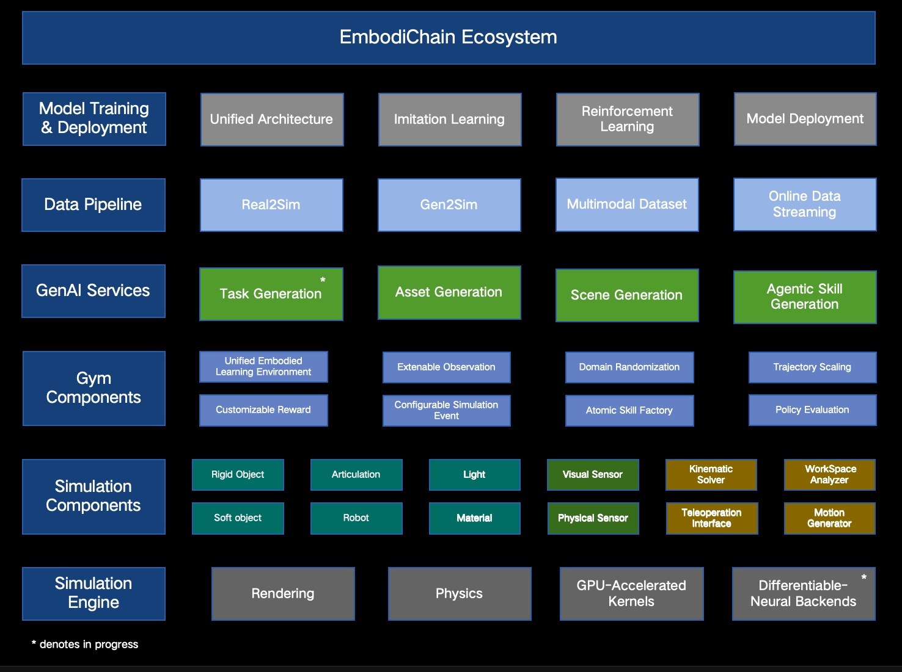

EmbodiChain
===========

EmbodiChain is an end-to-end, GPU-accelerated framework for embodied AI.
It brings robot simulation, generative data pipelines, and learning
workflows together so you can build environments, collect
demonstrations, train policies, and evaluate them in simulation.

.. NOTE::
   EmbodiChain is in Alpha and under active development. See the
   `roadmap <resources/roadmap.html>`__ for planned work, and share bug
   reports or feature requests through `GitHub
   Issues <https://github.com/DexForce/EmbodiChain/issues>`__.

Key Features
------------

- 🚀 **High-Fidelity GPU Simulation**: Realistic physics for rigid &
  deformable objects, advanced ray-traced sensors, all GPU-accelerated
  for high-throughput batch simulation.
- 🤖 **Unified Robot Learning Environment**: Standardized interfaces for
  Imitation Learning, Reinforcement Learning, and more.
- 📊 **Scalable Data Pipeline**: Automated data collection, efficient
  processing, and large-scale generation for model training.
- ⚡ **Efficient Training & Evaluation**: Online data streaming,
  parallel environment rollouts, and modern training paradigms.
- 🧩 **Modular & Extensible**: Easily integrate new robots,
  environments, and learning algorithms.

The figure below illustrates the overall architecture of EmbodiChain:

Explore EmbodiChain’s module relationships with the `interactive
architecture visualization <overview/architecture/index.html#>`__.

Getting Started
---------------

1. **Set up your environment** with the `Installation
   Guide <quick_start/install.html>`__, including Docker, local
   installation, Python compatibility, and optional dependencies.
2. **Create your first scene or preview an official task** with the
   `First Run guide <quick_start/first_run.html>`__.
3. **Explore runnable workflows** in the
   `examples <https://github.com/DexForce/EmbodiChain/blob/main/examples/README.md>`__,
   or consult the `API Reference <api_reference/index.html>`__ to build
   your own.

After installation, discover the available tasks, robots, and examples:

.. code:: bash

   embodichain list-task
   embodichain list-robot
   embodichain run-example --list

Task Environments
~~~~~~~~~~~~~~~~~

Use ``embodichain list-task`` to discover tasks and
``embodichain run-task`` to launch one with its configuration. See
`Tasks <resources/task/index.html>`__ for available tasks, runnable
configurations, and task authoring guides.

Third-party Training Frameworks
~~~~~~~~~~~~~~~~~~~~~~~~~~~~~~~

EmbodiChain supports **RLinf** and **LeRobot** alongside its native
trainers. EmbodiChain owns simulation, task configuration and
demonstration collection; the selected framework owns its training
runtime and checkpoints.

+-----------------------------------+------------------------------------------------------------------------------------------------+
| Workflow                          | Entry point                                                                                    |
+===================================+================================================================================================+
| RLinf: train against EmbodiChain  | `RLinf integration <guides/rlinf.html>`__                                                      |
| Gym environments; the upstream    |                                                                                                |
| example uses CartPole PPO         |                                                                                                |
+-----------------------------------+------------------------------------------------------------------------------------------------+
| LeRobot: collect demonstrations,  | `LeRobot integration <guides/lerobot.html>`__ · `Runnable ACT                                  |
| train official ACT and evaluate   | example <https://github.com/DexForce/EmbodiChain/blob/main/examples/learning/act/README.md>`__ |
| in simulation                     |                                                                                                |
+-----------------------------------+------------------------------------------------------------------------------------------------+
| Export finalized recordings for   | `Dataset export <guides/lerobot_export.html>`__                                                |
| LeRobot 0.6.1 consumers           |                                                                                                |
+-----------------------------------+------------------------------------------------------------------------------------------------+

See `training framework selection <guides/training_frameworks.html>`__
for dependency profiles, ownership and compatibility boundaries.

Official Extensions
-------------------

EmbodiChain bundles six official extensions under
``embodichain.extensions`` in the main ``embodichain`` distribution.

+---------------------------------------+-----------------------+----------------------------------------------------------------------------------------------------------------------------+
| Module                                | What it provides      | Explore                                                                                                                    |
+=======================================+=======================+============================================================================================================================+
| ``embodichain.extensions.tasks``      | Official task         | `Task configurations and                                                                                                   |
|                                       | environments,         | authoring <https://github.com/DexForce/EmbodiChain/blob/main/embodichain/extensions/tasks/README.md>`__                    |
|                                       | runnable deployments, |                                                                                                                            |
|                                       | and reusable scene    |                                                                                                                            |
|                                       | and embodiment        |                                                                                                                            |
|                                       | components for        |                                                                                                                            |
|                                       | manipulation,         |                                                                                                                            |
|                                       | locomotion, and       |                                                                                                                            |
|                                       | classic control.      |                                                                                                                            |
+---------------------------------------+-----------------------+----------------------------------------------------------------------------------------------------------------------------+
| ``embodichain.extensions.robots``     | Concrete robot        | `Robot catalog and                                                                                                         |
|                                       | presets, model        | configuration <https://github.com/DexForce/EmbodiChain/blob/main/embodichain/extensions/robots/README.md>`__               |
|                                       | assets, and           |                                                                                                                            |
|                                       | calibrated defaults,  |                                                                                                                            |
|                                       | organized by vendor   |                                                                                                                            |
|                                       | and model.            |                                                                                                                            |
+---------------------------------------+-----------------------+----------------------------------------------------------------------------------------------------------------------------+
| ``embodichain.extensions.models``     | Policy models for     | `Model families and                                                                                                        |
|                                       | action prediction,    | workflows <https://github.com/DexForce/EmbodiChain/blob/main/embodichain/extensions/models/README.md>`__                   |
|                                       | and world models /    |                                                                                                                            |
|                                       | neural dynamics       |                                                                                                                            |
|                                       | models for predicting |                                                                                                                            |
|                                       | future states and     |                                                                                                                            |
|                                       | environment dynamics. |                                                                                                                            |
+---------------------------------------+-----------------------+----------------------------------------------------------------------------------------------------------------------------+
| ``embodichain.extensions.solvers``    | Native physics        | `Solver adapters <https://github.com/DexForce/EmbodiChain/blob/main/embodichain/extensions/solvers/README.md>`__           |
|                                       | deployment adapters.  |                                                                                                                            |
+---------------------------------------+-----------------------+----------------------------------------------------------------------------------------------------------------------------+
| ``embodichain.extensions.sensors``    | Official sensor       | `Sensor backend                                                                                                            |
|                                       | presets, including    | support <https://github.com/DexForce/EmbodiChain/blob/main/docs/source/overview/sim/sensors/backend_support.md>`__         |
|                                       | the nominal VLP-16    |                                                                                                                            |
|                                       | lidar.                |                                                                                                                            |
+---------------------------------------+-----------------------+----------------------------------------------------------------------------------------------------------------------------+
| ``embodichain.extensions.benchmarks`` | Motion planning and   | `Benchmark suites and                                                                                                      |
|                                       | Atomic Skill          | usage <https://github.com/DexForce/EmbodiChain/blob/main/embodichain/extensions/benchmarks/motion_generation/README.md>`__ |
|                                       | evaluation suites     |                                                                                                                            |
|                                       | with scenarios,       |                                                                                                                            |
|                                       | planner adapters,     |                                                                                                                            |
|                                       | scoring, and reports. |                                                                                                                            |
+---------------------------------------+-----------------------+----------------------------------------------------------------------------------------------------------------------------+

The core provides shared simulation, data, and learning infrastructure.
Extensions build on those APIs for specific workflows. See each
workflow’s guide for model weights, datasets, and optional runtime
dependencies.

See the `extension development
guide <https://github.com/DexForce/EmbodiChain/blob/main/embodichain/extensions/README.md>`__
for package layout and how to add a bundled extension.

Contribution Guide
------------------

We welcome contributions! Please see the `contribution
guide <https://github.com/DexForce/EmbodiChain/blob/main/CONTRIBUTING.md>`__
for guidelines on how to get started.

Publications
------------

See `Academic Publications <resources/publications/README.html>`__ for a
complete list of academic papers related to EmbodiChain.

Citation
--------

If you find EmbodiChain helpful for your research, please consider
citing our work:

.. code-block:: bibtex

   @misc{EmbodiChain,
     author = {EmbodiChain Developers},
     title = {EmbodiChain: An end-to-end, GPU-accelerated, and modular platform for building generalized Embodied Intelligence},
     month = {November},
     year = {2025},
     url = {https://github.com/DexForce/EmbodiChain}
   }

.. code-block:: bibtex

   @misc{GS-World,
      author = {Guiliang Liu and Yueci Deng and Zhen Liu and Kui Jia},
      title = {GS-World: An Efficient, Engine-driven Learning Paradigm for Pursuing Embodied Intelligence using World
         Models of Generative Simulation},
      month = {October},
      year = {2025},
      journal = {TechRxiv}
   }
