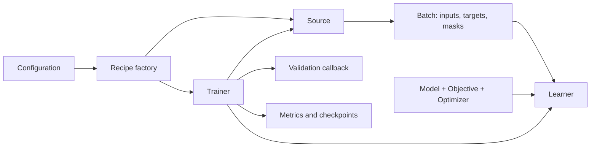

# Supervised Learning

Use `embodichain.learning.sl` to train a model from explicit inputs and supervision,
with a shared optimizer-update loop, validation, checkpoints and single-node
distributed training. The same infrastructure supports imitation policies and
learned dynamics. It does not require a simulator or an RL environment.

A model recipe defines the network, data encoding and loss. The SL layer runs
that recipe without assuming an observation layout, action representation or
sequence length. Shared networks live in `learning.models`; concrete models and
their recipes live in the bundled `embodichain_models` extension.
See [Integrated models](#integrated-models) to choose a model and find its data
preparation and training workflow.

## Components and data flow

| Component | Responsibility |
| --- | --- |
| `SupervisedBatch` | Structured inputs, targets, named masks and host-side metadata |
| `SupervisedSource` | Sample an owned batch with an explicit CPU sampling generator and a stable source identity |
| `SupervisedObjective` | Compute a differentiable scalar loss and return a `LossResult` with metrics and effective supervision weight |
| `SupervisedLearner` | Run forward/backward, check and clip gradients, and commit one optimizer update |
| `SupervisedTrainer` | Schedule sampling, updates, validation, metrics and checkpoint recovery |
| `SupervisedTrainingState` | Integrate additional committed state, such as a source cursor or model average, into updates and recovery |



For each update, the trainer samples a batch and moves its tensor trees to the
configured device. The learner computes the loss, backpropagates, checks/clips
gradients and steps the optimizer. After success, the update count and sampling
RNG advance; registered training states update in order, followed by the learning
rate scheduler. Validation, metric logging and periodic saving then run when due.

The objective owns masks, normalization and multi-step integration.
`SupervisedBatch.to(device)` preserves gradient paths; the trainer does not
detach rollout histories. Nonfinite losses or gradients prevent an optimizer
commit. The whole iteration is not a rollback transaction: an error after the
optimizer step does not undo that step or refund data already delivered.

See the {doc}`SL API </api_reference/embodichain/embodichain.learning.sl>` for
complete signatures and configuration fields.

## Integrated models

Four model families provide installable factories for the shared trainer. They
ship in the main `embodichain` wheel; datasets, pretrained weights and optional
runtime dependencies are prepared through each model's workflow.

| Model | Use case | Prediction inputs | Prediction output |
| --- | --- | --- | --- |
| ACT | Visual imitation learning | Current RGB frame and robot state | A chunk of robot actions |
| NeRD | Robot dynamics with history | States, joint efforts and optional contact history | State changes decoded into the next robot state |
| RWM | Action-conditioned robot dynamics | Current state, action and optional physical context | Next robot state at a fixed control period |
| RigidFormer | Interacting rigid-object dynamics | Geometry history, reference geometry and physical properties | Future rigid-object geometry |

### ACT: visual action-chunk policy

Action Chunking with Transformers (ACT) learns actions from demonstrations.
The integrated policy combines a ResNet-18 image encoder, a Transformer and a
conditional VAE. Training uses demonstrated action chunks with a masked L1 loss
and a KL term; inference predicts an action chunk from current RGB and robot
state without requiring future observations.

The recipe reads frame-aligned RGB, numeric state and action windows from
LeRobot datasets and fits normalization on training data only. The included
Franka PushCube workflow covers expert collection, offline training, checkpoint
selection and physical policy evaluation. It requires CUDA and the camera and
dataset dependencies described in the
{download}`ACT workflow <../../../../examples/learning/act/README.md>`.
See the {doc}`visual ACT API </api_reference/visual_act>` for model and adapter
interfaces.

### NeRD: history-based robot dynamics

Neural Robot Dynamics (NeRD) uses a causal Transformer to predict state changes
from histories of robot states, generalized efforts and configured contact
observations. A physical codec defines the feature representation and decodes
predictions into native robot states. Training minimizes normalized state-change
error using statistics computed from training windows.

The shipped reference systems are Cartpole and Ant. Their committed trajectory
shards, codec and physical metadata must match the model; the network runs on
CPU or CUDA without starting a simulator. Start from the
{download}`Cartpole recipe <../../../../examples/learning/nerd/configs/cartpole/sl.train.yaml>`
or {download}`Ant recipe <../../../../examples/learning/nerd/configs/ant/sl.train.yaml>`
after preparing data and updating paths as described in the
{doc}`NeRD guide </features/neural_dynamics/nerd>`.

### RWM: action-conditioned robot state prediction

Robot World Model (RWM) uses an MLP to predict frame-local state increments and
integrates them into the next robot state. Its supervised objective rolls out
multiple steps autoregressively and compares them with measured targets while
retaining state/action gradients. Use it when measured state/action transitions
and a fixed control period define the prediction problem.

The recipe reads a tensor corpus with initial states, actions, future state
targets and validity masks. Action semantics, control period and ordered joints
are explicit metadata. The CPU/CUDA example generates controlled fitting data
and an SL `recipe.json`; these checks qualify fitting and interfaces rather
than robot policy performance. See the
{doc}`RWM guide </features/neural_dynamics/rwm>` and
{download}`RWM example <../../../../examples/learning/rwm/README.md>` for corpus
preparation and training.

### RigidFormer: rigid geometry prediction

RigidFormer combines a geometry encoder and attention to predict anchor motion,
then applies rigid projection to produce the next object geometry. Its current
adapter predicts motion from observed geometry and physical properties without
an action input. Training uses position and acceleration losses on anchors
before and after rigid projection, with model-specific augmentation and an
exponential moving average (EMA) of model parameters.

The MOVi-Sphere, MOVi-A and MOVi-B recipes consume prepared, aligned material-point
sequences, reference geometry, anchors and physical properties. Geometry
prediction requires CUDA and the `embodichain[rigidformer]` dependencies. The
public `rollout()` runs without autograd; differentiable action-based control
is not part of this adapter. Start from the
{download}`MOVi-A recipe <../../../../examples/learning/rigidformer/configs/sl.movi_a.yaml>`
after following the
{doc}`RigidFormer guide </features/neural_dynamics/rigidformer>` for preparation,
runtime requirements and evaluation.

## Run a first recipe

From a repository checkout with EmbodiChain installed, run the existing masked
regression example on CPU. It generates a fixed synthetic corpus locally and
trains a small MLP; no simulator or dataset download is needed.

```bash
python -m embodichain train-sl --config examples/learning/sl_ddp/cpu.yaml
```

Each fresh run needs an artifact-free `trainer.output_dir`. The supplied recipe
uses `outputs/sl_ddp_cpu`, 200 updates and a batch size of 32. It validates every
50 updates and saves every 100 updates. Copy the configuration and choose a new
output directory before starting another independent run.

The configuration selects its factory with:

```yaml
factory: examples.learning.sl_ddp.recipe:build_trainer
```

The factory receives the full configuration and returns a `SupervisedTrainer`.
It interprets model, data, objective, optimizer and evaluation settings, then
assembles the source, model, objective, optimizer and learner. These sections are
recipe-specific; for example, optimizer field names need not match across model
families. The `trainer` section uses `SupervisedTrainerCfg`.

The example writes `run.json`, `metrics.jsonl`, `step_100.pt`, `step_200.pt` and
`last.pt`. Its validation MSE is logged as `validation/mse`. The generic trainer
does not automatically select a best checkpoint; a recipe's validation callback
can implement selection using development data, never the test split.

For a local copy of the example, see the
{download}`CPU configuration <../../../../examples/learning/sl_ddp/cpu.yaml>`,
{download}`factory source <../../../../examples/learning/sl_ddp/recipe.py>` and
{download}`launch and recovery notes <../../../../examples/learning/sl_ddp/README.md>`.
The example factory is a checkout example, not an installed model-library entry point.

## Choose a data source

| Source | Use it for | Recovery considerations |
| --- | --- | --- |
| `TensorBatchSource` | A fixed CPU tensor-tree corpus; samples with replacement | Takes an owned snapshot and binds content and metadata to source identity |
| `SequenceBatchSource` | A data-pipeline `BatchSource` plus an explicit, versioned encoder | Exact resume is opt-in for immutable, unbudgeted resident tensor sources |
| Model-specific source | Model-owned image decoding, state codecs or window selection | The recipe must provide the required identity and recoverable state |

An encoder selects causal inputs, supervision and objective masks explicitly.
The sequence bridge preserves canonical masks and provenance under
`metadata['sequence_source']`; it does not infer action meaning or automatically
turn future observations into inputs. Units, coordinate frames, action semantics
and control periods belong in the data declarations and recipe signature.

Live buffers and delivery quotas are not restored by the common trainer.
`SequenceBatchSource` defaults to rejecting exact resume; `immutable=True`
requires an unchanged resident `TensorDataSource` (including resident
`LeRobotDataSource`) without delivery quotas. Such sources verify content again
before recovery. A live source may train and save a snapshot without supporting
exact continuation.

Data production, refill, waits and error recovery remain application-owned.
The CLI closes the returned source when it provides `close()`; programmatic
callers manage that consumption lifetime themselves. See
{doc}`Online Data Streaming </features/online_data>` and the
{download}`sequence bridge example notes <../../../../examples/learning/sl_data_source/README.md>`
for the data-supply side.

## Single-node distributed training

Run the same CPU recipe with two workers using Gloo, after choosing a fresh output
directory in the configuration:

```bash
OMP_NUM_THREADS=1 torchrun --standalone --nnodes=1 --nproc-per-node=2 \
  -m embodichain train-sl --config examples/learning/sl_ddp/cpu.yaml
```

For two GPUs, use the CUDA recipe; each worker uses one GPU through NCCL:

```bash
CUDA_VISIBLE_DEVICES=0,1 OMP_NUM_THREADS=1 \
  torchrun --standalone --nnodes=1 --nproc-per-node=2 \
  -m embodichain train-sl --config examples/learning/sl_ddp/cuda.yaml
```

The CLI initializes the process group before the factory and resolves
`trainer.device` to `cpu` or `cuda:LOCAL_RANK`. Programmatic callers can use
`distributed_run(device)` for the same scoped setup. It cleans up only the group
it creates.

`batch_size` is per rank; two workers with 32 examples each draw 64 examples per
update. The learning rate is unchanged. Sampling remains source-owned: tensor
sources draw independently with replacement, while traversal-based sources may
shard windows. Account for each worker's source/cache memory.

Under DDP, each objective returns a local mean loss and a finite, positive
`LossResult.weight`, representing its effective valid supervision count. The
learner forms `sum(weight_rank * loss_rank) / sum(weight_rank)` and scales the
backward pass accordingly. Equally sized batches can have different weights
when their masks differ. Objective metrics use the same weighting and must have
consistent names across workers and updates.

All ranks participate in ordinary `fit()`, `save()` and `resume()` calls. Only
rank 0 writes files and validates with the unwrapped model. A save inside the
trainer's rank-zero validation callback uses the already captured training
boundary, without another collective call.

## Checkpoints and exact continuation

A checkpoint stores model and optimizer state, update count, scheduler state,
sampling and global RNG states, recipe/source identity and registered training
states. Distributed checkpoints also retain each rank's RNG, sampler and model
buffers. Validation preserves training mode, buffers, RNG, sampling state and
registered training states; callbacks must not mutate model parameters or other
unprotected training resources.

Exact continuation requires the same source, recipe, training configuration and
world size. `total_updates` is an absolute budget, including restored work;
changing it is not supported by exact resume. The output directory may change.

For example, after the single-CPU run above, copy `cpu.yaml` to
`/tmp/sl-resume.yaml` and change only `trainer.output_dir` to a fresh path such as
`outputs/sl_cpu_resumed`. Keep the 200-update budget and all other settings:

```bash
python -m embodichain train-sl --config /tmp/sl-resume.yaml \
  --resume outputs/sl_ddp_cpu/step_100.pt
```

This continues from update 100 while preserving the original run's later
history. For a checkpoint created by `torchrun`, use the same worker count to
resume. An interrupted run may reuse its original directory only if `run.json`
matches and the complete metric history is not ahead of the checkpoint. Older
checkpoints without a run identity require a fresh destination. Resume checks
compatibility before restoring live training state; a saved snapshot alone does
not establish that its data source supports exact recovery.

## Recipe factories and related workflows

Factory identifiers use the `embodichain_models.` prefix followed by the module
and function below, joined with `:`.

| Model | Factory module / function | Model-owned behavior |
| --- | --- | --- |
| ACT | `policy.act.sl_recipe`<br>`build_act_trainer` | Current RGB frame, causal action chunks, ACT loss and training-set normalization |
| NeRD | `dynamics.nerd.sl_recipe`<br>`build_supervised_trainer` | Dynamics windows, state codec, integration and numerical policy |
| RWM | `dynamics.rwm.sl_recipe`<br>`build_rwm_trainer` | Transition corpus, state/action contract and multi-step dynamics loss |
| RigidFormer | `dynamics.rigidformer.sl_recipe`<br>`build_rigidformer_trainer` | MOVi geometry windows, anchor losses, augmentation and EMA |

To integrate a model, define the batch semantics and objective, supply a source,
and assemble the trainer in a factory. Record preprocessing and numerical-policy
versions in the checkpoint signature. Additional persistent cursors or model
averages can implement `SupervisedTrainingState`; their mathematics stays with
the model family.

- {doc}`Neural dynamics workflows </features/neural_dynamics>` describe model-specific training and qualification.
- {doc}`Official model library </api_reference/model_catalogs>` documents concrete models and recipes.
- {doc}`Differentiable Kinematics <differentiable_kinematics>` supplies reusable FK/IK layers for networks and losses.
- {doc}`Expert Data Expansion </tutorial/data_expansion>` and {doc}`ODS </features/online_data>` cover collecting and supplying demonstrations.

Offline validation loss and physical policy success are separate measurements;
task execution and physical evaluation remain with their host application.
