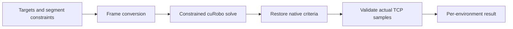

# cuRobo V2 Planner

CuroboPlanner is EmbodiChain's optional, CUDA-accelerated and collision-aware
motion-planning backend. It implements the normal MotionGenerator and
atomic-skill interfaces while cuRobo performs collision-aware inverse
kinematics and trajectory optimization. It supports Cartesian EEF_MOVE and
joint-space JOINT_MOVE requests for one configured control part at a time.

`planner_type="curobo"` selects this backend. cuRobo V2 is deliberately not an
EmbodiChain core dependency: importing EmbodiChain planners does not import
cuRobo, and constructing this planner requires a CUDA-capable NVIDIA GPU.

## Install cuRobo V2

Install cuRobo V2 separately from EmbodiChain. Select
exactly one source requirement that matches the CUDA runtime used by PyTorch:

~~~bash
python -c "import torch; print(torch.version.cuda)"
~~~

Use `cu12` for a `12.x` result and `cu13` for a `13.x` result. Do not select the
extra from the maximum CUDA version displayed by `nvidia-smi`.

~~~bash
# Recommended for the normal EmbodiChain environment, where PyTorch is present.
uv pip install "nvidia-curobo[cu12] @ git+https://github.com/NVlabs/curobo.git@v0.9.0"
uv pip install "nvidia-curobo[cu13] @ git+https://github.com/NVlabs/curobo.git@v0.9.0"

# For a fresh environment that also needs PyTorch.
uv pip install "nvidia-curobo[cu12-torch] @ git+https://github.com/NVlabs/curobo.git@v0.9.0"
uv pip install "nvidia-curobo[cu13-torch] @ git+https://github.com/NVlabs/curobo.git@v0.9.0"

python -c "import curobo; print(curobo.__version__)"
pytest --pyargs curobo.tests
~~~

These commands follow [NVIDIA's official cuRobo installation
guide](https://nvlabs.github.io/curobo/latest/getting-started/installation.html)
and pin the source dependency to cuRobo V2-Fast `v0.9.0`. The adapter requires
V2-Fast 0.9 or later. Use a Python environment supported by both EmbodiChain
and DexSim on Linux with a supported NVIDIA GPU and driver. The
non-`torch` variants are preferred for EmbodiChain because the simulation
environment normally already provides PyTorch; the `-torch` variants delegate
the PyTorch version requirement to cuRobo. Keep cuRobo in the same Python
environment that runs the simulator.

## Configure a control part

Select a registered robot with an IK solver for the desired control part.
The adapter generates the robot profile from its URDF, joint names, base link,
and TCP; see [robot model generation](#auto-generated-robot-yaml) for caching
and collision-sphere settings. `CuroboPlanOptions.control_part` selects the
part at plan time.

Lock non-controlled joints (for example gripper joints) in the cuRobo robot
profile so they are not exposed as active planner joints. The simulator values of
those joints must remain equal to the V2 profile's `lock_joints` values while a
plan is executed; the adapter intentionally preserves non-control simulator
joints in the full-DoF atomic-skill output. For example, the Panda V2 profile
locks both fingers at `0.04`, so use the same simulated finger state or include
the fingers in the planned control part. A mismatch means cuRobo validates a
different collision geometry from the one replayed in DexSim.

Assuming the scene has been registered as shown in
{doc}`../../../task_program/scene_registry`, construct the planner world from
that catalog:

~~~python
from embodichain.lab.sim.motion.motion_generator import MotionGenCfg, MotionGenerator
from embodichain.lab.sim.motion.planners import CuroboPlannerCfg, CuroboWorldCfg
from embodichain.lab.task_program.semantics import SceneCollisionWorldMode

collision_mode = registry.resolve_collision_world_mode(
    batch_size=robot.num_instances,
)

planner_cfg = CuroboPlannerCfg(
    robot_uid="my_franka",
    planner_type="curobo",
    world=CuroboWorldCfg(
        rigid_objects=registry.collision_geometry_by_id(),
        dynamic_obstacle_names=list(registry.dynamic_collision_entity_ids),
        multi_env=collision_mode is SceneCollisionWorldMode.PER_ENV,
    ),
)
motion_generator = MotionGenerator(MotionGenCfg(planner_cfg=planner_cfg))
scene_provider = registry.make_planning_scene_provider(
    motion_generator,
    batch_size=robot.num_instances,
)
~~~

cuRobo's Python logger defaults to error-only output. Set
`CuroboPlannerCfg.log_level` to `"debug"`, `"info"`, `"warning"`, or `"error"`
to change its verbosity. This setting does not affect EmbodiChain's own logs.

## Generate a motion

`MotionGenerator` forwards `start_qpos` and `control_part` to cuRobo. Native
Cartesian goals bypass generic pre-interpolation. If `MotionGenOptions.sample_count`
requests a different output count, the generator resamples in time while
preserving duration. Set `CuroboPlannerCfg.preserve_plan_samples=True` to retain
cuRobo's original collision-checked samples. When resampling changes the grid,
the generator revalidates the final joint samples against the resolved collision
scene and fails rows with invalid samples. This check does not certify the
continuous path between samples.

~~~python
import torch

from embodichain.lab.sim.motion.motion_generator import MotionGenOptions
from embodichain.lab.sim.motion.planners import CuroboPlanOptions, PlanState

goal_pose = torch.eye(4, device=robot.device).repeat(robot.num_instances, 1, 1)
goal_pose[:, :3, 3] = torch.tensor(
    [[0.55, 0.30, 0.45]], device=robot.device
)
result = motion_generator.generate(
    [PlanState.from_xpos(goal_pose)],
    MotionGenOptions(
        start_qpos=robot.get_qpos(name="arm"),
        control_part="arm",
        plan_opts=CuroboPlanOptions(),
    ),
)
assert result.success.all()
~~~

(curobo-linear-grasp-approaches)=
## Line-constrained grasp approaches

`CuroboPlanOptions.path_constraints` adds optional straight-line and
target-orientation requirements to individual Cartesian segments. The adapter
installs native cuRobo path costs, enables native path-tolerance checks, and
then verifies the returned samples using the actual TCP geometry. Defaults
remain unchanged when no path constraints are supplied.



### Configure the approach segment

Each constraint belongs to the segment arriving at the target at the same
list index. For targets `[pre_grasp, grasp, lift]`, the selection
`[None, approach, None]` constrains only `pre_grasp -> grasp`. The whole selected
segment, including its start, must satisfy the tolerances. Route to a suitable
pre-grasp pose first when the initial robot pose lies outside the approach
line or has a different orientation.

The following example assumes a registered `robot`, a scene collision-world
configuration `world_cfg`, and a target TCP transform `grasp_pose` with shape
`(B, 4, 4)` in the simulator world/arena frame:

~~~python
import math

from embodichain.lab.sim.motion.motion_generator import (
    MotionGenCfg,
    MotionGenOptions,
    MotionGenerator,
)
from embodichain.lab.sim.motion.planners import (
    CuroboLinearConstraintCfg,
    CuroboPlanOptions,
    CuroboPlannerCfg,
    PlanState,
)

generator = MotionGenerator(
    MotionGenCfg(
        planner_cfg=CuroboPlannerCfg(
            robot_uid=robot.uid,
            world=world_cfg,
            preserve_plan_samples=True,
        )
    )
)

pre_grasp = grasp_pose.clone()
pre_grasp[:, :3, 3] -= grasp_pose[:, :3, 2] * 0.15
lift = grasp_pose.clone()
lift[:, 2, 3] += 0.16

approach = CuroboLinearConstraintCfg(
    direction=(0.0, 0.0, 1.0),
    frame="goal",
    weight=1.0,
    position_tolerance=0.005,
    orientation_tolerance=math.radians(3.0),
)
result = generator.generate(
    [PlanState.from_xpos(pose) for pose in (pre_grasp, grasp_pose, lift)],
    MotionGenOptions(
        start_qpos=robot.get_qpos(name="arm"),
        control_part="arm",
        plan_opts=CuroboPlanOptions(path_constraints=[None, approach, None]),
    ),
)
~~~

This is an arm-motion planning example. Atomic Skills own the hand-closing,
settling, effect verification, and execution boundaries between grasp arrival
and lift; direct consumers must schedule those actions separately.

| Setting | Meaning | Default |
| --- | --- | --- |
| `direction` | Nonzero line direction; normalized before use. | `(0.0, 0.0, 1.0)` |
| `frame` | `goal`: target TCP axes; `base`: native planning-base axes. | `"goal"` |
| `weight` | Positive native nonterminal residual scale. | `1.0` |
| `position_tolerance` | Maximum perpendicular TCP distance, in meters. | `0.005` |
| `orientation_tolerance` | Maximum target-relative TCP rotation, in radians. | `0.05`, approximately 2.86 degrees |

The constraint list must match the target count. Constrained entries require
full-pose `EEF_MOVE` targets; joint targets and position-only or
orientation-only modalities are rejected. Directions must be finite and
nonzero, weights and tolerances must be finite and positive, and orientation
tolerance cannot exceed pi. Approach distance belongs to pre-grasp waypoint
construction, independently of this line configuration.

### Line geometry and orientation

Let the target TCP pose in the planning base be `(p_g, R_g)`, and let forward
kinematics map joint positions `q` to TCP position `p(q)` and rotation `R(q)`.
Normalize the configured direction to a unit vector `d` in the same frame.
The target line and perpendicular-position residual are

:::{math}
\mathcal{L}=\{p_g+s d\mid s\in\mathbb{R}\},\qquad
P=I-dd^{\mathsf T},\qquad
e_\perp(q)=P\bigl(p(q)-p_g\bigr).
:::

`P` removes displacement along the line and retains transverse displacement.
For a planning-base Z direction, the perpendicular distance is simply
`sqrt((x - x_g)**2 + (y - y_g)**2)`; axial displacement remains available for
approach progress. The endpoint pose goal still determines where the motion
must finish.

The acceptance condition is `norm(e_perp) <= position_tolerance`: a 5 mm
tolerance describes a tube of radius 5 mm around the line. This is an infinite
line, so reversing `direction` leaves the geometry unchanged. It does not
enforce monotonic progress, a signed approach, or confinement between the two
endpoints.

Orientation is constrained relative to the complete target rotation, including
rotation around the approach axis. With `R_e = R_g.T @ R(q)`, the adapter uses
the rotation angle

:::{math}
\theta=\operatorname{atan2}\left(
    \frac{\|R_e-R_e^{\mathsf T}\|_F}{\sqrt{8}},
    \frac{\operatorname{tr}(R_e)-1}{2}
\right)
\leq\varepsilon_R.
:::

For valid rotation matrices, this gives the relative rotation angle. The
`atan2` expression avoids the loss of small-angle resolution that can occur
when using only `acos` of the trace in float32.

### Native optimization costs and tolerance checks

The adapter calls cuRobo V2-Fast's `ToolPoseCriteria.linear_motion()` with the
configured direction and `non_terminal_scale=weight`. Intermediate position
residuals use the line projector `P`; intermediate orientation residuals retain
all rotation axes. Terminal position and orientation projectors remain full
identity matrices. Existing goal, collision, dynamic-limit, and smoothness
terms continue to participate in the solve.

For cuRobo 0.9, ignoring tolerance deadbands, these path contributions can be
written as

:::{math}
C_{\mathrm{path}}=\sum_k\left[
    \frac{c_p}{2}\|w e_{\perp,k}\|^2
    +c_R\|w r_{R,k}\|^2
\right].
:::

Here `c_p` and `c_R` are native cost weights, and `w` is this adapter's
`weight`. The native rotation residual is twice the vector part of a
normalized, shortest-arc error quaternion: `r_R = 2 * vec(q_error)`. Its norm
is `2 * sin(theta / 2)`, which approximates the rotation angle near zero.
EmbodiChain's final check uses the rotation angle itself.

The position cost propagates through the robot's position Jacobian:

:::{math}
\nabla_q C_p=c_p w^2 J_{\mathrm{xyz}}(q)^{\mathsf T}
P\bigl(p(q)-p_g\bigr).
:::

The optimizer can therefore adjust joint trajectories and redundant joint
postures while discouraging TCP displacement away from the line. This does
not turn the optimization into an exact Cartesian interpolation algorithm.

The adapter also sets `path_tolerance` and `enforce_path_tolerance=True` in the
native criteria. In cuRobo 0.9, residual scaling participates in both quadratic
costs and native reported error distances, so changing `weight` can also change
native feasibility decisions. At `weight=2`, the quadratic contribution is
approximately four times larger outside deadbands. Start with `weight=1` when
matching native checks to physical tolerances; increasing it does not guarantee
that a feasible path will be found. The final TCP checks always use unscaled
meters and radians.

See the upstream [criteria factory](https://github.com/NVlabs/curobo/blob/v0.9.0/curobo/_src/cost/tool_pose_criteria.py)
and [projected pose metrics](https://github.com/NVlabs/curobo/blob/v0.9.0/curobo/_src/cost/wp_pose_metric.py)
for the native residual definitions.

### Goal frames, planning bases, and TCP offsets

With `frame="goal"`, a direction is expressed in the **target TCP frame**.
For example, `(0, 0, 1)` follows the target TCP Z axis, which may point downward
in the simulator frame. Its planning-base expression is `d_B = R_g @ d_goal`.
With `frame="base"`, the supplied direction is already in the native planning
base. The adapter's normal simulator-world-to-base conversion still applies
to target poses; `base` does not mean the simulator world frame.

The native model's tool frame `F` may differ from the configured TCP `T` by a
fixed transform. Using `B` for the planning base, the adapter converts the
target and reconstructs the actual TCP with

:::{math}
{}^B T_{F,g}={}^B T_{T,g}\left({}^F T_T\right)^{-1},
\qquad
{}^B T_T(q)={}^B T_F(q)\,{}^F T_T.
:::

For goal-frame constraints, it also rotates the direction into the native
tool's goal axes: `d_F = R_FT @ d_T`. A translated TCP offset makes the final
reconstruction important: even a small tool-orientation change can move the
TCP sideways while the tool origin stays close to its line. The returned
trajectory is checked at the TCP, including this fixed offset.

### Returned samples, batches, and scoped state

After native planning, the adapter maps every returned joint sample back
through native FK, reconstructs the TCP, and checks finite transforms,
perpendicular position error, and rotation angle. Acceptance requires **every
sample**, including the start and endpoint, to pass the unscaled tolerances.
An optimizer success flag alone does not bypass this check.

Trajectories have shape `(B, N, D)`. FK is evaluated in device-resident chunks
of at most 1024 joint states, bounding intermediate FK storage. Validity is
reduced per environment. If a segment fails in one environment, that
environment's complete request returns `success=False` and an initial-qpos
hold, while other environments can retain their successful trajectories. A
TCP rejection adds no separate automatic repair loop.

Constrained requests require `preserve_plan_samples=True`. FK is nonlinear:
interpolating two valid joint samples can create a new TCP sample outside the
line or orientation tolerance. A consumer that resamples or deforms the path
must revalidate the resulting samples before making the same claim.

Native criteria are installed only for the selected segment and restored to
ordinary full-pose terminal costs with zero path costs in a `finally` block.
This prevents a constrained approach from affecting later lifts or subsequent
requests, including after exceptions. Each backend retains only its most
recent pair of constrained/reset criteria, keyed by direction, frame, weight,
and tolerances. Goals remain per-call inputs. Native updates copy values into
fixed-address buffers, retaining CUDA Graph compatibility.

### Compare the example and interpret the result

The comparison reuses the Franka obstacle scene from
`examples/sim/motion/planners/curobo_planner.py`. It first plans one shared
pre-grasp route, then starts both final approaches from the same reached joint
state. Targets, collision geometry, dynamic limits, and sampling resets are
held constant; only the final segment's path constraint changes.

~~~bash
python -m scripts.benchmark.motion_generation.curobo_grasp_approach --warmup 2 --repeats 5
python -m scripts.benchmark.motion_generation.curobo_grasp_approach --num-envs 2 --warmup 2 --repeats 5 --output-dir outputs/benchmarks/curobo_grasp_approach_b2
~~~

The script writes `report.md`, `measurements.json`, `comparison.png`, and
`before.npz` / `after.npz` under `outputs/benchmarks/curobo_grasp_approach` by
default. Latency is warmed, CUDA-synchronized wall time for
`MotionGenerator.generate()`, including adapter validation but excluding
independent Robot FK scoring and plotting. Memory is measured in separate
warmed calls, with Torch allocator coverage stated in the report.

One fixed single-environment case measured on an RTX 5090 with cuRobo 0.9.0,
PyTorch 2.11.0+cu130, float32, CUDA Graphs, seed 0, and five repeated solves
produced the following snapshot:

| Metric | Unconstrained approach | Constrained approach |
| --- | --- | --- |
| Maximum perpendicular TCP error | 5.82 mm | 4.59 mm |
| Maximum target-orientation error | 0.21 degrees | 0.35 degrees |
| Median planning latency | 12.46 ms | 19.26 ms |
| Attempts meeting 5 mm / 3 degree tolerances | 0 / 5 | 5 / 5 |

The transverse error fell by about 21%, while planning latency and orientation
error increased. Both orientation errors remain within the configured bound.
Optimization balances several objectives and need only satisfy the accepted
tube; it does not promise zero deviation or improvement in every metric.
These are repetitions of one fixed planning case, not a scene-population
success rate or a physical grasp-success measurement.

### Scope relative to blended grasp approaches

This implementation retains the pre-grasp waypoint and existing stage
boundaries. It does not implement the cuRobo V1
[`create_grasp_approach_metric()` time-activated cost](https://nvlabs.github.io/curobo/v0.7.6/advanced_examples/3_constrained_planning.html#grasp-approach-vector),
which can enable approach costs for a later portion of a single trajectory
optimization and blend through the pre-grasp region. There is no
`tstep_fraction` option in this adapter.

The guarantees here concern accepted returned samples. Monotonic approach,
continuous validity between samples, a transition without an intermediate
stop, and physical grasp success require additional planning or host-side
verification. Existing collision-model coverage and the self-collision
limitation below still apply.

## Devices and CUDA graphs

The physics and planner devices are independent.
`SimulationManagerCfg(sim_device="cpu")` keeps robot state, targets, and
returned trajectories on CPU,
while cuRobo still performs all model generation and planning on CUDA. By
default a CPU simulation uses PyTorch's current CUDA device; set
`CuroboPlannerCfg.cuda_device="cuda:1"` (or an integer GPU index) to select a
different planning GPU. A CPU value is rejected because cuRobo itself has no
CPU backend.

`CuroboPlannerCfg.use_cuda_graph` defaults to `True`. The planner runs in the
simulator process and reuses its CUDA context; it does not launch a persistent
`spawn` worker or copy planning tensors through multiprocessing queues. Set
`use_cuda_graph=False` when lower one-time initialization cost and lower
graph-resident memory are more important than hot planning latency.

In graph mode, planner initialization uses the same per-device
`CaptureCoordinator` as DexSim's Newton backend and synchronizes the device
before and after cuRobo warmup. EmbodiChain also forces cuRobo's PyTorch graphs
to use `cuda_graph_capture_error_mode="thread_local"` (the default).
Unlike PyTorch's strict `"global"` mode, this allows DexSim's Vulkan render
thread to continue making CUDA calls without invalidating capture on the
planner thread.

If coordinator acquisition times out before recording begins,
`cuda_graph_fallback=True` waits for the active capture to finish and builds a
non-graph backend. An exception after graph recording starts is deliberately
not downgraded: CUDA may have invalidated the process context, so the planner
raises an error and requires a simulator-process restart. The `"global"` and
`"relaxed"` modes remain available for diagnosis, but `"thread_local"` is the
supported renderer-compatible setting.

cuRobo cannot reset a captured trajectory-optimizer graph when switching
between Cartesian pose goals and joint-space goals. EmbodiChain therefore
caches those two goal types separately and initializes each lazily. Applications
that use only one move type retain one planner backend; using both incurs a
second one-time warmup and its graph-resident memory, but still no subprocess or
second CUDA context.

## Collision world

:::{warning}
cuRobo self-collision checking is temporarily disabled in this backend.
Robot-to-world collision checking remains enabled, but planned trajectories
are not currently rejected when two robot links collide with each other.
:::

The adapter automatically rebases simulator-world Cartesian goals and dynamic
obstacle poses through the live simulator control-part base, so parallel arena
offsets and a moved robot base are handled. If the simulator and cuRobo base
frames use different fixed conventions, set
`CuroboPlannerCfg.sim_base_to_curobo_base` to the transform from the simulator
base to the cuRobo base. Collision-world poses are authored in the cuRobo
base/world frame. `tool_frame_to_tcp` (read from `solver.tcp_xpos`) converts an
EmbodiChain TCP goal into the chosen cuRobo tool frame when the solver's end link
is not itself the TCP. By convention, the adapter uses
`T_curobo,X = T_curobo,sim_base @ inv(T_world,sim_base) @ T_world,X`. It obtains
the simulator base from the control part's IK solver root.

The collision world is auto-generated from live `RigidObject` **physical
collision shapes** via `RigidObject.get_collision_shapes()`. It does not use
`get_vertices()` / `get_triangles()`, which expose combined visual meshes and may
differ from the geometry used by DexSim physics. The canonical, registry-backed
form of `CuroboWorldCfg.rigid_objects` is a mapping from authoritative registry
ID to live object. The mapping key, rather than `RigidObject.uid`, becomes the
logical collision ID, cache identity, generated obstacle-name prefix, and
runtime-update key. The sequence form remains available for advanced callers
and derives IDs from each `uid` or an `obstacle_<index>` fallback.

`CuroboWorldCfg.representation="auto"` is the default. The policy preserves
boxes as cuboids, spheres and capsules as analytic primitives, and convex
collision shapes as meshes. Triangle meshes remain meshes up to
`mesh_triangle_threshold`; above that threshold they become voxel ESDF when the
estimated dense allocation fits `max_voxel_count`. Pose-dynamic meshes use twice
the threshold before voxelization, while static cached meshes favor ESDF sooner
for repeated collision queries. SDF descriptors fall back to
their canonical collision mesh because the current DexSim Python binding does
not expose reusable SDF grid data. Unsupported descriptors raise an explicit
error instead of silently falling back to visual geometry.

Forced voxel mode and per-object overrides remain available:

```python
world_cfg = CuroboWorldCfg(
    rigid_objects={
        "room_scan": room_scan,
        "precision_fixture": precision_fixture,
    },
    representation="auto",
    overrides={
        "room_scan": "voxel",
        "precision_fixture": "mesh",
    },
)
```

`voxel_size` and `voxel_padding` configure generated ESDF layers. `plane_dims`
bounds an infinite DexSim plane as a thin cuRobo cuboid. Compound and ACD bodies
produce stable names such as `fixture__shape_0`; callers still use the owning
canonical ID in `dynamic_obstacle_names` and
`CuroboPlanOptions.dynamic_obstacle_poses`, and the adapter fans each update out
through the sub-shapes' local poses.

> **DexSim binding requirement:** Correct compound/USD offsets require
> `RigidBody.get_shape_geometry()` to copy each physical shape's local pose into
> `ShapeGeometry.local_pose`. Reusing a DexSim SDF as a voxel grid additionally
> requires grid metadata/data that the current Python API does not expose. Until
> those upstream bindings are available, verify compound offsets explicitly;
> SDF descriptors use their canonical collision mesh when one is exposed and
> otherwise raise an actionable error.

Generated poses are authored in the cuRobo base/world frame, so this is exact
when the robot base sits at the simulator world origin. For obstacles that move
or live in an offset base frame, declare their canonical IDs in
`CuroboWorldCfg.dynamic_obstacle_names` and update poses at plan time through
`CuroboPlanOptions.dynamic_obstacle_poses`.

Registry-backed mappings fail fast if a selected source has no physical
collision shapes. This prevents a canonical collision ID from being silently
omitted from the generated tensor-backed scene. The advanced sequence form may
skip such an object with a warning, independently of the registry contract.

`CuroboPlanner.collision_world_info.entity_ids` reports every configured logical
source ID: each mapping key on the registry path, or each inferred name on the
advanced sequence path. It deliberately does not expose compound-expanded
physical shape names. `collision_world_info.dynamic_entity_ids` reports exactly
the configured dynamic subset. `MotionGenerator` forwards these through its
`collision_world_entity_ids` and `dynamic_collision_entity_ids` properties.
Static entries therefore participate in construction-time identity validation
even though they do not receive per-plan pose updates.

`CuroboWorldCfg` validates this planner-local registration at construction:
obstacle IDs must be unique, and every dynamic obstacle ID must match an entry
in `rigid_objects`. Use the mapping form for registry-backed worlds.

For registry-backed integration, derive geometry, dynamic IDs, and the scene
provider from the same registry, as in the configuration example. The
{doc}`../../../task_program/scene_registry` validates exact collision-ID,
dynamic-ID, and batch-mode agreement before execution.

### Shared and per-environment collision worlds

`CuroboWorldCfg.multi_env` controls collision-world batching only. Robot start
states and planning goals remain batched regardless of this setting.

Choose the setting based on obstacle poses after EmbodiChain rebases them from
the simulator world frame into each environment's robot-base frame:

| Environment layout | Recommended setting |
|---|---|
| Replicated arenas have different simulator-world offsets, but each obstacle has the same pose relative to its local robot base | `multi_env=False` (default) |
| Obstacles have different poses relative to their respective robot bases, for example due to per-environment pose randomization | `multi_env=True` |

With `multi_env=False`, all batch rows share one collision world. Raw
simulator-world poses may differ—for example, because env 1 is translated from
env 0—but the shared world remains correct when rebasing removes the arena
offset and the resulting robot-relative poses are equal. If the rebased poses
differ, the adapter rejects the update and instructs the caller to enable
`multi_env`.

With `multi_env=True`, cuRobo allocates one collision world per batch row and
EmbodiChain sends row `i` of each dynamic obstacle pose to world `i`. The
auto-generated collision cache still reads the static scene from env 0 and
clones that scene for every row; setting `multi_env=True` does not by itself
discover each environment's distinct initial object poses. Any object whose
robot-relative pose differs by environment must also:

1. Be listed in `CuroboWorldCfg.dynamic_obstacle_names`.
2. Have its current `(B, 4, 4)` simulator-world poses passed through
   `CuroboPlanOptions.dynamic_obstacle_poses` when planning.

For a registry-backed world, derive both the geometry mapping and dynamic ID
list from the same catalog:

```python
world_cfg = CuroboWorldCfg(
    rigid_objects=registry.collision_geometry_by_id(),
    dynamic_obstacle_names=list(registry.dynamic_collision_entity_ids),
    multi_env=True,
)

current_snapshot = scene_provider.snapshot(timestamp=now, env_ids=env_ids)
plan_options = CuroboPlanOptions(
    control_part="arm",
    dynamic_obstacle_poses=current_snapshot.collision_obstacle_poses(
        batch_size=robot.num_instances,
        device=robot.device,
        dtype=robot.get_qpos().dtype,
    ),
)
```

An empty world (`rigid_objects=None`) is likewise materialized once per row in
multi-env mode so its per-environment cache is allocated. Dynamic pose updates
still require the named geometry to already exist in every scene; the adapter
does not insert new geometry at runtime. Independent worlds replicate scene
data and collision caches across the batch, so retain the shared default when
the rebased layouts are identical.

For a registry-backed integration, a single-environment dynamic world may infer
the registry's shared mode. A multi-environment registry with dynamic collision
entities must explicitly choose shared or per-environment semantics, then set
`multi_env=False` or `True` to match. The registry validator rejects a mismatch
before planning.

(curobo-auto-generated-robot-yaml)=
## Auto-generated robot YAML

On the first plan, the adapter auto-derives the cuRobo robot profile from the
robot's URDF and solver, so nothing robot-specific needs to be hardcoded:

- `robot_config_path` is produced by `generate_curobo_robot_yaml`, which fits
  collision spheres to each link mesh and writes a cuRobo V2 robot YAML.
- The TCP, tool frame, and base link are read from the robot's solver
  (`robot._solvers[control_part]`): `tool_frame_name` <- `solver.end_link_name`,
  `tool_frame_to_tcp` <- `solver.tcp_xpos`, `base_link_name` <-
  `solver.root_link_name`.
- `sim_to_curobo_joint_names` is the identity mapping, since the generated YAML
  reuses the simulator's own URDF joint names.

The generated YAML is cached on disk (default `$XDG_CACHE_HOME/embodichain_curobo`
or `~/.cache/embodichain_curobo`) keyed by the URDF path, URDF content, control
part, tool frame, and fit parameters, so editing the URDF or changing the fit
settings regenerates automatically and subsequent inits reuse the cache. Sphere
fitting always uses DexSim's `SphereFitType.MORPHIT`, with at most 2 convex hulls
per robot link and 16 per voxelized obstacle shape. The default
`sphere_density=0.1` keeps the
per-link sphere count low (~80 for a Panda) so planning stays fast; raise it for
tighter collision coverage, or set `force=True` to bypass the cache.

For an Open3D overlay of the robot collision spheres and sampled world collision
representations read back from those caches, call
`planner.visualize_robot_collision_models(control_part)`. Robot sphere centers are
transformed by the simulator's live link poses. The interactive cuRobo example
calls this once after planner initialization; close the Open3D window to continue.

## Atomic Skills and supported scope

Single-arm MoveEndEffector is supported through the normal
`strategy="motion_gen"` route. MoveJoints can opt in to collision-aware
joint-space planning with `strategy="motion_gen"`; the action uses the planner
already owned by its MotionGenerator. Movement phases of PickUp, Place,
and MoveHeldObject can use the same single-arm static-world route.

Supported scope is limited as follows:

- Only one configured control part is planned per request; coordinated dual-arm
  planning and CoordinatedPickment are unsupported.
- Collision worlds use the physical shapes described above
  plus named dynamic pose updates. Arbitrary geometry insertion and removal at
  runtime are unsupported.
- The generated collision world assumes a fixed-base robot at the simulator
  origin. With a moving base, publish each relevant world obstacle as a named
  dynamic pose for every plan; automatic reprojection of static obstacles is
  unsupported.
- attached-object collision geometry, automatic attachment/detachment, and
  collision-aware carrying of a held object are unsupported.
- Non-control joints must remain at the matching cuRobo V2 `lock_joints`
  values. The adapter does not yet validate cross-model locked-joint name/value
  equivalence automatically.
- CPU execution of cuRobo itself and cuRobo V1 compatibility are unsupported.
  CPU physics is supported because tensors are transferred to CUDA only for
  planning and the resulting trajectory is copied back to the simulation
  device.

## Demo

After installing cuRobo V2 and configuring a CUDA simulation environment, run
the Panda obstacle-avoidance demo from the repository root:

~~~bash
python examples/sim/motion/planners/curobo_planner.py --headless --hold-steps 1 --step-repeat 1

# CPU physics with CUDA planning
python examples/sim/motion/planners/curobo_planner.py --headless --sim-device cpu
~~~

The demo exports the DexSim `demo_block` into the cuRobo collision world via
`CuroboWorldCfg.rigid_objects` (the robot YAML and mixed collision-world cache are
auto-generated), prints the result status and trajectory shape, then replays
the returned full-DoF trajectory. CUDA graph capture is enabled by default with the
renderer-compatible `"thread_local"` mode; pass `--no-cuda-graph` to disable it.
Headless runs
automatically record this fixed offscreen camera view to an MP4. Set an explicit
destination with `--record-save-path outputs/videos/curobo_demo.mp4`, adjust
the rate with `--record-fps`, or pass `--disable-record` to skip recording. See
[MotionGenerator](../motion_generator.md) for the common planner interface.

For a more visible approach-constraint comparison, run the 45 cm side-approach
showcase:

~~~bash
python examples/sim/motion/planners/curobo_approach_showcase.py
~~~

It plans both approaches against the same physical alignment frame, checks
native sampled collisions and independent TCP errors, and writes an overview /
overhead comparison video plus `summary.json` and joint trajectories under
`outputs/curobo_approach_showcase`. Blue shows the unconstrained path and orange
the line-constrained path; the green guide has a 5 mm radius. The fixture opening
permits both plans, so the difference demonstrates approach geometry rather
than a collision-checking failure. Playback is kinematic, at six times slow
motion. Use `--plan-only` for planning checks or `--probe` for still frames.

In this fixed case, the sampled maximum perpendicular TCP error is 71.5 mm
without the path constraint and 4.3 mm with it; both paths pass the native
sampled world-collision check. This is a geometric planning comparison, not a
physical insertion-success measurement. Rendered media are generated locally
by the example and are not included in the repository.
