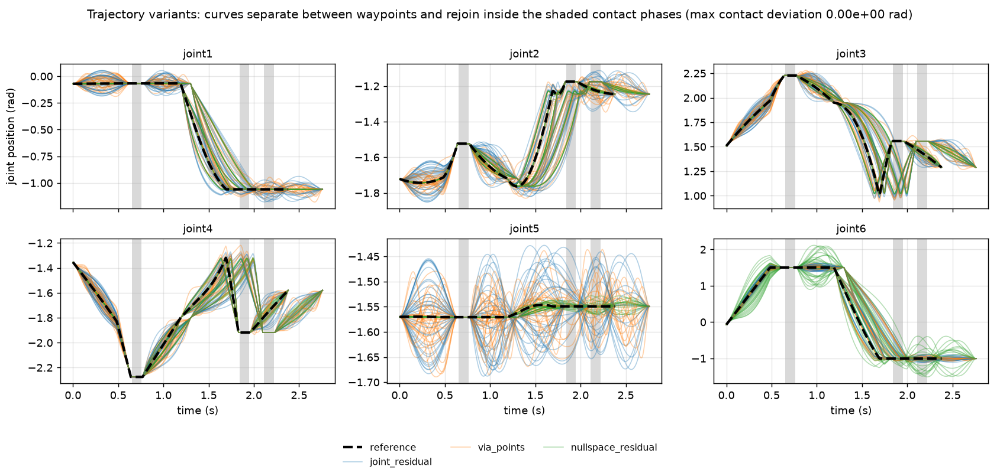
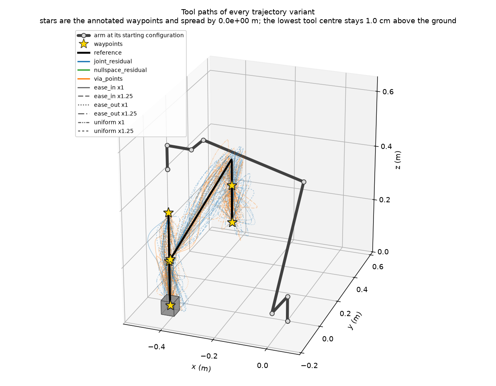

# Trajectory Variants

Trajectory variants create alternative motions for one task while keeping its
annotated waypoints. Unlike [affordance sampling](../atomic_actions/affordance_sampling.md),
which changes where contact happens, trajectory expansion varies the motion
between fixed contacts.

## Interactive laboratory

<a href="../../../trajectory-augmentation/">Open the trajectory augmentation laboratory</a>
to compare the methods on a seven-DoF Franka Panda pick-and-place example. The
self-contained page includes 3D playback, joint curves, strength and seed
selection, and light, dark, or system themes. The object and target provide
context; their poses and the scene are not sampled.

## Where the variation comes from

```{list-table}
:header-rows: 1
:widths: 30 70

* - Method
  - Effect
* - {func}`~embodichain.lab.sim.motion.expansion.joint_residual`,
    {func}`~embodichain.lab.sim.motion.expansion.via_points`
  - Reshape the joint path inside authorized free phases.
* - {func}`~embodichain.lab.sim.motion.expansion.nullspace_residual`
  - Vary redundant joint posture while preserving the declared task rows to
    first order.
* - {func}`~embodichain.lab.sim.motion.expansion.retime`
  - Change free-phase duration or speed profile while retaining the path and
    contact/hold durations.
* - Task-space deformation
  - Deform permitted tool-path samples and project them to joint positions with
    trajectory IK. This is opt-in and requires a kinematics callable.
* - {func}`~embodichain.lab.sim.motion.expansion.perturb_approach_direction`
  - Propose a new Cartesian standoff for a fixed contact. Replan it through IK;
    the qpos variant helpers reject this factor.
```

Manipulability-guided selection and phase stitching are also demonstrated in
the laboratory. Task-space and manipulability factors are explicit opt-ins.
The declared `contact`, `contact_timing`, and `recovery` factors are not yet
implemented and are rejected when enabled.

<span id="what-combines-with-what"></span>
<span id="limitations"></span>
## What is and is not guaranteed

- Joint-path operators preserve phase endpoints and do not edit `contact` or
  `hold` phases. Joint-limit violations are rejected for joints they move;
  optional velocity and acceleration limits check sampled motion.
- Only one joint-path operator runs per variant. Retiming can follow it, but
  requires phase boundaries aligned to the host control clock.
- Null-space constraints are first-order approximations. Verify interior tool
  poses with forward kinematics when the task requires them.
- Neither deduplication nor sampled limit checks prove collision freedom,
  dynamic feasibility, or task success. The host owns execution, validation,
  reset, and storage.

## Running the tutorial

Run the Place example with one variant per environment. The variant count
normally defaults to `--num_envs`, and row zero is the unmodified reference:

```bash
embodichain run-example sim/atomic_action/place --num_envs 6 --device cuda
```

Use `--trajectory_variants` to request a different number and
`--variant_plot_dir` to save joint and tool-path figures. For example, this
requests more variants than are replayed:

```bash
embodichain run-example sim/atomic_action/place \
  --headless --auto_play --num_envs 1 --device cuda \
  --trajectory_variants 12 --variant_plot_dir outputs/variants
```

Only the first `--num_envs` variants are replayed. Use
`--trajectory_variant_mode task_space` to select task-space variants, and
`--help` for the optional scale, timing, and seed overrides.

<span id="seeing-what-changed"></span>
```{dropdown} Example plots
The joint plot shows the variants rejoining at the shaded contact phases; the
tool-path plot marks the fixed waypoints with stars.




```

## Using it from code

Given an annotated `template`, a `case`, and the robot's limits:

```python
from embodichain.lab.sim.motion.expansion import expand_trajectory_variants

result = expand_trajectory_variants(
    template,
    case=case,
    count=8,
    joint_limits=robot.get_qpos_limits()[0],
    control_dt=0.02,
)
```

The result contains up to `count` candidates, starting with the unchanged
reference, plus the resolved configuration and rejection counts. Without an
explicit configuration, the helpers enable joint-space and timing factors;
null-space variants are included only when `task_jacobians` or `kinematics`
are supplied.

<span id="tuning-the-residual-scale"></span>
<span id="redundancy-and-the-jacobian-frame"></span>
## Advanced options

- Pass `cfg=` to control the policy; explicit configurations are not overridden.
  {func}`~embodichain.lab.sim.motion.expansion.default_variant_factors` provides
  a starting point. Its joint offset scale is a fraction of each declared joint
  range; keep `coverage.joint_dedup_normalized_tol` below that scale so distinct
  paths are not discarded as duplicates.
- Supply full spatial Jacobian rows and select constrained rows with
  `ik.task_rows`. The caller owns the Jacobian frame and column order; a fully
  constrained, full-rank task has no null space and is rejected.
- Supply both `velocity_limits` and `acceleration_limits` for sampled limit
  checks. `max_attempts` limits proposal draws; by default it is four times the
  requested count. `coverage.target_per_cell` limits timing variants per geometry.
- Shorter candidate rows are padded with their final position. Use
  {attr}`~embodichain.lab.sim.motion.expansion.CandidateTrajectoryBatch.valid_mask`
  before recording to exclude padding.
