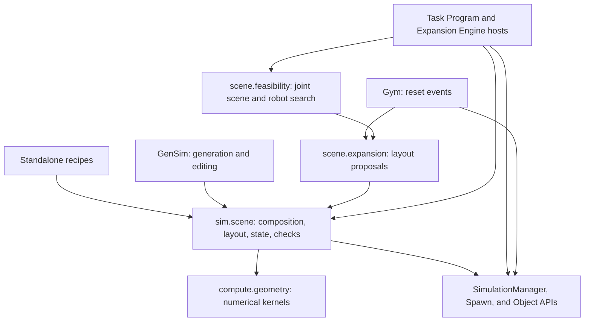

# Scene Services

`embodichain.lab.sim.scene` provides reusable scene composition, layout,
physical-state operations, and measured checks. Use it to assemble a workcell,
propose object placements, or prepare another initial state in an existing
simulation. Standalone scripts, GenSim, Gym reset events, and expansion hosts
share these services.

Start with [the usage workflows](workflows.md) for runnable examples, or
[the integration map](integrations.md) to find the production callers. Signatures
and configuration fields live in the
[scene API reference](../../../api_reference/embodichain/embodichain.lab.sim.scene.rst).

## Place in the architecture

Scene services adapt explicit configurations, geometry, and existing physical
entities. `SimulationManager` and Spawn own the world and its native resources;
`compute.geometry` owns reusable numerical operations. The following arrows
show service use, rather than an execution schedule:



Several APIs describe a scene at different levels. Choose the representation
that matches the operation:

| Representation | What it owns | Where it is used |
| --- | --- | --- |
| `SceneFragment` | Copies of rigid-object/articulation configs and named anchors | Composition before declaration; robots are configured through embodiments |
| `SceneRecipe` / `GeneratedScene` | Explicit layout inputs / one proposal and its geometric checks | Seeded configuration-based construction |
| `SceneView` | A fixed-topology selection of existing physical bindings and environment rows | Reading poses, capturing state, applying changes, and settling |
| `SceneState` | Immutable numeric physical state tied to its original owner and bindings | Restoration within the same simulation |
| `SceneVariant` | Arena-local pose proposals, identity, and provenance | Existing-entity layout generation and host preparation |
| Task Program `SceneRegistry` | Canonical semantic IDs, bindings, affordances, and planning roles | Grounding Semantic Calls and planner observations |
| GenSim scene graph | Editable generation model and support hierarchy | Image/text generation, editing, and export |

`SceneView` resolves the manager's existing UIDs. It does not infer semantic roles
or introduce another entity registry. See
[Scene Registry](../../task_program/scene_registry.md) for the semantic layer and
[Simulation Framework](../index.rst) for world preparation and lifetime.

## Capabilities and entry points

The package facade loads its exported services on first access. Specialized
services remain in their owning submodules.

| Need | Entry points | Result and responsibility |
| --- | --- | --- |
| Reuse a physical assembly | `SceneFragment`, `compose`, `declare_fragment` | Owned configs, optional UID namespace and anchor alignment; the caller declares the complete scene and invokes `sim.prepare()` |
| Generate a tabletop layout | `SceneRecipe`, `generate`, `LayoutProblem`, `solve_layout` | Fixed-orientation XY AABB proposals with explicit bounds, relations, budgets, and status |
| Detect support or move a group | `detect_support_region`, `clamp_group`, `align_group_height`, `separate_aabbs` | Support geometry or numeric placement proposals; the caller applies them |
| Inspect and restore physical state | `SceneView`, `capture_state`, `restore_state`, `compare_states` | Selected-row poses, velocities, joints, controller targets, and efforts |
| Change existing rigid poses | `SceneChangeSet`, `apply_changes`, `apply_changes_batch` | Preflighted writes, cleared dynamics, render publication, and host cache refresh requests |
| Measure preparation | `SceneCheck`, `validate_scene`, `SettlingCfg`, `settle_scene`, `check_layout` | Explicit required checks, caller-driven settling, and measured XY layout evidence |
| Vary physical parameters | `scene.physics` | Selected dynamic-body mass/inertia and friction changes derived from a captured baseline, with readback validation |
| Adapt geometry for observations or planning | `capture_scene_meshes`, `snapshot_collision_sources`; `scene.rigid_mesh`, `scene.planar_observation`, `scene.native_hand` | Owned geometry with explicit provenance and acquisition limits |
| Propose layouts from a support tree | `scene.expansion` | Prepared geometry, CPU/CUDA candidates, selected-row application, and versioned save/load |
| Check robot-related placements | `RobotSceneWorkspace`; `scene.feasibility` | Object-pose IK/FK checks, or task-conditioned joint layout/installation search through an explicit host |

Static articulation/control readers such as `scene.articulation_inputs`,
`scene.press_inputs`, and `scene.revolute_inputs` adapt authored physical roles
and geometry. Live control state still comes from Object APIs; their detailed
contracts are in the scene API reference.

## Coordinates, batches, and topology

Physical poses use local Z-up arena coordinates in metres. A matrix maps the
entity frame into its arena; a seven-component pose is
`(px, py, pz, qx, qy, qz, qw)`. Arena replication offsets are excluded.
GenSim owns conversion from its Y-up editing representation.

Layout AABBs already include scale and orientation. Mesh snapshots instead
retain scaled vertices in their owning body/link frame and require separately
observed poses for projection. Check the acquisition API before combining mesh
and pose data; applying scale twice changes the geometry.

There are three independent batching scopes:

| Scope | Current contract |
| --- | --- |
| Numerical geometry | Leading dimensions index independent layouts; `(B, N, 2, 3)` means B layouts containing N AABBs. `compute.geometry` supports CPU/CUDA tensor operations. |
| Basic physical services | `SceneView` accepts nonempty, unique `env_ids` in a caller-chosen order. Capture and restore preserve that selection. `apply_changes` broadcasts one change set; `apply_changes_batch` accepts distinct changes keyed by environment ID. |
| Host execution | The Task Program `SimulationSceneExpansionHost` prepares and restores a fixed B=1 scene for `execute_scene_variant`. This does not restrict the separate batched layout application API. |

Views support rigid objects, robots, and articulations. Worlds containing rigid
object groups, deformables, or explicit rigid constraints are rejected by this
view contract. Changing entity bindings or world capacity requires rebuilding
the view and recapturing its state. A group of separately declared rigid bodies,
as in the tabletop recipe, is distinct from a `RigidObjectGroup` asset.
Specialized native geometry and collision adapters can have narrower backend
and batch requirements; follow their owning API contracts.

CPU support detection, polygon placement, greedy packing, and SLSQP layout
solving remain CPU strategies. CUDA geometry kernels and the batched expansion
sampler have their own device contracts; they do not move these CPU strategies
or simulator execution to CUDA.

## Preparation and acceptance

A typical caller generates a proposal, declares or changes physical entities,
advances physics explicitly, and measures the resulting scene. The caller
decides which checks are required for its use case.

- `LayoutSolution.status` distinguishes `solved`, `no_solution`,
  `budget_exhausted`, and `unsupported`. Only a solved proposal can be applied;
  failure within a budget does not prove mathematical infeasibility.
- `SceneCheckReport.passed` requires a nonempty collection in which every check
  passed. Missing evidence is `unverified`.
- `settle_scene` uses a host-supplied step callback. Since stepping advances the
  whole world, its view must select every environment. Fixed-step mode reports
  unverified stability; convergence mode measures consecutive low velocities.
- `check_layout` checks actual poses. Changed orientations need measured XY
  AABBs; group proxies need measured bounds for all members. A valid XY layout
  alone does not establish vertical support, collision-free motion, or task success.
- State restoration preflights ownership, backend, topology, and joint limits.
  Physical parameters have a separate baseline API. Solver history, episode
  progress, and dataset state belong to their respective hosts.
- A pose write returns cache refresh requests even when simulation time has not
  advanced. Hosts refresh geometry, planning, and observations before consuming
  the new state. A native write failure can leave partial changes and requires
  host recovery.

The [usage workflows](workflows.md) show how these stages connect. For task
execution and recording, use the owning integration described in
[the integration map](integrations.md).

```{toctree}
:maxdepth: 1

workflows
integrations
```
