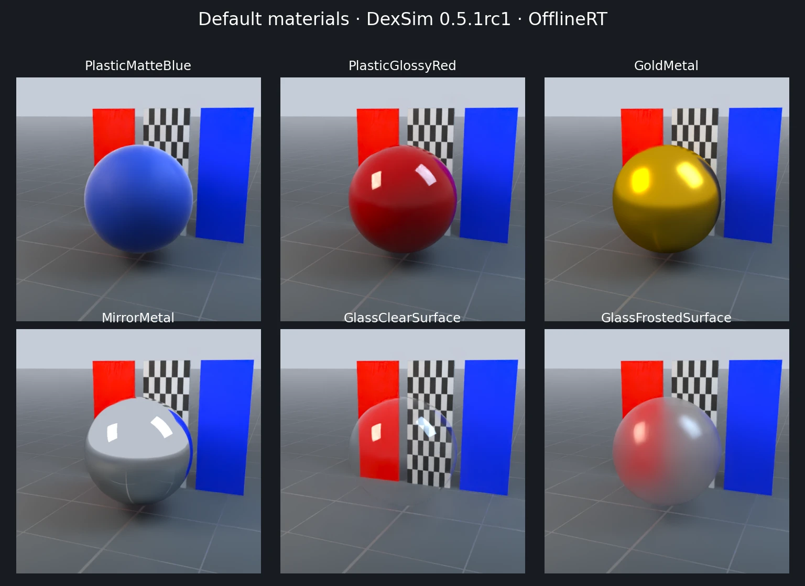
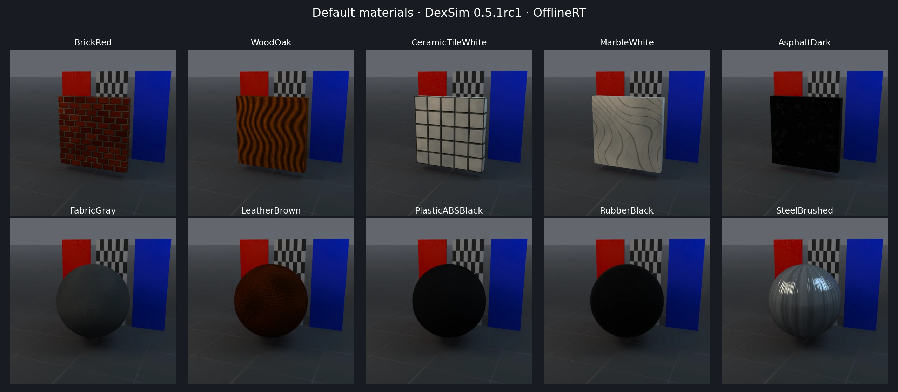
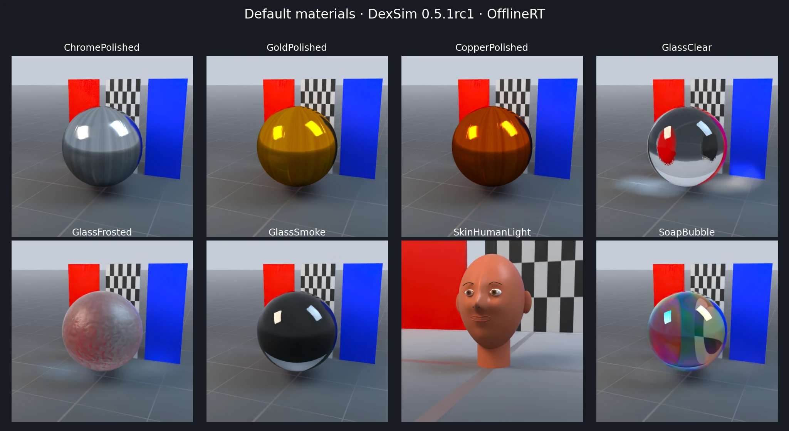

# Visual materials and default presets

EmbodiChain provides **24 public material presets** through one
`VisualMaterialCfg.from_preset()` interface: six built-in parameter presets and
18 downloadable resource presets. A separate `SoapBubbleInterior` auxiliary
material supplies the inward-facing interface for the bubble preview.

The images below are actual DexSim **0.5.1rc1 OfflineRT** renders. All presets
use the same studio lighting and exposure; a checkerboard and colored cards
make reflection, transmission and roughness visible. Click a material name in
a table to open its individual image.

## Create and override a material

Select `RenderCfg(renderer="rt")` for OfflineRT; see {doc}`configuration` for
renderer and denoising options. With an existing simulation manager `sim`:

```python
from embodichain.lab.sim import VisualMaterialCfg
from embodichain.lab.sim.shapes import SphereCfg

cfg = VisualMaterialCfg.from_preset("PlasticMatteBlue", uid="blue")
material = sim.create_visual_material(cfg)
shape = SphereCfg(radius=0.25, visual_material=cfg)

# Create another variant before binding it to geometry.
glossy_cfg = cfg.replace(uid="blue_glossy", roughness=0.08)
glossy_material = sim.create_visual_material(glossy_cfg)
```

Unspecified fields remain `None` and inherit their preset values. Explicit zero
and false values override the preset. `cfg.replace(roughness=None)` restores
inheritance. Common fields stay flat; advanced native parameters belong in
`parameters`:

```python
glass = VisualMaterialCfg.from_preset(
    "GlassClear", ior=1.6,
    parameters={"volume_attenuation_distance": 8.0},
)
```

Presets select scattering through native material parameters. Keep variants
pre-created and rebind their instances when changing appearance. The manual
`material_type` interface remains available for handwritten configurations.
See the {doc}`material API </api_reference/embodichain/embodichain.lab.sim.material>`
for UID sharing, validation, copy/replace, reset and lifecycle rules.

## Built-in parameter presets

These six definitions are included in the wheel and **do not download the
`DefaultMaterials` texture archive**. They contain no texture maps. The simulator
initialization and its common scene resources follow their usual setup.



| Preset | Base color RGBA | Metallic | Roughness | Transmission | IOR | Renderers |
| --- | --- | ---: | ---: | ---: | ---: | --- |
| [PlasticMatteBlue](../../../../_static/visual_materials/PlasticMatteBlue.webp) | `[0.05, 0.22, 0.6, 1]` | 0 | 0.65 | 0 | 1.5 | Hybrid / FastRT / OfflineRT |
| [PlasticGlossyRed](../../../../_static/visual_materials/PlasticGlossyRed.webp) | `[0.55, 0.025, 0.025, 1]` | 0 | 0.08 | 0 | 1.5 | Hybrid / FastRT / OfflineRT |
| [GoldMetal](../../../../_static/visual_materials/GoldMetal.webp) | `[0.95, 0.76, 0.32, 1]` | 1 | 0.22 | 0 | 1.5 | Hybrid / FastRT / OfflineRT |
| [MirrorMetal](../../../../_static/visual_materials/MirrorMetal.webp) | `[0.95, 0.95, 0.95, 1]` | 1 | 0 | 0 | 1.5 | Hybrid / FastRT / OfflineRT |
| [GlassClearSurface](../../../../_static/visual_materials/GlassClearSurface.webp) | `[1, 1, 1, 1]` | 0 | 0 | 1 | 1.5 | OfflineRT |
| [GlassFrostedSurface](../../../../_static/visual_materials/GlassFrostedSurface.webp) | `[1, 1, 1, 1]` | 0 | 0.28 | 1 | 1.5 | OfflineRT |

All six use `emissive=[0, 0, 0]` and `emission_intensity=1`. The two surface-glass
presets explicitly use `thin_walled=true` and configure no volume absorption.
Their supported factory backend is OfflineRT.

Choose `GlassClearSurface` or `GlassFrostedSurface` for simple surface transport.
Choose the resource `GlassClear`, `GlassFrosted` or `GlassSmoke` when a closed
object needs authored volume absorption and texture detail. These are separate
material definitions with different optical parameters.

## Resource presets

The resource collection keeps its native texture maps and material manifests.
It is downloaded lazily through `DefaultMaterials`, with a revision-specific
cache, archive/member integrity checks and the existing download lock.

### Basic texture materials



All ten support **Hybrid, FastRT and OfflineRT**. Each uses 1024×1024 color,
roughness, metallic, ambient-occlusion and OpenGL normal maps. Their legacy
directories declare no scalar material manifest, so those fields retain the
native DexSim defaults. The factory does not substitute handwritten-config
defaults. Suggested dimensions describe a texture repeat; they do not resize
geometry or change UVs.

| Preset | Appearance | Suggested texture dimensions, m |
| --- | --- | --- |
| [BrickRed](../../../../_static/visual_materials/BrickRed.webp) | Red fired brick with gray mortar | 1.2 × 0.84 |
| [WoodOak](../../../../_static/visual_materials/WoodOak.webp) | Warm oak wood grain | 0.8 × 0.8 |
| [CeramicTileWhite](../../../../_static/visual_materials/CeramicTileWhite.webp) | White glazed ceramic tiles with gray grout | 1 × 1 |
| [MarbleWhite](../../../../_static/visual_materials/MarbleWhite.webp) | Polished white marble with gray veins | 1.5 × 1.5 |
| [AsphaltDark](../../../../_static/visual_materials/AsphaltDark.webp) | Dark asphalt with fine aggregate | 2 × 2 |
| [FabricGray](../../../../_static/visual_materials/FabricGray.webp) | Fine woven gray fabric | 0.25 × 0.25 |
| [LeatherBrown](../../../../_static/visual_materials/LeatherBrown.webp) | Brown grained leather | 0.35 × 0.35 |
| [PlasticABSBlack](../../../../_static/visual_materials/PlasticABSBlack.webp) | Black ABS plastic with a subtle orange-peel finish | 0.25 × 0.25 |
| [RubberBlack](../../../../_static/visual_materials/RubberBlack.webp) | Rough black rubber | 0.25 × 0.25 |
| [SteelBrushed](../../../../_static/visual_materials/SteelBrushed.webp) | Directional brushed steel | 0.5 × 0.5 |

### Advanced resource materials



These eight presets require **OfflineRT**. Incompatible renderers fail before
asset download or native material loading. Advanced parameter variations of
basic presets also require OfflineRT.

| Preset | Appearance | Important authored parameters |
| --- | --- | --- |
| [ChromePolished](../../../../_static/visual_materials/ChromePolished.webp) | Highly reflective polished chrome | metallic 1; anisotropy 0.16 |
| [GoldPolished](../../../../_static/visual_materials/GoldPolished.webp) | Polished gold | metallic 1; anisotropy 0.10 |
| [CopperPolished](../../../../_static/visual_materials/CopperPolished.webp) | Polished copper | metallic 1; anisotropy 0.12 |
| [GlassClear](../../../../_static/visual_materials/GlassClear.webp) | Clear solid glass with weak volume absorption | IOR 1.52; transmission 1; attenuation distance 15 |
| [GlassFrosted](../../../../_static/visual_materials/GlassFrosted.webp) | Rough transmitting frosted glass | IOR 1.50; transmission 0.94; attenuation distance 2.5 |
| [GlassSmoke](../../../../_static/visual_materials/GlassSmoke.webp) | Gray-blue absorbing smoke glass | IOR 1.52; transmission 0.98; attenuation distance 0.45 |
| [SkinHumanLight](../../../../_static/visual_materials/SkinHumanLight.webp) | Light human skin with pores and approximate diffuse transmission | IOR 1.4; specular 0.48; diffuse transmission 0.16 |
| [SoapBubble](../../../../_static/visual_materials/SoapBubble.webp) | Soap film with spatially varying iridescence | IOR 1.33; film thickness 250–520 nm; iridescence factor 1 |

With texture maps, `base_color`, `metallic` and `roughness` are factors. A
`roughness` factor of 1 preserves the roughness map distribution. Gold and
copper coloration comes from their color textures.

### Full advanced parameter definitions

The following are the resource manifests' explicit native parameters. Unlisted
fields inherit native defaults. The native `emission_intensity` key corresponds
with the flat configuration field `emissive_intensity`.

```yaml
ChromePolished:
  base_color: [1.0, 1.0, 1.0, 1.0]
  metallic: 1.0
  roughness: 1.0
  specular_strength: 1.0
  anisotropy_strength: 0.16
  anisotropy_rotation: 0.0
  double_sided: false
GoldPolished:
  base_color: [1.0, 1.0, 1.0, 1.0]
  metallic: 1.0
  roughness: 1.0
  specular_strength: 1.0
  anisotropy_strength: 0.1
  anisotropy_rotation: 0.0
  double_sided: false
CopperPolished:
  base_color: [1.0, 1.0, 1.0, 1.0]
  metallic: 1.0
  roughness: 1.0
  specular_strength: 1.0
  anisotropy_strength: 0.12
  anisotropy_rotation: 0.0
  double_sided: false
GlassClear:
  base_color: [1.0, 1.0, 1.0, 1.0]
  metallic: 0.0
  roughness: 1.0
  ior: 1.52
  transmission: 1.0
  specular_strength: 1.0
  volume_thickness: 1.0
  volume_attenuation_color: [0.995, 0.998, 1.0]
  volume_attenuation_distance: 15.0
  thin_walled: false
  double_sided: false
GlassFrosted:
  base_color: [1.0, 1.0, 1.0, 1.0]
  metallic: 0.0
  roughness: 1.0
  ior: 1.5
  transmission: 0.94
  specular_strength: 1.0
  volume_thickness: 1.0
  volume_attenuation_color: [0.86, 0.94, 0.97]
  volume_attenuation_distance: 2.5
  thin_walled: false
  double_sided: false
GlassSmoke:
  base_color: [1.0, 1.0, 1.0, 1.0]
  metallic: 0.0
  roughness: 1.0
  ior: 1.52
  transmission: 0.98
  specular_strength: 1.0
  volume_thickness: 1.0
  volume_attenuation_color: [0.44, 0.53, 0.64]
  volume_attenuation_distance: 0.45
  thin_walled: false
  double_sided: false
SkinHumanLight:
  base_color: [1.0, 1.0, 1.0, 1.0]
  metallic: 0.0
  roughness: 1.0
  ior: 1.4
  specular_color: [1.0, 0.96, 0.92]
  specular_strength: 0.48
  sheen_color: [0.14, 0.035, 0.022]
  sheen_roughness: 0.58
  clearcoat: 0.1
  clearcoat_roughness: 0.3
  diffuse_transmission_color: [1.0, 0.24, 0.14]
  diffuse_transmission_strength: 0.16
  double_sided: false
SoapBubble:
  base_color: [1.0, 1.0, 1.0, 1.0]
  metallic: 0.0
  roughness: 0.075
  ior: 1.33
  transmission: 1.0
  specular_strength: 1.0
  emissive: [1.0, 1.0, 1.0]
  emission_intensity: 0.32
  volume_thickness: 1.0
  volume_attenuation_color: [0.9, 0.85, 0.84]
  volume_attenuation_distance: 3.0
  iridescence_factor: 1.0
  iridescence_ior: 1.75
  iridescence_reflection_boost: 2.6
  iridescence_min_reflection: 0.045
  iridescence_thickness: [250.0, 520.0]
  thin_walled: false
  double_sided: false
```

### Bubble and skin geometry

`SoapBubble` binds color, AO, metallic, iridescence-thickness and emissive maps.
The explicit auxiliary `SoapBubbleInterior` reuses the outer resource's color,
AO, metallic and normal maps. It has roughness 0.035, transmission 1, IOR 1.33,
zero emission and zero iridescence factor. Its attenuation color is
`[0.90, 0.85, 0.84]`, attenuation distance is 3, and volume thickness is 1.
Both interfaces use `thin_walled=false` and `double_sided=false`. The preview
creates a smaller inward-facing inner shell; the factory only creates materials.

`SkinHumanLight` approximates skin using texture detail, specular reflection,
sheen, clearcoat and diffuse transmission. It does not implement random-walk
subsurface scattering. The portrait preview uses an optional caller-provided
segmented `SkinFaceDemo` GLB; that mesh is not included in the material archive.
Without `--model`, the example renders the same skin material on a sphere.

## Query, cache and reproduce

```python
from embodichain.data import list_default_materials, get_default_material_info

names = list_default_materials()  # 24 public presets, no World or download
info = get_default_material_info("PlasticMatteBlue")
assert info["source"] == "builtin"
assert info["requires_download"] is False
print(info["parameters"])
```

`SoapBubbleInterior` is available by name but omitted from the public list.
Built-ins have no texture resolution or nominal texture size. Resource metadata
contains dimensions, compatible renderers, dependencies and the pinned resource
revision. Both sources share the same runtime/Spawn resolver and UID rules.
NoRender retains declarations without downloading or loading native materials.

```bash
# Offline catalog query.
python examples/sim/rendering/default_materials.py --list

# Only the six built-in parameter materials.
python examples/sim/rendering/default_materials.py \
  --all --source builtin --renderer rt --compare-native --size 640 --frames 6 --spp 12 --gallery

# All 24 presets; add --model /path/to/skin_face.glb for the portrait sample.
python examples/sim/rendering/default_materials.py \
  --all --renderer rt --compare-native --size 640 --frames 6 --spp 12 --gallery

# Pre-download the 18 resource presets and the bubble helper.
embodichain data download --name DefaultMaterials
```

The preview saves lossless `*_preset.png`, `*_native.png` and
`*_native_repeat.png` images plus `results.json`. Direct-native comparisons use
the original resource directory or the built-in native parameter definition,
with the same geometry, camera, exposure and lights. Material parameter readback
and center-crop image differences are checked against a native-repeat control.
The documentation images are compressed WebP exports of the preset captures.

The resource archive is currently hosted on the DexSim internal resource server.
To use a mirror, set `EMBODICHAIN_DOWNLOAD_PREFIX` before importing EmbodiChain
and provide the identical archive at
`materials/default-materials/ec9f748242c50b85/offlinert_materials.zip` beneath
your prefix. Built-in parameter definitions remain available in the wheel.
The resource revision, file digests and upstream attribution are recorded in
`embodichain/data/default_materials.json`.
