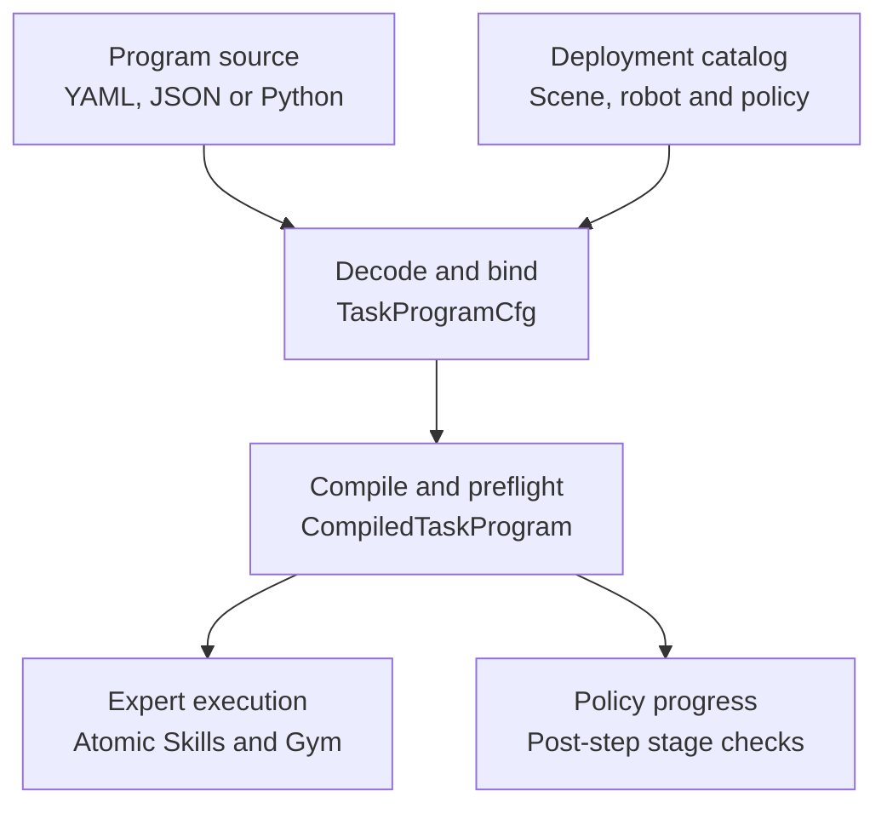
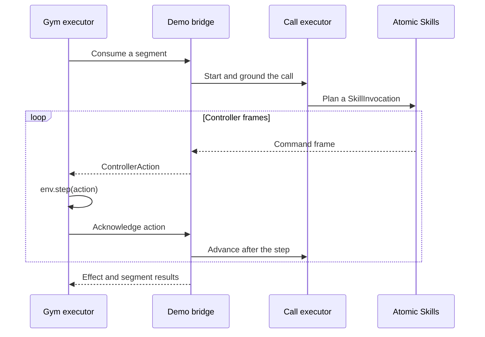

(task-program-architecture)=

# Task Program architecture

```{currentmodule} embodichain.lab.task_program
```

Task Program connects object-centric task intent to execution in a configured
scene. A program declares **which Semantic Calls to run, in what order, and
what to check**. A deployment binds those calls to a scene, robot resources,
and an execution policy. Compilation resolves static references. Execution
uses live observations to turn each call into a typed Atomic Skill invocation.



The [Franka Pick/Place walkthrough](#trace-the-franka-pick-and-place-example) follows
one configured program through those boundaries. Use [entry points](#entry-points)
to choose the interface for YAML, Python, or an MLLM response.

## Ownership boundaries

| Layer | Package | Main contract |
|---|---|---|
| Language | `embodichain.lab.task_program.language` | Normalizes YAML or JSON and decodes the bounded **program tree** into {class}`TaskProgramCfg`. |
| Semantics | `embodichain.lab.task_program.semantics` | Defines **Semantic Calls**, canonical scene entities and affordances, robot resource bindings, effects, and evidence. |
| Compiler | `embodichain.lab.task_program.compiler` | Builds {class}`CompiledTaskProgram` from scene declarations. `SemanticCallCompiler` analyzes the workflow and grounds a call into a `SkillInvocation` when given live state. |
| Integrations | `embodichain.lab.task_program.integrations` | Composes the trusted catalog from configuration and supplies factories for live observations, motions, transports, and evidence. |
| Runtime | `embodichain.lab.task_program.runtime` | Executes the compiled sequence or parallel block and advances semantic task state under the selected effect policy. |
| Atomic Skills and motion | `embodichain.lab.sim.atomic_skills` and `embodichain.lab.sim.motion` | Plan and issue controller commands from a typed goal and bound resources. The selected skill and policy determine the planning backend. |
| Gym and recording | `embodichain.lab.gym.envs.task_program`, `embodichain.lab.gym.envs`, and `embodichain.data_pipeline` | Adapt actions to `env.step()`, check episode outcomes, and persist accepted trajectories through the configured recorder. |

A **Semantic Call** such as `place` refers to a held object and a destination.
An **Atomic Skill** such as `Place` receives the grounded goal, robot resources,
and options as a `SkillInvocation`. The program can be reused when another
deployment satisfies its semantic scene and resource contracts. See
{doc}`../sim/atomic_skills/index` for the skill execution boundary.

## Entry points

| Goal | Entry point | Result |
|---|---|---|
| Run a configured expert task | `embodichain run-task --gym_config path/to/task.yaml` | Selects an environment, composes its integration, and runs the program through the Gym demo executor. |
| Run the Franka expert program with direct Sim stepping | `embodichain run-example sim/task_program/franka_pick_place` | Creates a `SimulationManager` and runs the [standalone action and acceptance loop](#standalone-simulation). |
| Load YAML or decode a mapping | `load_task_program()` or `decode_task_program()` from `embodichain.lab.task_program` | An owned `TaskProgramCfg` that can be checked against a supplied validation context. |
| Compile against static scene identities | `TaskProgramCompiler(scene_manifest).compile(program)` | A `CompiledTaskProgram` with typed references and stable occurrence indices. Use the configured catalog's `preflight()` to also check available calls, resources, and policies. |
| Compose the semantic deployment from Python | `load_configured_task_program_deployment()` from `embodichain.lab.task_program.integrations` | A `ConfiguredTaskProgramDeployment` with trusted IDs, a validated catalog, and a lazy adapter factory. Pass the resolved `skill_profile` and the deployment's `task_program` selectors, then call `load_program()` for static preflight. |
| Compile and run in an existing expert environment | `env.compile_task_program(program)` and `env.create_demo_segments(task_program=compiled)` | Uses the environment's `TaskProgramEnvironmentAdapter`. The Gym demo executor consumes the lazy segments. |
| Accept an MLLM response | `decode_mllm_task_program()` or `compile_mllm_task_program()` from `embodichain.agents.mllm` | Applies the frontend's restrictions to explicit JSON. The host supplies the scene, profile, and preset selection. |
| Execute a typed motion directly | `AtomicSkillEngine` and `ExecutionRunner` from `embodichain.lab.sim.atomic_skills` | Takes an explicit `SkillInvocation` for callers that already own grounding and task sequencing. |

For a complete Python example, see {doc}`/tutorial/task_program_python`.
`load_task_program()` takes a filesystem path. The launcher also resolves
installed package references. The MLLM frontend accepts the sequential subset
with `pick`, `place`, or `hand_over` and uses host-owned resource bindings.
See [choosing a form](authoring.md#choosing-a-form) for its JSON shape.

The {doc}`/features/generative_sim/task_engine` is an upstream authoring path.
It produces candidate semantic graphs and requirements. The deployment binds
their logical entities to a physical scene and selects a compatible embodiment
and policy for the resulting Task Program.

(semantic-layer)=

## What a program can call

| Program syntax | Semantic Call and Atomic Skill | Declaration |
|---|---|---|
| `pick` | `Pick` → `PickUp` | The object and an optional grasp affordance. |
| `place` | `Place` → `Place` | The held object and a pose, support, or container destination. |
| `hand_over` | `HandOver` → `HandOver` | The object, source and destination resource roles, and an optional final target. The profile can supply default resources. |
| `move_held_object` | `MoveHeldObjectCall` → `MoveHeldObject` | The held object and a target pose under a verified retention policy. |
| `registered` | `RegisteredSemanticCall` → the skill declared by the integration | A registered `call_id` and its arguments. For example, Open Drawer exposes `simulation.articulation_link_slide` for `Slide`. |
| `demo_skill` | Registered call with a configured nominal motion source | The deployment's named Demo Skill alias and asset-defined roles. |

The language defines the call shapes. The selected integration and policy
preset supply the concrete availability, resource defaults, and argument
contracts. To inspect them, use `--json --explain` with the
[deployment inspector](deployment.md#inspect-the-resolved-deployment).
`contracts` describes the selected catalog. `calls` lists the resolved resources
and authored path for every expanded call occurrence.

### Services used during expert execution

| What the runtime needs | Source |
|---|---|
| Semantic identity and geometry | A {class}`~embodichain.lab.task_program.semantics.SceneRegistry` maps semantic entities to physical objects and their affordances. A provider-free {class}`~embodichain.lab.task_program.semantics.SceneManifest` supplies identities for compilation. Live planning observations supply current poses, joints, and any scene geometry required by the selected skill. |
| Robot capabilities and commands | {class}`~embodichain.lab.task_program.semantics.RobotSkillProfile` binds logical resource slots to motion, grasp, or other endpoints. The integration maps those endpoints to simulation control parts. |
| Planning and tracking | Atomic Skills use the selected motion strategy, IK and planner backends, such as {doc}`../sim/motion/motion_generator` where configured. The policy also selects tracking, runner, and recovery settings. |
| Physical evidence | The integration supplies registered observation and evidence ports for effects such as grasp and release. Environment {doc}`sensors </overview/sim/sensors/index>` supply measurements, and evaluation rules interpret them for the selected checks. |
| Trajectory recording and expansion | Gym uses `env.dataset` for recording. An expansion profile can also select plan transforms for matching grounded expert calls. See {doc}`/guides/run_task` and {doc}`/guides/offline_expert_datasets`. |

## Configure a simulation environment

A runnable deployment selects the physical environment, embodiment, program,
integration, and execution policy. The Franka Quickstart uses this file.

```{literalinclude} ../../../../embodichain/extensions/tasks/configs/tasks/manipulation/repeated_pick_place/task.franka.yaml
:language: yaml
```

The environment owns physical scene entities and the physics backend. The
embodiment owns the robot, sensors, and reusable skill profile. The program owns
object-level flow, targets, and segment checks. `integration.yaml` maps
semantic scene entities to physical UIDs and declares task-specific resource
defaults, skill options, monitors, and allowlisted services. The execution policy
selects motion, tracking, recovery, and effect assurance. See
{doc}`deployment` for the configuration ownership table and {doc}`scene_registry`
for the `scene_binding` structure.

The Gym configuration loader resolves component paths relative to the runnable
YAML, selects one physical environment file, and checks each semantic root
against its physical binding. It composes the catalog and injects the trusted
scene-registry, robot-profile, and preset IDs as a {class}`TaskProgramIntegrationCfg`.
The host registers the common `EmbodiedEnv` under the deployment's Gym ID.
The launcher can select a compatible program file with `--task-program`.

## Program schema

A {class}`TaskProgramCfg` holds the program ID, the selected integration,
optional overall instruction, named targets, and one bounded program tree.
The YAML selected by a configured deployment carries the program declaration.
The deployment supplies its integration selection during loading.

{class}`SequenceCfg` orders steps, {class}`RepeatCfg` repeats a bounded body, and
{class}`SegmentCfg` gives a group of steps an instruction and observable outcome.
{class}`InvokeCfg` holds one call. {class}`ParallelCfg` contains branches and a
{class}`BarrierCfg`. Shorthand normalizes to these same nodes. The decoder
checks field names, values, references, and expansion limits. See
{doc}`authoring` for the two YAML forms and {doc}`/guides/expert_task_language`
for how root and segment instructions are recorded.

## Load and compile

1. **Normalize and decode.** Expand shorthand, bind the supplied integration,
   and validate typed call arguments, targets, and structural bounds. Diagnostics
   map back to the source YAML or JSON paths.
2. **Compile the static program.** Compilation resolves canonical references
   against the scene manifest. The compiled structure preserves parallel
   blocks and provides stable segment and call indices as its bounded repeats
   are expanded. A `cyclic_pose` selects a pose from the nearest repeat's
   iteration. A `scene_relative` target retains its reference and local pose
   until live grounding.
3. **Preflight the compiled calls against the catalog.** Confirm that the
   selected resource bindings, policies, and required lowerers or monitors
   satisfy the compiled program. The deployment inspector uses this check.

The result is a provider-free {class}`CompiledTaskProgram`. The configured
adapter checks the integration selection and registration before creating the
live runtime. Planning then uses the current environment observations.

## Runtime lifecycle

In expert mode, `EmbodiedEnv.create_demo_segments()` selects the program and
the adapter creates a `TaskProgramDemoBridge`. The bridge yields `DemoSegment`
objects with lazy controller actions. The normal Gym demo executor consumes
those actions and owns stepping, recording, and reset.



The bridge checks segment prerequisites and captures any required entry
measurements before dispatch. For each call, `SemanticCallExecutor` reads a
fresh planning observation and asks `SemanticCallCompiler` to ground its goal,
resources, and effect contract. This binds scene-relative targets to that
observation. `AtomicSkillEngine` plans the invocation and `ExecutionRunner`
advances its command and feedback lifecycle. The bridge encodes command frames
for Gym, then advances its clock after the action is consumed. Configured
recovery handles failed attempts using the same execution lifecycle.

### Standalone simulation

With a CUDA installation, run the packaged Franka Pick/Place Task Program in
headless Default physics.

```bash
embodichain run-example sim/task_program/franka_pick_place
```

The example resolves the existing `task.franka.yaml` components, creates a
`SimulationManager`, spawns the configured Franka and cube, and calls
`sim.prepare()`. It binds the configured adapter to the simulation, robot,
and control interval. The adapter compiles the program and creates the bridge.
The example owns the command loop and calls `sim.update()` directly.

```{literalinclude} ../../../../examples/sim/task_program/franka_pick_place.py
:language: python
:pyobject: _run_program
```

Each yielded action sets the robot's joint position targets. The example then
advances `sim_steps_per_control` physics intervals. Resuming the action iterator
after those intervals acknowledges the action and advances the bridge clock
once. The example exhausts each segment's actions, including any post-policies,
and calls its validator before requesting the next segment. It prints the
per-segment masks and returns a nonzero exit status if the program's final
`completion_mask` rejects the run.

The packaged program uses projected effects. To also measure the cube's
resting position after each Place, download the existing
{download}`two_moves_checked.yaml <examples/two_moves_checked.yaml>` and select
it from the working directory.

```bash
embodichain run-example sim/task_program/franka_pick_place --program two_moves_checked.yaml
```

This variant waits for settling and checks the measured cube position against
`rest_pose` for both Place segments. See the {doc}`quickstart` for the target
definitions and acceptance tolerance.

### Policy progress

With `task_program.execution: policy`, `ActionManager` translates the policy's
actions into control commands. After each environment step, `TaskProgramProgress`
updates ordered stage achievements using the configured measured conditions.
`program_stage_reward` and `program_stage_condition` read those results for
reward and termination. The mode uses the compiled program as the stage
structure and keeps control with the policy. See
[expert execution and policy progress](deployment.md#choose-expert-execution-or-policy-progress)
for the configuration and limits.

## Effect assurance is mandatory

The execution policy explicitly chooses `effect_assurance`. With `verified`,
measured evidence authorizes semantic effects. Curated Pick, Place, and
HandOver calls require corresponding monitor declarations. With `projected`,
command completion applies the expected symbolic effect and the integration
supplies an empty effect-monitor mapping.

| Boundary | What to check |
|---|---|
| Per-call effect | The runtime reports the projected or verified transition for the call. In a verified task, evidence can establish attachment during Pick or release during Place. |
| Segment post-policy | The bridge performs configured follow-up behavior, such as holding the robot while it waits for an object to settle. |
| Segment acceptance | Validators and any segment contract outcomes determine which environment rows are accepted. `metadata.post_policies` and `metadata.validation` show the respective results. |
| Episode and dataset | The environment combines program completion with its configured final and process requirements. The recorder commits eligible data and metadata as a separate step. |

Follow the [run verification guide](deployment.md#verify-the-run) to inspect
these results at their respective boundaries.

## Parallel programs

Each parallel branch is a sequential lane. Parallel execution requires disjoint
robot resource claims and runtime targets, control-grid alignment,
conflict-free symbolic writes, a `ParallelCommandSafetyValidator`, and an
explicit fail-fast barrier. The executor coordinates the lanes on one clock and
checks the combined commands before dispatch. The selected integration supplies
the safety validator.

## Registered calls

Registered calls select an integration-owned lowerer by name. Open Drawer
uses this declaration to map a semantic articulation handle to the `Slide`
Atomic Skill.

```{literalinclude} ../../../../embodichain/extensions/tasks/configs/tasks/manipulation/open_drawer/task_program/program.yaml
:language: yaml
:start-at:     registered:
```

The registration declares the call ID, revision, target skill descriptor, and
argument rules. Preflight checks those declarations. Live assembly creates a
fresh lowerer that binds the invocation using the registered runtime services.
Named Demo Skills reuse the same mechanism with an occurrence-bound nominal
source. See [Named Demo Skills](authoring.md#named-demo-skills).

## Reference tasks

### Trace the Franka Pick and Place example

1. `task.franka.yaml` selects `task_program/program.yaml`, the scene registry
   `task_program_repeated_pick_place`, the `franka_panda` skill profile, and the
   `trajectory` preset. The integration's semantic `cube` binds to the
   physical `cube` UID and declares the `cube_grasp` affordance.
2. The `repeat` body schedules `pick_cube` and `place_cube` three times. The
   three Place occurrences select `drop_pose` values in order A → B → A.
3. The Pick and Place resource defaults select `primary_manipulator`. Franka's
   profile binds its motion endpoint to `arm` and the grasp endpoint to `eef`.
   Atomic Skills use the preset's `ik_interp` strategy to generate commands,
   and the normal Gym executor advances the environment.
4. The preset projects the expected held and released states after the calls
   complete. The checked Quickstart adds `wait_stable` and a validator against
   `rest_pose` to measure where the cube settles. The recorded episode carries
   those results alongside the trajectory.

```{literalinclude} ../../../../embodichain/extensions/tasks/configs/tasks/manipulation/repeated_pick_place/task_program/program.yaml
:language: yaml
:start-at: program:
```

| Environment | What it illustrates |
|---|---|
| `TaskProgramRepeatedPickPlace-Franka-v1` | Bounded repeat, cyclic targets, and the projected expert flow above. |
| `TaskProgramRepeatedPickPlace-v1` | UR5 expert deployment with a separate expansion declaration. |
| `TaskProgramOpenDrawer-v1` | A registered call lowered to `Slide`. |
| `HandOver-v1` | Coordinated `HandOver` with verified effects, settling, and final-target validation. |
| `PourWater-v1` | Registered held-object transport and `Pour` calls in a longer sequence. |
| `StackBlocksTwoPolicy-v1` | Ordered measured lift and stacking conditions evaluated during policy execution. |

The repeated Pick/Place and Open Drawer deployment files select either Default
or Newton physical environments using the same Gym ID. See
[select a task and environment](deployment.md#select-a-task-and-environment).

## Recommended change sites

| Change | Owning source |
|---|---|
| AST values, shorthand, or strict decoding | `embodichain/lab/task_program/language/` |
| Bounded program structure and static scene resolution | `embodichain/lab/task_program/compiler/program.py` |
| Semantic analysis, grounding, and `SkillInvocation` construction | `embodichain/lab/task_program/compiler/lowering.py` |
| Catalog declarations, component composition, and live service factories | `embodichain/lab/task_program/integrations/` |
| Call execution, effect transitions, recovery, and scheduling | `embodichain/lab/task_program/runtime/` |
| Gym adapter and segment lifecycle | `embodichain/lab/gym/envs/task_program/bridge.py` and `embodichain/lab/gym/envs/demo.py` |
| Atomic planning and controller scheduling | `embodichain/lab/sim/atomic_skills/` |

## Focused validation

Use the [deployment inspector](deployment.md#inspect-the-resolved-deployment)
for changes to configured tasks. For implementation changes, choose the tests
covering the affected boundary.

```bash
pytest -q tests/lab/task_program
pytest -q tests/gym/envs/task_program
pytest -q tests/sim/atomic_skills
python docs/scripts/check_api_docs.py
```

Physical qualification requires runs on the intended environment, with
controlled seeds, measured checks, and persisted acceptance metadata.

## Further reading

- See {doc}`authoring` for the language forms, target types, and segment contracts.
- See {doc}`scene_registry` and {doc}`robot_profiles` for physical scene and robot bindings.
- Use {doc}`quickstart` to run and record the Franka example.
- Use {doc}`/tutorial/task_program` to build a compatible deployment.
