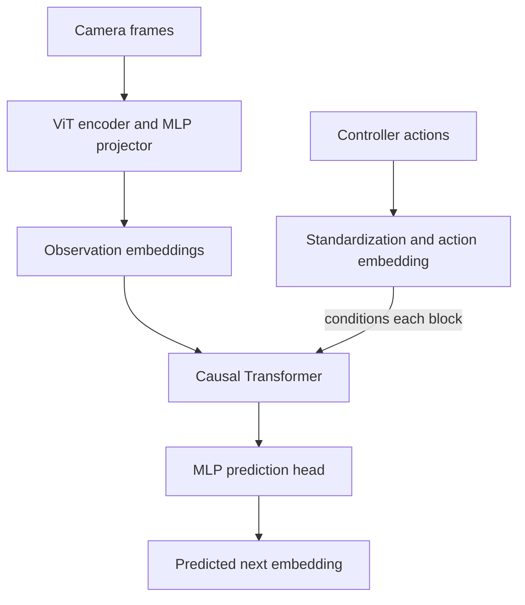

# LeWM: Action-Conditioned Visual World Model

**LeWorldModel (LeWM)** is a Joint-Embedding Predictive Architecture (JEPA)
that learns how actions change a scene from RGB trajectories. It predicts the
embedding of a future camera frame. A planner can use those predictions to
choose actions that bring the scene closer to a goal image.

## Architecture

The encoder maps each camera frame to a single vector. The predictor uses
recent vectors and the intervening actions to estimate where the next frame
will land in that same space. The observed and predicted vectors can
therefore be compared directly during training and planning. [LeWM project](https://le-wm.github.io/) · [Authors' training diagram](https://arxiv.org/html/2603.19312v1#S0.F1)



- **Image encoder.** `preprocess_rgb` resizes RGB frames and applies ImageNet
  normalization. The default 12-layer ViT-Tiny takes 224 × 224 images with
  14 × 14 patches. An MLP with batch normalization projects the final `[CLS]`
  token to a single 192-dimensional embedding per frame.
- **Action encoder.** Each model step takes the raw controls issued between
  successive frames. A step can pack several consecutive controls into one
  vector. LeWM standardizes that vector using saved action means and standard
  deviations, then embeds it with a 1D convolution and an MLP.
- **Dynamics predictor.** A six-layer Transformer uses learned temporal
  positions and causal attention over recent observation embeddings. The
  action embeddings condition its blocks through adaptive layer normalization
  (AdaLN-Zero). An MLP maps the output to the image embedding space.

### Training and planning

The original training objective jointly optimizes the encoder and predictor on
offline image and action sequences. The prediction term measures mean squared
error between the predicted embedding and the actual next frame's embedding
from the same encoder. The Sketched Isotropic Gaussian Regularizer (SIGReg)
uses random one-dimensional projections to push the embeddings toward a
standard Gaussian, which penalizes collapse to a constant representation.

```{math}
\mathcal{L} = \mathrm{MSE}(\hat{z}_{t+1}, z_{t+1})
              + \lambda\,\mathrm{SIGReg}(Z).
```

Here `Z` contains the encoded observations in the training batch and `λ`
weights the regularizer.

The shared supervised-learning recipe in EmbodiChain reads HDF5 episodes
containing `T + 1` RGB frames and `T` outgoing actions. It samples aligned
windows within each episode and exports weights with the model configuration
and action statistics.

At inference, the planner encodes the live observation and the goal image with
the same encoder. It feeds predicted embeddings back into the predictor to
roll out candidate action sequences. The cross-entropy method (CEM) scores
each sequence by the squared distance from its final embedding to the goal
embedding and refits its sampling distribution to the lowest-cost candidates.
Executing planned controls and replanning from fresh camera frames gives
closed-loop model predictive control.

## Inputs and outputs

Images arrive as channels-last uint8 RGB or RGBA. `preprocess_rgb` converts
them to normalized, channels-first RGB. For a batch of `B` histories, `H` is
the number of observed frames, `D` the latent width and `A` the number of
raw control values in one model-action block.

| Operation | Inputs | Outputs |
| --- | --- | --- |
| `LeWM.encode` | Images `[B, H, 3, height, width]` | Observed latents `[B, H, D]` |
| `LeWM.rollout` | Observed latents, executed actions `[B, H-1, A]` and `S` candidate sequences `[B, S, T, A]` | Future latents `[B, S, T, D]` for `T` model steps |
| `LeWMCEMPlanner.plan_sequence` | Observed latents, executed actions and a goal-image latent `[B, D]` | Raw action blocks `[B, horizon, A]` and a terminal goal cost `[B]` |

The caller unpacks each selected block into consecutive controller actions.
The [LeWM API](../../../api_reference/lewm.rst) documents the model and planner.

## Examples

Reproduce image-goal planning with the [OGBench Cube example](https://github.com/DexForce/EmbodiChain/tree/main/examples/learning/lewm/cube).

The Cube example uses DexUni CPU rigid-body physics and the EmbodiChain
camera. The paired training workflow starts from the published OGBench Cube
weights. It adapts the visual encoder and projector to native camera images
using targets computed by the published encoder from matching upstream frames.
The predictor stays frozen, and action normalization uses statistics from the
official dataset.

Before running the commands, set up Python, CUDA and the example dependencies
from the [Cube runtime guide](https://github.com/DexForce/EmbodiChain/blob/main/examples/learning/lewm/cube/DEPLOYMENT.md).

```{include} ../../../../../examples/learning/lewm/cube/README.md
:start-after: <!-- cube-reproduction-start -->
:end-before: <!-- cube-reproduction-end -->
```

To train both the visual encoder and dynamics predictor on native RGB,
follow the example's [expert-trajectory fine-tuning instructions](https://github.com/DexForce/EmbodiChain/tree/main/examples/learning/lewm/cube#fine-tune-on-native-expert-trajectories).

## References

Lucas Maes, Quentin Le Lidec, Damien Scieur, Yann LeCun, and Randall
Balestriero (2026). *LeWorldModel: Stable End-to-End Joint-Embedding Predictive
Architecture from Pixels*. [arXiv:2603.19312](https://arxiv.org/abs/2603.19312)

```bibtex
@misc{leworldmodel2026,
  author = {Maes, Lucas and Le Lidec, Quentin and Scieur, Damien and
            LeCun, Yann and Balestriero, Randall},
  title = {{LeWorldModel}: Stable End-to-End Joint-Embedding Predictive Architecture from Pixels},
  year = {2026},
  eprint = {2603.19312},
  archivePrefix = {arXiv},
  primaryClass = {cs.LG},
  url = {https://arxiv.org/abs/2603.19312}
}
```
