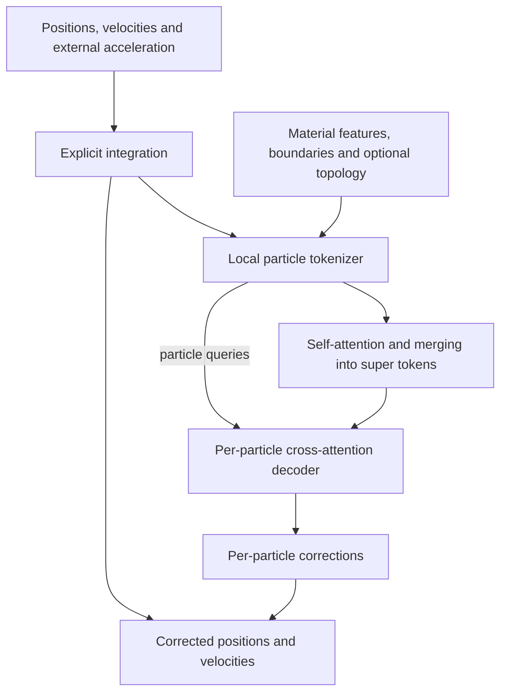

# WorldParticle: Lagrangian Particle Dynamics

WorldParticle tracks material as moving particles. The authors train the same
architecture on different materials using their particle features, boundary
samples and connectivity. EmbodiChain runs four frozen checkpoints for Fancy
Fluid, Cloth on Ball, Duck forward deformation and Deep Fluid.

## Architecture

The original model advances particles under known external acceleration,
then learns a correction for interactions. Local convolutions encode nearby
particles, boundaries and, where available, neighbors connected in the
material. The encoder alternates attention with token merging. Each particle
then queries the smaller set of super tokens to recover its own correction.
[WorldParticle project and architecture diagram](https://worldparticle.github.io/WorldParticle_Web/#method)



The diagram shows the position-and-velocity head. A position-only checkpoint
predicts displacement from the current state and recovers velocity
by dividing that displacement by the timestep.

## Inputs and outputs

Load the matching local `checkpoint`, `config` and `inputs` once with
`load_model(options, device="cuda:0")`. Then call
`next_q, next_qd = model(q, qd, acceleration, dt)` for each step.

| Quantity | Shape | Meaning |
| --- | --- | --- |
| Fixed inputs | `[N, C]` features and two `[M, 3]` boundary arrays | Material features for `N` particles, positions and features for `M` boundary samples, plus CSR connectivity for topology-enabled checkpoints |
| `q`, `qd` | Each `[N, 3]` | Current world-space positions in metres and velocities in metres/second |
| `acceleration`, `dt` | `[N, 3]` and a scalar | Total world acceleration in metres/second², including gravity, and the checkpoint timestep in seconds |
| `next_q`, `next_qd` | Each `[N, 3]` | Predicted positions and velocities in the same world frame and particle order, ready for the next step |

The caller supplies FP32 CUDA tensors in the authored particle order. The
frozen network uses BF16 internally. The native solver converts force to
acceleration as force divided by mass plus gravity. With an optional proper
rotation `R = model_to_world`, row vectors obey `q_world = q_model @ R.T`.
Boundary samples stay in model coordinates and native gravity is
`R @ config_gravity`. The Provider checks the particle count. The caller
preserves particle identity and order. [Full input and coordinate contract](https://github.com/DexForce/EmbodiChain/blob/main/examples/learning/worldparticle/INPUTS.md)

## Examples

Prepare assets, run standalone tensor inference, or launch any of the four
native scenes with the [WorldParticle examples](https://github.com/DexForce/EmbodiChain/tree/main/examples/learning/worldparticle).

### Runtime requirements

The checked profile is Linux x86_64 / Python 3.12, Torch 2.11.0+cu128,
CXX11 ABI, SDK 0.6.0rc2 and SM120. Open3D `0.19.0+1e7b1743` and FlashAttention
2.8.3 need the corresponding Torch/CUDA build. Historical Torch 2.7 wheels do
not replace main's Torch 2.11 operators. Compatible wheels remain local build
artifacts, without a published `worldparticle` installation extra.

Check the [runtime requirements](https://github.com/DexForce/EmbodiChain/tree/main/examples/learning/worldparticle#runtime-requirements)
before loading assets or creating a World. Provision compatible operators
separately; their build/patch tooling is outside this model integration.

### Prepare and run

In the checked environment, from the repository root:

```bash
python -m embodichain run-example learning/worldparticle prepare
python -m embodichain run-example learning/worldparticle demo --scene fancy_fluid --headless --once --hold-seconds 0
python -m embodichain run-example learning/worldparticle demo --scene cloth_on_ball --headless --once --hold-seconds 0
python -m embodichain run-example learning/worldparticle demo --scene inverse_design --headless --once --hold-seconds 0
python -m embodichain run-example learning/worldparticle demo --scene deep_fluid --headless --once --hold-seconds 0
```

Assets default to `outputs/worldparticle/assets`. Preparation needs the existing
internal resource service when files are absent and verifies all 19 hashes/sizes.
Use `--assets DIR` for another prepared location; `prepare --local-files-only`
forbids downloads. Predicted NPZ state and JSON reports stay outside Git/the wheel.

The [native solver quickstart](https://github.com/DexForce/EmbodiChain/blob/main/examples/learning/worldparticle/DEPLOYMENT.md)
shows a complete Fancy Fluid World/Scene/Provider with step/readback/reset/close
and the registered-name alternative. The demos use direct SDK SceneBuilder;
the manager's `add_fluid_object` retains its DexUni/SPH semantics. Cloth keeps
its authored surface; other demos use an unconnected-particle carrier.

### Native integration

The frozen model also runs independently of Newton and DexSim. Native
deployment calls it through the particle Provider.

| Component | Responsibility |
| --- | --- |
| `embodichain.extensions.models.dynamics.worldparticle` | Frozen network, checkpoint loading, features, topology and coordinate conversion |
| `embodichain.extensions.solvers.physics.worldparticle.provider` | Scene admission and the `worldparticle` Provider |
| SDK `ParticleInferenceSolver` | Streams, native buffers, force-to-acceleration conversion, writes, reset and close |
| `examples/learning/worldparticle` | Resource preparation, scene construction and runnable demos |

### Execution evidence and limits

At implementation commit `b0875186c` on 2026-11-15, default headless runs
completed 199 / 80 / 15 / 199 steps for Fancy Fluid / Cloth / Duck / Deep Fluid,
with finite state and normal exit. Each scene also produced two 1920×1080 RGB
offscreen captures in a separate two-step run.

The [verification summary](https://github.com/DexForce/EmbodiChain/tree/main/examples/learning/worldparticle#verification)
gives commands and measured scope. Desktop window interaction
and new full-length video encoding were not qualified in this run. Finite
rollout/captures do not establish accuracy, historical equivalence, native/model
numerical parity or bitwise reproducibility. CUDA reductions/hash-neighbor
construction in the unchanged source have no established determinism guarantee.

One CUDA particle world with static model boundaries and forward inference/reset
is supported. Dynamic rigid coupling, native contact-force reports and CUDA
Graph capture remain outside the scope. Duck's `inverse_design` name means a
forward-deformation demo here; Deep Fluid uses generated initial conditions
without an official reference trajectory.

See the {doc}`model API </api_reference/model_catalogs>` for public imports.

## References

Caoliwen Wang et al. (2026). *WorldParticle: Unified World Simulation of
Lagrangian Particle Dynamics via Transformer*. [arXiv:2605.15305](https://arxiv.org/abs/2605.15305)

```bibtex
@misc{wang2026worldparticle,
  author = {Wang, Caoliwen and Guo, Minghao and Chen, Siyuan and Zhang, Heng and
            Wang, Mengdi and Ni, Xingyu and Sun, Hanson and Wang, Kunyi and
            Pan, Zherong and Wu, Kui and Liu, Lingjie and Yang, Yin and
            Jiang, Chenfanfu and Komura, Taku and Matusik, Wojciech and Chen, Peter Yichen},
  title = {{WorldParticle}: Unified World Simulation of Lagrangian Particle Dynamics via Transformer},
  year = {2026},
  eprint = {2605.15305},
  archivePrefix = {arXiv},
  primaryClass = {cs.GR},
  url = {https://arxiv.org/abs/2605.15305}
}
```

The upstream revision, source-file hashes and retained licenses, including the
ToMe notice, are recorded in the [source provenance](https://github.com/DexForce/EmbodiChain/blob/main/embodichain/extensions/models/dynamics/worldparticle/PROVENANCE.json).
