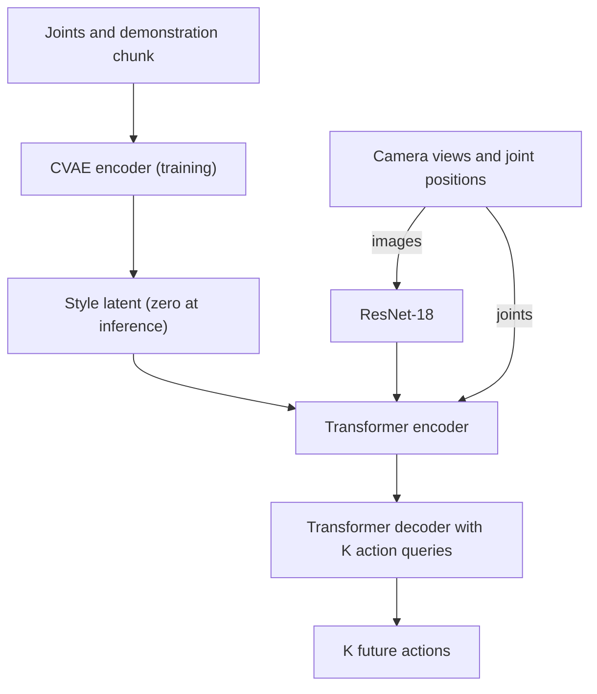

# ACT: Action Chunking with Transformers

ACT predicts a sequence of future actions from the current observation. The
original ALOHA policy used multiple camera views and both arms' joint
positions to imitate bimanual demonstrations. EmbodiChain uses LeRobot ACT
with one camera and a Franka arm for visual PushCube. [ALOHA project](https://tonyzhaozh.github.io/aloha/)

## Architecture

ACT trains a conditional variational autoencoder (CVAE). During training,
an encoder infers a style latent from the demonstrated action chunk and
current joint positions. A ResNet extracts spatial features from each view.
A Transformer fuses those features with the joints and latent, then decodes
one learned query per future step. [Authors' architecture diagram](https://tonyzhaozh.github.io/aloha/resources/algo.png)



The PushCube recipe uses ResNet-18 and trains with an L1 loss on valid action
targets plus a KL penalty that draws the latent distribution toward a standard
Gaussian. At inference the policy uses the prior mean (zero). It predicts a
fresh chunk at each control step and averages predictions from overlapping
chunks for the **same** instant to choose the command.

## Inputs and outputs

| Stage in the PushCube example | Shape | Meaning |
| --- | --- | --- |
| Camera input | `[1, 3, 224, 224]` | Current uint8 RGB frame |
| State input | `[1, 9]` | Measured positions of seven arm joints and two finger joints |
| Model prediction | `[1, 30, 8]` | A 30-step chunk in the learned action space |
| `select_action(rgb, state)` output | `[1, 8]` | Seven absolute arm joint targets and one normalized parallel-gripper command for the current step |

### Using a trained policy

Use the Python 3.12 environment with LeRobot 0.6.1 and the native camera
renderer. Load the exported `pretrained_model` directory together with its
`embodichain_act.json` manifest through `load_act_policy`. The adapter applies
the saved processors and returns physical commands. Call `reset()` after
every environment reset to clear the ensemble's action history.

## Examples

Collect successful demonstrations, train the policy and evaluate a checkpoint
on held-out PushCube scenes using the [visual PushCube example](https://github.com/DexForce/EmbodiChain/tree/main/examples/learning/act).
For the loader and training configuration, see the [ACT API](../../../api_reference/visual_act.rst).

## References

Tony Z. Zhao, Vikash Kumar, Sergey Levine, and Chelsea Finn (2023).
*Learning Fine-Grained Bimanual Manipulation with Low-Cost Hardware*.
Robotics: Science and Systems XIX. [Proceedings and paper](https://www.roboticsproceedings.org/rss19/p016.html)

```bibtex
@inproceedings{Zhao-RSS-23,
  author = {Zhao, Tony Z. and Kumar, Vikash and Levine, Sergey and Finn, Chelsea},
  title = {Learning Fine-Grained Bimanual Manipulation with Low-Cost Hardware},
  booktitle = {Robotics: Science and Systems XIX},
  year = {2023},
  doi = {10.15607/RSS.2023.XIX.016}
}
```
