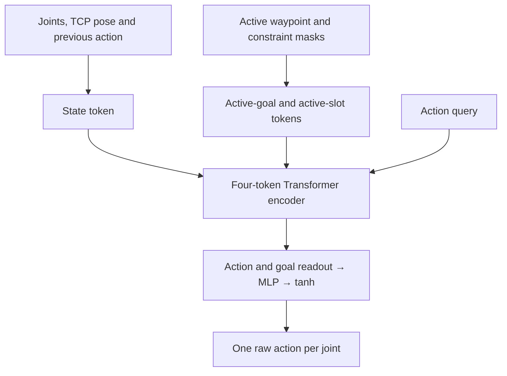

# NMG: Neural Motion Generator

NMG learns one closed-loop policy per robot to reach an ordered sequence of
goals. A goal can specify a joint configuration, a tool position, a tool
orientation, or a full tool pose.
During training, forward kinematics maps sampled joint configurations to
reachable goals. Differentiating the tracking cost through a rollout lets the
policy learn from these goals without demonstration trajectories. [NMG project](https://gs-world.github.io/nmg/)

## Architecture

The actor uses four Transformer tokens. The state token encodes the joints,
tool center point (TCP) pose and previous action. Two tokens describe the
active goal and its slot in the sequence. The fourth is an action query.
An MLP reads the action-query and goal features and emits one bounded value
per joint. [Original policy and training diagrams](https://gs-world.github.io/nmg/#method)



`NeuralPlanner` scales the raw action into a joint increment and applies the
joint limits. It recomputes the TCP pose and advances the active slot once
its constraints are satisfied. Repeating this step produces a joint path that
the planner can retime under velocity and acceleration limits.

## Inputs and outputs

The actor takes one packed FP32 observation per arm in a batch of size `B`.
Its output is a single policy step. Choose the weights matching the arm,
joint order and TCP used to assemble the observation.

### Supported configurations and weights

| Supported configuration | Policy TCP | FP32 observation → raw action | ONNX inference | Native PyTorch |
| --- | --- | --- | --- | --- |
| Franka FR3 (7 DoF) with Robotiq 2F-140 | 0.20 m flange offset with gripper rotation | `[B, 417] → [B, 7]` | [`v1/franka.onnx`](https://huggingface.co/DexForceAI/neural_motion_generator/resolve/47b67542bb20dc612acb78a6ac329b3b4fdd088f/v1/franka.onnx) | [`v1/franka.pt2`](https://huggingface.co/DexForceAI/neural_motion_generator/resolve/47b67542bb20dc612acb78a6ac329b3b4fdd088f/v1/franka.pt2) |
| PiPER V100 (6 DoF) with parallel gripper | 0.143 m `link6` offset with gripper rotation | `[B, 391] → [B, 6]` | [`v1/piper.onnx`](https://huggingface.co/DexForceAI/neural_motion_generator/resolve/47b67542bb20dc612acb78a6ac329b3b4fdd088f/v1/piper.onnx) | [`v1/piper.pt2`](https://huggingface.co/DexForceAI/neural_motion_generator/resolve/47b67542bb20dc612acb78a6ac329b3b4fdd088f/v1/piper.pt2) |

Both model formats are pinned to the same release. The simulation examples
download the ONNX file and verify its SHA256.
Use `--download-only` to print its verified local path, `--offline` to
use the cache, or `--model-path` to supply a local copy.

```bash
embodichain run-example sim/motion/planners/nmg/franka --download-only
embodichain run-example sim/motion/planners/nmg/piper --download-only
```

### Prepare the observation

Both exports have 12 waypoint slots. The observation packs current joint
positions and TCP pose, waypoint positions, xyzw quaternions and joints,
the active-slot indicator and constraint masks, the previous action, and
relative waypoint features. Joint order, TCP and feature order must match
the export. The file includes normalization. Inspect `observation_metadata`
on the loaded model for its layout and fingerprint.

### Single-step inference and input gradients

Use `NeuralMotionGenerator` with an encoded FP32 observation. ONNX inference
loads `.onnx` with `from_onnx()` and uses the `policy-deploy` extra.
Input gradients load a matching `.pt2` program with `from_checkpoint()` and
use PyTorch from the base installation.

The `nmg.actor.pt2.v1` archive contains the upstream actor graph, frozen
weights, observation metadata and normalization. Its `nmg.checkpoint_sha256`
identifies the training checkpoint. Use the program paired with the ONNX
export by policy identity. Update scripts using a `.pt` alias on Hugging Face
`main` to the matching `.pt2` link above. `from_checkpoint()` verifies the
published archives against built-in SHA256 digests. Pass a trusted `sha256`
for a custom graph archive.

```python
from pathlib import Path

import torch
from embodichain.extensions.models.policy.nmg import NeuralMotionGenerator


def compare_step(
    onnx_path: Path,
    checkpoint_path: Path,
    obs: torch.Tensor,
    action_weights: torch.Tensor,
) -> tuple[torch.Tensor, torch.Tensor, torch.Tensor]:
    inference = NeuralMotionGenerator.from_onnx(onnx_path, device=obs.device)
    policy = NeuralMotionGenerator.from_checkpoint(checkpoint_path, device=obs.device)

    obs = obs.requires_grad_(True)
    action = policy(obs)
    (d_obs,) = torch.autograd.grad(action, obs, grad_outputs=action_weights)
    return inference(obs), action, d_obs
```

Load each model once for repeated steps. The exported actor freezes weights and follows the caller's PyTorch
autograd context. Keep the waypoint
masks and active slot fixed when differentiating continuous observation
features. CPU and CUDA actions and input gradients are compared against the
paired ONNX exports and directional finite differences.

[NeuralPlanner](../../../overview/sim/motion/planners/neural_planner.md)
assembles observations, checks the fingerprint and runs ONNX inference for
complete trajectories. See the [model API](../../../api_reference/model_catalogs.rst)
and [installation guide](../../../quick_start/install.md#nmg-input-gradients).

## Examples

Run the single-arm waypoint, perturbation-recovery or coordinated dual-arm
demos from the [NMG planner examples](https://github.com/DexForce/EmbodiChain/tree/main/examples/sim/motion/planners/nmg).

The single-arm Franka and PiPER demos each visit eight goals in the default
EmbodiChain scene. A cube marks the
TCP associated with a joint goal. A sphere marks a Cartesian position, and RGB
axes show a requested orientation. Amber highlights the active goal. Completed
goals turn green. Blue-gray dots trace the planned TCP path, and cyan traces
the TCP measured during playback.

### Free motion

The planner generates the joint path, retimes it under velocity and acceleration
limits, and replays each phase up to its waypoint. Franka mixes all four goal
types. PiPER mixes joint, position and full-pose goals.

### Closed-loop perturbation

During the second goal, the simulator displaces the first joint by 0.55 rad.
The magenta arrow marks the TCP jump and the dot marks its new position.
At each control interval the controller reads the measured joints, rebuilds
the observation and queries the policy again. It advances the goal after
three consecutive measurements satisfy the active constraints.

In the CPU demos the TCP moved about 28 cm on Franka and 14 cm on PiPER
at injection. The arms reached the disturbed goal after 37 and 13 further
policy updates, respectively, then finished the sequence.

### Dual Franka

Two FR3 arms share the released Franka ONNX policy. In free space they follow
six pairs of joint and Cartesian goals. In the proximity interlock, the two
measured TCPs must hold inside their respective sensor regions simultaneously.
Both examples use paired waypoint progression and timing in NeuralPlanner.

```bash
embodichain run-example sim/motion/planners/nmg/dual_franka_free_space --headless --device cpu
embodichain run-example sim/motion/planners/nmg/dual_franka_interlock --headless --device cpu
```

### Run and record

From the repository checkout, install the inference backend and the retimer,
then select the robot and scenario. Either scenario accepts either robot.

```bash
python -m pip install -e '.[policy-deploy]' toppra
embodichain run-example sim/motion/planners/nmg/franka --headless --device cpu
embodichain run-example sim/motion/planners/nmg/piper --headless --device cpu \
    --scenario closed-loop-perturbation --output piper-recovery.json
```

Use `--web --keep-open` to watch interactively. Add `--video` to record the
fixed-camera view at 1280 × 720 and 25 fps. Recording uses a rendering GPU
even with CPU physics. On Linux servers without a display, prefix the recording
command with `xvfb-run -a`.

```bash
embodichain run-example sim/motion/planners/nmg/franka --headless --device cpu \
    --scenario closed-loop-perturbation --video franka-recovery.mp4
```
