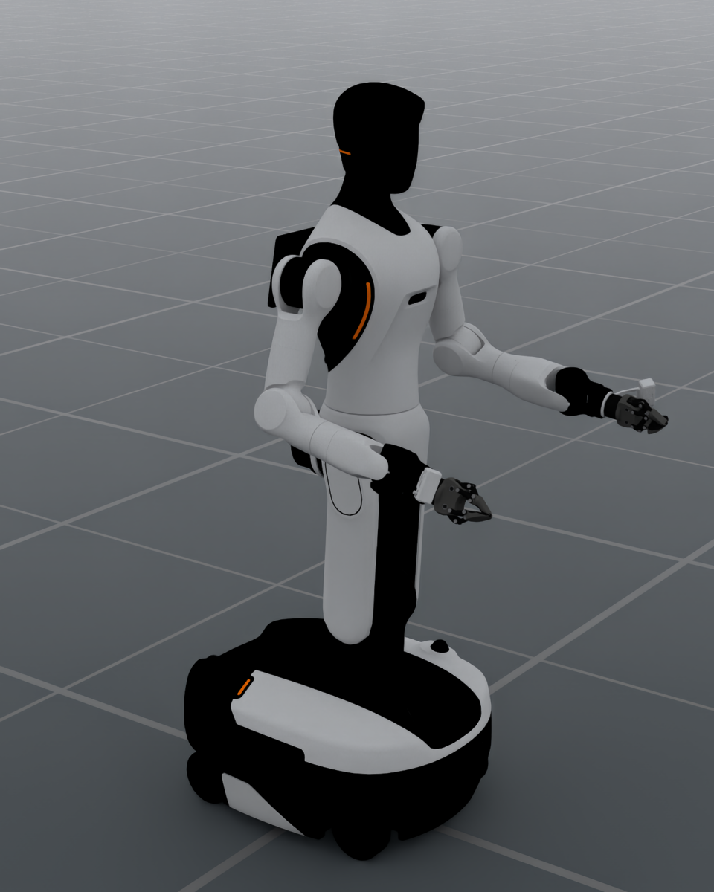

# AgiBot G2

The `AgibotG2` preset supplies the official G2 with two seven-DOF CRS arms
and OmniPicker grippers. It has 32 independent control DOFs and 14 gripper
mimic followers. Torso, head, steering and wheel joints remain available for
explicit joint control.

<div style="display: flex; justify-content: center; align-items: flex-start; gap: 20px; flex-wrap: wrap;">
  <figure style="text-align: center; margin: 0; flex: 1 1 320px; max-width: 540px;">
    
    <figcaption><b>G2 · CRS arms · OmniPicker grippers · 32 DOF</b><br/><code>AgibotG2</code></figcaption>
  </figure>
</div>

The image is captured from the registered preset with the same portrait camera
and `RenderCfg(renderer="rt")` defaults (OfflineRT) as the
[W1 documentation](https://dexforce.github.io/EmbodiChain/main/resources/robot/dexforce/w1.html).
The bent-elbow pose uses G2's native joint coordinates for this display only;
it does not change the neutral preset home pose. Source mesh materials are
preserved.

:::{dropdown} Image rendering settings
960 × 1200; 1 sample per pixel; DLSS offscreen reconstruction (quality 2);
tone mapping off; exposure 1.0; path depths 4–8. The scene uses the default
ground and environment emission, with no added direct lights. Physics is not
stepped, and 48 rendered frames warm up reconstruction. Camera settings,
actual joint positions, asset revision, runtime versions and the image hash
are recorded in the [render manifest](../../../_static/robots/agibot_g2_render.json).
:::

## Configuration

```python
from embodichain.robot_registry import resolve_robot_cfg

cfg = resolve_robot_cfg("AgibotG2")
# sim is an existing SimulationManager.
robot = sim.add_robot(cfg)
```

```bash
embodichain preview-robot --robot AgibotG2 --viser
python -m embodichain_robots.agibot.g2._preview --output g2-render.png
```

The rendering command also writes `g2-render.render.json` with the capture
settings and source provenance.

## Control Parts

| Part | Source joints | Independent commands |
|---|---:|---:|
| `left_arm`, `right_arm` | 7 each | 7 each |
| `left_eef`, `right_eef` | 8 each | 1 each |
| `torso` | 5 | 5 |
| `head` | 3 | 3 |
| `chassis_steering` | 4 | 4 |
| `chassis_wheels` | 4 | 4 |

Each gripper uses one independent leader in `[-pi/4, 0]` (open to closed)
and seven source mimic followers. Steering uses position targets; wheel
rotation uses velocity targets. The root is fixed by default for manipulation
previews. A mobile application must explicitly select a free root and provide
its base controller. The preset raises the root to 4.1 cm to clear the source
wheel collision cylinders above the default ground.

## Kinematics and Assets

Both arms use strict Warp SSIK with seed-local redundancy search on CPU/CUDA.
Their geometry comes from the original URDF, including the 18 mm elbow offset.
Arm chains run from `arm_base_link` to `gripper_l_base_link` /
`gripper_r_base_link`, with identity mounting-frame TCPs. Configure tool offsets
explicitly for grasp targets. Camera housing geometry is included without
invented optical calibration.

The asset source is
[AgibotTech/genie_sim_robot_model](https://github.com/AgibotTech/genie_sim_robot_model/tree/6d5b2159806ae0e64b432b638e9ee288d8bddc8f),
pinned at `6d5b2159806ae0e64b432b638e9ee288d8bddc8f` under Apache-2.0.
The cached public URDF is `AgibotG2/g2.urdf`. Archive and dependency checksums
are verified during installation. The portable derivative repairs two
nonphysical source inertia tensors and retains the upstream gripper mimic
approximation in place of GenieSim-specific loop constraints. Ordinary use
requires neither ROS nor Xacro.
