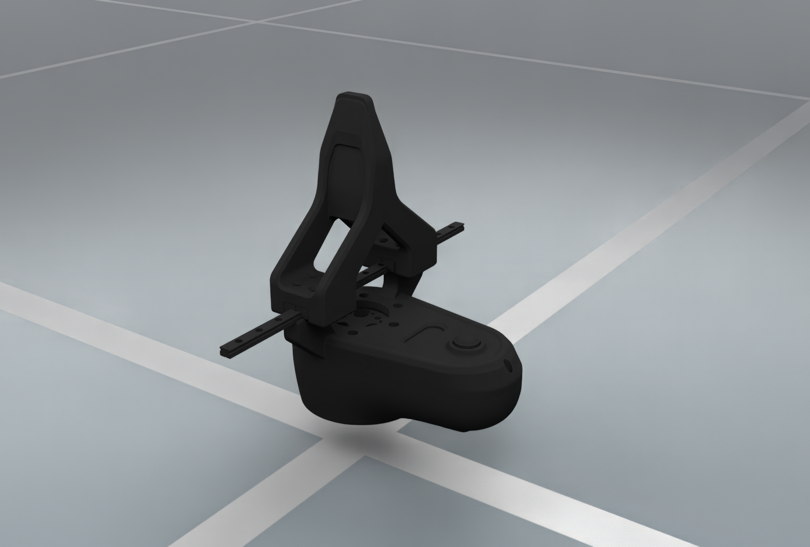

# AgileX Pika Gripper

The official AgileX SDK supports Pika Gripper. The archive records preparation from a local `pika_ros` package named `pika_gripper_description`, including relative mesh paths, normalized attachment frames and a mimic jaw. A public upstream commit and original asset author remain unverified.

<figure style="text-align: center; margin: 20px auto; max-width: 960px;">
  
  <figcaption><b>PikaGripper/PikaGripper.urdf</b></figcaption>
</figure>

[Render manifest](../../../_static/robots/eef/agilex_pika.json).

The images use the archive's visual meshes and authored materials in native
OfflineRT. They show a zero-coordinate display pose with a presentation root transform,
without stepping physics. Rendering settings and the source URDF checksum are
recorded per image. See [EEF rendering conventions](../end_effectors.md#rendered-illustrations).

## Resolve and preview

Canonical download-class import:

```python
from embodichain_robots.agilex.pika.assets import PikaGripper
```

Use the stable asset reference for normal loading:

```python
from embodichain.data import get_data_path

urdf_path = get_data_path("PikaGripper/PikaGripper.urdf")
```

```bash
embodichain data download --name PikaGripper
embodichain preview-asset --asset_path /absolute/path/to/pika-display/PikaGripper.urdf --viser
```

For this asset, the native standalone loader requires the caller-owned display
copy described below. Pass that copy to `preview-asset`. Asset listing and
class lookup do not download the archive; resolving its files may download on
first use. The remaining source models in this archive are listed in the image
captions above.

## Standalone display preparation

The current native Default importer rejects the source root's explicit zero
mass/inertia. This does not change the stable archive or the mounted W1/Pika
assembly. The illustration uses a temporary display URDF with inertials removed
from the two empty fixed frames, `GRIPPER_ROOT_LINK` and `ADAPTER_LINK`.
Visual meshes, their transforms, materials and joint geometry are unchanged;
mesh references resolve through a symlink to the original extracted files.
The manifest records this preparation separately from the original URDF hash.

To reproduce a display copy outside the shared cache:

```python
from pathlib import Path
import xml.etree.ElementTree as ET
from embodichain.data import get_data_path

source = Path(get_data_path("PikaGripper/PikaGripper.urdf"))
display = Path("pika-display")
display.mkdir(exist_ok=True)
if not (display / "meshes").exists():
    (display / "meshes").symlink_to(source.parent / "meshes", target_is_directory=True)
tree = ET.parse(source)
for name in ("GRIPPER_ROOT_LINK", "ADAPTER_LINK"):
    link = tree.find(f"link[@name='{name}']")
    link.remove(link.find("inertial"))
tree.write(display / "PikaGripper.urdf")
```

This is a visual-only preparation, not calibrated physical data or a replacement
simulation preset. The existing `dexforce_w1_030_pika` embodiment owns mounted
simulation, tool drives and TCP calibration.

## Attachment and jaw coordinates

Mount through `GRIPPER_ROOT_LINK`. `FINGER1_JOINT` is the independent prismatic
jaw coordinate over 0–0.05 m, closed to open; `FINGER2_JOINT` mimics it.
The archive separates DAE visual meshes from STL collision meshes. W1/Pika
mounts, TCPs and drives remain in the existing task embodiment rather than a
new Pika-specific W1 catalog variant.

## Ownership and provenance

The download class lives in `extensions/embodichain_robots/agilex/pika/assets.py` and registers through the
existing `embodichain.assets` catalog with category `eef`. This asset-only
package does not introduce a standalone robot preset. Host assembly owns the
mounting transform, naming prefix, control-group mapping and task-specific TCP.

The [asset provenance record](https://github.com/DexForce/EmbodiChain/blob/main/extensions/embodichain_robots/agilex/pika/README.md)
separately records manufacturer affiliation, model matching, asset production,
archive distribution, modifications and license status. Missing upstream or
license evidence stays explicitly unverified. The Python implementation's
Apache header is not an asset license statement.
