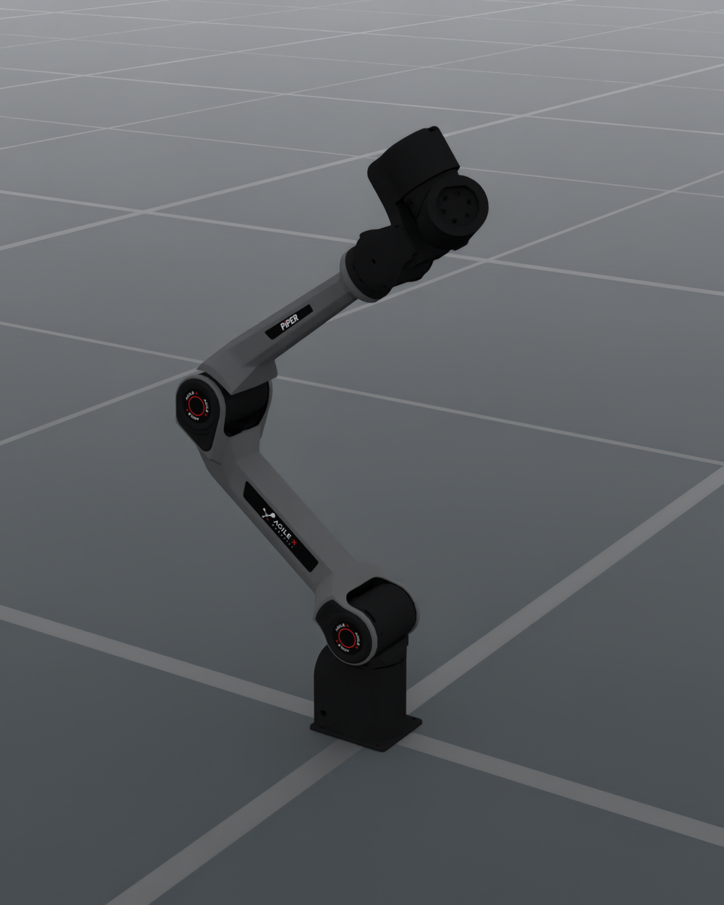
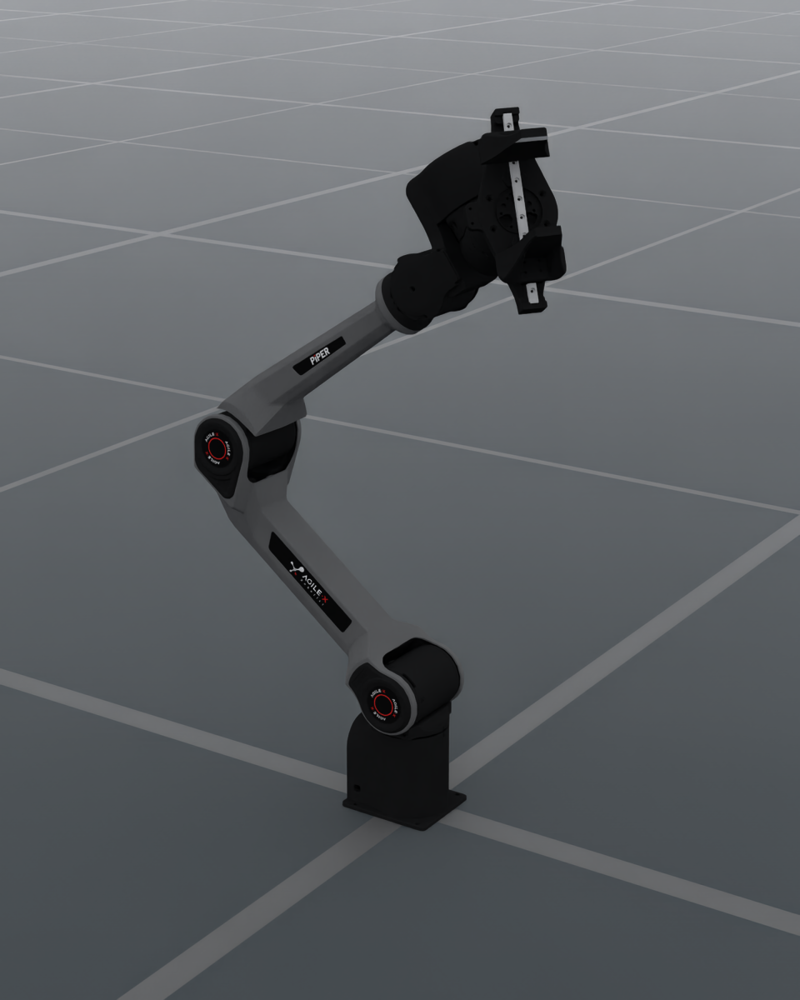

# AgileX PiPER-X

| Bare PiPER-X | PiPER-X with AGX gripper |
| --- | --- |
|  |  |

The two images use the same arm pose, camera and default scene. DexSim
captured both at 960 × 1200 with OfflineRT and DLSS Ray Reconstruction after
48 warmup frames. [Bare-arm capture](../../../_static/robots/agilex_piper_x.render.json) ·
[Mounted capture](../../../_static/robots/agilex_piper_x_agx_gripper.render.json)

## Bare arm

The `AgilexPiperX` catalog preset provides six revolute joints in the `arm`
control group. Its numerical FK and IK use the portable URDF through the
mounting flange. The source models and their MIT license are pinned to the
[official AgileX description](https://github.com/agilexrobotics/agx_arm_urdf/tree/680fa925cd00db7e2628563d2edc5540963045de).

```bash
embodichain data download --name AgilexPiperX
embodichain preview-robot --robot AgilexPiperX
```

```python
from embodichain_robots import AgilexPiperXCfg

cfg = AgilexPiperXCfg.from_dict({})
```

## AGX two-finger gripper

Download the `AgxGripper` asset separately with
`embodichain data download --name AgxGripper`. Its portable URDF is
`AgxGripper/agx_gripper.urdf`, rooted at `gripper_base`. The active
`gripper` joint commands jaw opening from 0 to 0.1 m and drives two
mimic joints.

Select `configs/components/embodiments/piper_x_agx_gripper.yaml` from the
`embodichain_tasks` extension as a deployment's embodiment component.
It places the tool 4.5 mm along flange Z with a +90° rotation about that
axis, following the [official assembly Xacro](https://github.com/agilexrobotics/agx_arm_urdf/blob/680fa925cd00db7e2628563d2edc5540963045de/piper_x/urdf/piper_x_with_gripper_description.xacro#L49-L53).
The embodiment configures the `eef` control group and locates the arm TCP
at the midpoint of the fingertip reference frames, 142.5 mm along flange Z.
