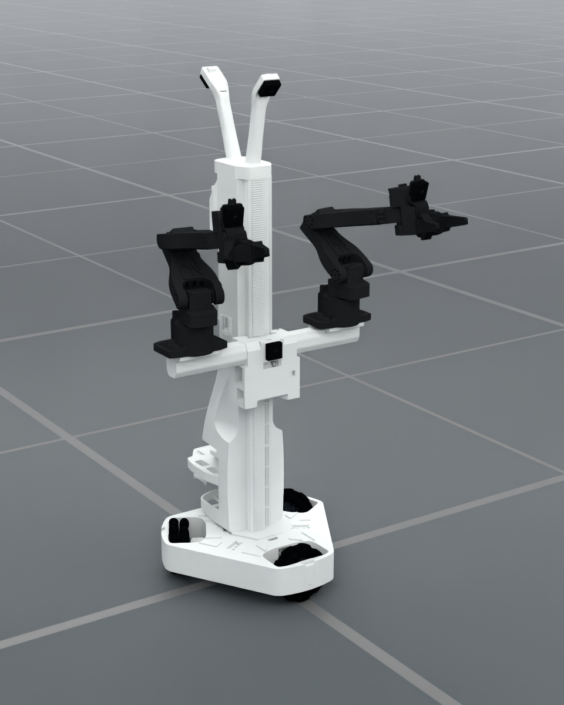

# Aloha Mini 2 Pro

`AlohaMiniCfg` loads the complete `AlohaMini/alohamini2pro.urdf` asset without
renaming its joints or assembling separate arms.

<figure style="text-align: center; margin: 20px auto; max-width: 540px;">
  
  <figcaption><b>Aloha Mini 2 Pro · 15 DOFs across five control groups</b></figcaption>
</figure>

The image uses the registered `AlohaMini` preset in a display pose, rendered
with `RenderCfg(renderer="rt")` (OfflineRT). Three soft area lights reveal
the dark arm details while retaining the white body's surface definition.

:::{dropdown} Image rendering settings
960 × 1200; 1 sample per pixel; DLSS offscreen reconstruction (quality 2);
tone mapping off; exposure 1.0. The default ground and environment emission
are supplemented by neutral key, fill and rim rectangular lights. Exact
camera, lighting and joint settings are recorded in the
[render manifest](../../_static/robots/aloha_mini_render.json).
:::

```python
from embodichain_robots import AlohaMiniCfg

cfg = AlohaMiniCfg.from_dict({"uid": "aloha_mini"})
robot = sim.add_robot(cfg=cfg)
```

| Control part | DOF | Joints / endpoint |
| --- | --- | --- |
| `left_arm` | 6 | Shoulder through wrist; `left_tcp` |
| `right_arm` | 6 | Shoulder through wrist; `right_tcp` |
| `left_eef` | 1 | `left_gripper` |
| `right_eef` | 1 | `right_gripper` |
| `torso` | 1 | `vertical_move` |

The arms use `PytorchSolverCfg` with the TCP frames authored in the asset.
The torso uses a position-only solver; the hands use joint-space commands.
The source's three planar base joints and three wheel joints remain outside
these control parts, with position drives that hold their initial positions.
Drive gains follow the CobotMagic simulation preset and can be overridden
through `joint_drive_props`.

`cfg.build_pk_serial_chain()` returns all five parts. Each chain is local to
its part: arm poses are relative to `left_Base` / `right_Base`, hand poses to
the fixed jaws, and torso poses to `base_cad_link`. Arm chains do not include
torso or planar base motion. Hand chains describe moving-jaw poses, while the
arm chains describe the grasp TCPs.

Run a headless construction smoke check with:

```bash
python -m embodichain_robots.aloha_mini --headless --device cpu
```

Omit `--headless` for the interactive simulation window. Select the physics
backend with `--physics default` or `--physics newton`.

See the [API reference](../../api_reference/aloha_mini.rst).
