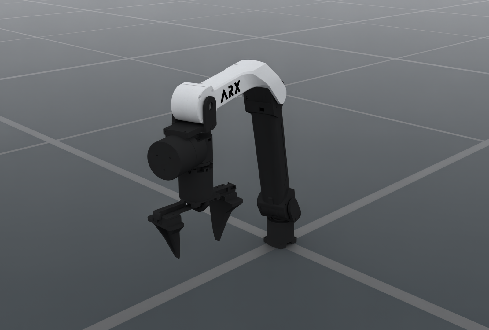

# ARX5 X5A

`embodichain_robots.ARX5Cfg` configures the bundled `ARX5/X5A.urdf` asset.
Its implementation lives in `extensions/embodichain_robots/arx/arx5/cfg.py`, and the
bundled robot catalog registers it as `ARX5`. The package exports the class
lazily; listing the catalog does not load the asset or simulation runtime.

<div style="text-align: center;">
  
  <p><b>ARX5 X5A with native parallel-jaw gripper</b></p>
</div>

The standalone image uses the registered `ARX5` preset and its adjusted default
ready pose. Its OfflineRT, denoising, exposure and default environment lighting
match the existing UR and W1 robot illustrations. Source meshes, joint positions
and the original gripper are used.

:::{dropdown} Image rendering settings
1600 × 1080; 1 sample per pixel; DLSS offscreen reconstruction (quality 2);
tone mapping off; exposure 1.0; default environment emission intensity 80;
48 warmup frames. There are no additional direct lights. Zero-diffuse black
materials use the existing W1 V030 black display color (sRGB 46/255) and
roughness (0.408248) to retain readable shading. These material overrides apply
only to this illustration. Exact camera, lighting, material values and their
reference manifests are recorded in the
[render manifest](../../_static/robots/arx5_render.json).
:::

## Control and kinematics

It exposes six revolute joints (`joint1`–`joint6`) as `arm` and the two
independent prismatic fingers (`joint7`, `joint8`) as `eef`. The fingers
have no mimic relation; increasing their coordinates opens them.

| Control part | Source joints | Coordinates | Default command |
| --- | --- | --- | --- |
| `arm` | `joint1`–`joint6` | radians | Outward-elbow ready pose |
| `eef` | `joint7`, `joint8` | metres | `(0.044, 0.044)` opens; `(0.0, 0.0)` closes |

There are eight independent controlled joints. `init_qpos` follows source
order: the six arm joints, then the two fingers.

```python
from embodichain_robots import ARX5Cfg

cfg = ARX5Cfg.from_dict({})
robot = sim.add_robot(cfg=cfg)
```

The default Warp SSIK solver uses the `base_link` → `ee_link` serial chain.
Its separate tool transform aligns TCP X with jaw opening and TCP Z with
approach. `build_pk_serial_chain()` returns the flange chain; compose its FK
with `solver_cfg["arm"].tcp` to obtain tool poses. Both simulation and kinematics
resolve the same source asset. Configuration dictionaries round-trip through
`from_dict()` and `to_dict()`.

```python
from embodichain.robot_registry import resolve_robot_cfg

cfg = resolve_robot_cfg("ARX5")
restored = ARX5Cfg.from_dict(cfg.to_dict())
chains = restored.build_pk_serial_chain()
assert len(chains["arm"].get_joint_parameter_names()) == 6
```

An explicit `fpath` selects a local URDF for both simulation and kinematics.
Solver root/end-frame and TCP overrides follow the standard `RobotCfg`
configuration interface.

## Ready pose and physical defaults

The default fixed-base configuration enables self-collision and uses an
outward elbow with an unflipped wrist:

```text
arm: [-2.84, 1.825, 1.743, -1.489, 0.0, -1.266] rad
eef: [0.044, 0.044] m
```

The fixed base, ready pose, drive gains, velocity caps and tool frame are
simulation defaults, not manufacturer-verified hardware parameters. Source
arm limits are preserved; task-specific workspace and IK branch restrictions
belong to the caller's scene configuration.

## Warp IK and optional reference alignment

The default arm solver is `SSIKSolverCfg(backend="warp", geometry_mode="near_parallel")`,
using Warp on CPU or CUDA. The source rounds a half turn to
`3.1416`, producing a parallel-axis residual of about `7.24e-6`. It therefore
does not satisfy the SSIK Warp backend's strict geometric classification.
The near-parallel mode uses eight geometric initializations and one seed initialization,
with bounded numerical correction on the actual source model. It preserves
the 85 mm, quarter-turn TCP and validates returned float32 joints at the
unchanged `1e-5` metre/radian gates. This mode is a geometric/numerical hybrid;
it does not require SSIK installed. Continuous paths regenerate candidates
from each preceding result, including its current winding; the complete
source and benchmark qualifications are recorded in the acceptance reports.
Explicit solver replacements remain authoritative. The original Pytorch
configuration can be restored while preserving frames, TCP, limits and weights;
see [numerical solver selection](../../overview/sim/motion/solvers/ssik_solver.md#selecting-the-numerical-solver).

The optional CPU reference instead uses an offline-derived general 6R
Raghavan–Roth artifact for this actual source model. Its final acceptance uses
the original model and unchanged `1e-5` metre/radian pose gates.

See [SSIK's prepared model example](../../overview/sim/motion/solvers/ssik_solver.md#prepared-arx5-and-rizon4s-models)
for explicit selection, optional dependency installation and rebuilding an
artifact after a model change. No optional SSIK dependency is needed to list,
construct or execute the default Warp configuration.

## Asset fingerprints

- Registry archive: `ARX5_2.zip`, MD5 `6fc1d6a5a35b7926ba6325c0d20f5bc3`.
- Source URDF SHA256: `826b5392ef2d37526a73a95a2a379e6c23e2fec7f81923934d8d642ef8fa3116`.
- SSIK source pin: `4109147f37a7ca3e2516c83853aca583612783f3`.

The prepared artifact is tied to these source frames and joint order; it is
not a replacement model for another ARX hardware revision.

## Preview and Atomic Skills tutorial

Select the exact catalog ID with `--robot ARX5`:

```bash
embodichain preview-robot --robot ARX5
embodichain preview-robot --robot ARX5 --headless --renderer no-render --device cpu --physics default --max-steps 100
```

The {ref}`Atomic Skills tutorial <atomic-embodiment-switching>`
uses this preset directly. Its fixture inherits the adjusted ready pose and
self-collision setting, adds a 50 mm table and scene-specific IK branch limits,
and executes the same PickUp → Place invocation code used for UR5 and Franka:

```bash
python scripts/tutorials/atomic_action/embodiment_switching.py --task pick_place --robot arx5
```

The tutorial selector is lowercase `arx5`; the robot catalog ID is `ARX5`.
Its scene calibration lives in `examples/sim/atomic_action/embodiments.py`.
