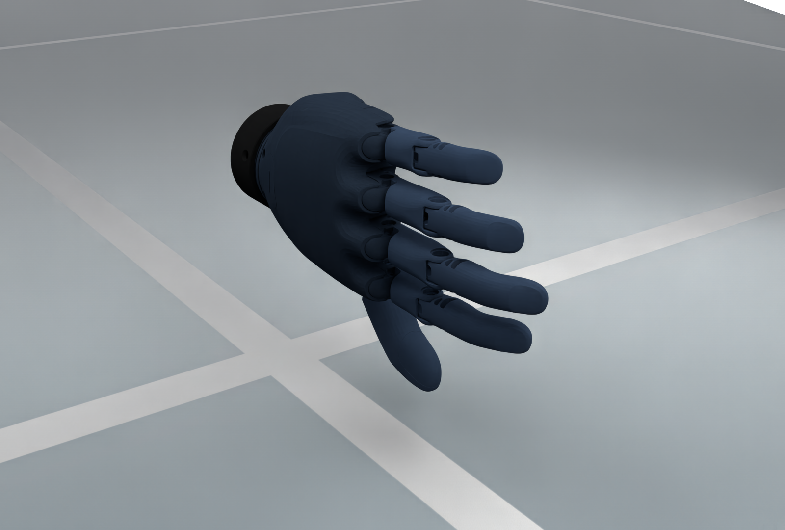
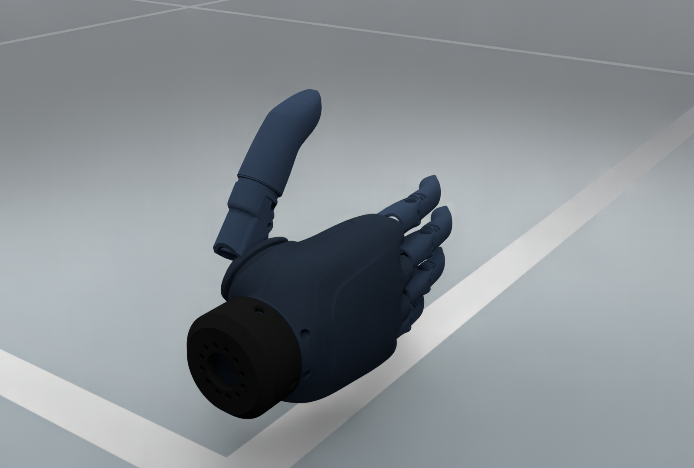

# BrainCo Revo 1

`embodichain_robots.BrainCoRevo1Cfg` configures a standalone left or right
BrainCo Revo 1 hand. The catalog ID is `BrainCoRevo1`; `left` and `right`
variants select the native hand asset, with right as the default.

<figure style="text-align: center; margin: 20px auto; max-width: 960px;">
  
  <figcaption><b>BrainCo Revo 1 · left hand · 6 independent commands</b></figcaption>
</figure>

[Render manifest](../../../_static/robots/eef/brainco_revo1_left.json).

<figure style="text-align: center; margin: 20px auto; max-width: 960px;">
  
  <figcaption><b>BrainCo Revo 1 · right hand · 6 independent commands</b></figcaption>
</figure>

[Render manifest](../../../_static/robots/eef/brainco_revo1_right.json).

The illustrations use the archive's visual geometry and authored materials,
a presentation root rotation and native OfflineRT without stepping physics.
They show a zero-coordinate display pose, not a calibrated grasp. See
[EEF rendering conventions](../end_effectors.md#rendered-illustrations).

## Construct, discover and preview

Given an existing `SimulationManager` instance named `sim`:

```python
from embodichain.robot_registry import resolve_robot_cfg
from embodichain_robots import BrainCoRevo1Cfg

cfg = resolve_robot_cfg("BrainCoRevo1", variant="left")
# Equivalent native side selection:
cfg = BrainCoRevo1Cfg.from_dict({"side": "left"})
restored = BrainCoRevo1Cfg.from_dict(cfg.to_dict())
robot = sim.add_robot(cfg=restored)
```

```bash
embodichain list-robot
embodichain preview-robot --robot BrainCoRevo1 --variant left --viser
embodichain preview-robot --robot BrainCoRevo1 --variant right --viser
embodichain preview-robot --robot BrainCoRevo1 --headless --device cpu --renderer no-render --physics default --max-steps 100
```

Only `left` and `right` are supported sides. `from_dict()` builds defaults before
applying isolated caller overrides. A local `fpath` can select an existing URDF
without downloading the bundled archive. The single fixed-base articulation
preserves the native joint and link identifiers.

## Control contract

| Group | Independent source joints | Units |
| --- | --- | --- |
| `eef` | `LEFT_HAND_THUMB1`, `LEFT_HAND_THUMB2`, `LEFT_HAND_INDEX`, `LEFT_HAND_MIDDLE`, `LEFT_HAND_RING`, `LEFT_HAND_PINKY` for left; corresponding `RIGHT_` names for right | radians |

Four additional index/middle/ring/pinky PIP joints retain the source mimic
relations, including their nonzero offsets. They do not add command dimensions.
The six active joints start at zero. Followers retain their source coupling;
commands and resets use the existing articulation runtime. Send six-dimensional targets using
the named control group; preserve its documented order.

```python
import torch

q = robot.get_qpos(name="eef").clone()
q += torch.tensor([[0.05] * 6], device=robot.device)
robot.set_qpos(q, name="eef")
```

The default `solver_cfg` is empty and `build_pk_serial_chain()` returns `{}`.
No single tool TCP, finger IK, grasp command or retargeting service is implied
by the `eef` name. The branched hand is not represented as one serial chain.
The catalog advertises zero arms and no generic dual-arm base compatibility.

## Physical defaults

The default root position is `(0, 0, 0.3)` metres. This presentation height
keeps the standalone source geometry clear of the global ground; it is not a
calibrated mounting transform. Source position limits, mass and inertia are
preserved. Because the bundled
URDF declares zero effort and velocity limits, the standalone simulation preset
sets active-joint stiffness to 100, damping to 10, maximum effort to 1000 and
maximum velocity to 1 rad/s. These are initial simulation values, not verified
motor specifications or hardware calibration. The default native solver uses
64 position iterations and 16 velocity iterations for the mimic constraints;
these iteration counts apply to the Default backend. Caller overrides can
replace these simulation settings.

## Shared model and W1 mounting

The asset class is
`embodichain_robots.brainco.revo1.assets.BrainCoHandRevo1`. Its shared archive
contains both `BrainCoLeftHand/BrainCoLeftHand.urdf` and
`BrainCoRightHand/BrainCoRightHand.urdf`. Stable references remain:

```python
from embodichain.data import get_data_path

left_urdf = get_data_path("BrainCoHandRevo1/BrainCoLeftHand/BrainCoLeftHand.urdf")
right_urdf = get_data_path("BrainCoHandRevo1/BrainCoRightHand/BrainCoRightHand.urdf")
```

The same model-owned native specifications are consumed by the W1 adapter.
W1 owns its mounting transforms, revision offsets, assembled naming and
`left_eef` / `right_eef` groups. Independent-hand drives do not override W1's
existing calibration. See [W1](../dexforce/w1.md) for its assembly interface.
A hand can be an independent `Robot` or a mounted EEF without duplicating its
model definition.

## Provenance

The [BrainCo product documentation](https://www.brainco-hz.com/docs/revolimb-hand/revo1/parameters.html)
confirms product affiliation. The exact packaged CAD release, original author,
upstream revision and asset license remain unverified. See the
[archive-specific source record](https://github.com/DexForce/EmbodiChain/blob/main/extensions/embodichain_robots/brainco/revo1/README.md)
for the download digest, inspection evidence and pending questions.
