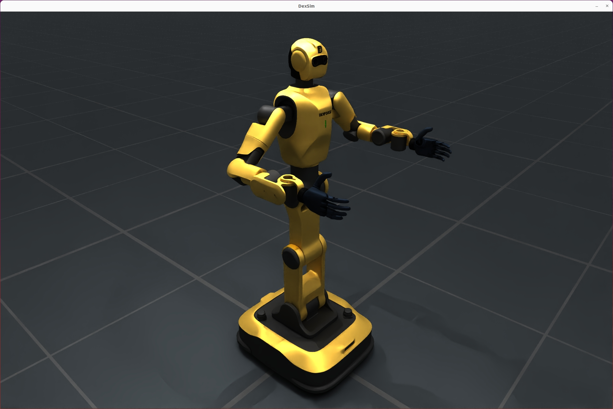
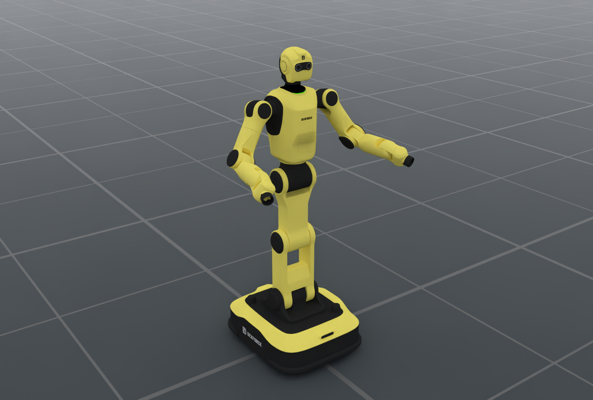

# Dexforce W1

Dexforce W1 is a dual-arm humanoid robot developed by DexForce Technology Co., Ltd.

<div style="display: flex; justify-content: center; align-items: flex-start; gap: 20px; flex-wrap: wrap;">
  <figure style="text-align: center; margin: 0; flex: 1 1 320px; max-width: 540px;">
    
    <figcaption><b>Earlier W1 with hands</b></figcaption>
  </figure>
  <figure style="text-align: center; margin: 0; flex: 1 1 320px; max-width: 540px;">
    
    <figcaption><b>W1 V030 — standard bare body (20 DOF)</b></figcaption>
  </figure>
</div>

The V030 image uses the registered `v030/bare` asset in a bent-elbow display
pose, rendered with `RenderCfg(renderer="rt")` (OfflineRT). All other
`RenderCfg` fields and scene lighting use their defaults. Its physical wrist flanges
are shown without detachable end effectors.

## Key Features

- Supports dual 7-DOF arms
- Supports version-owned asset layouts and calibration parameters
- Configurable left/right hand brand and version
- Flexible URDF assembly and simulation configuration
- Compatible with SimulationManager simulation environment

## Supported Body Revisions

EmbodiChain supports four complete W1 body revisions. Select the revision
explicitly when reproducing an asset or calibration setup:

| Body revision | Default arm solver | Default end effectors | Default control DOF | Asset and calibration differences |
|---|---|---|---|---|
| `v021` | `SRSSolver` | Dual BrainCo hands | 32 | Separate component datasets and a separate eyes component; identity revision mounting offset |
| `v022` | `SRSSolver` | Dual BrainCo hands | 32 | Unified body/component archive; eyes included in the head; provisional identity flange calibration |
| `v025` | `SRSSolver` | Dual BrainCo hands | 32 | Unified archive; calibrated `+0.012 m` revision mounting offset along each arm's `ee` Z axis |
| `v030` | `FEPSolver` | None: standard bare body | 20 | Unified bare-body archive; flange TCPs; optional tools assembled separately; no wrist-camera mounting frames |

The unmodified configuration still defaults to `v021/BrainCo`. V021, V022,
and V025 also support bare-body and DH gripper profiles described below. One
revision selects the chassis, torso, head and both arms together; mixed body
and arm revisions are unsupported.

Use the exact catalog variant to select each released default:

```python
from embodichain.robot_registry import resolve_robot_cfg

w1_v021 = resolve_robot_cfg("DexforceW1", variant="v021/BrainCo")
w1_v022 = resolve_robot_cfg("DexforceW1", variant="v022/BrainCo")
w1_v025 = resolve_robot_cfg("DexforceW1", variant="v025/BrainCo")
w1_v030 = resolve_robot_cfg("DexforceW1", variant="v030/bare")

# sim is an existing SimulationManager.
robot = sim.add_robot(cfg=w1_v030)
```

## Configuration with `DexforceW1Cfg.from_dict`

Catalog resolution calls `DexforceW1Cfg.from_dict`, which can also be used
directly. Each configuration describes the complete chassis, torso, head and
both arms for one body revision. V021 assembles eyes as a separate component;
V022, V025 and V030 include eyes in the head. V021/V022/V025 add the registered
wrist-camera mounting frames. V030 leaves wrist cameras to optional
attachments with their own calibration.

**Parameters:**

- `version`: Body revision: `v021`, `v022`, `v025`, or `v030`.
- `hand_types`: Dict specifying hand brand for each arm side (`LEFT`/`RIGHT`).
- `hand_versions`: Dict specifying hand version for each arm side.
- `with_default_eef`: Whether to install the registered default end effectors.
  Defaults to `True` for V021/V022/V025 and `False` for V030.
- `hand_attach_xposes`: Optional hand-specific mounting transforms.
- `solver_cfg`: Optional per-arm solver overrides, including a tool-specific TCP.

```python
from embodichain_robots import DexforceW1Cfg

cfg = DexforceW1Cfg.from_dict(
    {
        "uid": "dexforce_w1",
        "version": "v025",
        "hand_types": {
            "left": "BRAINCO_HAND",
            "right": "BRAINCO_HAND",
        },
        "hand_versions": {"left": "v021", "right": "v021"},
    }
)
robot = sim.add_robot(cfg=cfg)
```

For the standard V030 body, `DexforceW1Cfg.from_dict({"version": "v030"})`
selects the bare body and calibrated FEP defaults without specifying hands.

## Catalog Variants and Control DOFs

`embodichain list-robot` advertises **19 W1 variants**: six profiles for each of
V021, V022 and V025, plus the standard `v030/bare` profile.

| Profile suffix | Body revisions | End effectors | Independent control DOF |
|---|---|---|---|
| `BrainCo` | `v021`, `v022`, `v025` | Two `BRAINCO_HAND` hands | 32 |
| `DH_PGC` | `v021`, `v022`, `v025` | Two `DH_PGC_GRIPPER` grippers | 22 |
| `DH_PGC_M` | `v021`, `v022`, `v025` | Two `DH_PGC_GRIPPER_M` grippers | 22 |
| `L=DH_PGC,R=DH_PGC_M` | `v021`, `v022`, `v025` | Left DH_PGC, right DH_PGC_M | 22 |
| `L=DH_PGC_M,R=DH_PGC` | `v021`, `v022`, `v025` | Left DH_PGC_M, right DH_PGC | 22 |
| `bare` | `v021`, `v022`, `v025`, `v030` | No default end effector | 20 |

Combine the body revision and suffix, for example `v022/DH_PGC_M` or
`v025/L=DH_PGC,R=DH_PGC_M`. Dexterous-hand/two-finger-gripper mixtures are
omitted from the catalog. V030 only advertises `v030/bare`: constructing an
optional hand assembly through `with_default_eef=True` does not establish
that its mount and TCP have been validated for that revision.

BrainCo PIP followers are passive joints outside the default hand control
groups. They are listed as mimic joints while each `left_eef` / `right_eef`
group contains six independent control joints. DH gripper groups each have
one independent joint and one follower, displayed as `1+1m`.

See {doc}`/guides/robot_catalog` for the complete hand-pairing table and
examples of selecting these profiles through configuration fields.

## Control Parts and Joint Coordinates

Every bare body has four torso joints, two head joints and two seven-joint
arms, for 20 independent control DOFs. The control parts are `torso`, `head`,
`left_arm`, `right_arm`, `dual_arm`, and `full_body`. The last two overlap
their constituent groups and do not add independent joints. Installing hands
adds `left_eef` and `right_eef`; `full_body` remains the torso, head and arms.

The arms use revision-specific mirrored axes. Joint positions are in radians
and retain the selected asset's coordinate convention. Use the configured
left/right solvers and source joint limits when transferring poses between
arms or revisions.

## Type Descriptions

| Type                    | Options / Values                                      | Description                        |
|-------------------------|-------------------------------------------------------|------------------------------------|
| `DexforceW1HandBrand`   | `BRAINCO_HAND`, `DH_PGC_GRIPPER`, `DH_PGC_GRIPPER_M`  | Hand brand                         |
| `DexforceW1Version`     | `V021`, `V022`, `V025`, `V030`                        | Body release version               |
| `DexforceW1HandVersion` | `V021`                                                  | External hand/gripper asset version |
| `DexforceW1ArmSide`     | `LEFT`, `RIGHT`                                       | Left/right hand identifier         |

## Assets and Download Layout

The body dataset and full-robot path are version-owned:

| Body revision | Dataset ID | Full-robot asset path |
|---|---|---|
| `v021` | `DexforceW1V021` | `DexforceW1V021/DexforceW1_v02_1.urdf` |
| `v022` | `DexforceW1V022` | `DexforceW1V022/w1/robot.urdf` |
| `v025` | `DexforceW1V025` | `DexforceW1V025/w1/robot.urdf` |
| `v030` | `DexforceW1V030` | `DexforceW1V030/w1/robot.urdf` |

V021 runtime assembly uses the separate `DexforceW1ChassisV021`,
`DexforceW1TorsoV021`, `DexforceW1HeadV021`, `DexforceW1EyesV021`,
`DexforceW1LeftArmV021`, and `DexforceW1RightArmV021` datasets. V022, V025 and
V030 each use one unified archive for the full body and all five components:

```text
dexforce_w1/<version>/w1.zip
└── w1/
    ├── robot.urdf
    ├── chassis.urdf
    ├── torso.urdf
    ├── head.urdf
    ├── left_arm.urdf
    ├── right_arm.urdf
    ├── visual/              # V022/V025
    ├── visual_recoloured/   # V030
    └── collision/
```

For unified archives, direct FK/IK uses `robot.urdf` or the arm URDFs, while
configurable assembly reads components from the same extracted directory.
Registered downloads use the shared asset cache and validate the archive
checksum before extraction.

The [V030 asset release](https://huggingface.co/datasets/DexForceAI/embodichain_data/tree/main/dexforce_w1/v030)
contains the complete standard body, a preview and a per-file checksum
manifest. Its `w1.zip` is 25.58 MiB and contains 49 files: seven URDFs, 21
visual GLBs and 21 collision OBJs. `robot_with_ee.urdf` is an identical
compatibility alias of the bare `robot.urdf`. Detachable grippers and
unreferenced duplicate/backup meshes are excluded. Each component's visual,
collision and inertial definitions match the full body.

## Solver and TCP Calibration

V021/V022/V025 use their version-owned SRS parameters and legacy tool TCPs.
Selecting a bare profile on those revisions preserves the configured tool
TCP; choose an explicit flange TCP if that is the intended control frame.
V030 uses FEP with source-URDF joint limits and identity TCPs at `left_ee` and
`right_ee` by default.

### V030 FEP defaults

| Parameter | Left arm | Right arm |
|---|---|---|
| `reference_qpos` (radians) | `[0, 0, -pi/2, 0, 0, -pi/2, 0]` | `[0, 0, -pi/2, 0, 0, pi/2, 0]` |
| `axis_alignment_tolerance` | `2e-5` | `1e-6` |
| `position_tolerance` (metres) | `1e-5` | `1e-5` |
| `rotation_tolerance` (radians) | `5e-5` | `1e-5` |
| `redundancy_search` | `True` | `True` |
| `arm_angle_weight` | `0.0` | `0.0` |

The reference posture rebases the geometric reconstruction; inputs, returned
joints and limits retain the original URDF coordinates. The left CAD model
has a small J7 axis tilt, so its geometry and rotation tolerances are explicit
revision settings. Every accepted solution is checked against the original
URDF FK. This remains an FEP-family geometric solver; the axis allowance is an
approximation and does not establish complete reachability coverage.

Joint-distance and limit-margin scoring are enabled without a swivel-angle
preference because the outstretched V030 home pose has an undefined GeoFIK
swivel angle. A tool assembly owns its mounting transform and TCP calibration;
configure these separately from the standard body.

For the standard configuration, 9,216 CPU/CUDA IK samples passed source-chain
FK and joint-limit checks, with maximum position error 8.42 micrometres and
orientation error 0.00159 degrees. Native kinematic checks also passed with
the default and Newton backends. These measurements validate simulator
kinematics, not hardware or dynamics calibration.

### Version-owned end-effector offset

Different arm revisions may place the physical mounting surface at different
positions relative to the arm `ee` frame. This difference belongs to the W1
revision, not to a BrainCo hand, DH gripper, PIKA gripper, or any other
end-effector.

`W1VersionSpec.default_eef_attach_xpos` is the single source of truth for this
revision offset:

| Version | Left arm | Right arm |
|---------|----------|-----------|
| V021 | Identity | Identity |
| V022 | Identity (provisional; calibration required) | Identity (provisional; calibration required) |
| V025 | `+0.012 m` along the `ee` frame Z axis | `+0.012 m` along the `ee` frame Z axis |
| V030 | Identity at the physical flange | Identity at the physical flange |

The final assembly transform and solver TCP are derived as follows:

```python
final_attach_xpos = version_attach_xpos @ eef_attach_xpos
final_tcp = version_attach_xpos @ solver_tcp
```

Therefore, the V025 offset affects both the assembled end-effector position and
FK/IK results. The offset is also applied when callers provide a custom
`hand_attach_xposes` value, a custom `left_hand`/`right_hand` component
transform, or an explicit arm TCP through `DexforceW1Cfg.from_dict`.
Serialization removes the derived offset and restores it on loading, so a
configuration round trip does not apply the offset twice.

Do not manually add the 12 mm correction to an end-effector transform or TCP.
Those values must describe the end-effector relative to the standard mounting
surface; the W1 version layer adds the robot revision correction.

Robot and hand versions are independent. `DexforceW1Version` selects the W1
body, arm assets, kinematics, and flange calibration. `DexforceW1HandVersion`
selects an external hand or gripper asset from
`embodichain_robots/dexforce_w1/hand_specs.py`.

The currently released BrainCo hand and DH gripper registrations all use
`DexforceW1HandVersion.V021`. V021/V022/V025 install that hand revision by
default. V030 installs no hands; explicitly enabling a registered hand also
selects hand V021 unless overridden. This is an independent hand-release
default, not a compatibility alias or a validation of every body/tool pairing.

## Extending Body and Hand Revisions

To add another W1 revision:

1. Register the new `DexforceW1Version` value and dataset archive.
2. Add one `W1VersionSpec` entry in
   `embodichain_robots/dexforce_w1/specs.py`.
3. Register component URDF paths and the full-robot URDF path.
4. Set the matching solver configuration, arm kinematic parameters and
   `default_eef_attach_xpos` for both sides. Use identity only after confirming
   that the arm `ee` frame is already at the physical mounting surface.
5. Verify that the same version offset is present in both the assembled
   end-effector pose and the final FK/IK TCP.
6. Validate FK/IK and joint limits against the source URDF. Register optional
   hand/gripper and camera assemblies only with their corresponding mount/TCP
   calibration and integration checks.

To add another hand release:

1. Add a `DexforceW1HandVersion` value.
2. Register each supported brand and side in `hand_specs.py`, including its
   URDF, joint names, root/end links, and mounting transform.
3. Select it explicitly through `hand_versions`; an unregistered version fails
   during config construction.

Control parts, assembly, TCP selection, analytical parameters and FK/IK then use
the version specification without revision-specific branches.
