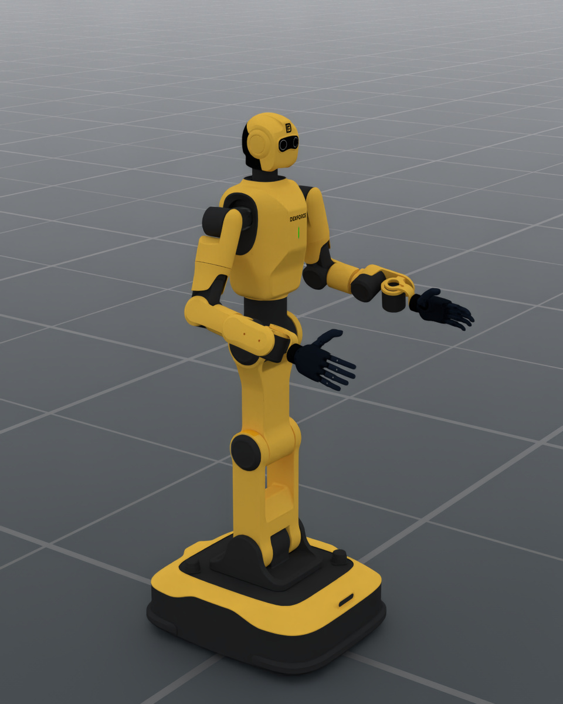

# DexForce W1

DexForce W1 is a mobile dual-arm humanoid with two 7-DOF arms, a 4-DOF torso
and a 2-DOF head. The bare body has 20 independent control DOFs; end effectors
are configured separately.

<div style="display: flex; justify-content: center; align-items: flex-start; gap: 20px; flex-wrap: wrap;">
  <figure style="text-align: center; margin: 0; flex: 1 1 320px; max-width: 540px;">
    
    <figcaption><b>W1 V021 · BrainCo V021 hands · 32 DOF</b><br/><code>v021/BrainCo</code></figcaption>
  </figure>
  <figure style="text-align: center; margin: 0; flex: 1 1 320px; max-width: 540px;">
    
    <figcaption><b>W1 V030 · Bare body · 20 DOF</b><br/><code>v030/bare</code></figcaption>
  </figure>
</div>

Both images are captured from the registered robot presets using the same
camera, bent-elbow display pose and current `RenderCfg(renderer="rt")`
defaults (OfflineRT), with default scene lighting.
The display pose is for illustration; it does not change the preset home pose.
V030 uses the V021 yellow (`#F8C349`) and dark
(`#2E2E2E`) plastic palette with matching roughness, retaining V030 geometry
and markings.

:::{dropdown} Image rendering settings
960 × 1200; 1 sample per pixel; DLSS offscreen reconstruction (quality 2);
tone mapping off; exposure 1.0; path depths 4–8. The scene uses the default
ground and environment emission, with no added direct lights. Camera settings,
joint positions and the V030 asset revision are recorded in the
[render manifest](../../_static/robots/dexforcew1_render.json).
The manifest also records the V021 material parameters and the published
archive checksums. `scripts/tools/prepare_w1_v030_materials.py` reproduces the
material update from the original archive revision recorded there.
:::

## Supported Body Revisions

| Body revision | Default arm solver | Default end effectors | Independent control DOF | Revision differences |
|---|---|---|---|---|
| `v021` | `SRSSolver` | BrainCo V021 hands | 32 | Separate component datasets and eyes component; identity mounting offset |
| `v022` | `SRSSolver` | BrainCo V021 hands | 32 | Unified archive; eyes included in the head; provisional identity flange calibration |
| `v025` | `SRSSolver` | BrainCo V021 hands | 32 | Unified archive; calibrated 12 mm mounting offset along each arm's `ee` Z axis |
| `v030` | `FEPSolver` | None | 20 | Standard bare body; flange TCPs; no wrist-camera mounting frames |

The default remains `v021/BrainCo`. A body revision selects the chassis,
torso, head and both arms together; mixed body/arm revisions are unsupported.
Hand versions are independent of body versions.

## Configuration

Select an exact catalog variant to reproduce a configuration:

```python
from embodichain.robot_registry import resolve_robot_cfg

cfg = resolve_robot_cfg("DexforceW1", variant="v030/bare")
# sim is an existing SimulationManager.
robot = sim.add_robot(cfg=cfg)
```

Use `DexforceW1Cfg.from_dict` when customizing the end effectors:

```python
from embodichain_robots import DexforceW1Cfg

cfg = DexforceW1Cfg.from_dict(
    {
        "version": "v025",
        "hand_types": {"left": "BRAINCO_HAND", "right": "BRAINCO_HAND"},
        "hand_versions": {"left": "v021", "right": "v021"},
    }
)
robot = sim.add_robot(cfg=cfg)
```

| Field | Purpose |
|---|---|
| `version` | Body revision: `v021`, `v022`, `v025` or `v030` |
| `hand_types` | Per-side brand: `BRAINCO_HAND`, `DH_PGC_GRIPPER` or `DH_PGC_GRIPPER_M` |
| `hand_versions` | Per-side hand asset revision; current registrations use `v021` |
| `with_default_eef` | Install registered end effectors; defaults to `True` for V021/V022/V025 and `False` for V030 |
| `hand_attach_xposes` | Per-side hand mounting transforms |
| `solver_cfg` | Per-arm solver overrides, including tool TCPs |

Side keys accept `left` / `right` or `DexforceW1ArmSide` values.
`DexforceW1Cfg.from_dict({"version": "v030"})` selects the standard bare body.
Optional V030 tools require their own mounting and TCP calibration.

## Catalog Variants and Control DOFs

`embodichain list-robot` lists 19 W1 variants: six profiles each for V021,
V022 and V025, plus `v030/bare`.

| Profile suffix | Body revisions | End effectors | Independent control DOF |
|---|---|---|---|
| `BrainCo` | V021/V022/V025 | Two BrainCo hands | 32 |
| `DH_PGC` / `DH_PGC_M` | V021/V022/V025 | Two matching DH grippers | 22 |
| `L=DH_PGC,R=DH_PGC_M` / `L=DH_PGC_M,R=DH_PGC` | V021/V022/V025 | Mixed DH grippers | 22 |
| `bare` | V021/V022/V025/V030 | None | 20 |

Combine a revision and suffix, for example `v022/DH_PGC_M`.
Each BrainCo hand contributes six independent joints; its PIP followers are
outside the default EEF control group. Each DH gripper contributes one
independent joint and one mimic follower (`1+1m`). See
{doc}`/guides/robot_catalog` for hand-pairing and selection details.

The bare-body control parts are `torso`, `head`, `left_arm`, `right_arm`,
`dual_arm` and `full_body`. The last two combine existing joints; `full_body`
excludes hands. Installed hands add `left_eef` and `right_eef`. Joint positions
use radians and revision-specific mirrored axes; preserve the selected
URDF's coordinates and limits when transferring poses.

## Solver and TCP Calibration

V021/V022/V025 use version-owned SRS settings and legacy tool TCPs. Their
`bare` profiles retain those TCPs; configure an explicit flange TCP when
controlling the physical flange.

V030 uses FEP, source-URDF joint limits and identity TCPs at `left_ee` /
`right_ee`. Its left CAD wrist has a small J7 axis tilt, handled by explicit
revision tolerances; accepted solutions are checked against source-URDF FK.
Redundancy search scores joint distance and limit margin without a swivel-angle
preference (`arm_angle_weight=0.0`), because the outstretched home pose has no
defined GeoFIK swivel angle. These settings describe simulator kinematics;
hardware and tool calibration remain separate.

The body revision owns the mounting correction: identity for V021, provisional
identity for V022, **+12 mm along each `ee` Z axis for V025**, and identity at
the physical flange for V030. Configuration assembly applies it to both the
hand transform and solver TCP:

```python
final_attach_xpos = version_attach_xpos @ eef_attach_xpos
final_tcp = version_attach_xpos @ solver_tcp
```

Supply hand transforms and TCPs relative to the standard mounting surface;
do not add the V025 correction manually. This also applies to custom hand
components and explicit solver overrides. Serialization removes and restores
the derived offset so it is applied once.

## Assets and Download Layout

| Body revision | Dataset ID | Full-robot asset path |
|---|---|---|
| `v021` | `DexforceW1V021` | `DexforceW1V021/DexforceW1_v02_1.urdf` |
| `v022` | `DexforceW1V022` | `DexforceW1V022/w1/robot.urdf` |
| `v025` | `DexforceW1V025` | `DexforceW1V025/w1/robot.urdf` |
| `v030` | `DexforceW1V030` | `DexforceW1V030/w1/robot.urdf` |

V021 assembles separate chassis, torso, head, eyes and arm datasets. Each later
revision uses one checksum-validated archive containing the full robot and
five component URDFs, with matching visual, collision and inertial definitions.
V030's `robot_with_ee.urdf` is a compatibility alias of its bare `robot.urdf`;
detachable tools are separate assets.

V030 visual updates replace the existing archive and cache in place. To refresh
an existing assembled robot after a visual-only update, set
`cfg.urdf_cfg.use_signature_check = False` for one assembly so its copied meshes
are rebuilt.

Body assets, solvers and mounting offsets are registered in
`embodichain_robots/dexforce_w1/specs.py`; external hand assets and transforms
are registered independently in `hand_specs.py`.
