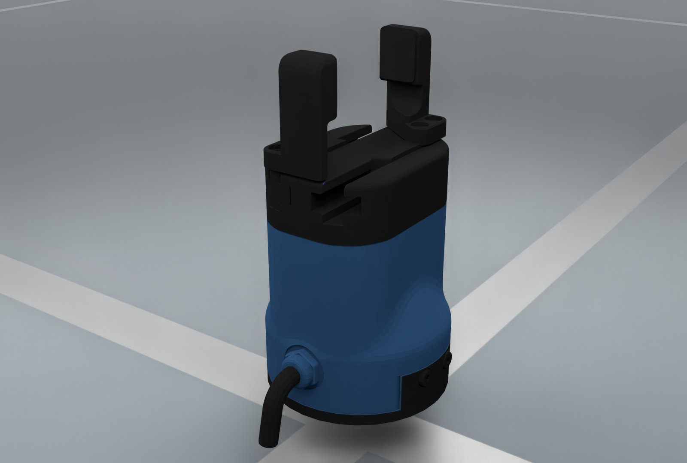
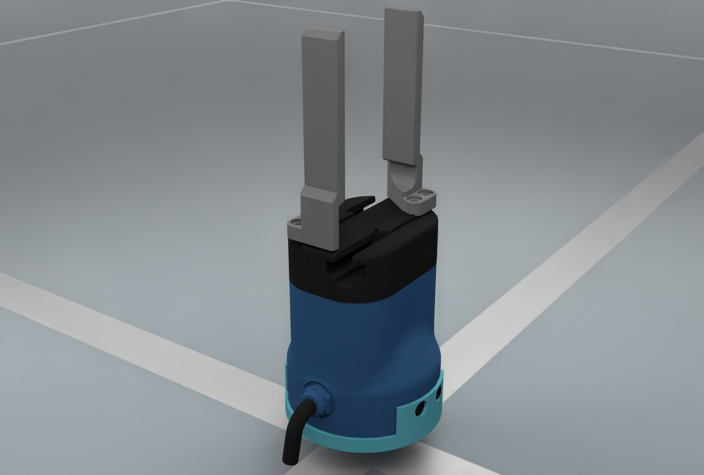

# DH-Robotics PGC-140-50

The `_M` archive is a DexForce-modified PGC-140-50 asset: the historical registry records changes to the connector and fingers. The two assets retain separate IDs and checksums. The unmodified-looking ID does not establish an original-manufacturer URDF release.

<figure style="text-align: center; margin: 20px auto; max-width: 960px;">
  
  <figcaption><b>DH_PGC_140_50/DH_PGC_140_50.urdf</b></figcaption>
</figure>

[Render manifest](../../../_static/robots/eef/dh_pgc_140_50.json).

<figure style="text-align: center; margin: 20px auto; max-width: 960px;">
  
  <figcaption><b>DH_PGC_140_50_M/DH_PGC_140_50_M.urdf</b></figcaption>
</figure>

[Render manifest](../../../_static/robots/eef/dh_pgc_140_50_m.json).

The images use the archive's visual meshes and authored materials in native
OfflineRT. They show a zero-coordinate display pose with a presentation root transform,
without stepping physics. Rendering settings and the source URDF checksum are
recorded per image. See [EEF rendering conventions](../end_effectors.md#rendered-illustrations).

## Resolve and preview

Canonical download-class import:

```python
from embodichain_robots.dh_robotics.pgc_140_50.assets import DH_PGC_140_50, DH_PGC_140_50_M
```

Use the stable asset reference for normal loading:

```python
from embodichain.data import get_data_path

urdf_path = get_data_path("DH_PGC_140_50/DH_PGC_140_50.urdf")
```

```bash
embodichain data download --name DH_PGC_140_50
embodichain preview-asset --asset_path /absolute/path/to/DH_PGC_140_50.urdf --viser
```

Pass the resolved absolute `urdf_path` to `preview-asset`. Asset listing and
class lookup do not download the archive; resolving its files may download on
first use. The remaining source models in this archive are listed in the image
captions above.

## Ownership and provenance

The download class lives in `extensions/embodichain_robots/dh_robotics/pgc_140_50/assets.py` and registers through the
existing `embodichain.assets` catalog with category `eef`. This asset-only
package does not introduce a standalone robot preset. Host assembly owns the
mounting transform, naming prefix, control-group mapping and task-specific TCP.

The [asset provenance record](https://github.com/DexForce/EmbodiChain/blob/main/extensions/embodichain_robots/dh_robotics/pgc_140_50/README.md)
separately records manufacturer affiliation, model matching, asset production,
archive distribution, modifications and license status. Missing upstream or
license evidence stays explicitly unverified. The Python implementation's
Apache header is not an asset license statement.
