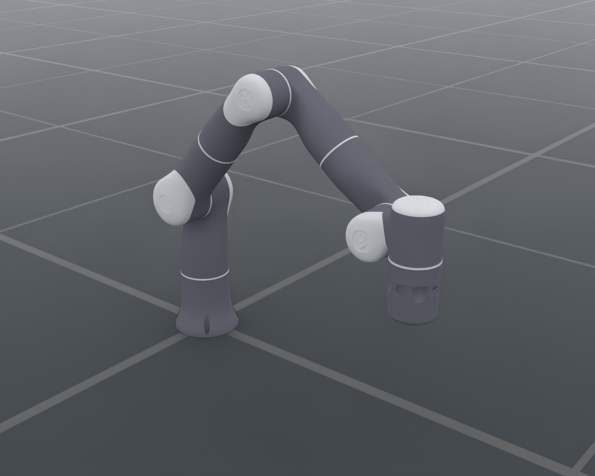

# Flexiv Rizon 4S

`FlexivRizon4SCfg` integrates Flexiv's seven-axis Rizon 4S arm with its bare
flange, original meshes and materials. The catalog ID is `FlexivRizon4S`.
The preset has one `arm` control part, containing `joint1` through `joint7`;
it does not attach a gripper or declare an `eef` control part.

<div style="text-align: center;">
  
</div>

The image uses the catalog defaults and native OfflineRT with the same default
lighting/render settings as the other robot resource pages. Camera and renderer
settings are recorded in the [render manifest](../../_static/robots/flexiv_rizon4s_render.json).

## Usage

```python
from embodichain.lab.sim import SimulationManager, SimulationManagerCfg
from embodichain_robots import FlexivRizon4SCfg

sim = SimulationManager(SimulationManagerCfg(headless=True))
try:
    cfg = FlexivRizon4SCfg.from_dict({})
    robot = sim.add_robot(cfg=cfg)
    sim.prepare()
    sim.update(step=1)
finally:
    sim.destroy(exit_process=False)
SimulationManager.flush_cleanup_queue()
```

The shared catalog also accepts `resolve_robot_cfg("FlexivRizon4S")`, or
`class_type: FlexivRizon4S` in a robot configuration mapping. Discover and
preview it with:

```bash
embodichain list-robot
embodichain data list --category robot
embodichain data download --name FlexivRizon4S
embodichain preview-robot --robot FlexivRizon4S --renderer rt
embodichain preview-robot --robot FlexivRizon4S --headless --renderer no-render --max-steps 300
```

## Assets and kinematic frames

The approximately 0.8 MB Apache-2.0 asset archive is hosted in the
[EmbodiChain Hugging Face dataset](https://huggingface.co/datasets/DexForceAI/embodichain_data/blob/main/robot_assets/FlexivRizon4S_v1.zip).
`get_data_path("FlexivRizon4S/rizon4s.urdf")` uses the standard `FlexivRizon4S`
data wrapper to download, checksum and extract it under the shared dataset lock
into the revision-specific `FlexivRizon4S_v1` cache. The configured
`EMBODICHAIN_DOWNLOAD_PREFIX` is tried first, with the official Hugging Face
dataset as a fallback. A network connection is needed for the initial download;
subsequent loads reuse the cache. ROS and Xacro processing are not required.
Catalog listing does not construct the robot or download its assets.

The archive contains the expanded URDF, visual/collision meshes and MTLs,
original parameter/Xacro files, the drive-reference USD layers, `LICENSE`,
`NOTICE` and a SHA256 provenance manifest. Expansion changes only mesh paths
to relative paths; joint/link names, transforms and numerical inertial values
remain those of the pinned official description. A derived triangular copy of
the visual joint-ring mesh supports native ray tracing, which skips the source
mesh's polygon faces. The original OBJ remains in the archive; vertex positions,
UVs, material assignments and collision meshes are unchanged.

Both simulation and `build_pk_serial_chain()` use the same selected URDF.
An explicit URDF `fpath` override replaces that source for both consumers.
The chain and the default `PytorchSolverCfg` run from `base_link` to `flange`.
The TCP is identity, so FK returns the bare flange pose. IK targets that same
frame. The general numerical solver accommodates this arm's offset joint
geometry without assuming Franka or spherical-wrist dimensions.

The initial joint positions are the official ready pose, in source order:
`[0, -0.69813, 0, 1.570796, 0, 0.69813, 0]` radians.

## Optional SSIK CUDA and CPU reference

Explicit `SSIKSolverCfg(backend="cuda_rr", ...)` runs the prepared
Raghavan–Roth matrix-pencil solve entirely on CUDA, without installing SSIK.
It enumerates all 384 slots on the verified 16-sample joint-lock grid, bridges
the source terminal frame, and checks actual PK/TCP pose error after float32
conversion. The coefficient bundle includes a corrected zero-lock DH chart
and an offline build/consistency manifest. Finite-grid continuous coverage and
single-call p99 have not passed the default-switch gates; Pytorch remains the
default. Preserve the preset's root, flange and TCP when opting in.

The preset retains its Pytorch default. An explicit `SSIKSolverCfg` reference
configuration can use the prepared `flexiv_rizon4s.py` package resource. See
[prepared SSIK models](../../overview/sim/motion/solvers/ssik_solver.md#prepared-arx5-and-rizon4s-models)
for the complete selection and rebuild example.

This source model is not strict SRS. The reference uses pinned SSIK's
joint-lock and 6R algebraic path after verifying the source joint prefix,
with an explicit correction for the 43 mm terminal offset relative to the
upstream Rizon 4 artifact. Model, joint order, source and coefficient sidecar
fingerprints are checked. Its fixed 16-sample cached RR grid never launches
an unprepared HP secondary solve; a failed finite search is not proof of
unreachability. Every accepted result is validated against the
actual Rizon 4S PK chain and TCP. CPU reference and CUDA RR are separate,
explicitly selected paths; failure does not invoke another solver.

## Published dynamics and simulation drives

Link masses, centers of mass, complete inertia tensors, position limits and
speed limits are preserved from the official URDF. No automatic mass scaling
or inertia recomputation is applied. For example, the base mass is 3.788 kg,
link 1 is 3.596 kg and link 7 is 1.403 kg in that public model.

**These are public simulation parameters.** [Flexiv's RDK documentation](https://www.flexiv.com/software/rdk/manual/robot_description.html)
states that public URDF dynamics parameters are blurred. Precise robot dynamics
require the `flexiv::rdk::Model` API on a connected robot. Likewise, the published
Isaac Sim drive gains below do not specify the real controller's factory gains.

The preset uses the force-drive stiffness and armature from Flexiv's official
Isaac Sim asset. USD angular stiffness/damping are per degree; multiplying by
`180/pi` gives the per-radian values consumed by EmbodiChain. Armature remains
in kg·m². The official damping reference is **80 / 70 / 15 N·m·s/rad** for
joints 1–2 / 3–4 / 5–7. The preset multiplies that damping by three to suppress
repeated rebound during reachable native IK dragging on the Default backend.
This damping adjustment is simulation tuning, not a manufacturer controller gain.

| Joints | Stiffness (N·m/rad) | Damping (N·m·s/rad) | Effort limit (N·m) | Armature (kg·m²) | Speed limit (rad/s) |
| --- | ---: | ---: | ---: | ---: | ---: |
| 1–2 | 4000 | 240 | 123 | 3.169792 | 2.0944 |
| 3–4 | 5000 | 210 | 64 | 1.375488 | 2.4435 |
| 5–7 | 1500 | 45 | 39 | 0.134325 | 4.8869 |

The regression exercises a reachable 8 cm Cartesian arc over 250 ms with the
native DexSim IK solver and a 10 ms physics step. Increased damping reduces
rebound with some additional tracking lag; it does not resolve IK solution
jumps at joint limits or unreachable targets.

Passive joint friction is zero as authored in the official simulation asset.
The fixed base, disabled self-collision and Default-backend root iteration
counts (32 position, 16 velocity) also follow that asset. Newton ignores the
root iteration counts; enforcement of drive/limit fields depends on its
selected solver, as described by `JointDrivePropertiesCfg`.

As with other robot configurations, `joint_drive_props`, `root_props`,
`attrs` and per-link `link_attrs` can override these simulation defaults.
For example, tune the shoulder drive without replacing its torque limits:

```python
cfg = FlexivRizon4SCfg.from_dict(
    {"joint_drive_props": {"stiffness": {"joint[1-2]": 3000.0}}}
)
```

## Pinned sources

- [Flexiv description, jazzy-v3.1](https://github.com/flexivrobotics/flexiv_description/tree/7d5dd28c3bbf66115b3e098d5df25c01c953104b):
  `config/Rizon4s`, `meshes/Rizon4s`, and the official Xacro macros.
- [Flexiv Isaac Sim workspace](https://github.com/flexivrobotics/isaac_sim_ws/tree/9378b06fea73e338dc05cc047272b47c74101379/assets/rizon_4s/payloads/Physics):
  `physics.usda` supplies gains/effort, and `physx.usda` supplies armature,
  friction and root iteration counts.
- Archive SHA256:
  `850c9531a19d103b15c9609f60a6d594dbde602032c8fbb34b73c83fc4ecabf3`.
