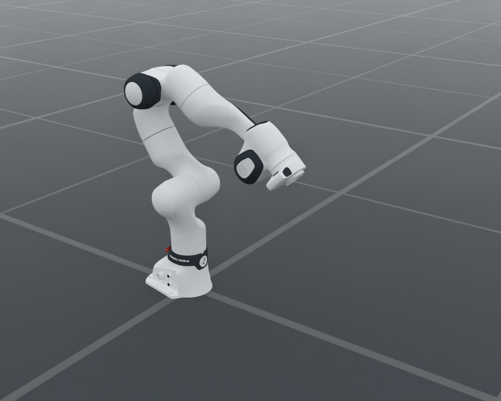

# Franka — seven-DOF bare arms

`FrankaCfg`, catalog ID `Franka`, selects a bare seven-joint arm. Both variants expose only `arm`;
the default TCP is the flange and no end effector is attached implicitly.

<div style="text-align: center;">
  
  <p><b>Franka — bare arm</b> (default FR3 model)</p>
</div>

The image is a native OfflineRT render of the configured FR3 asset in its
initial joint pose, ending at the mounting flange. No physics steps or tool
attachments are used. The [render record](../../../_static/robots/franka/fr3.json)
preserves source URDF hashes, named joints, camera and renderer settings.
The original Panda variant is selected separately through `arm_model` below.

| Variant | Source arm | Solver | Flange |
| --- | --- | --- | --- |
| `fr3` (default) | Historical FR3 asset, `Franka/Panda/Panda.urdf` | FEP | `fr3_link8` |
| `panda` | Pinned original Panda, `FrankaPandaArm/Panda/PandaExactV1.urdf` | Pink | `ee_link` |

## Construction and preview

```python
from embodichain_robots import FrankaCfg

arm = FrankaCfg.from_dict({})  # FR3 by default
panda_arm = FrankaCfg.from_dict({"arm_model": "panda"})
assert set(arm.control_parts) == {"arm"}
assert len(arm.init_qpos) == 7
```

Add the selected configuration to `SimulationManager` with `sim.add_robot(cfg=arm)`.
The catalog and preview CLI use the same configuration:

```bash
embodichain preview-robot --robot Franka --variant fr3 --renderer rt
embodichain preview-robot --robot Franka --variant panda --renderer rt
```

## Franka and the historical FrankaPanda entry

| Selection | Constructed robot | Tool ownership |
| --- | --- | --- |
| `Franka` / `FrankaCfg`, `arm_model: fr3` | Seven-joint FR3 arm | Embodiment or standard RobotCfg overrides |
| `Franka` / `FrankaCfg`, `arm_model: panda` | Seven-joint original Panda arm | Embodiment or standard RobotCfg overrides |
| `FrankaPanda` / `FrankaPandaCfg` | Historical FR3 arm, with legacy `robot_type: panda` | Explicit assembly is also required |
| `franka_panda` embodiment | FR3 arm plus native Panda Hand | Component declares hand joints, drives, mount and TCP |

The legacy `FrankaPanda` name continues to select the historical FR3 asset
family. The original Panda is selected by `FrankaCfg` with `arm_model: panda`.
See [FrankaPanda and its native-hand setup](panda.md) for the compatibility
constructor and a visual comparison with the explicit hand assembly.

## Mounting end effectors

Use the same standard RobotCfg overrides as UR arms: append a `hand` URDF
component, declare its control group, drives and initial joints, and set the
flange-to-TCP matrix in `solver_cfg.arm.tcp`. The component's `transform` is
the flange-to-hand mounting transform. The TCP matrix includes that mounting
transform and the tool-local TCP offset once.

The reusable embodiment components provide concrete qualified assemblies:

- `franka_panda.yaml` and `franka_panda_rgb_224.yaml` mount the authored FR3
  hand as a separate component, preserving its finger joints and contact TCP.
- `franka_panda_robotiq85.yaml` mounts the shared `Robotiq_V2` 2F-85 at the
  explicitly declared 18 mm adapter, with a 150 mm tool-local offset. It owns
  the six linkage joint declarations, signed limits, tool drives, nominal
  inertial overlays and solver iteration calibration.

The FR3 hand component `Franka/Panda/Fr3HandV1.urdf` is derived from the pinned
`PandaWithHand.urdf` hand subtree. The original file is retained. Link and joint
names, collision geometry and authored inertials are preserved; a sidecar
records the source and derived hashes. The arm and hand URDFs share their
original asset directory so relative mesh paths remain valid.

The Robotiq assembly retains its qualified asset, component order and assembly
name. The separate `Robotiq2F85` archive is a different model identity and is
not substituted. Opening conversion remains available from
`embodichain_robots.robotiq.two_finger.robotiq85_joint_positions`.

## Migration

`gripper`, `gripper_mount_z_m`, `gripper_mount_yaw_rad` and `tcp_offset_m` are
removed from `FrankaCfg`; supplying them fails with assembly guidance. Use the
ordinary component and solver fields described above. Tool identity is owned
by the explicitly selected tool asset rather than a second arm selector.

`FrankaPandaCfg` and catalog ID `FrankaPanda` remain legacy selectors for the
historical FR3 arm (`robot_type: panda`). They now also produce a bare arm.
Callers needing fingers must use an explicit embodiment or mount their tool.
Bare dual-arm composition contains fourteen arm joints; finger groups are
added only by a tool-equipped deployment. Official native-hand and PGI
consumers assemble their tools explicitly.

Model-specific Panda inertial overlays remain arm-owned. Tool and contact
calibrations are embodiment-owned. Identified inertials, nominal tool values
and the explicit 5 g pad assumption establish simulation settings, not hardware
dynamics qualification. See the model README and asset provenance for sources.
