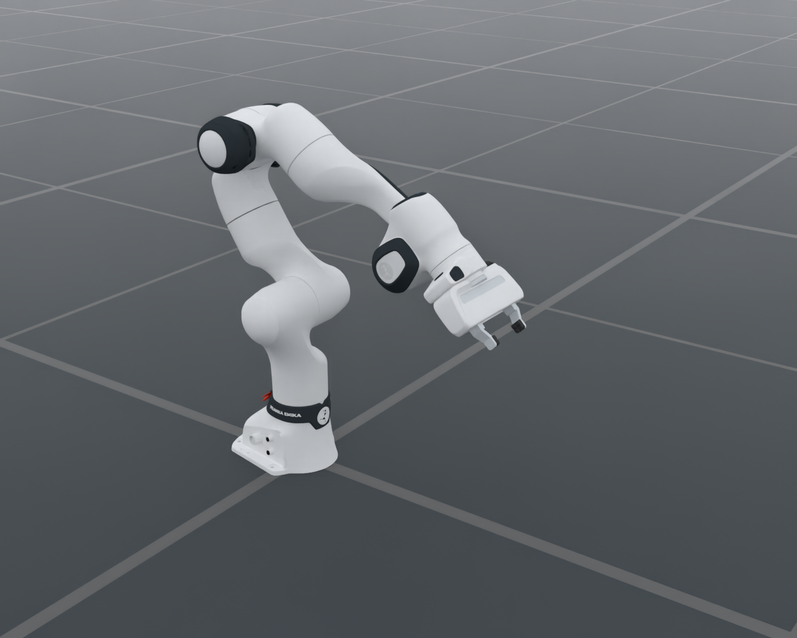

# FrankaPanda — compatibility and native-hand setup

`FrankaPandaCfg` is a compatibility selector for the historical FR3 asset family.
`robot_type: panda` continues to choose that model; it now constructs its bare
seven-joint arm ending at `fr3_link8`. New callers use `FrankaCfg` with
`arm_model: fr3` or `arm_model: panda`.

Mount end effectors with ordinary URDF components, control groups, drive
parameters and solver TCP overrides, as for UR robots. The `franka_panda`
embodiment explicitly installs the native hand for existing task deployments.
See [Franka configuration](cfg.md) for arm selection, assembly and migration.

## Bare compatibility constructor

```python
from embodichain_robots import FrankaPandaCfg

cfg = FrankaPandaCfg.from_dict({"robot_type": "panda"})
robot = sim.add_robot(cfg=cfg)
```

The catalog ID `FrankaPanda` and YAML `class_type: FrankaPanda` remain valid.
This constructor exposes `arm` with seven joints and a flange TCP. Its native
joint names are `fr3_joint1` through `fr3_joint7`; the end link is `fr3_link8`.

## Explicit native-hand assembly

<div style="text-align: center;">
  
  <p><b>FrankaPanda — native-hand assembly</b> (explicit <code>franka_panda</code> embodiment)</p>
</div>

The hand-equipped layout shown here is loaded from the existing embodiment
component. It uses the same camera, lighting and arm pose as the
[Franka bare-arm illustration](cfg.md). The
[render record](../../../_static/robots/franka/native_hand.json) includes both
source components and their transforms.

The embodiment is a reusable configuration, selected independently of the arm
class. It adds two named finger joints to the seven arm joints; the source
mimic relation leaves one independent finger drive. Its control groups are
`arm` and `eef`, and its solver TCP includes the hand mounting rotation and
103.4 mm flange-to-TCP offset.

For standalone construction, load that component through the public catalog:

```python
from embodichain.robot_registry import resolve_robot_cfg
from embodichain.utils.utility import load_config
from embodichain_tasks.configs import get_config_path

fields = load_config(get_config_path("components/embodiments/franka_panda.yaml"))[
    "simulation"
]
cfg = resolve_robot_cfg(fields.pop("class_type"), fields)
robot = sim.add_robot(cfg=cfg)
```

The [Task Program quickstart](../../../overview/task_program/quickstart.md)
uses this explicit native-hand embodiment. Tool geometry, commands and TCP
belong to the component, while `FrankaPandaCfg` remains the bare-arm
compatibility selector.

```{eval-rst}
.. py:class:: embodichain_robots.franka.panda.FrankaPandaCfg

   Legacy FR3 arm selector. The inherited ``from_dict()`` and
   ``build_pk_serial_chain()`` use the bare seven-joint arm and flange TCP.
```
