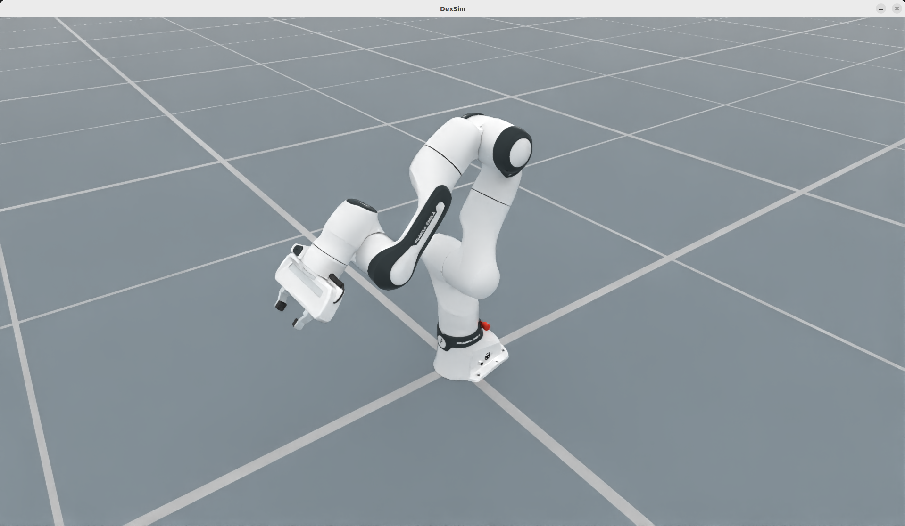

# Franka Panda

`FrankaPandaCfg` configures the Franka Panda manipulator together with its
parallel-jaw hand. The bundled model contains the seven-joint arm and two
finger joints in one URDF.

<div style="text-align: center;">
  
  <p><b>Franka Panda with parallel-jaw hand</b></p>
</div>

## Key Features

- **Seven-axis manipulator** with the two-joint Panda hand.
- **Ready-to-use robot configuration** for the URDF, control parts, joint
  drives, and initial joint positions.
- **Numerical forward and inverse kinematics** through `PytorchSolverCfg` and
  `pytorch-kinematics`.
- **Multi-environment simulation support** through `SimulationManager`.
- **Dual-arm composition support** through the `"FrankaPanda"` base-robot key.

## Usage

```python
from embodichain.lab.sim import SimulationManager, SimulationManagerCfg
from embodichain_robots import FrankaPandaCfg

sim = SimulationManager(SimulationManagerCfg(headless=True, num_envs=4))
cfg = FrankaPandaCfg.from_dict({"robot_type": "panda"})
robot = sim.add_robot(cfg=cfg)
```

`from_dict` also accepts standard `RobotCfg` overrides. For example, the base
pose and initial joint positions can be changed when the configuration is
created:

```python
cfg = FrankaPandaCfg.from_dict(
    {
        "robot_type": "panda",
        "init_pos": [0.5, 0.0, 0.0],
        "init_qpos": [0.0, -0.5, 0.0, -2.5, 0.0, 2.8, 0.7, 0.04, 0.04],
    }
)
```

## Robot Configuration

| Item | Default |
|------|---------|
| Configuration class | `FrankaPandaCfg` |
| `robot_type` | `"panda"` (the only currently supported variant) |
| UID | `FrankaPanda` |
| URDF | `Franka/Panda/PandaWithHand.urdf` |
| Arm joints | `fr3_joint1` through `fr3_joint7` |
| Hand joints | `fr3_finger_joint1`, `fr3_finger_joint2` |
| Kinematics root / end link | `base` / `fr3_hand_tcp` |
| Solver | `PytorchSolverCfg` with 30 samples |

The configuration exposes two independently addressable control parts:

```python
arm_joint_ids = robot.get_joint_ids("arm")
eef_joint_ids = robot.get_joint_ids("eef")
```

The hand's second finger joint is a mimic of the first in the bundled URDF.
`embodichain list-robot` therefore reports eight independent control DOFs and
marks the gripper as `eef (1+1m)`.

## Default Joint State

The default state places the arm in a neutral ready pose and opens both fingers:

| Joint | Position (rad) |
|-------|----------------|
| `fr3_joint1` | 0.000 |
| `fr3_joint2` | -0.569 |
| `fr3_joint3` | 0.000 |
| `fr3_joint4` | -2.810 |
| `fr3_joint5` | 0.000 |
| `fr3_joint6` | 3.037 |
| `fr3_joint7` | 0.741 |
| `fr3_finger_joint1` | 0.040 |
| `fr3_finger_joint2` | 0.040 |

## Franka Panda with PGI Gripper

`FrankaPandaPgiCfg` assembles the arm-only Panda URDF with the DH Robotics
`DH_PGI_140_80` parallel gripper on the `fr3_link8` flange. It owns the whole
assembly, so none of the Panda-hand defaults above apply.

Preview this catalog entry with `embodichain preview-robot --robot FrankaPandaPgi --viser`.

```python
from embodichain_robots import FrankaPandaPgiCfg

cfg = FrankaPandaPgiCfg.from_dict({"init_pos": [0.5, 0.0, 0.0]})
robot = sim.add_robot(cfg=cfg)
```

| Item | Default |
|------|---------|
| Configuration class | `FrankaPandaPgiCfg` |
| UID | `FrankaPandaPgi` |
| URDF components | `Franka/Panda/Panda.urdf` (arm), `DH_PGI_140_80/DH_PGI_140_80.urdf` (hand) |
| Control parts | `arm`: `fr3_joint1` through `fr3_joint7`; `eef`: `gripper_finger1_joint_1` |
| Solver | `FEPSolverCfg`, root `base`, end link `fr3_link8` |
| Tool center point | 0.17 m along the `fr3_link8` z axis |
| Initial gripper state | Open: both PGI finger joints at 0.0 |
| Newton fingertip contacts | `gripper_finger1_link_1`, `gripper_finger2_link_1` |

The arm solver and `build_pk_serial_chain()` both end at `fr3_link8` on the
arm URDF used by the assembly. The serial chain returns the flange pose;
compose it with `cfg.solver_cfg["arm"].tcp` to obtain the tool center point
the solver plans for.

## Dual-Arm Composition

Use `DualArmRobotCfg` with `base_robot="FrankaPanda"` to create a pair of Panda
arms. The dual-arm builder prefixes the generated joints, control parts, and
solver links with `left_` and `right_`.

```python
from embodichain.lab.sim.robots import DualArmRobotCfg

cfg = DualArmRobotCfg.from_dict(
    {
        "base_robot": "FrankaPanda",
        "mount": {"preset": "side_by_side", "separation": 0.6},
    }
)
robot = sim.add_robot(cfg=cfg)
```

See :doc:`dual_arm` for the available mount presets and configuration options.

## See Also

- :doc:`/overview/sim/motion/solvers/index` - IK solver reference
- :doc:`/guides/add_robot` - Adding a new robot (quick reference)
