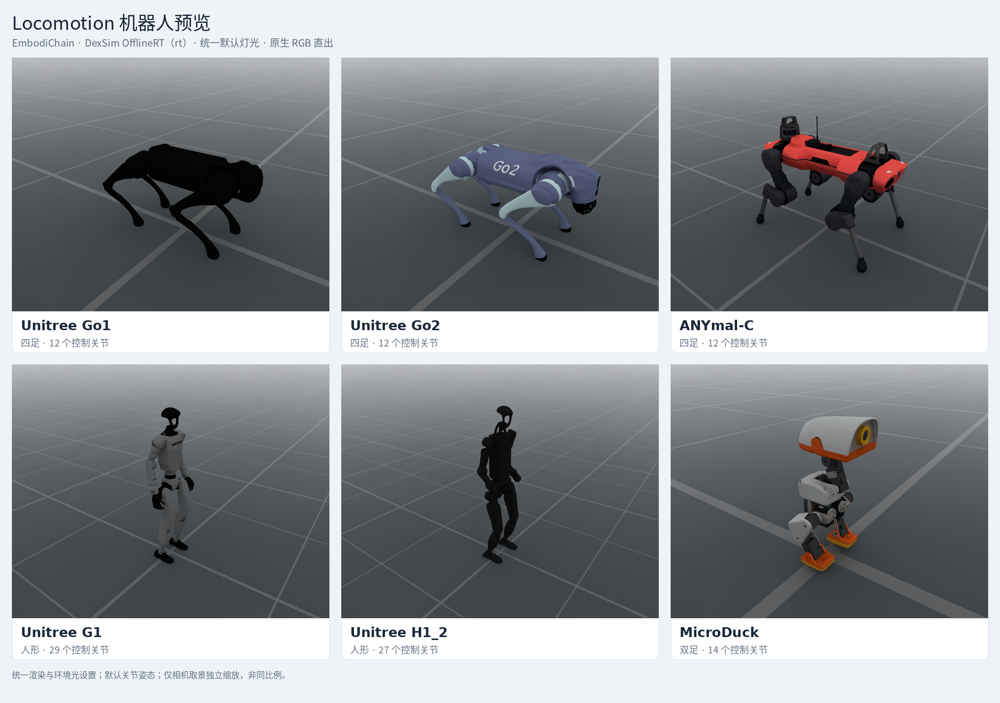

# Locomotion robots

The bundled locomotion presets use the generic `Robot` runtime. They can be
selected independently of a task through the robot catalog:



DexSim OfflineRT (`rt`) preview with shared lighting and render settings:
1 sample per pixel, DLSS denoising, tone mapping disabled and exposure 1.
Each model uses its default joint pose and is framed independently, so the
images do not show a common physical scale. RGB captures have no additional
gamma or color correction.

| Catalog ID | Configuration class | Controlled joints |
| --- | --- | --- |
| `UnitreeGo1` | `UnitreeGo1Cfg` | 12 |
| `UnitreeGo2` | `UnitreeGo2Cfg` | 12 |
| `UnitreeG1` | `UnitreeG1Cfg` | 29 |
| `UnitreeH1_2` | `UnitreeH12Cfg` | 27 |
| `ANYmalC` | `ANYmalCCfg` | 12 |
| `MicroDuck` | `MicroDuckCfg` | 14 |

```bash
embodichain preview-robot --robot UnitreeGo2
```

Each configuration owns the simulation asset, floating base, default standing
pose, `locomotion` control group and effective PD drive defaults previously
defined by its flat-velocity task. The same model configuration serves Default
and Newton deployments. G1 and H1_2 identify the specific bundled models above;
they do not select other hardware revisions implicitly.

Task YAML selects `robot.class_type` and may override `joint_drive_props`.
Tasks continue to own action scaling, observation layout, commands, rewards,
randomization and illegal-contact rules. Contact sensors remain environment
declarations. The model profiles are simulation presets, not certified hardware
calibrations or implementations of Isaac Lab's learned or BAM actuators.

The backend-free profile reader is shared with pure Torch task contracts.
Source-ordered `asset.init_qpos` and the ordered
`robot.joint_names` / `robot.default_joint_position` pair have distinct roles;
keep their ordering when changing a model. Foot and IMU reference points are
stored alongside the model. The presets retain `build_pk_chain=False` and
provide no limb IK solver.

See the [API reference](../../api_reference/locomotion_robots.rst) for the public
configuration classes and model-profile reader.
