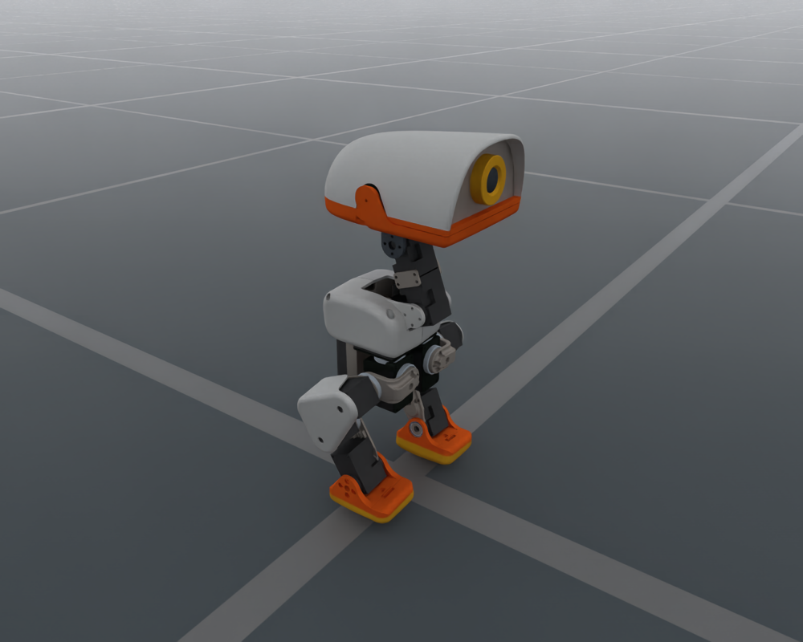

# MicroDuck

`MicroDuckCfg` configures the bundled 14-joint MicroDuck biped,
including its floating base, standing pose and simulation PD drive defaults.

<div style="text-align: center;">
  
  <p><b>MicroDuck in the default joint pose</b></p>
</div>

## Usage

```python
from embodichain.lab.sim import SimulationManager, SimulationManagerCfg
from embodichain_robots import MicroDuckCfg

sim = SimulationManager(SimulationManagerCfg(headless=True, num_envs=1))
cfg = MicroDuckCfg.from_dict({})
robot = sim.add_robot(cfg=cfg)
```

The catalog ID is also accepted by the shared preview command:

```bash
embodichain preview-robot --robot MicroDuck
```

## Robot Configuration

| Item | Default |
| --- | --- |
| Catalog ID / UID | `MicroDuck` |
| Configuration class | `MicroDuckCfg` |
| Canonical module | `embodichain_robots.pollen_robotics.microduck` |
| Vendor | `pollen_robotics` |
| Morphology | `biped` |
| Arm count | 0 |
| Asset | `MicroDuckLocomotion/microduck.urdf` |
| Control parts | `locomotion`: 14 joints |
| Base | Floating |
| Initial root height | 0.12 m |
| Physics backends | Default and Newton |
| Limb IK solvers | None; `build_pk_chain=False` |

Standard `RobotCfg` overrides, including `joint_drive_props`, are accepted
by `from_dict`. Locomotion tasks preserve these explicit overrides.

## See Also

- {doc}`Shared locomotion defaults and render settings </resources/robot/locomotion>`
- {doc}`Locomotion robot API reference </api_reference/locomotion_robots>`
