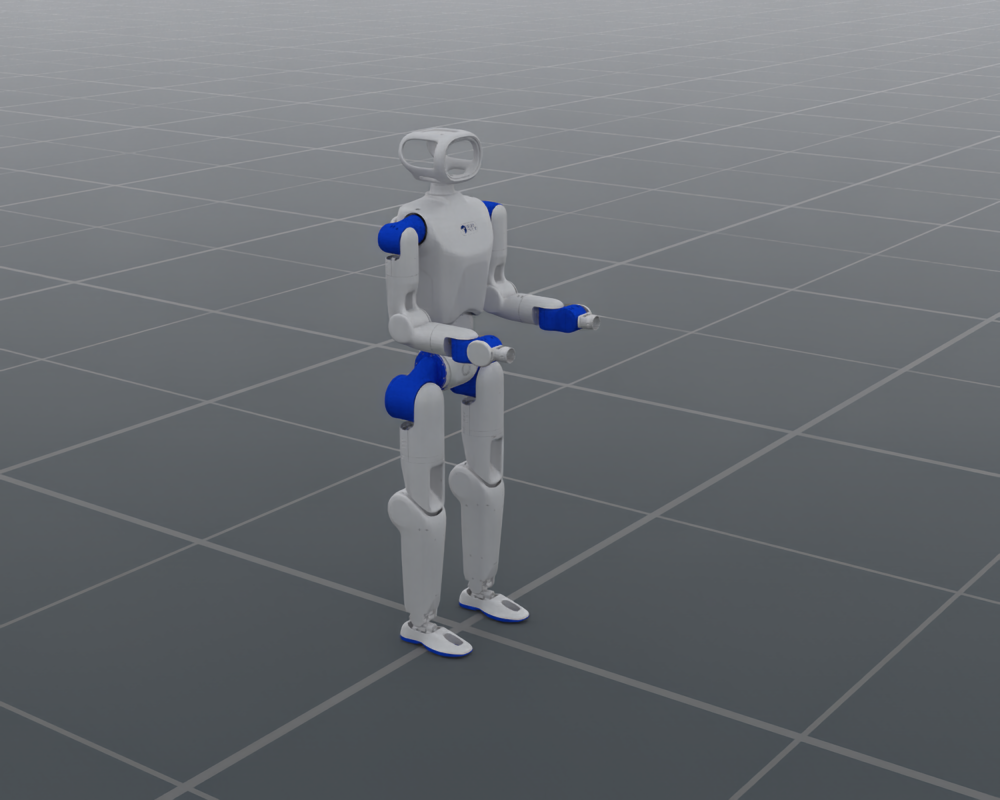
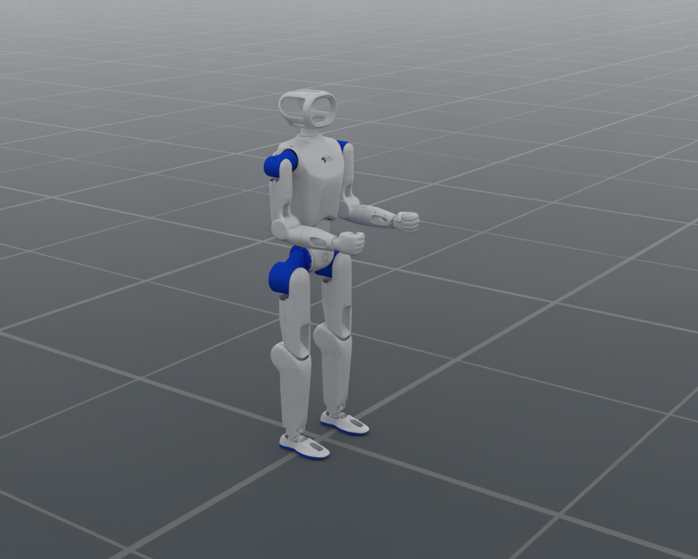
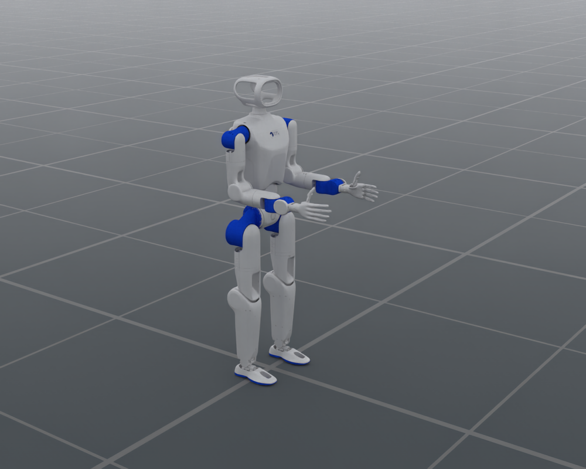
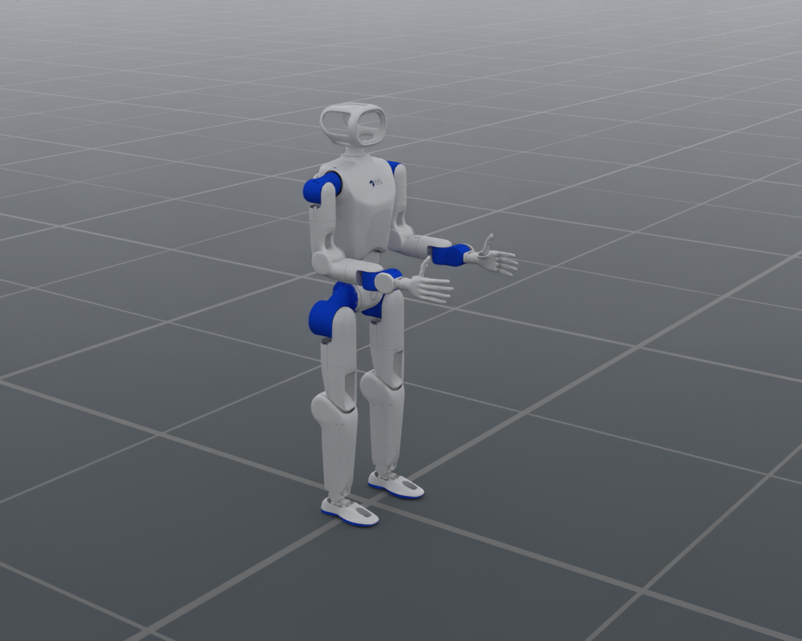

# RoboParty RP1

`RoboPartyRP1Cfg` configures the floating-base RP1 humanoid. Select a
variant with `--variant` in the CLI or with the `model` field in
`RoboPartyRP1Cfg.from_dict()`.

| `28dof` | `24dof` |
| --- | --- |
|  |  |

| `hand` | `hand_fixed` |
| --- | --- |
|  |  |

Each render uses its preset's default joint pose. All four share the same
camera and lighting. The [shared locomotion render settings](../locomotion.md#render-settings)
use DexSim OfflineRT, one sample per pixel, DLSS and exposure 1 with tone
mapping disabled. [Render manifest](../../../_static/robots/roboparty/render_manifest.json)

## Variants and control

| Variant | URDF under `RoboPartyRP1/` | Wrist axes per side | Independent commands |
| --- | --- | --- | --- |
| `28dof` (default) | `rp1.urdf` | Roll, yaw and pitch | 28 in `locomotion` |
| `24dof` | `rp1_24dof.urdf` | Roll | 24 in `locomotion` |
| `hand` | `rp1_hand.urdf` | Roll, yaw and pitch | 28 in `locomotion`, 6 each in `left_eef` and `right_eef` |
| `hand_fixed` | `rp1_hand_fixed.urdf` | Roll, yaw and pitch | 28 in `locomotion` with fixed fingers |

Each RP1 has six joints per leg, two at the waist, and three shoulder axes
and one elbow axis per arm. The single-axis wrists on `24dof` account for
the four-joint difference from `28dof`. The `hand` and `hand_fixed` models
share the visual hand geometry. The articulated version adds six independent
finger joints and five mimic followers per side. In `hand_fixed`, the fixed
fingers move as a unit with each wrist.

The floating base starts at 0.78 m from the upstream MJCF. The body uses
simulation PD gains and source URDF joint limits. The articulated finger
drives apply simulation limits of 2 N·m and 5 rad/s because the source
declares zero effort and velocity for the fingers. The finger armature
is 0.01 kg·m², matching the source MJCF and stabilizing the native mimic
response in Newton. The presets expose joint-space control with
`build_pk_chain=False`.

## Usage

```bash
embodichain data download --name RoboPartyRP1
embodichain preview-robot --robot RoboPartyRP1 --variant hand
```

Given a `SimulationManager` named `sim`:

```python
from embodichain.extensions.robots import RoboPartyRP1Cfg

cfg = RoboPartyRP1Cfg.from_dict({"model": "hand"})
robot = sim.add_robot(cfg=cfg)
```

### Newton scene settings

RP1's foot contacts can exceed the default Newton constraint capacity.
Pass the following `physics_cfg` to `SimulationManagerCfg` for the
single-robot scene used in validation.

```python
from embodichain.lab.sim.cfg import NewtonPhysicsCfg

physics_cfg = NewtonPhysicsCfg(
    solver_cfg={
        "solver_type": "dexuni",
        "mujoco_options": {"njmax": 512, "nconmax": 256},
    }
)
```

## Assets and provenance

The downloader verifies the pinned archive and adds root-level URDFs with
mesh paths relative to the archive root. The originals, MJCF and meshes
remain in the local cache shared with [standalone RP Hand](rp_hand.md).
The pinned description repository leaves asset license terms unspecified.
EmbodiChain retrieves the archive directly from RoboParty at runtime.
[Pinned RP1 source](https://github.com/Roboparty/rp1_description/tree/7b7d807e52cbec23f22f36444ed3129f082d76ca)
