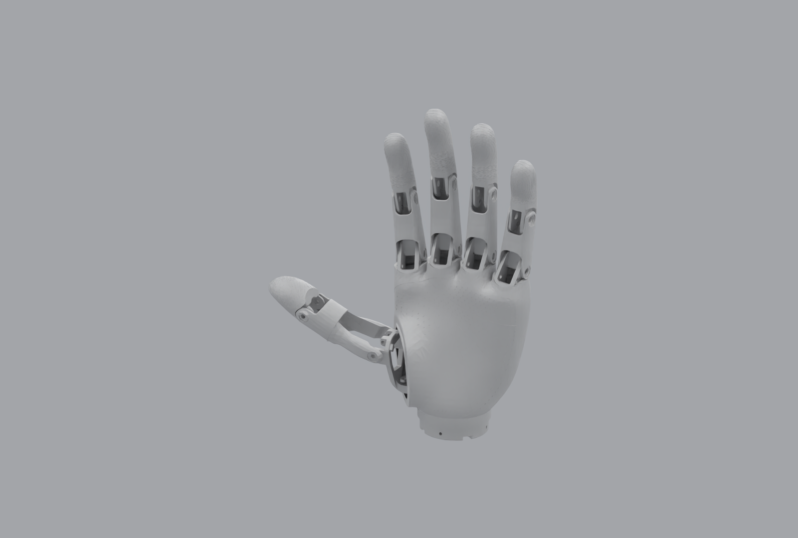
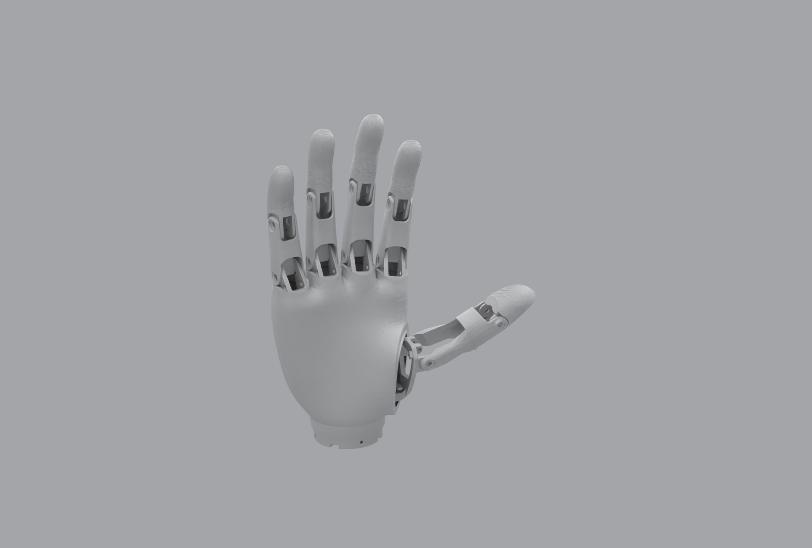

# RoboParty RP Hand

`RoboPartyRPHandCfg` configures a fixed-base RP Hand. The robot catalog ID
is `RoboPartyRPHand`. Select `left` or `right`, with `right` as the default.

<figure style="text-align: center; margin: 20px auto; max-width: 960px;">
  
  <figcaption><b>RP Hand · left · 6 independent commands</b></figcaption>
</figure>

[Left render manifest](../../../_static/robots/eef/roboparty_rp_hand_left.json)

<figure style="text-align: center; margin: 20px auto; max-width: 960px;">
  
  <figcaption><b>RP Hand · right · 6 independent commands</b></figcaption>
</figure>

[Right render manifest](../../../_static/robots/eef/roboparty_rp_hand_right.json)

These previews use the preset's initial joint positions with a presentation
root transform. They follow the [EEF rendering conventions](../end_effectors.md#rendered-illustrations)
and the Wuji Hand and Sharpa Wave studio setup, with environment emission
intensity 40 and three half-intensity rectangular lights.

## Usage

```bash
embodichain data download --name RoboPartyRPHand
embodichain preview-robot --robot RoboPartyRPHand --variant left --viser
```

Given a `SimulationManager` named `sim`:

```python
from embodichain.extensions.robots import RoboPartyRPHandCfg

cfg = RoboPartyRPHandCfg.from_dict({"side": "left"})
robot = sim.add_robot(cfg=cfg)
```

Use `fpath` for a compatible local URDF or USD. A structured `source` can
select an individual articulation prim in a USD file. The preset resolves
`source.file_path` through the asset registry and data root before reading the
selected joint names and mimic relations. Binding and reset align the initial
pose by joint name.

## Control and physical defaults

The `eef` group accepts six joint position targets in radians. The source
order is `finger11`, `finger12`, `finger21`, `finger31`, `finger41` and
`finger51`, with prefix `lh_` or `rh_`. Five other joints follow the source
mimic relations. The preset limits `finger12` to approximately 0.0162 to
1.2326 rad so its follower `finger13` can reach both endpoints within its
authored travel. The fixed palm starts 0.3 m above the ground with the thumb
leader at 0.02 rad.

The simulation uses force PD drives with stiffness 3 N·m/rad and damping
0.1 N·m·s/rad. Effort and speed are capped at 2 N·m and 5 rad/s. The preset
uses 16 position and 4 velocity iterations on Default. On compatible Newton
solvers, it enables the mimic stabilizer for follower tracking.

## Assets and provenance

The portable URDFs resolve as `RoboPartyRPHand/rp_hand_left.urdf` and
`RoboPartyRPHand/rp_hand_right.urdf`. They share the [RP1 model cache](rp1.md).
Each standalone URDF roots the corresponding hand subtree at its palm,
preserving the authored geometry, joint names and mimic relations.
[Pinned articulated RP1 URDF](https://github.com/Roboparty/rp1_description/blob/7b7d807e52cbec23f22f36444ed3129f082d76ca/urdf/rp1_hand.urdf)
