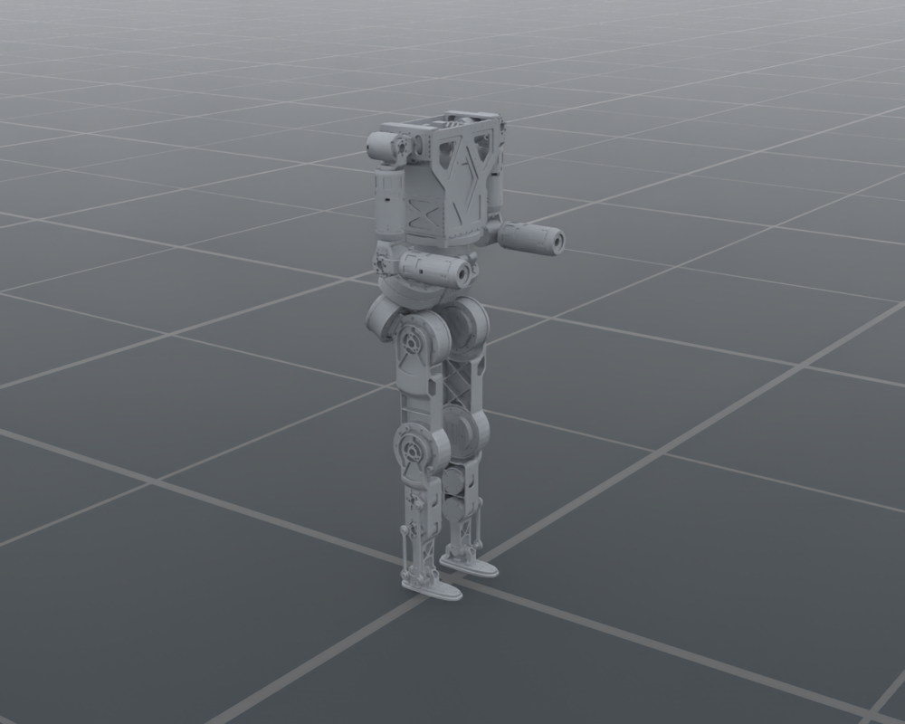

# RoboParty Roboto Origin (RPO)

`RoboPartyRPOCfg` configures the floating-base, 23-joint Roboto Origin
humanoid. The `locomotion` control group follows the source URDF joint order.

<figure style="text-align: center; margin: 20px auto; max-width: 720px;">
  
  <figcaption><b>Roboto Origin in the default joint pose</b></figcaption>
</figure>

The preview follows the shared [locomotion render settings](../locomotion.md#render-settings),
with the three-quarter camera bearing from the W1 and AgiBot G2 previews.
The camera is framed for RPO's dimensions. [Render manifest](../../../_static/robots/roboparty/render_manifest.json)

## Usage

```bash
embodichain data download --name RoboPartyRPO
embodichain preview-robot --robot RoboPartyRPO
```

Given a `SimulationManager` named `sim`:

```python
from embodichain.extensions.robots import RoboPartyRPOCfg

cfg = RoboPartyRPOCfg.from_dict({"uid": "robot"})
robot = sim.add_robot(cfg=cfg)
```

## Configuration and assets

| Item | Default |
| --- | --- |
| Asset | `RoboPartyRPO/rpo.urdf` |
| Control group | `locomotion` with 23 independent joints |
| Base | Floating, with initial root height 0.75 m from the upstream MJCF |
| Position drive | Force PD with stiffness 100 N·m/rad and damping 4 N·m·s/rad |
| Position, effort and velocity limits | Source URDF |
| Physics backends | Default and Newton |
| Control interface | Joint-space control with `build_pk_chain=False` |

The downloader verifies the pinned archive and adds a root-level URDF with
mesh paths relative to the archive root. The local cache keeps the original
URDF, MJCF, meshes and CERN-OHL-W-2.0 license. [Pinned RPO source](https://github.com/Roboparty/rpo_description/tree/8e0f8f78903dc147a5c094c0fdc14b4a78f1b667)
