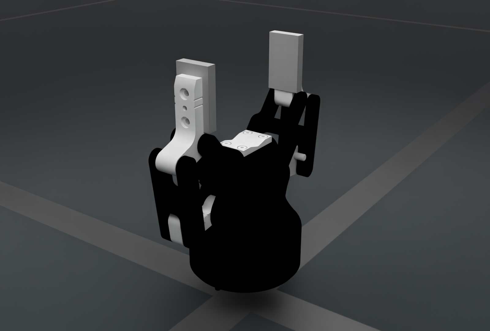
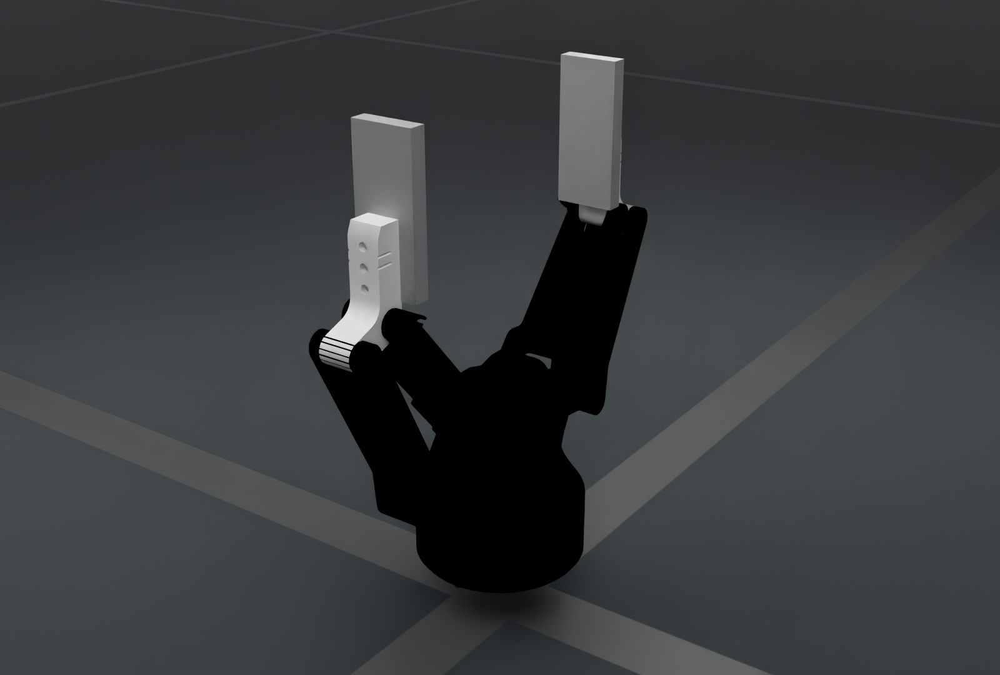

# Robotiq shared gripper archive

The shared `Robotiq` archive contains source-named 85 mm and 140 mm gripper models. It remains a vendor-owned archive and is independent of the separately packaged `Robotiq2F85` asset.

<figure style="text-align: center; margin: 20px auto; max-width: 960px;">
  
  <figcaption><b>Robotiq/robotiq_arg2f_85/robotiq_arg2f_85.urdf</b></figcaption>
</figure>

[Render manifest](../../../_static/robots/eef/robotiq_2f85_shared.json).

<figure style="text-align: center; margin: 20px auto; max-width: 960px;">
  
  <figcaption><b>Robotiq/robotiq_arg2f_140/robotiq_arg2f_140.urdf</b></figcaption>
</figure>

[Render manifest](../../../_static/robots/eef/robotiq_2f140_shared.json).

The images use the archive's visual meshes and authored materials in native
OfflineRT. They show a zero-coordinate display pose with a presentation root transform,
without stepping physics. Rendering settings and the source URDF checksum are
recorded per image. See [EEF rendering conventions](../end_effectors.md#rendered-illustrations).

This page's illustrations enable tone mapping and use emission intensity 20
with quarter-intensity studio lights to retain white-part detail. Source
materials are preserved; the exact settings are recorded in each manifest.

## Resolve and preview

Canonical download-class import:

```python
from embodichain_robots.robotiq.assets import Robotiq
```

Use the stable asset reference for normal loading:

```python
from embodichain.data import get_data_path

urdf_path = get_data_path("Robotiq/robotiq_arg2f_85/robotiq_arg2f_85.urdf")
```

```bash
embodichain data download --name Robotiq
embodichain preview-asset --asset_path /absolute/path/to/robotiq_arg2f_85.urdf --viser
```

Pass the resolved absolute `urdf_path` to `preview-asset`. Asset listing and
class lookup do not download the archive; resolving its files may download on
first use. The remaining source models in this archive are listed in the image
captions above.

## Ownership and provenance

The download class lives in `extensions/embodichain_robots/robotiq/assets.py` and registers through the
existing `embodichain.assets` catalog with category `eef`. This asset-only
package does not introduce a standalone robot preset. Host assembly owns the
mounting transform, naming prefix, control-group mapping and task-specific TCP.

The [asset provenance record](https://github.com/DexForce/EmbodiChain/blob/main/extensions/embodichain_robots/robotiq/README.md)
separately records manufacturer affiliation, model matching, asset production,
archive distribution, modifications and license status. Missing upstream or
license evidence stays explicitly unverified. The Python implementation's
Apache header is not an asset license statement.
