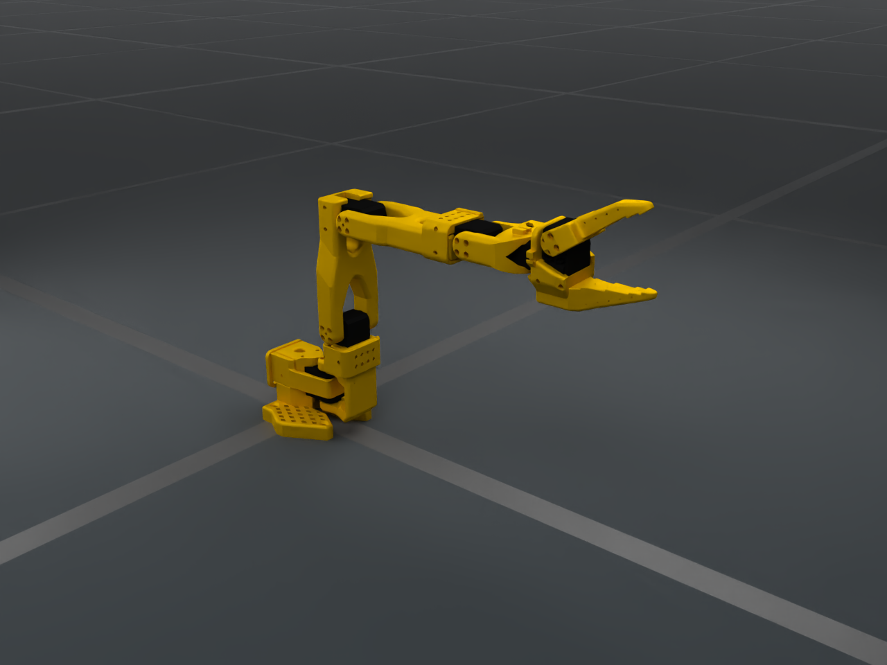

# SO101 Follower

`SO101FollowerCfg` configures The Robot Studio's SO101 follower: a five-axis
arm and one actuated gripper jaw. The canonical catalog ID is `SO101Follower`.



```bash
embodichain data download --name SO101FollowerAssets
embodichain preview-robot --robot SO101Follower --renderer fast-rt
```

For browser joint controls, add `--viser`. Native DexSim rendering displays the
yellow printed parts and dark STS3215 housings; Viser uses simplified colors.

## Usage and control parts

```python
from embodichain.lab.sim import SimulationManager, SimulationManagerCfg
from embodichain_robots import SO101FollowerCfg

sim = SimulationManager(SimulationManagerCfg(headless=True))
cfg = SO101FollowerCfg.from_dict({})
robot = sim.add_robot(cfg)
sim.prepare()

arm_ids = robot.get_joint_ids("arm")
gripper_ids = robot.get_joint_ids("eef")
```

| Control part | Independent joints |
|---|---|
| `arm` | `shoulder_pan`, `shoulder_lift`, `elbow_flex`, `wrist_flex`, `wrist_roll` |
| `eef` | `gripper` |

There are six independent control DOFs and no mimic followers. The base is
fixed; self-collision is disabled by default. Initial joint positions are zero
in the source's **new calibration** convention. The gripper is a revolute
joint in radians; LeRobot's normalized `0..100` gripper command is not a
simulation joint position and requires an explicit mapping.

## Kinematics and frames

The simulation and `build_pk_serial_chain()` use the same official
`so101_new_calib.urdf` component, retaining all asset-defined names.

| Chain | Root | End | DOFs |
|---|---|---|---|
| `arm` | `base_link` | `gripper_frame_link` | 5 |
| `eef` | `gripper_link` | `moving_jaw_so101_v1_link` | 1 |

The arm ends at the source's fixed gripper frame, including its authored TCP
translation and rotation. The jaw chain is local to the gripper body.
`PytorchSolverCfg` supplies arm FK and DLS **position-only IK**: five arm joints
cannot satisfy every arbitrary 6D target pose. The jaw has no IK solver.

## Dynamics and provenance

The preset pins [The Robot Studio's SO-ARM100 repository](https://github.com/TheRobotStudio/SO-ARM100/tree/a758567c3978dfeefe282ede0500085a48fe8f78/Simulation/SO101)
at commit `a758567c3978dfeefe282ede0500085a48fe8f78`. Its unmodified URDF,
thirteen mesh files, motor-reference XML, README and Apache-2.0 license are
cached by `SO101FollowerAssets`. Every file has a pinned SHA256. The first
construction requires network access; later constructions verify and reuse
the revision-specific cache. `EMBODICHAIN_DATA_ROOT` selects its root.

The seven physical links retain their source CAD mass, COM and full inertia
tensor; the preset does not scale or replace them. Their total mass is
approximately **0.732006 kg**, excluding the negligible dummy TCP link.
The source's fixed dummy TCP link has zero inertia; DexSim applies its normal
small-inertia fallback to that frame while retaining the seven physical links.

Motor parameters follow the official
[`joints_properties.xml`](https://github.com/TheRobotStudio/SO-ARM100/blob/a758567c3978dfeefe282ede0500085a48fe8f78/Simulation/SO101/joints_properties.xml),
which adapts STS3215 simulation properties from Open Duck Mini. They are
simulation references, **not hardware-identified parameters or guaranteed
servo specifications**. Actual torque depends on the servo voltage/model.

| Joint property | Default | Source / interpretation |
|---|---|---|
| Drive type | `force` | Torque-based position/velocity drive |
| Position gain | `17.8 N·m/rad` | XML position actuator `kp` |
| Velocity damping | `0.60 N·m·s/rad` | XML joint damping, represented as drive damping for zero-velocity position holds |
| Friction | `0.052` | XML `frictionloss`; interpretation/enforcement depends on backend |
| Armature | `0.028 kg·m²` | XML joint-space artificial inertia |
| Maximum effort | `3.35 N·m` | XML actuator `forcerange`, replacing the URDF's generic `10 N·m` limit |
| Maximum velocity | `10 rad/s` | Published URDF limit |
| Position limits | Source URDF | Retains the pinned model's calibration offsets |

Standard overrides remain available:

```python
cfg = SO101FollowerCfg.from_dict(
    {"joint_drive_props": {"max_effort": 1.6, "stiffness": 20.0}}
)
```

Choose hardware-specific limits separately when connecting a real arm. The
upstream reference's passive damping and this drive's damping are equivalent
for zero-velocity position holds; nonzero velocity-target control has different
semantics. The preset does not simulate the optional upstream backlash joints.
