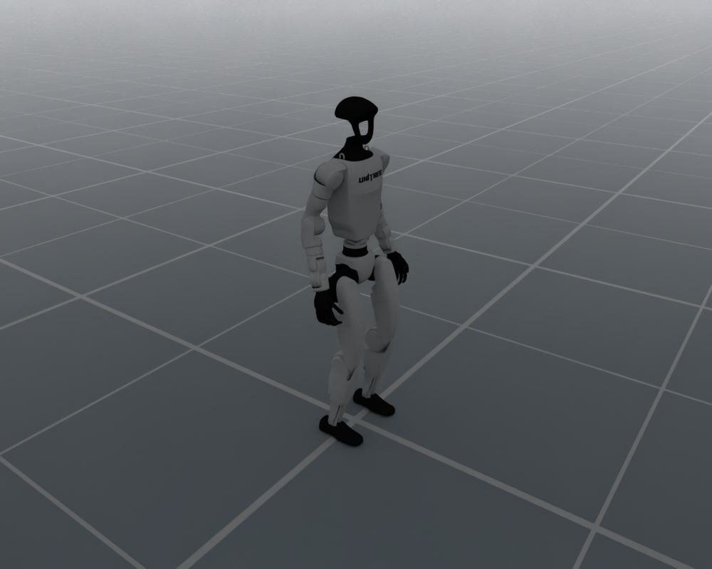

# Unitree G1

`UnitreeG1Cfg` configures the bundled 29-joint Unitree G1 humanoid,
including its floating base, standing pose and simulation PD drive defaults.

<div style="text-align: center;">
  
  <p><b>Unitree G1 in the default joint pose</b></p>
</div>

## Usage

```python
from embodichain.lab.sim import SimulationManager, SimulationManagerCfg
from embodichain_robots import UnitreeG1Cfg

sim = SimulationManager(SimulationManagerCfg(headless=True, num_envs=1))
cfg = UnitreeG1Cfg.from_dict({})
robot = sim.add_robot(cfg=cfg)
```

The catalog ID is also accepted by the shared preview command:

```bash
embodichain preview-robot --robot UnitreeG1
```

## Robot Configuration

| Item | Default |
| --- | --- |
| Catalog ID / UID | `UnitreeG1` |
| Configuration class | `UnitreeG1Cfg` |
| Canonical module | `embodichain_robots.unitree.g1` |
| Vendor | `unitree` |
| Morphology | `bipedal_humanoid` |
| Arm count | 2 |
| Asset | `UnitreeG1Locomotion/g1.usda` |
| Control parts | `locomotion`: 29 joints |
| Base | Floating |
| Initial root height | 0.8 m |
| Physics backends | Default and Newton |
| Limb IK solvers | None; `build_pk_chain=False` |

Standard `RobotCfg` overrides, including `joint_drive_props`, are accepted
by `from_dict`. Locomotion tasks preserve these explicit overrides.

## See Also

- {doc}`Shared locomotion defaults and render settings </resources/robot/locomotion>`
- {doc}`Locomotion robot API reference </api_reference/locomotion_robots>`
