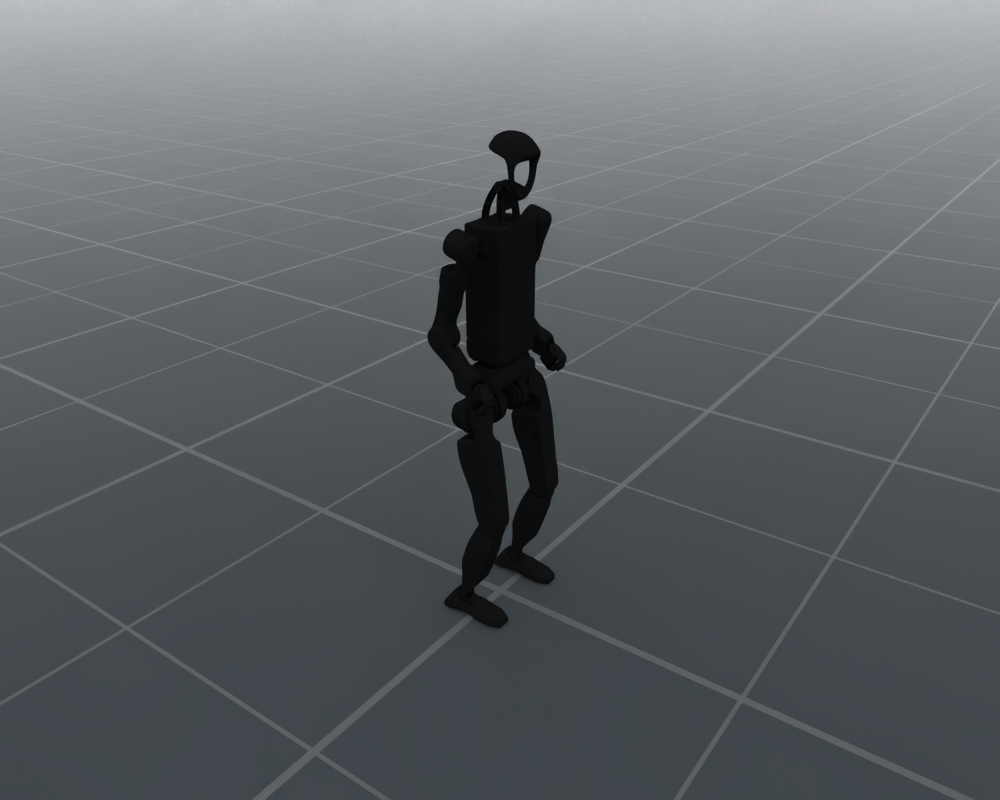

# Unitree H1_2

`UnitreeH12Cfg` configures the bundled 27-joint Unitree H1_2 humanoid,
including its floating base, standing pose and simulation PD drive defaults.

<div style="text-align: center;">
  
  <p><b>Unitree H1_2 in the default joint pose</b></p>
</div>

## Usage

```python
from embodichain.lab.sim import SimulationManager, SimulationManagerCfg
from embodichain_robots import UnitreeH12Cfg

sim = SimulationManager(SimulationManagerCfg(headless=True, num_envs=1))
cfg = UnitreeH12Cfg.from_dict({})
robot = sim.add_robot(cfg=cfg)
```

The catalog ID is also accepted by the shared preview command:

```bash
embodichain preview-robot --robot UnitreeH1_2
```

## Robot Configuration

| Item | Default |
| --- | --- |
| Catalog ID / UID | `UnitreeH1_2` |
| Configuration class | `UnitreeH12Cfg` |
| Canonical module | `embodichain_robots.unitree.h1_2` |
| Vendor | `unitree` |
| Morphology | `bipedal_humanoid` |
| Arm count | 2 |
| Asset | `UnitreeH1_2Locomotion/h1_2.usda` |
| Control parts | `locomotion`: 27 joints |
| Base | Floating |
| Initial root height | 1.02 m |
| Physics backends | Default and Newton |
| Limb IK solvers | None; `build_pk_chain=False` |

Standard `RobotCfg` overrides, including `joint_drive_props`, are accepted
by `from_dict`. Locomotion tasks preserve these explicit overrides.

## See Also

- [Shared locomotion defaults and render settings](locomotion.md)
- [Locomotion robot API reference](../../api_reference/locomotion_robots.rst)
