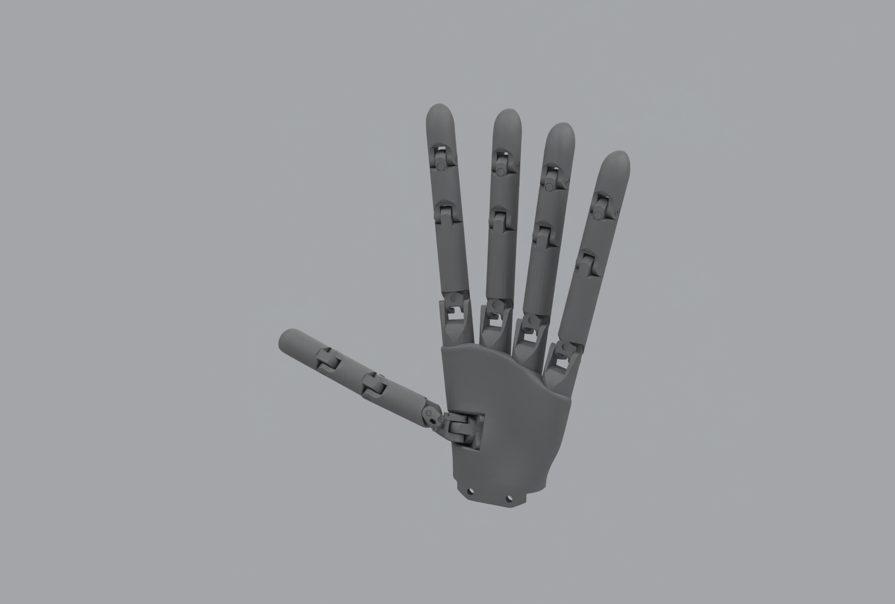
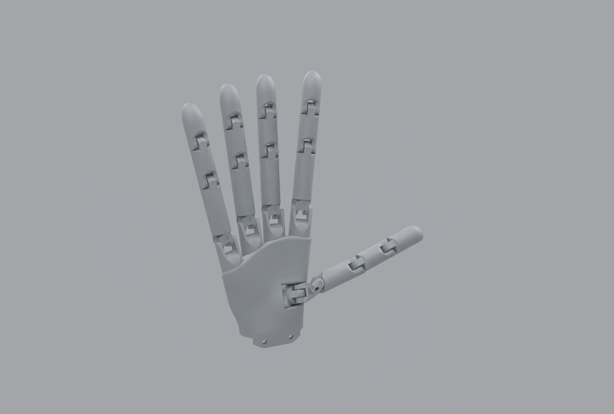

# Wuji Hand

`embodichain_robots.WujiHandCfg` configures a standalone left or right
Wuji Hand. The robot catalog ID is `WujiHand`; `left` and `right` select the
native models, with right as the default.

<figure style="text-align: center; margin: 20px auto; max-width: 960px;">
  
  <figcaption><b>Wuji Hand · left hand · 20 independent joints</b></figcaption>
</figure>

[Render manifest](../../../_static/robots/eef/wuji_hand_left.json).

<figure style="text-align: center; margin: 20px auto; max-width: 960px;">
  
  <figcaption><b>Wuji Hand · right hand · 20 independent joints</b></figcaption>
</figure>

[Render manifest](../../../_static/robots/eef/wuji_hand_right.json).

The illustrations render the published visual geometry and authored materials
in native OfflineRT, at the preset's initial joint coordinates and a presentation
root transform. No physics steps or visual-mesh/material replacements are used.
Each manifest records the display lighting (environment intensity 40,
half-intensity studio lights placed outside the camera view), camera and
source/image hashes. See [EEF rendering conventions](../end_effectors.md#rendered-illustrations).

## Construct, discover and preview

Given an existing `SimulationManager` named `sim`:

```python
from embodichain.robot_registry import resolve_robot_cfg
from embodichain_robots import WujiHandCfg

cfg = resolve_robot_cfg("WujiHand", variant="left")
# Equivalent model-local selection:
cfg = WujiHandCfg.from_dict({"side": "left"})
restored = WujiHandCfg.from_dict(cfg.to_dict())
robot = sim.add_robot(cfg=restored)
```

```bash
embodichain list-robot
embodichain preview-robot --robot WujiHand --variant left --viser
embodichain preview-robot --robot WujiHand --variant right --viser
embodichain preview-robot --robot WujiHand --variant right --headless --device cpu --renderer no-render --physics default --max-steps 100
```

The model package also lazily exports `WujiHandCfg` from
`embodichain_robots.wuji.hand`. Listing catalogs does not
import configurations or download assets. Unsupported sides fail before asset
lookup. `from_dict()` builds defaults and applies isolated overrides through the
standard `RobotCfg` path. An existing local `fpath` bypasses asset download.
Caller-defined control-group names are retained.

## Control contract

`eef` commands all **20 independent revolute joints**, in radians.
The order is finger 1 through 5, each with joints 1 through 4:
`{side}_finger1_joint1`, …, `{side}_finger5_joint4`.
There are no mimic followers. The thumb first joint starts at **0.05 rad**, above its source lower limit
of 0.0475 rad. The other 19 joints start at zero.

```python
q = robot.get_qpos(name="eef").clone()
robot.set_qpos(q + 0.08, name="eef")
# Advance the simulator to execute the position command.
sim.update(step=100)
robot.reset()
```

`solver_cfg` and `build_pk_serial_chain()` are empty. The hand is a branched
articulation: no finger IK, single tool TCP, open/close service, grasping policy,
retargeting or tactile simulation is implied. Catalog metadata declares
`dexterous_hand`, zero arms and no generic dual-arm base compatibility.

## Physical defaults

The palm is fixed to the world at `(0, 0, 0.3)` metres with the source orientation.
This root placement clears the standalone ground and is not a calibrated mount.
Self-collision is disabled by the generic root defaults; callers can explicitly
configure it for their application. Native joint/link names, position, effort
and velocity limits, masses, COMs and inertias remain source-owned.

Force-drive stiffness **3 N·m/rad** and damping **0.1 N·m·s/rad** are initial
simulation PD defaults, not measured motor gains or hardware calibration.
Source effort/velocity limits and link inertials are explicitly reapplied
through portable drive/link fields because native importer defaults can
otherwise replace them. These overlays reproduce source values without
retuning the physical model. Caller configuration can
replace the gains and physical defaults. Validation covers Default-backend CPU
spawn, joint commands and reset for both sides; it does not qualify contact-rich
manipulation or other physics backends.

## Assets and provenance

```python
from embodichain.data import get_data_path
from embodichain_robots.wuji.hand.assets import WujiHand

right_urdf = get_data_path("WujiHand/right.urdf")
```

The [published V2 archive](https://huggingface.co/datasets/DexForceAI/embodichain_data/blob/0540f7a2eb383cf3f24e85069f5af2b369890541/eef_assets/WujiHandV2.zip)
contains both sides and uses the `WujiHandV2` cache. Source:
[wuji-technology/wuji-description at `5c4dfa169173`](https://github.com/wuji-technology/wuji-description/tree/5c4dfa16917355d073e2e1d7e3d03897b6cf9508).
The model-owned [provenance record](https://github.com/DexForce/EmbodiChain/blob/main/extensions/embodichain_robots/wuji/hand/README.md)
records licensing, preparation, archive hashes and native MJCF resources.
Host assemblies own mount transforms, naming prefixes and task-specific interfaces.

V2 adds native-compatible `left.urdf` / `right.urdf` at the asset root.
Only mesh references become root-relative and the MuJoCo-only compiler block
is omitted. Original `urdf/left.urdf` / `urdf/right.urdf` and MJCF resources
remain unchanged; meshes, materials, names and physical values are identical.
The versioned cache leaves existing V1 downloads intact.
